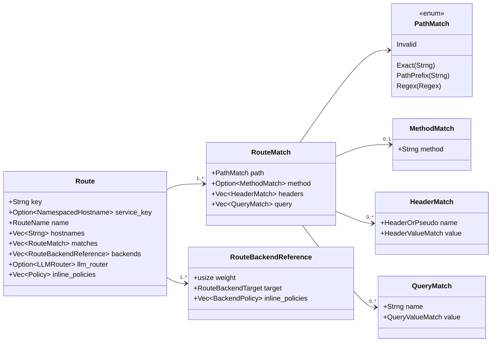
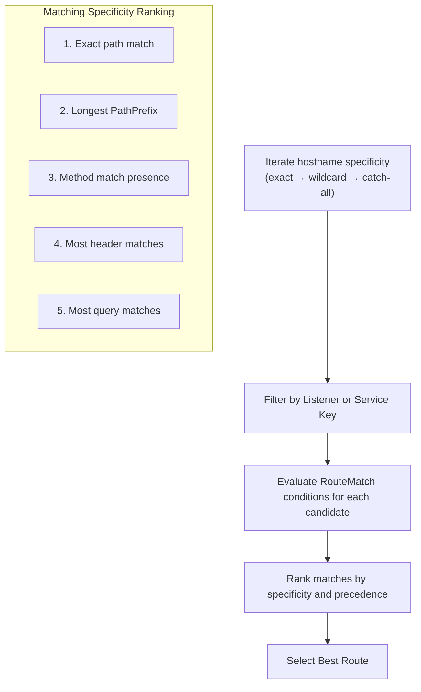
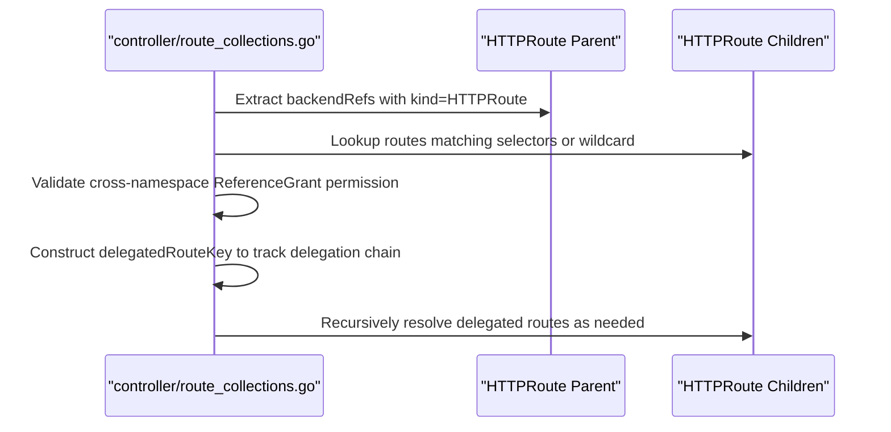
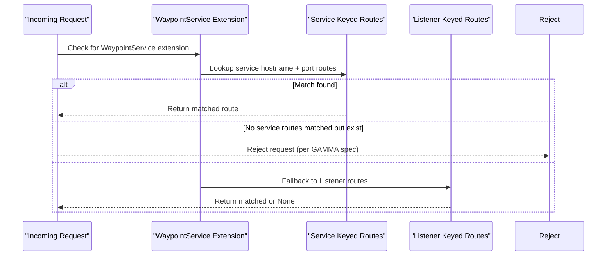
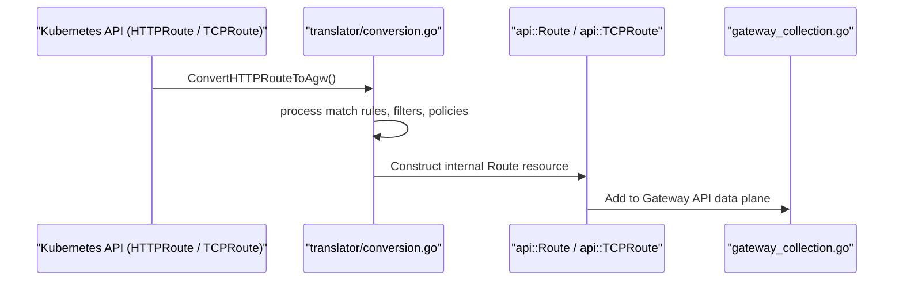
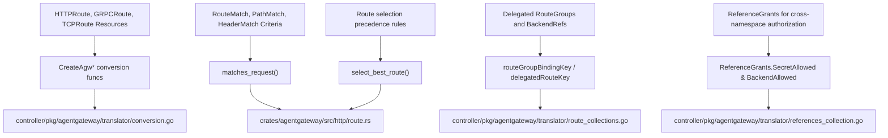
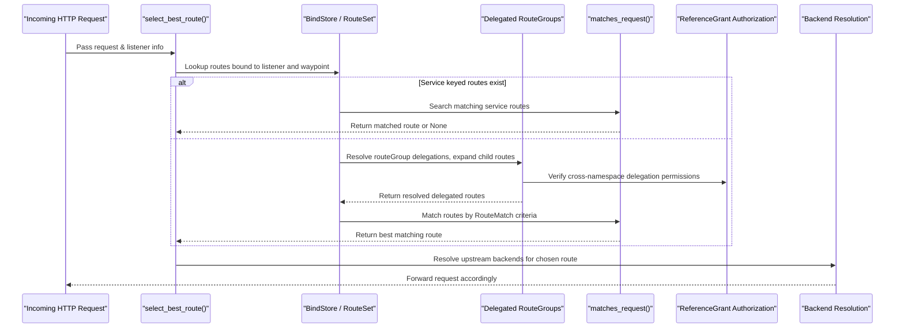

<!-- source: DeepWiki mcp.deepwiki.com · repo agentgateway/agentgateway · page 3.5 Routes, Matching, and Delegation · fetched 2026-10-21 -->

# Routes, Matching, and Delegation

<details>
<summary>Relevant source files</summary>

The following files were used as context for generating this wiki page:

- [crates/agentgateway/src/http/route.rs](crates/agentgateway/src/http/route.rs)
- [crates/agentgateway/src/http/route_test.rs](crates/agentgateway/src/http/route_test.rs)

</details>


This page covers the `Route` resource in Agentgateway: its data model, request matching semantics for HTTP/gRPC/TCP routes, and route delegation via routeGroups that support hierarchical routing and policy composition. It details the matching criteria (`RouteMatch`, `PathMatch`, `HeaderMatch`, etc.), the route selection precedence, and the delegation chain mechanics with cycle detection.

---

## Route Data Model

A `Route` represents a routing rule bound to a specific `Listener` or a delegated `routeGroup`. It contains one or more match conditions (`RouteMatch`) and one or more weighted backend references (`RouteBackendReference`).

### Route Type Hierarchy



### Key Data Entities

| Entity                   | Code Symbol                     | Purpose                                              |
|--------------------------|--------------------------------|------------------------------------------------------|
| `Route`                  | `agent::Route`                 | Represents a route resource in the data plane.       |
| `RouteMatch`             | `agent::RouteMatch`            | Defines AND-combined matching conditions.            |
| `PathMatch`              | `agent::PathMatch`             | Enum of path match types: Exact, Prefix, Regex.      |
| `MethodMatch`            | `agent::MethodMatch`           | HTTP method matching condition.                       |
| `HeaderMatch`            | `agent::HeaderMatch`           | Single HTTP header matching condition.               |
| `QueryMatch`             | `agent::QueryMatch`            | Query parameter matching condition.                   |
| `RouteBackendReference`  | `agent::RouteBackendReference` | Weighted backend target for routing.                 |
| `TCPRoute`               | `agent::TCPRoute`              | TCP routing resource for Layer 4 traffic.             |

Sources: [crates/agentgateway/src/http/route.rs:91-96](), [crates/agentgateway/src/http/route_test.rs:36-47]()

---

## RouteMatch Criteria

A `RouteMatch` is a conjunction (AND) of all its criteria; all must match for success. A `Route` may have multiple `RouteMatch` entries combined by OR (the route matches if **any** `RouteMatch` matches).

### Path Matching

Path matching features three variants in the `PathMatch` enum:

| Variant      | Description                                                                                                    |
|--------------|----------------------------------------------------------------------------------------------------------------|
| Exact        | Matches if the request path is exactly equal to the defined string.                                           |
| PathPrefix   | Matches if the request path begins with the prefix, respecting segment boundaries to avoid partial match.     |
| Regex        | Matches if the request path fully matches the specified regular expression pattern.                           |

The implementation normalizes CONNECT requests with empty path to path `/` before matching.

PathPrefix matching trims trailing slashes and enforces that the path suffix after the prefix is empty or starts with `/` (segment boundary).

**Core matching snippet:**

```rust
fn matches_request(m: &RouteMatch, request: &Request) -> bool {
	let request_path =
		if request.method() == ::http::Method::CONNECT && request.uri().path().is_empty() {
			"/"
		} else {
			request.uri().path()
		};
	let path_matches = match &m.path {
		PathMatch::Exact(p) => request_path == p.as_str(),
		PathMatch::Regex(r) => r
			.find(request_path)
			.map(|m| m.start() == 0 && m.end() == request_path.len())
			.unwrap_or(false),
		PathMatch::Invalid => false,
		PathMatch::PathPrefix(p) => {
			let p = p.trim_end_matches('/');
			let Some(suffix) = request_path.trim_end_matches('/').strip_prefix(p) else {
				return false;
			};
			suffix.is_empty() || suffix.starts_with('/')
		},
	};
	if !path_matches {
		return false;
	}

	if let Some(method) = &m.method
		&& request.method().as_str() != method.method.as_str()
	{
		return false;
	}
	for HeaderMatch { name, value } in &m.headers {
		if !http::request_header_matches(name, value, request) {
			return false;
		}
	}
	let query = request
		.uri()
		.query()
		.map(|q| url::form_urlencoded::parse(q.as_bytes()).collect::<HashMap<_, _>>())
		.unwrap_or_default();
	for agent::QueryMatch { name, value } in &m.query {
		let Some(have) = query.get(name.as_str()) else {
			return false;
		};
		match value {
			QueryValueMatch::Exact(want) => {
				if have.as_ref() != want.as_str() {
					return false;
				}
			},
			QueryValueMatch::Regex(want) => {
				let Some(m) = want.find(have) else {
					return false;
				};
				if !(m.start() == 0 && m.end() == have.len()) {
					return false;
				}
			},
			QueryValueMatch::Invalid => return false,
		}
	}
	true
}
```

Sources: [crates/agentgateway/src/http/route.rs:24-89]()

### Method Matching

If specified in a `RouteMatch`, the request must have the identical HTTP method for a match.

Sources: [crates/agentgateway/src/http/route.rs:51-55]()

### Header Matching

Every header specified in the match must be present in the request, matching either exactly or via regex per `http::request_header_matches`.

Sources: [crates/agentgateway/src/http/route.rs:56-60]()

### Query Parameter Matching

The query parameters from the URI are parsed and matched against patterns (exact or regex) provided in `RouteMatch.query`.

Sources: [crates/agentgateway/src/http/route.rs:61-87]()

---

## Hostname Matching

Each `Route` may limit applicability with a list of `hostnames`. Matching supports:

- Exact hostname matches (e.g., `"api.example.com"`)
- Wildcard hostnames (e.g., `"*.example.com"`), with multi-level matching
- Routes without any hostname act as catch-all

Candidate hostnames are enumerated from most specific (exact) to least specific (wildcard/catch-all) via the `HostnameMatch::all_matches` iterator, enabling precedence-based selection.

Sources: [crates/agentgateway/src/http/route.rs:114-143]()

---

## Route Selection Precedence

The `select_best_route` function determines the best matching route for a given request and listener. The precedence rules applied are:

1. Exact path matches outrank path prefix or regex.
2. Among prefix matches, longest prefix wins.
3. Presence of HTTP method match increases precedence.
4. Routes matching more headers outrank others.
5. Routes matching more query parameters outrank others.
6. If ties persist, older routes by creation timestamp have priority.
7. Final tie-break by alphabetical order of `{namespace}/{name}`.
8. Within a single HTTPRoute resource, the first matching rule by this precedence is chosen.

This produces deterministic and fine-grained routing behavior.



Sources: [crates/agentgateway/src/http/route.rs:91-112](), [crates/agentgateway/src/http/route.rs:189-218]()

---

## Route Delegation

### Overview

Route delegation allows hierarchical routing, where a parent route delegates part of its matching space to child routes/groups. This delegation is expressed via `BackendReference`s or `routeGroup` keys representing subsets of routes.

This enables modular ownership of route subsets, simplifies large routing configurations, and supports policy composition across delegation chains.

### Delegation in the Kubernetes Controller

The controller translates Kubernetes Gateway API definitions:

- BackendRefs with `group: gateway.networking.k8s.io` and `kind: HTTPRoute` become `routeGroup` keys referencing child HTTPRoutes.
- Delegation keys follow the pattern:  
  `{parentNamespace}/{parentName}/{childNamespace}/{childName or *}`
- Supports wildcard `*` delegation to all child routes in a namespace.
- Supports delegation selectors via name and labels.
- Cross-namespace delegation is only allowed where permitted by `ReferenceGrant` resources.
- Cycle detection prevents infinite delegation loops by tracking delegation paths and rejecting repeating keys.

### Delegation Resolution Flow



Sources: [controller/pkg/agentgateway/translator/route_collections.go:106-183](), [controller/pkg/agentgateway/translator/references_collection.go:120-194]()

---

### Cycle Detection

The controller keeps track of visited delegation keys during resolution. If a delegation key is encountered again in the chain, it indicates a cycle and that delegation is refused to avoid infinite loops.

---

### Delegation Examples

Controller testdata YAML files demonstrate delegation scenarios including:

- Wildcard delegation to all routes in a namespace
- Delegation with specific route names and label selectors
- Cross-namespace delegation guarded by ReferenceGrant
- Nested delegation chains with policy merges

These examples exemplify the power and flexibility of hierarchical routing delegation.

---

## Waypoint and Service Routing

Agentgateway supports waypoint-aware routing for service mesh environments.

- When the incoming request's extensions include a `WaypointService`, the route selection prioritizes routes keyed by that service's namespaced hostname and port.
- If service routes exist but none match, the request is rejected according to the GAMMA spec.
- Otherwise, fall back to listener-keyed routes.
- A default waypoint route with catch-all matching is synthesized if no service routes exist.

This mechanism ensures correct routing behavior inside waypoint deployments.



Sources: [crates/agentgateway/src/http/route.rs:117-188]()

---

## Translation Logic in the Controller

The controller converts Kubernetes Gateway API objects (`HTTPRoute`, `GRPCRoute`, `TCPRoute`) into internal agentgateway API route objects.

- Functions like `CreateAgwPathMatch`, `CreateAgwMethodMatch`, and `CreateAgwHeadersMatch` perform fine-grained translation of matches.
- URL rewrite filters and header modifiers in Kubernetes routes map to corresponding backend policies in Agentgateway.
- Backend references that point to other `HTTPRoute` resources are translated into routeGroup delegation keys.
- The controller assembles routes with delegation expanded and cross-namespace checks applied, producing route resources for the data plane.



Sources: [controller/pkg/agentgateway/translator/conversion.go:41-99](), [controller/pkg/agentgateway/translator/gateway_collection.go:116-139]()

---

## Key Implementation Details and Functions

- **`matches_request`**  
  Function to test if a `RouteMatch` matches an incoming HTTP request. It checks path, method, headers, and query parameters. It returns `true` if all conditions are met.  
  See: [crates/agentgateway/src/http/route.rs:24-89]()

- **`select_best_route`**  
  Primary function to select the best route given a request and listener. It applies route selection precedence including waypoint service routing and hostname matching. Returns the matching `Route` and the `PathMatch` that matched.  
  See: [crates/agentgateway/src/http/route.rs:91-218]()

- **Route Delegation Handling in Controller**  
  Manages delegation backendRefs of kind `HTTPRoute`. Creates routeGroup delegation keys and resolves delegated routes with validation.  
  See: [controller/pkg/agentgateway/translator/route_collections.go:106-183](),  
       [controller/pkg/agentgateway/translator/references_collection.go:120-194]()

- **ReferenceGrant Authorization**  
  Validates whether cross-namespace delegation or backend references are authorized by examining `ReferenceGrant` resources.  
  See: [controller/pkg/agentgateway/translator/references_collection.go:120-194]()

---

## Summary Diagram: Natural Language to Code Entity Mapping


Sources: [controller/pkg/agentgateway/translator/conversion.go:41-99](), [controller/pkg/agentgateway/translator/gateway_collection.go:116-139](), [controller/pkg/agentgateway/translator/route_collections.go:106-183](), [controller/pkg/agentgateway/translator/references_collection.go:120-194](), [crates/agentgateway/src/http/route.rs:24-216]()

---

## Summary Diagram: Delegation Chain and Route Selection Flow in Code


Sources: [controller/pkg/agentgateway/translator/route_collections.go:106-183](), [controller/pkg/agentgateway/translator/references_collection.go:120-194](), [crates/agentgateway/src/http/route.rs:91-218]()

---

## References

- `matches_request` and `select_best_route`: [crates/agentgateway/src/http/route.rs:24-216]()
- Route and match model: [controller/pkg/agentgateway/translator/conversion.go:41-99](), [controller/pkg/agentgateway/translator/gateway_collection.go:116-139]()
- Delegation and route collections: [controller/pkg/agentgateway/translator/route_collections.go:106-183]()
- ReferenceGrant authorization checks: [controller/pkg/agentgateway/translator/references_collection.go:120-194]()
- Delegation examples in controller testdata YAML files under `controller/pkg/agentgateway/translator/testdata/routes`

Sources: [crates/agentgateway/src/http/route.rs:24-216](), [controller/pkg/agentgateway/translator/conversion.go:41-99](), [controller/pkg/agentgateway/translator/gateway_collection.go:116-139](), [controller/pkg/agentgateway/translator/route_collections.go:106-183](), [controller/pkg/agentgateway/translator/references_collection.go:120-194]()

---

