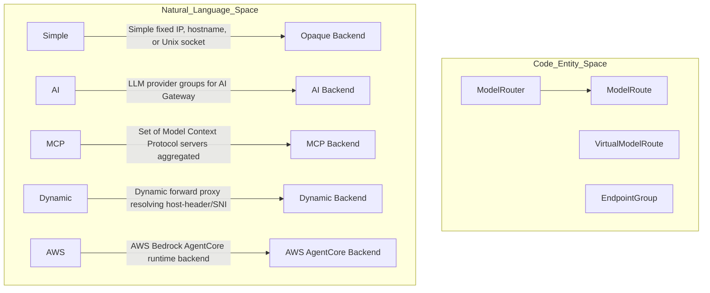
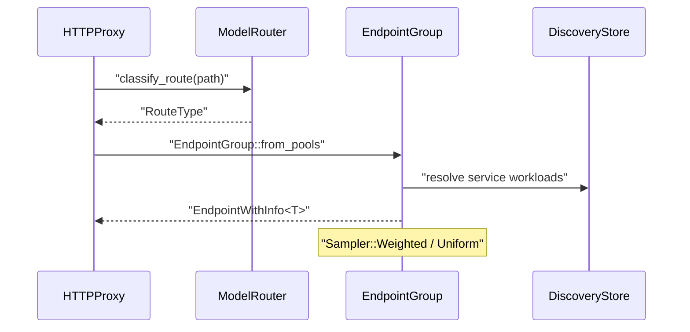
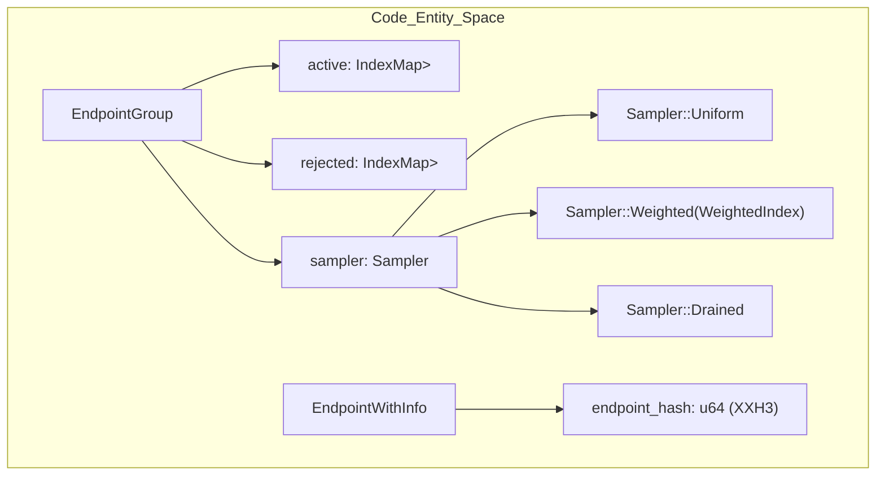
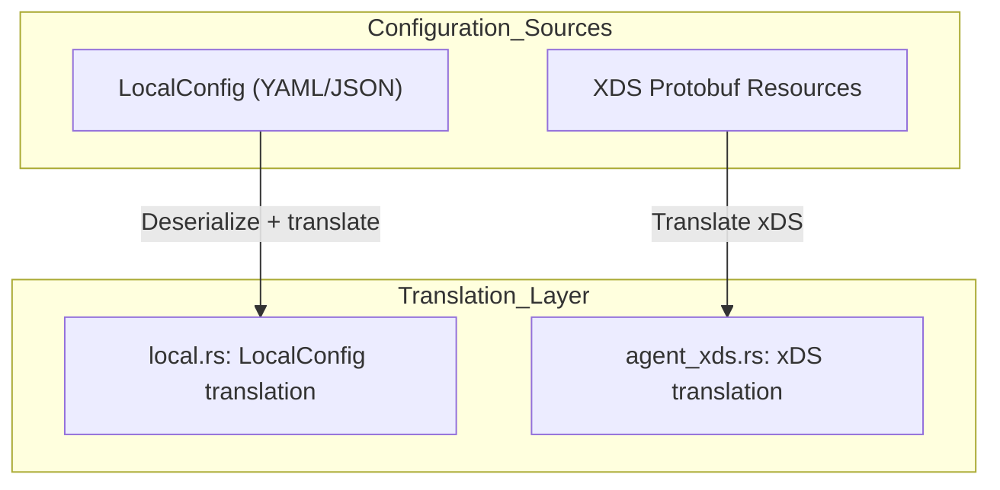
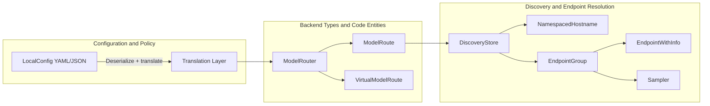

<!-- source: DeepWiki mcp.deepwiki.com · repo agentgateway/agentgateway · page 3.6 Backends and Service Discovery · fetched 2026-10-21 -->

# Backends and Service Discovery

Relevant source files

The following files were used as context for generating this wiki page:

- [crates/agentgateway/src/client/hbone_tunnel.rs](crates/agentgateway/src/client/hbone_tunnel.rs)
- [crates/agentgateway/src/llm/model_router.rs](crates/agentgateway/src/llm/model_router.rs)
- [crates/agentgateway/src/types/discovery.rs](crates/agentgateway/src/types/discovery.rs)
- [crates/agentgateway/src/types/loadbalancer.rs](crates/agentgateway/src/types/loadbalancer.rs)
- [crates/agentgateway/src/types/local_tests/basic_config.yaml](crates/agentgateway/src/types/local_tests/basic_config.yaml)
- [crates/agentgateway/src/types/local_tests/basic_normalized.snap](crates/agentgateway/src/types/local_tests/basic_normalized.snap)
- [crates/agentgateway/src/types/local_tests/llm_normalized.snap](crates/agentgateway/src/types/local_tests/llm_normalized.snap)
- [crates/agentgateway/src/types/local_tests/llm_simple_config.yaml](crates/agentgateway/src/types/local_tests/llm_simple_config.yaml)
- [crates/agentgateway/src/types/local_tests/llm_simple_normalized.snap](crates/agentgateway/src/types/local_tests/llm_simple_normalized.snap)
- [crates/agentgateway/src/types/local_tests/mcp_normalized.snap](crates/agentgateway/src/types/local_tests/mcp_normalized.snap)
- [crates/agentgateway/src/types/local_tests/mcp_simple_config.yaml](crates/agentgateway/src/types/local_tests/mcp_simple_config.yaml)
- [crates/agentgateway/src/types/local_tests/mcp_simple_normalized.snap](crates/agentgateway/src/types/local_tests/mcp_simple_normalized.snap)
- [crates/agentgateway/tests/tests/hbone.rs](crates/agentgateway/tests/tests/hbone.rs)
- [crates/hbone/src/lib.rs](crates/hbone/src/lib.rs)
- [crates/protos/proto/workload.proto](crates/protos/proto/workload.proto)
- [crates/xtask/src/schema.rs](crates/xtask/src/schema.rs)
- [tools/schema-to-md.sh](tools/schema-to-md.sh)
- [tools/schema_paths.jq](tools/schema_paths.jq)

## Purpose and Scope

This page details how the `agentgateway` component manages upstream backends for forwarding requests. It covers backend types—including Service, Opaque, AI, MCP, AWS AgentCore, and Dynamic backends—how backend endpoints are resolved via the `DiscoveryStore`, how weighted load balancing and health checks are implemented via `loadbalancer.rs`, and how backends compose with traffic policies.

This page is a detailed technical leaf focused on backend implementation and service discovery responsibilities. For upstream request processing, please see [2.5 Upstream Client and Transport Layer](). For routing details, see [3.5 Routes, Matching, and Delegation]().

Sources:  
- [crates/agentgateway/src/types/loadbalancer.rs:30-200]()  
- [crates/agentgateway/src/types/discovery.rs:20-111]()

---

## Backend Type Hierarchy and Representation

`agentgateway` supports various backend types, enabling it to proxy traffic to simple IP hosts, sophisticated AI provider groups, MCP clusters, AWS Bedrock AgentCore runtimes, or dynamically resolved hosts typical in forward proxies.

### Backend Enum and Variants

The internal representation of backends corresponds to upstream backend types handled during routing and model resolution:

**Mapping:**  
- **Simple/Opaque backend:** Represents services reachable by fixed IPs, hostnames, or Unix sockets, optionally including policies and TLS info.  
- **AI backend:** Manages LLM provider groups supporting routing and prioritization of providers like OpenAI, Anthropic, Bedrock, Vertex, etc. (`[crates/agentgateway/src/llm/model_router.rs:20-55]()`).  
- **MCP backend:** Aggregates multiple Model Context Protocol (MCP) targets, providing unified tool/prompt/resource API access.  
- **Dynamic backend:** Supports dynamically resolved hostnames or SNI-based routing typical in transparent or forward proxy use cases.  
- **AgentCore (AWS) backend:** For AWS Bedrock AgentCore runtime backends, enabling routing to their managed infrastructures.

Sources:  
- [crates/agentgateway/src/llm/model_router.rs:20-55]()  
- [crates/agentgateway/src/types/loadbalancer.rs:30-200]()

---

## Service Discovery and Endpoint Resolution

`agentgateway` decouples logical service names from physical endpoints using discovery stores and tightly couples with backend configuration.

### DiscoveryStore and NamespacedHostname

Services are identified by a composite key `NamespacedHostname`, combining Kubernetes namespace and hostname string. This struct supports parsing the format `namespace/hostname`, implements custom Serde serialization/deserialization for map key usage, and includes matching logic to verify waypoint identities with waypoint destination hostnames for HBONE routing (`[crates/agentgateway/src/types/discovery.rs:20-111]()`).

Key features of `NamespacedHostname`:  
- Implements `FromStr` allowing parsing from `"namespace/hostname"` strings.  
- Custom serialization/deserialization ensures compatibility as map keys.  
- Supports equality and hash for use in hash maps and indexing.  
- Functions to match waypoint identities with service hostnames or addresses for waypoint proxy routing (`[crates/agentgateway/src/client/hbone_tunnel.rs:85-139]()`).

The `DiscoveryStore` maintains maps from service names to workloads and endpoints, managing both logical service FQDNs and physical IP addresses.

### Backend Endpoint Selection Flow

During request processing:  
1. The route's backend references are resolved into backend instances using stores that integrate backend definitions and discovery info.  
2. For service-type backends, endpoints are selected from resolved workloads using weighted load balancing and health check state (`[crates/agentgateway/src/types/loadbalancer.rs:90-115]()`).  
3. If a service is configured with a waypoint, the resolved endpoint IP routes via the waypoint VIP address, preserving in-mesh HBONE routing (`[crates/agentgateway/src/client/hbone_tunnel.rs:85-139]()`).

Sources:  
- [crates/agentgateway/src/types/discovery.rs:20-111]()  
- [crates/agentgateway/src/client/hbone_tunnel.rs:85-139]()  
- [crates/agentgateway/src/llm/model_router.rs:147-160]()

---

## Load Balancing and Health Checking

Load balancing and endpoint health state management are implemented primarily in `loadbalancer.rs`, managing endpoint sets, weighted sampling, and controlled eviction/uneviction of endpoints (`[crates/agentgateway/src/types/loadbalancer.rs:30-200]`).

### Endpoint Group and Sampler Structures

The core structure is `EndpointGroup<T>`, which holds two collections of endpoints:  
- `active`: Endpoints currently considered healthy and selectable.  
- `rejected`: Endpoints evicted due to health failures or drain.  

Each endpoint in the group is wrapped in `EndpointWithInfo<T>` containing:  
- The endpoint data (`Arc<T>`).  
- Endpoint health and statistics info (`Arc<EndpointInfo>`).  
- Capacity: numeric indicating availability or weight for load balancing.  
- Precomputed hash of the endpoint key (`endpoint_hash`) for efficient routing algorithms (`[crates/agentgateway/src/types/loadbalancer.rs:44-68]()`).

The `Sampler` enum determines the load balancing strategy:  
- `Uniform`: Default when all active endpoints have capacity 1.  
- `Weighted`: Uses `WeightedIndex<u64>` from `rand` crate for weighted random selection by capacity (`[crates/agentgateway/src/types/loadbalancer.rs:71-114]`).  
- `Drained`: Indicates all active endpoints are present but drained (capacity zero).

### Health-based Eviction and Reinstatement

Endpoints failing health checks are moved from `active` to `rejected` pools using `EndpointGroup::evict` (`[crates/agentgateway/src/types/loadbalancer.rs:154-159]()`). When endpoints recover, they are re-promoted to `active` by `EndpointGroup::unevict` (`[crates/agentgateway/src/types/loadbalancer.rs:164-174]()`).

Sources:  
- [crates/agentgateway/src/types/loadbalancer.rs:30-200]()

---

## BackendWithPolicies: Backend and Policy Composition

Each backend is complemented by an associated set of policies encapsulated in runtime representations. This includes connection-level configuration such as TLS settings, authentication, timeouts, retries, and custom traffic shaping parameters.

Sources:  
- [crates/agentgateway/src/types/local_tests/llm_simple_normalized.snap:142-157]()  
- [crates/xtask/src/schema.rs:10-15]()

---

## Configuration, Translation, and Internal Store

Backends can be configured statically using YAML/JSON local config files or dynamically through xDS resources. The translation subsystem converts source configurations into internal representations for runtime use (`[crates/xtask/src/schema.rs:17-58]()`).

Sources:  
- [crates/xtask/src/schema.rs:17-58]()  
- [crates/agentgateway/src/types/local_tests/llm_normalized.snap:34-105]()

---

## Specialized Backends: AI and MCP

### AI Backend Provider Resolution

The AI backend models logical groups of LLM providers (OpenAI, Anthropic, AWS Bedrock, Vertex AI, etc.) supporting overrides per provider such as model aliasing, endpoint host/path overrides, and inline TLS/auth policies (`[crates/agentgateway/src/llm/model_router.rs:20-55]()`).

### MCP Backend Composition

MCP (Model Context Protocol) backends aggregate multiple MCP targets using heterogeneous transports (`stdio`, `mcp` streaming) with session affinity, failure modes, and prefix routing (`[crates/agentgateway/src/types/local_tests/mcp_normalized.snap:50-80]()`).

Sources:  
- [crates/agentgateway/src/llm/model_router.rs:20-35]()  
- [crates/agentgateway/src/types/local_tests/mcp_normalized.snap:50-80]()

---

# Summary Diagram: System to Code Entity Bridge for Backends

Sources:  
- [crates/agentgateway/src/llm/model_router.rs:20-55]()  
- [crates/agentgateway/src/types/discovery.rs:20-111]()  
- [crates/agentgateway/src/types/loadbalancer.rs:30-200]()  
- [crates/xtask/src/schema.rs:17-58]()

---

# Summary

This page documents the backend and service discovery system in `agentgateway`. Backends of diverse types—from simple fixed IP hosts to AI LLM provider pools and MCP clusters—are represented internally. Services are discovered and resolved to endpoint sets with load balancing and health checking provided by `loadbalancer.rs`. Configuration translation layers ingest local config or dynamic resources to create runtime backend representations.

Sources:  
- [crates/agentgateway/src/llm/model_router.rs:20-55]()  
- [crates/agentgateway/src/types/loadbalancer.rs:30-200]()

---

