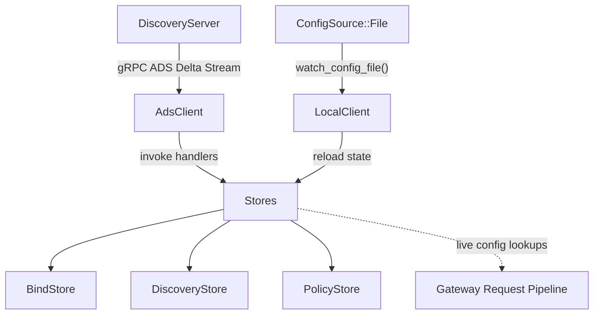
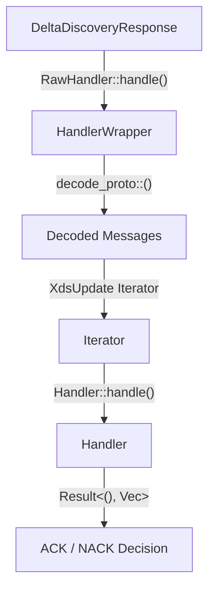

<!-- source: DeepWiki mcp.deepwiki.com · repo agentgateway/agentgateway · page 3.7 XDS Dynamic Configuration · fetched 2026-10-21 -->

# XDS Dynamic Configuration

<details>
<summary>Relevant source files</summary>

The following files were used as context for generating this wiki page:

- [controller/.custom-gcl.yml](controller/.custom-gcl.yml)
- [controller/.golangci.yaml](controller/.golangci.yaml)
- [controller/hack/testbox/main.go](controller/hack/testbox/main.go)
- [controller/pkg/logging/level.go](controller/pkg/logging/level.go)
- [controller/pkg/syncer/krtxds/pushqueue.go](controller/pkg/syncer/krtxds/pushqueue.go)
- [controller/pkg/syncer/krtxds/pushqueue_test.go](controller/pkg/syncer/krtxds/pushqueue_test.go)
- [controller/pkg/syncer/krtxds/xds.go](controller/pkg/syncer/krtxds/xds.go)
- [controller/test/e2e/backendtls_test.go](controller/test/e2e/backendtls_test.go)
- [controller/test/e2e/mcp_helpers_test.go](controller/test/e2e/mcp_helpers_test.go)
- [controller/test/helpers/kube_dump.go](controller/test/helpers/kube_dump.go)
- [controller/test/testutils/crd.go](controller/test/testutils/crd.go)
- [crates/agentgateway/src/http/auth/azure.rs](crates/agentgateway/src/http/auth/azure.rs)
- [crates/agentgateway/src/http/auth/gcp.rs](crates/agentgateway/src/http/auth/gcp.rs)
- [crates/agentgateway/src/http/auth/mod.rs](crates/agentgateway/src/http/auth/mod.rs)
- [crates/agentgateway/src/http/auth/tests.rs](crates/agentgateway/src/http/auth/tests.rs)
- [crates/xds/Cargo.toml](crates/xds/Cargo.toml)
- [crates/xds/src/client.rs](crates/xds/src/client.rs)
- [crates/xds/src/lib.rs](crates/xds/src/lib.rs)

</details>


This page provides an in-depth technical explanation of how AgentGateway implements dynamic configuration using the xDS (Extensible Discovery Service) protocol. It covers the integration with the ADS (Aggregated Discovery Service) client, resource lifecycle management, resource staging, and how the system achieves dynamic updates with zero downtime.

---

## Purpose and Scope

AgentGateway uses the xDS protocol to receive configuration updates dynamically from a control plane, enabling live reconfiguration of listeners, routes, backends, and policies without restarting or disrupting active connections. The dynamic configuration system supports two modes:

- **XDS Mode**: Connects to a remote control plane via an ADS gRPC stream to pull delta updates.
- **Local File Mode**: Watches and reloads local configuration files for local testing or fallback.

This dynamic approach relies on staging configuration snapshots in memory and atomically switching between them to prevent downtime during config reloads.

Sources: [crates/agentgateway/src/state_manager.rs:20-106](), [crates/xds/src/client.rs:40-245]()

---

## Overall Architecture and Data Flow

AgentGateway's dynamic configuration system is based on asynchronous clients managing incoming resource updates and applying them safely to in-memory stores. The architecture separates the configuration sources from the stores consumed by the runtime request pipeline.

Title: "XDS Architecture and Data Flow"


- The `agent_xds::AdsClient` runs a bidirectional gRPC stream with the xDS control plane (`krtxds::DiscoveryServer`), receiving delta updates for resource collections.
- The `state_manager::LocalClient` watches the filesystem for local config file changes and reloads config atomically.
- Both clients update shared in-memory `store::Stores` instances that hold Binds, Listeners, Routes, Backends, Policies, and Discovery metadata.
- The request processing pipeline queries the stores live without blocking or restart.

Sources: [crates/agentgateway/src/state_manager.rs:20-106](), [crates/xds/src/client.rs:40-245](), [crates/agentgateway/src/store/mod.rs:20-90]()

---

## Supported XDS Resource Types

AgentGateway's xDS integration handles multiple resource types, identified by their type URLs. Principal resource types include:

| Type URL | Protobuf Message | Description |
|---|---|---|
| `type.googleapis.com/agentgateway.dev.resource.Resource` | `ADPResource` | Gateway configuration resources: Binds, Listeners, Routes, Backends, Policies |
| `type.googleapis.com/istio.workload.Address` | `XdsAddress` | Workload endpoint metadata and discovery information |

The `state_manager::StateManager` maps handlers per resource type to internal stores:
- `ADDRESS_TYPE` updates handled by `DiscoveryStore`
- `ADP_TYPE` (AgentGateway resources) handled by `BindStore`

Upon receiving a delta update from the ADS stream, the corresponding handler decodes updates into typed structs and applies them to stores.

Sources: [crates/agentgateway/src/state_manager.rs:27-31](), [crates/agentgateway/src/state_manager.rs:69-78]()

---

## Aggregated Discovery Service (ADS) Client Implementation

The core xDS client functionality is implemented in the `agent_xds::AdsClient` found in the `crates/xds` crate. It communicates via Envoy-compatible `DeltaDiscoveryRequests` and `DeltaDiscoveryResponses`, maintaining stream state and resources on the client side.

### Key Code Entities

| Entity | Location | Description |
|---|---|---|
| `ResourceKey` | [crates/xds/src/client.rs:41-44]() | Represents a unique resource identifier with a name and type URL |
| `RejectedConfig` | [crates/xds/src/client.rs:53-90]() | Captures validation errors or warnings for configuration updates (used for generating NACKs) |
| `Handler<T>` Trait | [crates/xds/src/client.rs:158-163]() | Typed trait to handle parsed resource updates of protobuf message type `T` |
| `RawHandler` Trait | [crates/xds/src/client.rs:168-174]() | Internal trait for untyped raw delta discovery response handling |
| `HandlerWrapper<T>` Struct | [crates/xds/src/client.rs:177-211]() | Bridges raw `DeltaDiscoveryResponse` to typed resource handler by decoding resources |
| `handle_single_resource<T>()` | [crates/xds/src/client.rs:135-154]() | Helper function for invoking per-resource update closures and accumulating rejection errors |

### Update Processing Data Flow

Title: "XDS Update Processing Data Flow"


- When a `DeltaDiscoveryResponse` is received, `HandlerWrapper` decodes each raw protobuf resource into typed `T`.
- Updates and Removed resources are converted into a single iterator of `XdsUpdate<T>` enum variants.
- These updates are consumed by the resource-specific `Handler<T>::handle` function.
- Errors during decoding or handling produce `RejectedConfig` entries describing the rejection reasons.
- Successful application results in an ACK message; errors generate a NACK back to the xDS server.

Sources: [crates/xds/src/client.rs:135-245]()

---

## Store Updating and Resource Lifecycle Management

The `state_manager::StateManager` orchestrates configuration state through:
- The dynamic `agent_xds::AdsClient` in ADS xDS mode.
- The `state_manager::LocalClient` in local file mode.

This design allows atomic swapping of configuration snapshots in memory thus preventing contention or inconsistent state during updates.

### Lifecycle and Initialization

- The `StateManager` is constructed early in the system boot within the main `app.rs` [crates/agentgateway/src/app.rs:110-164]() and is run as an independent Tokio task.
- It blocks gateway readiness until the initial configuration sync from ADS or local file load completes.
- The manager supports graceful updates by applying only validated sets of changes to shared stores and avoiding partial application.

### Local File Mode

- In local mode, the `LocalClient` watches the configured configuration file for changes using async file watchers.
- On modification, it reloads full config snapshots and replaces the current state atomically.
- This mode is primarily used for standalone binaries or local development.

### Dynamic Updates and Staging Flow

Title: "Store Staging and Updates"
```mermaid
flowchart LR
    FileChange["Config File Modified"] -->|reload_config_after_change()| LocalClient["LocalClient"]
    LocalClient -->|update stored config| Stores["Stores"]

    ControlPlane["DiscoveryServer"] --> |DeltaDiscoveryResponse| AdsClient["AdsClient"]
    AdsClient --> |invoke handlers| Stores

    Stores -.-> |live lookup| RequestPipeline["Gateway Request Pipeline"]
```

This staged model ensures the in-flight requests operate on a consistent state without interruption.

Sources: [crates/agentgateway/src/state_manager.rs:31-106](), [crates/agentgateway/src/state_manager.rs:126-184](), [crates/agentgateway/src/app.rs:110-164]()

---

## Push Queue and Connection Management

AgentGateway implements a dedicated `PushQueue` to serialize and collapse outgoing xDS push requests per connection.

- The push queue deduplicates multiple configuration changes into a single push to reduce overhead.
- Supports shutdown-triggered wakeups and blocking waits (`Dequeue`), enabling controlled delivery of configuration updates to ADS clients.
- The internal implementation resides in [controller/pkg/syncer/krtxds/pushqueue.go:9-122]().

This queue sits between the control plane syncer (`DiscoveryServer`) and the ADS client stream writer.

Sources: [controller/pkg/syncer/krtxds/pushqueue.go:9-122]()

---

## Error Handling, Diagnostics, and Metrics

### Rejected Configuration and NACK Diagnostics

`RejectedConfig` encapsulates per-resource rejection details with:
- Resource name.
- Severity level (`Warning` or `Error`).
- Reason string describing the failure cause.

These reject messages are serialized into JSON diagnostic payloads returned as part of NACK responses to the control plane, informing it of invalid or rejected configuration updates.

### Metrics

AgentGateway exposes xDS-specific operational metrics in the `agent_xds::Metrics` structure:

| Metric Name | Type | Description |
|---|---|---|
| `xds_connections_terminations` | Counter | Count of closed xDS client connections |
| `xds_message` | Counter | Number of xDS messages received |
| `xds_message_bytes` | Counter | Total size in bytes of received discovery messages |
| `config_synchronized` | Gauge | Status indicator for successful config synchronization |

These metrics provide observability into the health and performance of the dynamic configuration system.

Sources: [crates/xds/src/client.rs:53-90](), [crates/xds/src/metrics.rs:11-108]()

---

# Summary

The XDS Dynamic Configuration system in AgentGateway provides a robust, zero-downtime configuration management framework leveraging the industry-standard xDS protocol. By adopting typed resource handlers, delta discovery streaming via ADS clients, and a staged atomic store update model, AgentGateway efficiently synchronizes dynamic gateway configurations from remote or local sources. This design ensures high availability and consistent state while enabling dynamic reconfiguration of all data plane components without service disruption.

---

### Overall Entity Association Diagram (Natural Language to Code)

Title: "Code Entity Association for Dynamic Configuration"
```mermaid
graph TD
    subgraph Dynamic_Configuration_Components
        CP["DiscoveryServer"]
        AdsClient["AdsClient"]
        LocalClient["LocalClient"]
        StateMgr["StateManager"]
        Stores["Stores"]

        CP -->|"gRPC (ADS Delta)"| AdsClient
        AdsClient -->|"Process update with Handler<T>"| Stores
        LocalClient -->|"File watch and reload"| Stores
        Stores -->|"Configuration Lookup"--> GatewayPipeline["Gateway HTTP/TCP Proxy"]
    end

    subgraph ADS_Client_Internals
        RawHandler["RawHandler"]
        HandlerWrapper["HandlerWrapper<T>"]
        Handler["Handler<T>"]
        ResourceKey["ResourceKey"]
        RejectedConfig["RejectedConfig"]
        DeltaResponse["DeltaDiscoveryResponse"]

        DeltaResponse --> RawHandler
        RawHandler --> HandlerWrapper
        HandlerWrapper --> Handler
        Handler --> RejectedConfig
    end

    AdsClient --> RawHandler
```

Sources: 
- `state_manager::StateManager` and clients: [crates/agentgateway/src/state_manager.rs:20-106]()
- `agent_xds::AdsClient` and handlers: [crates/xds/src/client.rs:1-245]()
- Push queue: [controller/pkg/syncer/krtxds/pushqueue.go:9-122]()
- Metrics: [crates/xds/src/metrics.rs:11-108]()
- App integration: [crates/agentgateway/src/app.rs:110-164]()

---

