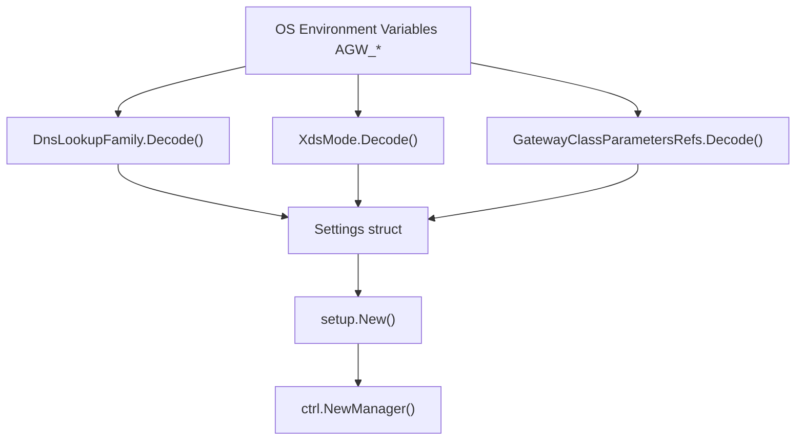
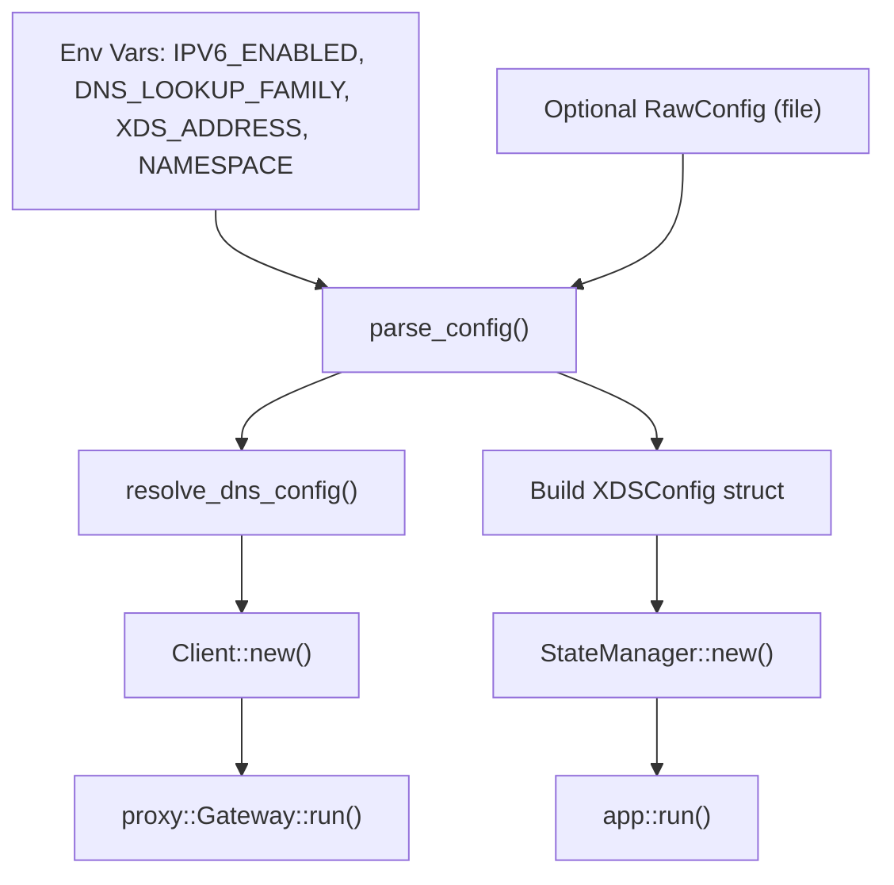

<!-- source: DeepWiki mcp.deepwiki.com · repo agentgateway/agentgateway · page 3.8 Environment Variables · fetched 2026-10-21 -->

# Environment Variables

Relevant source files

The following files were used as context for generating this wiki page:

- [controller/api/settings/settings.go](controller/api/settings/settings.go)
- [controller/api/settings/settings_test.go](controller/api/settings/settings_test.go)
- [controller/install/helm/agentgateway/templates/deployment.yaml](controller/install/helm/agentgateway/templates/deployment.yaml)
- [controller/install/helm/agentgateway/values.yaml](controller/install/helm/agentgateway/values.yaml)
- [controller/test/helm/testdata/agentgateway/gateway-class-name.golden](controller/test/helm/testdata/agentgateway/gateway-class-name.golden)
- [controller/test/helm/testdata/agentgateway/topology-spread-constraints.golden](controller/test/helm/testdata/agentgateway/topology-spread-constraints.golden)

This page provides a comprehensive technical reference for environment variables affecting both the **AgentGateway controller** and **data plane**. It details their implementation, configuration parsing, impact on runtime behavior, and relationships to key code modules and structs. This enables operators and developers to understand how environment variables influence system behavior, configuration precedence, and control plane integration.

---

## Configuration Precedence and Overview

Environment variables serve as overrides and initializers in **both** the Rust-based **Data Plane** and Go-based **Controller** components of AgentGateway. The system merges environment variables with static files, dynamic Kubernetes resources, and compile-time defaults into the final runtime configuration.

- The **Controller** primarily reads environment variables prefixed with `AGW_` which are parsed via the `envconfig` Go library into a `Settings` struct [controller/api/settings/settings.go:153-220]().
- The **Data Plane** parses several dedicated environment variables (e.g., `IPV6_ENABLED`, `DNS_LOOKUP_FAMILY`, `XDS_ADDRESS`) in Rust during startup via the `parse_config` function that produces a final internal `Config` object used throughout [crates/agentgateway/src/config.rs:33-166]().

These environment variables influence fundamental system behaviors such as network protocol selections, Kubernetes namespace context, xDS control plane connection parameters, logging verbosity, and feature toggles.

Sources:
[controller/api/settings/settings.go:153-220](), [crates/agentgateway/src/config.rs:33-166]()

---

## 1. Controller Environment Variables

The Go-based Kubernetes controller manages runtime settings predominantly via environment variables with the `AGW_` prefix. These are parsed at program start using the `envconfig` library as part of the setup flow [controller/api/settings/settings.go:153-220](), [controller/pkg/setup/setup.go:94-111]().

### 1.1 Core Controller Settings

| Variable               | Type     | Default        | Description                                                                                     | Code Reference                                      |
|------------------------|----------|----------------|-------------------------------------------------------------------------------------------------|----------------------------------------------------|
| `AGW_LOG_LEVEL`        | string   | `"info"`       | Controls the controller's log verbosity level (info, debug, etc.)                              | `Settings.LogLevel` [controller/api/settings/settings_test.go:87]() |
| `AGW_ISTIO_AUTO_ENABLED`| bool    | `false`        | Automatically enable Istio integration on built-in-class gateways                               | [controller/api/settings/settings.go:176]()        |
| `AGW_ISTIO_CA_ADDRESS` | string   | `""`           | The Istio Certificate Authority address for mesh integration                                   | [controller/api/settings/settings_test.go:28]()    |
| `AGW_LISTENER_BIND_IPV6`| bool    | `true`         | Whether listeners bind on IPv6 addresses                                                       | [controller/api/settings/settings.go:163]()        |
| `AGW_DNS_LOOKUP_FAMILY`| string   | `"V4_PREFERRED"`| DNS lookup family mode for backend resolution (e.g., `V4_ONLY`, `ALL`)                         | `DnsLookupFamily.Decode()` [controller/api/settings/settings.go:49-58]() |
| `AGW_KLOG_VERBOSITY`   | string   | N/A            | Kubernetes component log verbosity for `klog` logging                                         | [controller/pkg/setup/setup.go:94]()                |

Sources:
[controller/api/settings/settings.go:49-176](), [controller/api/settings/settings_test.go:28-87](), [controller/pkg/setup/setup.go:94-111]()

### 1.2 XDS and Control Plane Variables

| Variable                          | Type         | Default         | Description                                                                                     | Code Reference                                      |
|----------------------------------|--------------|-----------------|------------------------------------------------------------------------------------------------|----------------------------------------------------|
| `AGW_XDS_SERVICE_NAME`            | string       | `"agentgateway"`| Service name for the xDS control plane gRPC endpoint                                           | [controller/api/settings/settings_test.go:81]()    |
| `AGW_AGENTGATEWAY_XDS_SERVICE_PORT`| int        | `9978`          | Port used by the xDS gRPC server                                                               | [controller/api/settings/settings_test.go:82]()    |
| `AGW_XDS_MODE`                   | string       | `"plaintext"`   | xDS transport mode: `plaintext`, `tls`, or `either`                                           | `XdsMode.Decode()` [controller/api/settings/settings.go:61-76]() |
| `AGW_BACKEND_REF_GRANT_MODE`     | string       | `"route"`       | Mode for evaluating Backend Reference Grants (`route`, `route-and-policy`, `none`)            | [controller/api/settings/settings_test.go:94]()    |
| `AGW_GATEWAY_CLASS_PARAMETERS_REFS`| string (JSON map) | `{}`       | Maps GatewayClass names to ParametersReference Kubernetes objects in JSON-string format        | `GatewayClassParametersRefs.Decode()` [controller/api/settings/settings.go:102-144]() |

Sources:
[controller/api/settings/settings.go:61-144](), [controller/api/settings/settings_test.go:81-94]()

---

## 2. Data Plane Environment Variables

The Rust-based data plane uses environment variables to override or supplement the static and dynamic configurations during initialization in `parse_config` [crates/agentgateway/src/config.rs:33-166](). These variables influence low-level networking, xDS synchronization, workload identity, and feature flags.

### 2.1 Core Runtime Variables

| Variable             | Default                                           | Description                                                                                        | Code Reference                                       |
|----------------------|-------------------------------------------------|--------------------------------------------------------------------------------------------------|------------------------------------------------------|
| `IPV6_ENABLED`        | `true`                                          | Enables IPv6 binding and resolution for proxies and listeners                                    | `parse_config()` [crates/agentgateway/src/config.rs:52-54]() |
| `DNS_LOOKUP_FAMILY`   | `Auto`                                          | Sets DNS upstream resolution mode using `DnsLookupFamily` enum (All/Auto/V4Preferred etc.)       | `DnsLookupFamily::from_env_str()` [crates/agentgateway/src/lib.rs:109-112]() |
| `DNS_EDNS0`           | N/A                                             | Enables EDNS0 extensions in DNS resolution via hickory resolver                                  | [crates/agentgateway/src/config.rs:81]()              |
| `XDS_ADDRESS`         | None                                            | URI endpoint of dynamic xDS control plane for configuration sync                                 | `parse_config()` [crates/agentgateway/src/config.rs:96-97]() |
| `NAMESPACE`           | None                                            | Kubernetes namespace of this gateway, required when using dynamic xDS                            | [crates/agentgateway/src/config.rs:101-112]()          |
| `GATEWAY`             | None                                            | Name of the gateway used as identity in dynamic xDS                                             | [crates/agentgateway/src/config.rs:106-108]()          |
| `XDS_AUTH_TOKEN`      | None                                            | Path to file containing auth token for xDS, or none for no auth                                 | [crates/agentgateway/src/config.rs:114-134]()          |
| `XDS_ROOT_CA`         | `"./var/run/secrets/xds/root-cert.pem"` or `"SYSTEM"`| Path to root CA for xDS connection or system during TLS                                      | [crates/agentgateway/src/config.rs:135-146]()          |
| `CA_ADDRESS`          | None                                            | URI of Certificate Authority for SPIFFE/X.509 identity issuance                                 | [crates/agentgateway/src/config.rs:166-190]()          |
| `CA_AUTH_TOKEN`       | None                                            | Path to token file for Certificate Authority authentication                                     | [crates/agentgateway/src/config.rs:178-189]()          |

Sources:
[crates/agentgateway/src/config.rs:33-190](), [crates/agentgateway/src/lib.rs:109-112]()

---

## 3. Parsing and Validation Mechanisms

### 3.1 Controller Parsing (`AGW_` variables)

- Uses the Go package `github.com/kelseyhightower/envconfig` for automatic environment variable to struct field mapping.
- Specific fields use custom decoding to validate and normalize inputs:
  - `DnsLookupFamily.Decode()` validates accepted DNS modes and errors on invalid inputs [controller/api/settings/settings.go:49-58]().
  - `XdsMode.Decode()` parses `plaintext`, `tls`, or `either`, with leniency for legacy boolean values mapped to modes [controller/api/settings/settings.go:61-76]().
  - `GatewayClassParametersRefs.Decode()` parses a JSON map, validating keys and namespaces are present [controller/api/settings/settings.go:102-144]().

Sources:
[controller/api/settings/settings.go:49-144]()

### 3.2 Data Plane Parsing (Rust environment vars)

- The Rust data plane uses helper functions such as `parse::<T>("VAR_NAME")` during initial config parsing [crates/agentgateway/src/config.rs:33-166]().
- It uses `shellexpand::full` for environment variable expansions inside config files.
- Special validation is done when constructing authentication sources and paths, e.g., for `XDS_AUTH_TOKEN` [crates/agentgateway/src/config.rs:114-134]().
- Defaults are smartly applied based on runtime environment, file existence checks, and configuration contents (e.g., default CA cert file or system roots).

Sources:
[crates/agentgateway/src/config.rs:33-166]()

---

## 4. Data Flow and Key Code Entities

### Controller Environment Variable to Settings Mapping

- The `Settings` struct acts as the centralized configuration object for the controller.
- `envconfig` binds environment variables prefixed by `AGW_` to fields in `Settings`.
- The `Setup` initializes runtime components with this configuration.

Sources:  
[controller/api/settings/settings.go:49-144](), [controller/api/settings/settings_test.go:19-53](), [controller/pkg/setup/setup.go:94-111]()

---

### Data Plane Environment Variable Parsing and Usage

- `parse_config()` reads environment variables and merges them with optional config files.
- It builds the `XDSConfig` representing connection parameters to the control plane.
- The `StateManager` uses this to instantiate and run the xDS client.
- DNS configuration influences the DNS resolver used by client connections.

Sources:  
[crates/agentgateway/src/config.rs:33-166](),  
[crates/agentgateway/src/state_manager.rs:34-48](),  
[crates/agentgateway/src/app.rs:14-85]()

---

## 5. Summary Tables of Key Environment Variables

### 5.1 Controller Variables Summary

| Environment Variable                     | Type         | Default          | Description                                                  | Key Struct/Function              |
|-----------------------------------------|--------------|------------------|--------------------------------------------------------------|---------------------------------|
| `AGW_LOG_LEVEL`                         | String       | `"info"`         | Log verbosity for controller                                  | `Settings.LogLevel`              |
| `AGW_ISTIO_AUTO_ENABLED`                | Bool         | `false`          | Auto-enable Istio integration on gateways                    | `Settings`                      |
| `AGW_DNS_LOOKUP_FAMILY`                 | Enum String  | `"V4_PREFERRED"` | DNS query lookup family                                       | `DnsLookupFamily.Decode`         |
| `AGW_XDS_MODE`                         | Enum String  | `"plaintext"`    | Control plane connection mode (plaintext/tls/either)         | `XdsMode.Decode`                 |
| `AGW_BACKEND_REF_GRANT_MODE`            | Enum String  | `"route"`        | Backend Ref Grant mode                                        | `BackendRefGrantMode.Decode`    |
| `AGW_GATEWAY_CLASS_PARAMETERS_REFS`     | JSON String  | `{}`             | Maps GatewayClass to ParameterReference                      | `GatewayClassParametersRefs.Decode` |

Sources:
[controller/api/settings/settings.go:49-144](), [controller/api/settings/settings_test.go:81-94]()

### 5.2 Data Plane Variables Summary

| Environment Variable   | Default                             | Description                                                                | Key Rust Code Function           |
|-----------------------|-----------------------------------|----------------------------------------------------------------------------|---------------------------------|
| `IPV6_ENABLED`         | `true`                            | Enables or disables IPv6 address binding/resolution                       | `parse_config()`                 |
| `DNS_LOOKUP_FAMILY`    | `Auto`                            | DNS family configuration for host lookup (All, V4Only, etc.)              | `DnsLookupFamily::from_env_str` |
| `DNS_EDNS0`            | N/A                               | Enable EDNS0 in DNS resolver                                               | `parse_config()`                 |
| `XDS_ADDRESS`          | None                              | Address URI of xDS control plane                                           | `parse_config()`                 |
| `NAMESPACE`, `GATEWAY`| None                              | Kubernetes namespace and gateway identity when using dynamic configuration | `parse_config()`                 |
| `XDS_AUTH_TOKEN`       | None                              | File path to authentication token for xDS control plane                   | `parse_config()`                 |
| `XDS_ROOT_CA`          | `"./var/run/secrets/xds/root-cert.pem"` or `"SYSTEM"` | Root CA for validating xDS TLS connections                              | `parse_config()`                 |

Sources:
[crates/agentgateway/src/config.rs:33-166](), [crates/agentgateway/src/lib.rs:109-112]()

---

## 6. Operational Notes

- The controller environment variables are typically set via Helm chart `values.yaml` `controller.extraEnv`, enabling Kubernetes operators to customize behavior without config file changes [controller/install/helm/agentgateway/values.yaml:135-146]().
- The data plane environment variables are typically set in the environment of the Rust binary for standalone or container deployments.
- Validation errors in environment variables cause startup failures in both components to prevent invalid configurations.
- Defaults and fallback mechanisms are designed to support standard Kubernetes conventions, e.g., default token files and system CAs.

Sources:
[controller/install/helm/agentgateway/values.yaml:135-146](), [crates/agentgateway/src/config.rs:33-190]()

---

## References to Relevant Files

| Filename                                       | Description                                               |
|------------------------------------------------|-----------------------------------------------------------|
| `controller/api/settings/settings.go`          | Controller env var definitions, parsing, and defaults     |
| `controller/api/settings/settings_test.go`     | Unit tests for controller environment variables            |
| `controller/pkg/setup/setup.go`                 | Controller setup reading environment variables             |
| `crates/agentgateway/src/config.rs`             | Data plane config parsing and environment processing       |
| `crates/agentgateway/src/lib.rs`                 | Data plane core types including `DnsLookupFamily`          |
| `crates/agentgateway/src/state_manager.rs`       | XDS client instantiation with config                       |
| `crates/agentgateway/src/app.rs`                  | Application startup including config integration            |

Sources:
[controller/api/settings/settings.go:1-220](), [controller/api/settings/settings_test.go:1-143](), [controller/pkg/setup/setup.go:90-111](), [crates/agentgateway/src/config.rs:1-190](), [crates/agentgateway/src/lib.rs:90-132](), [crates/agentgateway/src/app.rs:14-85](), [crates/agentgateway/src/state_manager.rs:30-90]()

---

