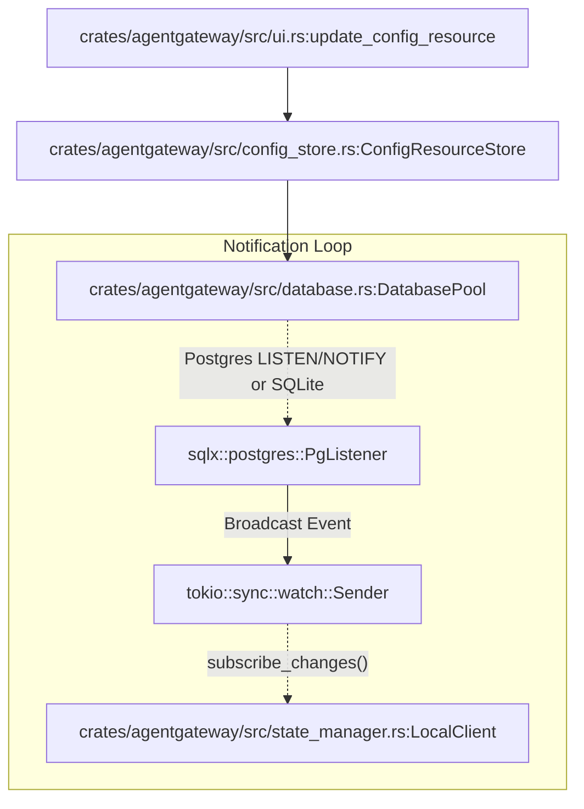
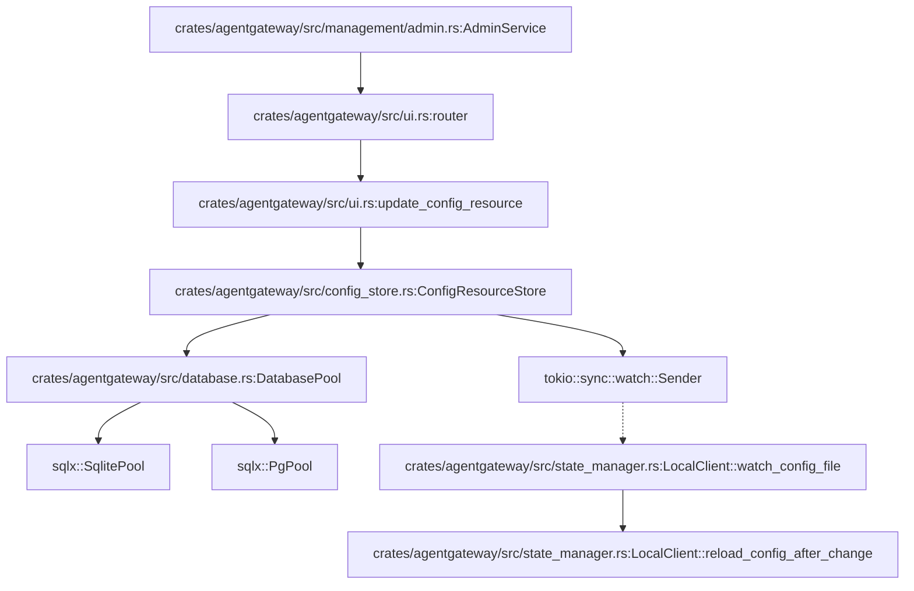

<!-- source: DeepWiki mcp.deepwiki.com · repo agentgateway/agentgateway · page 3.9 Config Store and Database-backed Configuration · fetched 2026-10-21 -->

# Config Store and Database-backed Configuration

<details>
<summary>Relevant source files</summary>

The following files were used as context for generating this wiki page:

- [catalog/model-catalog-overrides.yaml](catalog/model-catalog-overrides.yaml)
- [controller/pkg/cli/catalog/cmd.go](controller/pkg/cli/catalog/cmd.go)
- [controller/pkg/cli/catalog/model_catalog.go](controller/pkg/cli/catalog/model_catalog.go)
- [crates/agentgateway/src/app.rs](crates/agentgateway/src/app.rs)
- [crates/agentgateway/src/config.rs](crates/agentgateway/src/config.rs)
- [crates/agentgateway/src/config_store.rs](crates/agentgateway/src/config_store.rs)
- [crates/agentgateway/src/database.rs](crates/agentgateway/src/database.rs)
- [crates/agentgateway/src/lib.rs](crates/agentgateway/src/lib.rs)
- [crates/agentgateway/src/llm/catalog/model.rs](crates/agentgateway/src/llm/catalog/model.rs)
- [crates/agentgateway/src/llm/catalog/refresh.rs](crates/agentgateway/src/llm/catalog/refresh.rs)
- [crates/agentgateway/src/management/admin.rs](crates/agentgateway/src/management/admin.rs)
- [crates/agentgateway/src/management/admin_tests.rs](crates/agentgateway/src/management/admin_tests.rs)
- [crates/agentgateway/src/state_manager.rs](crates/agentgateway/src/state_manager.rs)
- [crates/agentgateway/src/telemetry/log_store.rs](crates/agentgateway/src/telemetry/log_store.rs)
- [crates/agentgateway/src/telemetry/log_store/postgres.rs](crates/agentgateway/src/telemetry/log_store/postgres.rs)
- [crates/agentgateway/src/telemetry/log_store/postgres_migrations/0001_create_request_log_schema.sql](crates/agentgateway/src/telemetry/log_store/postgres_migrations/0001_create_request_log_schema.sql)
- [crates/agentgateway/src/telemetry/log_store/sqlite.rs](crates/agentgateway/src/telemetry/log_store/sqlite.rs)
- [crates/agentgateway/src/ui.rs](crates/agentgateway/src/ui.rs)
- [examples/llm-ollama-postgres/README.md](examples/llm-ollama-postgres/README.md)
- [examples/llm-ollama-postgres/config.yaml](examples/llm-ollama-postgres/config.yaml)

</details>


## Purpose and Scope
This page details the hybrid configuration store architecture of Agentgateway, which supports storing configuration resources persistently in SQL databases (SQLite or PostgreSQL) while allowing API and UI-based dynamic editing. This hybrid mode facilitates zero-downtime configuration updates by notifying running gateway instances through database notifications and change watches.

The system cleanly separates static configurations from mutable, operational configuration overlays managed via a `ConfigResourceStore` backed by a relational database. This setup enables efficient synchronization of config state between UI, API, data-plane, and control-plane subsystems.

Sources:  
- `crates/agentgateway/src/config_store.rs:17-32`()  
- `crates/agentgateway/src/ui.rs:21-71`()  
- `crates/agentgateway/src/app.rs:14-25`()  
- `crates/agentgateway/src/state_manager.rs:33-145`()  

---

## 1. Storage Abstraction and Database Pools

Agentgateway abstracts database connectivity via the `DatabasePool` enum, supporting both SQLite and PostgreSQL backends. This abstraction enables flexible sharing or dedicated use of connections for configuration resources and telemetry logging.

The core database-backed configuration interface is provided by the `ConfigResourceStore` struct defined in `crates/agentgateway/src/config_store.rs`:

```rust
#[derive(Clone, Debug)]
pub struct ConfigResourceStore {
	pool: DatabasePool,
	change_tx: watch::Sender<()>,
	notification_id: Option<String>,
}
```

- `pool` holds the database connection pool (`DatabasePool::Sqlite` or `DatabasePool::Postgres`).
- `change_tx` is a Tokio watch channel sender broadcasting configuration changes.
- For PostgreSQL, `notification_id` is a unique UUID used to suppress self-notifications.

Initialization (`connect` or `from_pool`) performs:
- Applying embedded SQL schema for the database backend.
- For Postgres, generating a UUID notification ID and spawning an asynchronous listener `PgListener` subscribed to the channel `POSTGRES_CHANGE_CHANNEL` (`"config_resource_change"`).
- This listener reacts to external notifications triggering change broadcasts via `change_tx`.

Sources:  
- `crates/agentgateway/src/config_store.rs:17-21`()  
- `crates/agentgateway/src/config_store.rs:161-209`()  
- `crates/agentgateway/src/database.rs:1-50`()  

---

## 2. Configuration Resource Schema and `ConfigResourceKind`

Configuration managed via the database uses strongly typed JSON blobs grouped by resource kind, uniquely identified by string IDs, and versioned with an integer revision number.

The resource model is defined as:

```rust
#[derive(Debug, Clone, Serialize, Deserialize, PartialEq)]
#[serde(rename_all = "camelCase")]
pub struct ConfigResource {
	pub kind: ConfigResourceKind,
	pub id: String,
	pub value: Value,
	pub revision: i64,
	pub created_at: DateTime<Utc>,
	pub updated_at: DateTime<Utc>,
}
```

- `kind`: Specifies resource category (`ConfigResourceKind`), e.g., model catalogs, LLM providers, or traffic routes.
- `id`: Unique identifier within the kind.
- `value`: Arbitrary JSON serialized configuration value (`serde_json::Value`).
- `revision`: Monotonically increasing version for optimistic concurrency.
- `created_at` / `updated_at`: Resource lifecycle timestamps.

`ConfigResourceKind` enumerates supported configuration kinds:

| Subsystem         | Resource Kind          | Description                                   |
|-------------------|-----------------------|-----------------------------------------------|
| LLM               | `ModelCatalog`        | Model pricing and metadata catalogs.          |
|                   | `LlmProvider`         | Provider definitions (OpenAI, Azure, etc).    |
|                   | `LlmModel`            | Per-model configurations for providers.       |
|                   | `LlmVirtualModel`     | Virtual model routing definitions.             |
|                   | `LlmApiKey`           | API keys for LLM access.                        |
|                   | `LlmPolicy`           | LLM-specific policies and guardrails.          |
|                   | `LlmSettings`         | Global LLM subsystem settings.                  |
| MCP               | `McpTarget`           | Agent-to-Agent / MCP target definitions.       |
|                   | `McpPolicy`           | MCP-specific policy resources.                  |
|                   | `McpSettings`         | MCP subsystem settings.                          |
| Traffic           | `TrafficGateway`      | Gateway-level traffic routing configuration.   |
|                   | `TrafficRoute`        | HTTP routing rules.                             |
|                   | `TrafficTcpRoute`     | TCP routing rules.                              |
| UI and General    | `UiPolicy`            | UI-specific config overlays and metadata.      |

Sources:  
- `crates/agentgateway/src/config_store.rs:25-32`()  
- `crates/agentgateway/src/config_store.rs:50-109`()  

---

## 3. Configuration Resources API and UI Integration

Agentgateway exposes RESTful HTTP endpoints under `/api/config/resources` for managing configuration resource kinds and instances when running in hybrid config store mode (`config.storage.mode == Hybrid`).

The Axum router defined in `crates/agentgateway/src/ui.rs` sets up HTTP routes for config resource management:

- `GET /api/config/resources` — List all config resources (`list_config_resources`).
- `GET /api/config/resources/{kind}` — List resources by kind (`list_config_resources_by_kind`).
- `PUT /api/config/resources/{kind}` — Bulk upsert resources for a kind (`upsert_config_resources_by_kind`).
- `PUT /api/config/resources/{kind}/{id}` — Upsert a single resource (`update_config_resource`).
- `DELETE /api/config/resources/{kind}/{id}` — Delete a resource instance (`delete_config_resource`).

The `App` struct enforces write permission constraints via `ensure_writable()` and `config_resource_store()`, disallowing edits if storage mode is read-only or if hybrid mode is inactive. It also integrates `AuthorizationContext` to capture request ownership from `standardAttributes.user` CEL mappings.

Sources:  
- `crates/agentgateway/src/ui.rs:21-72`()  
- `crates/agentgateway/src/ui.rs:76-122`()  
- `crates/agentgateway/src/ui.rs:135-185`()  

---

## 4. Change Notification and Synchronization Flow

To enable reactive configuration reloads without restart, `ConfigResourceStore` integrates database change notifications and broadcasts:



- API requests invoke `ConfigResourceStore` methods to persist modifications into the database pool (`DatabasePool`).
- With PostgreSQL, a `NOTIFY` event is emitted on the change channel, captured by `sqlx::postgres::PgListener`.
- `PgListener` filters out self-notifications using the node's `notification_id` and signals the Tokio watch channel (`watch::Sender<()>`).
- `state_manager::LocalClient` subscribes to these changes and triggers `reload_config_after_change()` to update runtime state without downtime.

Sources:  
- `crates/agentgateway/src/config_store.rs:176-207`()  
- `crates/agentgateway/src/config_store.rs:215-217`()  
- `crates/agentgateway/src/state_manager.rs:163-207`()  

---

## 5. End-to-End Hybrid Architecture Mapping

The following diagram maps the hybrid configuration store architecture to exact code symbols and functions across the codebase.



This architecture ensures that administrative edits via the management UI or REST endpoints persist securely and propagate instantly to all active data plane workers.

Sources:  
- `crates/agentgateway/src/management/admin.rs:198-225`()  
- `crates/agentgateway/src/ui.rs:76-122`()  
- `crates/agentgateway/src/config_store.rs:17-21`()  
- `crates/agentgateway/src/state_manager.rs:138-207`()  

---

# Summary

Agentgateway’s hybrid configuration store mode seamlessly integrates persistent SQL database-backed config resources with dynamic in-memory state and UI/API editing capabilities. It leverages PostgreSQL’s `LISTEN/NOTIFY` or SQLite file watches for change detection, Tokio watch channels for event broadcasting, and Axum-based REST APIs for resource CRUD operations.

Sources:  
- `crates/agentgateway/src/config_store.rs:1-225`()  
- `crates/agentgateway/src/ui.rs:21-122`()  
- `crates/agentgateway/src/app.rs:14-25`()  
- `crates/agentgateway/src/state_manager.rs:33-145`()

---

