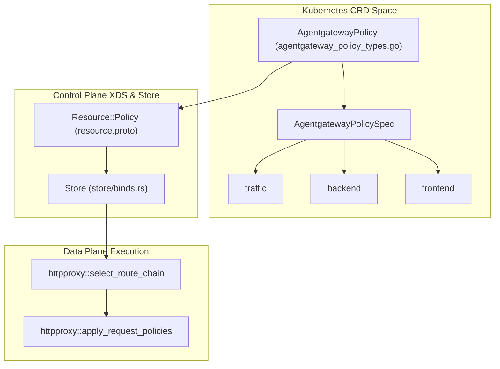
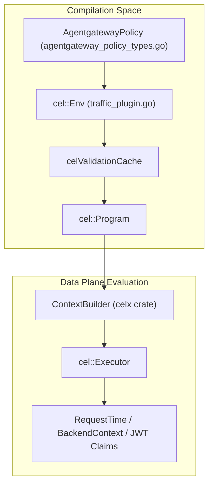
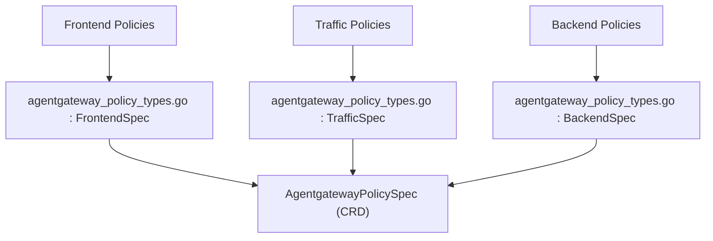

<!-- source: DeepWiki mcp.deepwiki.com · repo agentgateway/agentgateway · page 4 Policy System · fetched 2026-10-21 -->

# Policy System

<details>
<summary>Relevant source files</summary>

The following files were used as context for generating this wiki page:

- [api/resource.pb.go](api/resource.pb.go)
- [controller/api/v1alpha1/agentgateway/agentgateway_policy_types.go](controller/api/v1alpha1/agentgateway/agentgateway_policy_types.go)
- [controller/api/v1alpha1/agentgateway/zz_generated.deepcopy.go](controller/api/v1alpha1/agentgateway/zz_generated.deepcopy.go)
- [controller/install/helm/agentgateway-crds/templates/agentgateway.dev_agentgatewaybackends.yaml](controller/install/helm/agentgateway-crds/templates/agentgateway.dev_agentgatewaybackends.yaml)
- [controller/install/helm/agentgateway-crds/templates/agentgateway.dev_agentgatewaypolicies.yaml](controller/install/helm/agentgateway-crds/templates/agentgateway.dev_agentgatewaypolicies.yaml)
- [controller/pkg/agentgateway/plugins/backend_policies.go](controller/pkg/agentgateway/plugins/backend_policies.go)
- [controller/pkg/agentgateway/plugins/traffic_plugin.go](controller/pkg/agentgateway/plugins/traffic_plugin.go)
- [crates/agentgateway/src/proxy/httpproxy.rs](crates/agentgateway/src/proxy/httpproxy.rs)
- [crates/agentgateway/src/store/binds.rs](crates/agentgateway/src/store/binds.rs)
- [crates/agentgateway/src/types/agent.rs](crates/agentgateway/src/types/agent.rs)
- [crates/agentgateway/src/types/agent_xds.rs](crates/agentgateway/src/types/agent_xds.rs)
- [crates/agentgateway/src/types/local.rs](crates/agentgateway/src/types/local.rs)
- [crates/agentgateway/src/types/local_tests.rs](crates/agentgateway/src/types/local_tests.rs)
- [crates/protos/proto/resource.proto](crates/protos/proto/resource.proto)
- [schema/config.json](schema/config.json)
- [schema/config.md](schema/config.md)

</details>


The Policy System in AgentGateway provides a hierarchical, flexible framework for managing traffic control, security enforcement, request/response transformations, and AI-specific behaviors. Policies can be declared either statically via configuration files or dynamically through Kubernetes Custom Resources (`AgentgatewayPolicy`). This system applies policies across multiple layers of the gateway architecture—ranging from Gateway level down to Backend—with well-defined precedence to merge conflicting rules predictably and consistently. This ensures tight integration between control-plane configuration (Kubernetes CRDs, XDS resources) and data-plane enforcement.

---

## Policy Architecture and Application

AgentGateway policies are structured and applied using a layered architecture that aligns Kubernetes Custom Resources with XDS resource messages and finally to runtime data-plane implementations.

- At the Kubernetes control-plane level, `AgentgatewayPolicy` CRDs specify scoped policy rules and target references/selectors for associating policies with gateways, listeners, routes, backend endpoints, or route rules [controller/api/v1alpha1/agentgateway/agentgateway_policy_types.go:29-45]().

- These CRDs translate to XDS-style `Resource::Policy` protobuf messages in the control plane, which are then distributed to the data plane configuration store (implemented in [store/binds.rs](crates/agentgateway/src/store/binds.rs)) for real-time lookup and application [crates/protos/proto/resource.proto:156-180]().

- The runtime HTTP proxy subsystem (`httpproxy`) maps these policies into actual filtering and routing decisions. Key functions like `select_route_chain` and `apply_request_policies` execute the policy merges and evaluate their contents during request handling [crates/agentgateway/src/proxy/httpproxy.rs:112-153,201-209]().

This model defines a deterministic merge order based on policy "levels" or scope, where broader scopes apply first and more specific entries override or augment them:

```
Gateway < Listener < Route < Route Rule < Backend
```

### Architectural Flow Diagram: Policy Target Association



**Sources:**
- [controller/api/v1alpha1/agentgateway/agentgateway_policy_types.go:29-45]()
- [crates/protos/proto/resource.proto:156-180]()
- [crates/agentgateway/src/store/binds.rs:110-153]()
- [crates/agentgateway/src/proxy/httpproxy.rs:112-153,201-209]()
- [controller/install/helm/agentgateway-crds/templates/agentgateway.dev_agentgatewaypolicies.yaml:61-80]()

For extensive coverage including merge precedence rules and application phases during request handling, see the child page: [Policy Architecture and Application](#4.1).

---

## CEL Expression Engine

AgentGateway integrates the Common Expression Language (CEL) to enable dynamic, runtime policy evaluation including request matching, authorization checks, and conditional transformations without recompiling code.

- CEL expressions are compiled and strictly validated at configuration loading, ensuring that syntactic and semantic errors in expressions are caught early. This validation and compilation logic is handled within the controller plugins and agentgateway crates [controller/pkg/agentgateway/plugins/traffic_plugin.go:73-89]().

- The `cel-fork` Rust crate implementation is used with custom extensions, allowing enhanced attribute analysis and specialized functions.

- CEL evaluation programs (`cel::Program`) are cached for efficient reuse, and attribute dependencies are tracked to optimize request processing.

The evaluation pipeline begins with expression compilation into `Program`s, then proceeds to context-aware evaluation by the `Executor`. This architecture supports rich request and response introspection through well-defined CEL attributes exposed by the system.

### CEL Compilation and Evaluation Architecture Diagram



**Sources:**
- [controller/pkg/agentgateway/plugins/traffic_plugin.go:73-89]()
- [controller/api/v1alpha1/agentgateway/agentgateway_policy_types.go:29-38]()

For technical details on CEL parsing, compilation, attribute flags, and error handling, refer to: [CEL Expression Engine](#4.2).

---

## CEL Context and Functions

The evaluation of CEL policies depends on a comprehensive runtime context that exposes request, response, authentication, and AI-related metadata:

- The `Executor` context struct aggregates nested attributes such as `request`, `response`, `jwt` claims, API keys, LLM request/response metadata, backend details, and proxy timing information. This is implemented in the crate sources under `agentgateway/src/cel/types.rs` and related modules.

- These attributes enable CEL expressions to condition on a vast array of runtime data, such as HTTP headers, body content, authentication tokens, and telemetry timings.

- Custom CEL functions are provided by the `celx` crate and allow domain-specific operations (e.g., token counting, pattern matching, attribute extraction).

- The `ContextBuilder` registers which attributes an expression references, allowing selective buffering and optimization such as lazy body buffering only when needed.

**Sources:**
- [crates/agentgateway/src/cel/types.rs:1-204]()
- [crates/agentgateway/src/cel/mod.rs:140-232]()
- [controller/pkg/agentgateway/plugins/traffic_plugin.go:130-148]()

For a detailed breakdown of CEL evaluation contexts and available built-in or custom functions, see the child page: [CEL Context and Functions](#4.3).

---

## Policy Types Reference

AgentGateway organizes policies into three broad categories that correspond to their application points and roles in the data plane:

- **Frontend Policies:** These govern settings at the Gateway or Listener level. Examples include TLS configurations, connection options, proxy protocol handling, and network-level authentication [controller/api/v1alpha1/agentgateway/agentgateway_policy_types.go:62-67]().

- **Traffic Policies:** These govern routing, security, and traffic control at Route or Route Rule levels. Capabilities include JWT and API key authentication, rate limiting, timeouts and retries, CORS handling, request/response filtering, buffering, and transformation [controller/api/v1alpha1/agentgateway/agentgateway_policy_types.go:68-69]().

- **Backend Policies:** These apply when connecting to upstream services or AI backends. They manage backend TLS, AI provider parameters, MCP authentication, and prompt guards for LLMs [controller/install/helm/agentgateway-crds/templates/agentgateway.dev_agentgatewaypolicies.yaml:61-80]().

### Policy Category Mapping Diagram: Natural Language to Code Entities



**Sources:**
- [controller/api/v1alpha1/agentgateway/agentgateway_policy_types.go:62-69]()
- [controller/install/helm/agentgateway-crds/templates/agentgateway.dev_agentgatewaypolicies.yaml:61-80]()

For the full exhaustive reference of fields and struct definitions of all policy types, see the child page: [Policy Types Reference](#4.4).

---

# Summary

The AgentGateway Policy System is a robust, multi-level configuration and runtime evaluation framework enabling detailed traffic and AI request handling control. It combines:

- Hierarchical policy merge from Kubernetes CRDs through XDS down to runtime,
- Sophisticated CEL expression parsing and dynamic evaluation with rich runtime contexts,
- Clearly categorized policy types affecting the lifecycle at different architectural levels.

**Child Pages for Details:**
- [Policy Architecture and Application](#4.1)
- [CEL Expression Engine](#4.2)
- [CEL Context and Functions](#4.3)
- [Policy Types Reference](#4.4)

---

