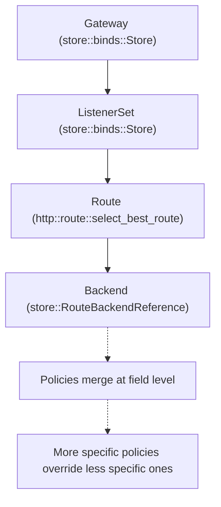
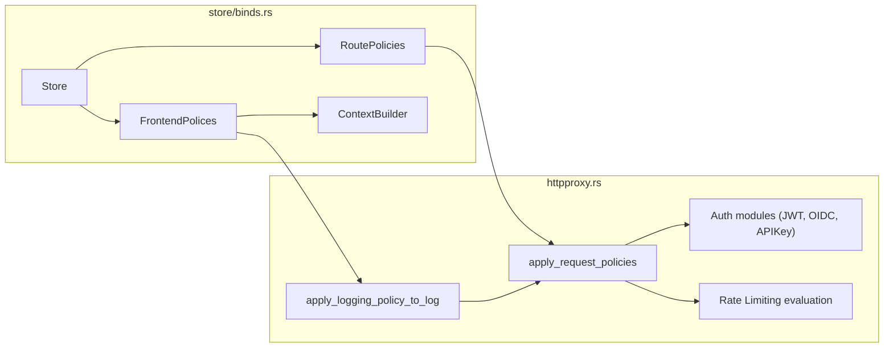
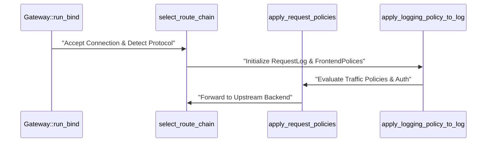

<!-- source: DeepWiki mcp.deepwiki.com · repo agentgateway/agentgateway · page 4.1 Policy Architecture and Application · fetched 2026-10-21 -->

# Policy Architecture and Application

Relevant source files

The following files were used as context for generating this wiki page:

- [api/resource.pb.go](api/resource.pb.go)
- [controller/api/v1alpha1/agentgateway/agentgateway_policy_types.go](controller/api/v1alpha1/agentgateway/agentgateway_policy_types.go)
- [controller/api/v1alpha1/agentgateway/zz_generated.deepcopy.go](controller/api/v1alpha1/agentgateway/zz_generated.deepcopy.go)
- [controller/install/helm/agentgateway-crds/templates/agentgateway.dev_agentgatewaybackends.yaml](controller/install/helm/agentgateway-crds/templates/agentgateway.dev_agentgatewaybackends.yaml)
- [controller/install/helm/agentgateway-crds/templates/agentgateway.dev_agentgatewaypolicies.yaml](controller/install/helm/agentgateway-crds/templates/agentgateway.dev_agentgatewaypolicies.yaml)
- [controller/pkg/agentgateway/plugins/backend_policies.go](controller/pkg/agentgateway/plugins/backend_policies.go)
- [controller/pkg/agentgateway/plugins/frontend_policies.go](controller/pkg/agentgateway/plugins/frontend_policies.go)
- [controller/pkg/agentgateway/plugins/traffic_plugin.go](controller/pkg/agentgateway/plugins/traffic_plugin.go)
- [crates/agentgateway/src/proxy/httpproxy.rs](crates/agentgateway/src/proxy/httpproxy.rs)
- [crates/agentgateway/src/store/binds.rs](crates/agentgateway/src/store/binds.rs)
- [crates/agentgateway/src/types/agent.rs](crates/agentgateway/src/types/agent.rs)
- [crates/agentgateway/src/types/agent_xds.rs](crates/agentgateway/src/types/agent_xds.rs)
- [crates/agentgateway/src/types/local.rs](crates/agentgateway/src/types/local.rs)
- [crates/agentgateway/src/types/local_tests.rs](crates/agentgateway/src/types/local_tests.rs)
- [crates/protos/proto/resource.proto](crates/protos/proto/resource.proto)
- [schema/config.json](schema/config.json)
- [schema/config.md](schema/config.md)

## Purpose and Scope

This document details the policy architecture within AgentGateway, focusing on the hierarchical organization of policy levels, the merge precedence rules, and the distinct phases during request processing where policies are applied. Policies govern multiple aspects such as connection handling, traffic authorization, authentication, rate limiting, request/response transformations, and backend configurations.

For detailed information on CEL (Common Expression Language) integration and evaluation that supports dynamic policy decisions, see section **4.2 CEL Expression Engine** and **4.3 CEL Context and Functions**. For exhaustive policy types and fields descriptions, refer to **4.4 Policy Types Reference**.

Sources: [crates/agentgateway/src/proxy/httpproxy.rs:1-50](), [crates/agentgateway/src/store/binds.rs:1-50]()

---

## Policy Types and Levels

AgentGateway categorizes policies into three broad types reflecting their scope and usage contexts within the proxy pipeline:

### 1. Frontend Policies

Frontend policies apply at the connection or listener level before any routing decisions. They mainly configure protocol-level parameters, TLS behavior, TCP socket options, and logging. This policy set is encapsulated in the `FrontendPolices` structure, which supports merging from multiple sources.

| Policy Type             | Purpose                               | Common Use Cases                                       |
|------------------------|-------------------------------------|-------------------------------------------------------|
| `frontend::TCP`         | Connection-level TCP socket settings| TCP keepalive intervals, connection timeouts          |
| `frontend::TLS`         | TLS termination and handshake config| ALPN protocol sets, TLS version ranges, cipher suites |
| `frontend::HTTP`        | HTTP protocol behaviors              | Buffer management, HTTP/2 settings, request timeouts  |
| `frontend::LoggingPolicy` | Access logging and filtering       | CEL-based log filtering, custom log fields, OTLP      |

This collection is managed in the `FrontendPolices` struct, which offers field-wise merge operations, ensuring that values from more specific policies override defaults from broader ones [crates/agentgateway/src/store/binds.rs:160-203](), [crates/agentgateway/src/types/agent.rs:166-210]().

Sources: [crates/agentgateway/src/store/binds.rs:145-203](), [crates/agentgateway/src/types/agent.rs:166-210]()

### 2. Traffic Policies

Traffic policies affect in-flight HTTP or TCP requests routed through the proxy. They cover authentication and authorization mechanisms, rate limiting, request/response transformations, and integration with external processing services.

| Policy Type                        | Purpose                                    | Implementation References                            |
|-----------------------------------|--------------------------------------------|-----------------------------------------------------|
| `Authorization`                   | CEL-based authorization rule evaluation    | `authorization` module and CEL use in `httpproxy`  |
| `JwtAuthentication`, `BasicAuth`, `APIKey`, `Oidc` | Authentication plugins           | Authentication logic in `httpproxy.rs:180-210`     |
| `LocalRateLimit`, `RemoteRateLimit` | Rate limiting via CEL using descriptors   | `store/binds.rs` filters and traffic policy merging |
| `CORS`                            | Cross-Origin Resource Sharing policy        | Handled via traffic policies                        |
| `Transformation`                  | CEL-based request/response data mutation    | Transformation support in `types/agent_xds.rs`     |
| `ExtProc`                        | External processing chain integration        | Extended processing in `httpproxy.rs`               |

Sources: [crates/agentgateway/src/store/binds.rs:144-160](), [crates/agentgateway/src/proxy/httpproxy.rs:180-210](), [crates/agentgateway/src/types/agent_xds.rs:28-97]()

### 3. Backend Policies

Backend policies configure settings for upstream services or providers, including TLS connection details, authentication credentials, AI model-specific controls, and MCP protocol parameters.

| Policy Type          | Purpose                                    | Implementation Reference                                |
|---------------------|--------------------------------------------|--------------------------------------------------------|
| `BackendTLS`        | TLS and mTLS configuration for upstream    | Backend TLS settings in `http/backendtls.rs`           |
| `BackendAuth`       | Backend authentication (AWS, GCP, Azure, etc.)| Authentication kinds defined in `types/agent_xds.rs`  |
| `AIBackend`         | Control over LLM AI models and prompt guards| AI backend policies defined in protobuf/CRDs           |
| `McpAuthorization`   | Model Context Protocol authentication and RBAC | MCP guards in `types/local.rs`                        |

Sources: [crates/agentgateway/src/store/binds.rs:144-160](), [crates/protos/proto/resource.proto:156-180]()

---

## Policy Hierarchy and Merge Precedence

AgentGateway policy architecture is hierarchical with multiple policy attachment levels. When multiple policies apply simultaneously, the system merges them field-wise based on level specificity.

Title: "Policy Hierarchy and Storage Mapping"

- The `FrontendPolices::set_if_empty` method implements field-level merges where the most specific applicable policy sets and retains the value, preventing override by higher-level defaults [crates/agentgateway/src/store/binds.rs:162-203]().
- This precedence pattern aligns with the Kubernetes CustomResourceDefinition (CRD) and protobuf schema for resources and policies: Gateway &lt; Listener &lt; Route &lt; Route Rule &lt; Backend or Service [crates/protos/proto/resource.proto:156-180]().

Sources: [crates/agentgateway/src/store/binds.rs:160-203](), [crates/protos/proto/resource.proto:156-180]()

---

## Code Entity Association: Implementation and Application

The policy system's implementation rests on several core components interacting during configuration loading and request processing:

Title: "Policy Processing and Storage Code Entities"

- The `apply_request_policies` function evaluates traffic policies including authentication and rate limiting applied on a per-request basis during traffic proxying [crates/agentgateway/src/proxy/httpproxy.rs:201-211]().
- The `Store` manages policy data indexed by keys, associating policy targets with their respective policies for efficient lookup at runtime [crates/agentgateway/src/store/binds.rs:110-126]().
- `FrontendPolices` manages connection-level policies such as TLS and logging filtering during connection acceptance [crates/agentgateway/src/store/binds.rs:160-175]().
- The `apply_logging_policy_to_log` function is responsible for merging logging policy filters and field configurations into the per-request `RequestLog` structure [crates/agentgateway/src/proxy/httpproxy.rs:155-199]().
- CEL expressions embedded in policies are parsed and registered at configuration load time through `ContextBuilder` for later evaluation during request processing [crates/agentgateway/src/store/binds.rs:15-16]().

Sources: [crates/agentgateway/src/proxy/httpproxy.rs:155-211](), [crates/agentgateway/src/store/binds.rs:15-126]()

---

## Application Phases and Execution Order

Policies are applied at distinct phases in the lifecycle of a connection and request within AgentGateway’s data plane:

### Request Processing Phases

| Phase        | Description                                          | Key Code Functions / Locations                                         |
|--------------|------------------------------------------------------|-----------------------------------------------------------------------|
| **Connection** | Initial TCP socket acceptance, protocol detection  | `Gateway::run_bind` - listener & connection management [proxy/gateway.rs:169-235]() |
| **Routing**   | Route chain resolution with potential delegation     | `select_route_chain` - recursive route and backend selection [crates/agentgateway/src/proxy/httpproxy.rs:112-153]() |
| **Request**   | Evaluate traffic policies: auth, authorization, rate limiting, transformations | `apply_request_policies` [crates/agentgateway/src/proxy/httpproxy.rs:201-211]()              |
| **Backend**   | Upstream backend connection and AI provider-specific settings | Backend connection, TLS, authentication setup [crates/agentgateway/src/types/agent_xds.rs:127-139]() |

### Phase Flow Illustration

Title: "Request Pipeline and Policy Phase Execution"

- **Frontend Phase:** Applied during bind acceptance; manages connection protocols, TLS parameters, socket options, and logging policies [crates/agentgateway/src/store/binds.rs:160-175]().
- **Routing Phase:** Resolves routes including route groups with delegation loops, assembling the full route chain via `select_route_chain` [crates/agentgateway/src/proxy/httpproxy.rs:112-153]().
- **Request Phase:** Applies traffic policies using CEL contexts and rules to govern authentication, authorization, rate limiting, etc. via `apply_request_policies` [crates/agentgateway/src/proxy/httpproxy.rs:201-211]().
- **Backend Phase:** Handles backend-level policies, including TLS connection info, backend authentication methods, and AI-specific policies [crates/agentgateway/src/types/agent_xds.rs:127-139]().

Sources: [crates/agentgateway/src/proxy/httpproxy.rs:112-211](), [crates/agentgateway/src/store/binds.rs:160-175](), [crates/agentgateway/src/types/agent_xds.rs:127-139]()

---

## Policy Storage and Target Resolution

Policy storage and lookup is designed for fast and precise resolution of all relevant policies affecting a request:

- **Route Chain Resolution:** The function `select_route_chain` recursively resolves the route chain by resolving route groups and detecting cycles, producing a stack of routes culminating with a backend selection relevant for policy merging [crates/agentgateway/src/proxy/httpproxy.rs:112-153]().
- **Policy Store:** The in-memory `Store` keeps mappings between `PolicyKey` and `PolicyTarget` associations for quick retrieval of applicable policies at various targets such as gateways, listeners, routes, or backend services [crates/agentgateway/src/store/binds.rs:110-119]().
- **CEL Registration:** CEL expressions defined in policies (e.g., for filters, conditions, transformations) are compiled and registered via `ContextBuilder` at config load time for efficient evaluation when requests are processed [crates/agentgateway/src/store/binds.rs:15-16]().

Sources: [crates/agentgateway/src/proxy/httpproxy.rs:112-153](), [crates/agentgateway/src/store/binds.rs:15-119]()

---

# Summary

AgentGateway implements a layered, hierarchical policy system spanning gateways, listeners, routes, and backends. This system merges policies with defined precedence rules at the field level to produce effective configurations tailored to each request. Policies are applied dynamically during discrete phases of request processing, integrated with careful route delegation for flexible service discovery. The use of CEL expressions for dynamic policy evaluation enables powerful and flexible control over authorization, transformations, rate limiting, and more.

---

Sources:
- crates/agentgateway/src/proxy/httpproxy.rs:1-211
- crates/agentgateway/src/store/binds.rs:1-203
- crates/agentgateway/src/types/agent.rs:166-210
- crates/agentgateway/src/types/agent_xds.rs:28-97,127-139
- crates/protos/proto/resource.proto:156-180

---

