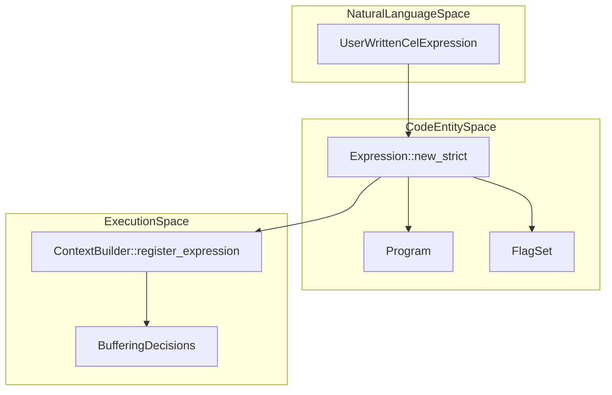
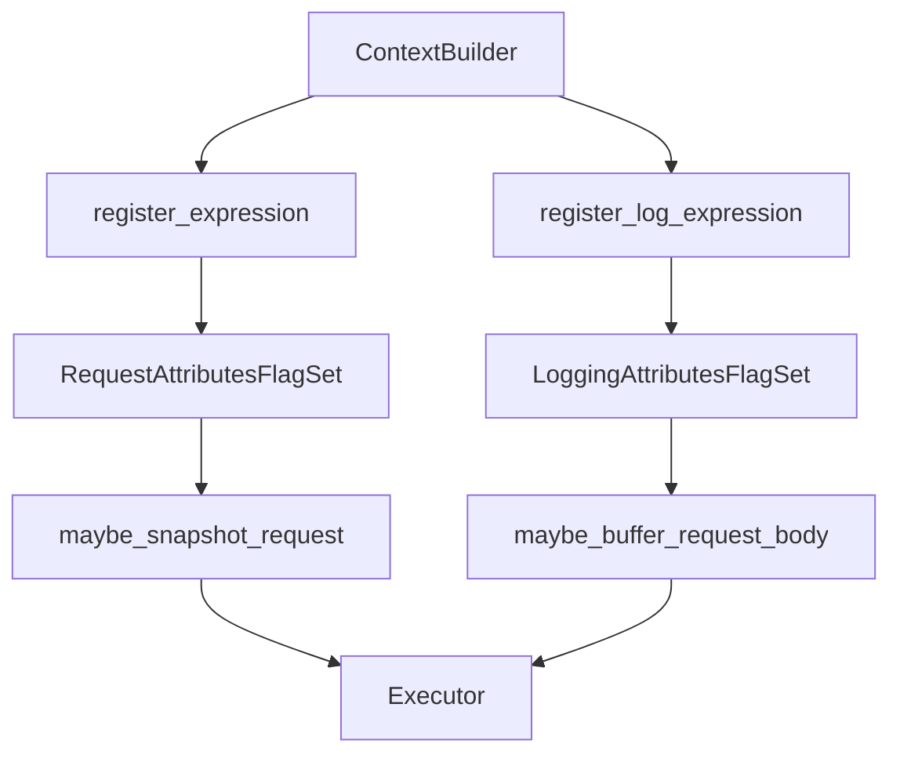
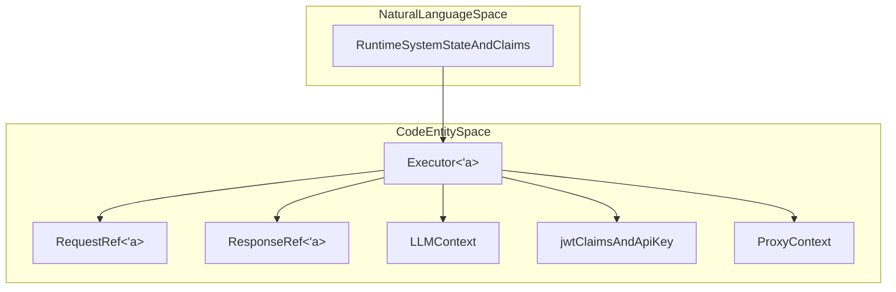
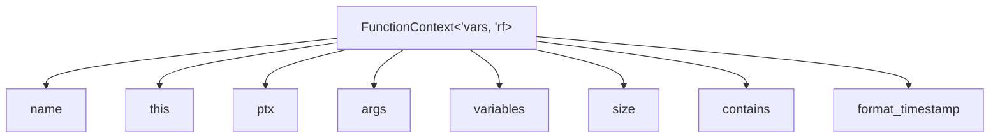

<!-- source: DeepWiki mcp.deepwiki.com · repo agentgateway/agentgateway · page 4.2 CEL Expression Engine · fetched 2026-10-21 -->

# CEL Expression Engine

Relevant source files

The following files were used as context for generating this wiki page:

- [crates/agentgateway/src/cel/helpers.rs](crates/agentgateway/src/cel/helpers.rs)
- [crates/agentgateway/src/cel/mod.rs](crates/agentgateway/src/cel/mod.rs)
- [crates/agentgateway/src/cel/tests.rs](crates/agentgateway/src/cel/tests.rs)
- [crates/agentgateway/src/cel/types.rs](crates/agentgateway/src/cel/types.rs)
- [crates/agentgateway/src/cel/types_test.rs](crates/agentgateway/src/cel/types_test.rs)
- [crates/agentgateway/src/http/transformation_cel.rs](crates/agentgateway/src/http/transformation_cel.rs)
- [crates/agentgateway/src/http/transformation_cel_tests.rs](crates/agentgateway/src/http/transformation_cel_tests.rs)
- [crates/cel-fork/cel/src/context.rs](crates/cel-fork/cel/src/context.rs)
- [crates/cel-fork/cel/src/duration.rs](crates/cel-fork/cel/src/duration.rs)
- [crates/cel-fork/cel/src/functions.rs](crates/cel-fork/cel/src/functions.rs)
- [crates/cel-fork/cel/src/json.rs](crates/cel-fork/cel/src/json.rs)
- [crates/cel-fork/cel/src/lib.rs](crates/cel-fork/cel/src/lib.rs)
- [crates/cel-fork/cel/src/objects.rs](crates/cel-fork/cel/src/objects.rs)
- [crates/cel-fork/cel/src/optimize.rs](crates/cel-fork/cel/src/optimize.rs)
- [crates/cel-fork/cel/src/parser/mod.rs](crates/cel-fork/cel/src/parser/mod.rs)
- [crates/cel-fork/cel/src/parser/references.rs](crates/cel-fork/cel/src/parser/references.rs)
- [crates/cel-fork/cel/src/test.rs](crates/cel-fork/cel/src/test.rs)
- [crates/cel-fork/cel/src/types/dynamic.rs](crates/cel-fork/cel/src/types/dynamic.rs)
- [schema/README.md](schema/README.md)
- [schema/cel.json](schema/cel.json)
- [schema/cel.md](schema/cel.md)

## Purpose and Scope

This page gives an in-depth technical overview of the CEL (Common Expression Language) expression engine integration within Agentgateway. CEL enables dynamic runtime evaluation of user-defined expressions for declarative policy decisions, request/response transformation, authorization, telemetry, and more.

At its core, the `cel-fork` crate provides expression parsing, compilation, optimized AST representations, execution context modeling, and built-in function implementations. Agentgateway builds atop this foundation by layering request-specific context builders, attribute reference analysis, and an execution environment tightly coupled with request state and metadata [crates/cel-fork/cel/src/lib.rs:1-45](), [crates/agentgateway/src/cel/mod.rs:40-141]().

---

## Overview

Agentgateway leverages CEL to evaluate expressions dynamically against runtime contexts including HTTP requests, JWT claims, AI/LLM metadata, backend states, and transformation artifacts.

Key features of this integration include:

- Expressions compiled once on configuration load into executable `Program` form in `cel-fork`.
- A typed symbol table and variable resolver exposes request and policy attributes.
- Attribute analysis tracks expression references to optimize buffering of expensive data (like request/response bodies).
- Lazy buffering and conditional context enrichment minimize runtime overhead.
- Execution returns dynamically typed `Value` enums representing all CEL data kinds.

CEL expressions pervade Agentgateway for authorization policy checks, HTTP request/response transformations, logging/tracing attribute evaluation, rate limit predicates, and AI prompt guard conditions [crates/agentgateway/src/cel/mod.rs:109-141](), [crates/agentgateway/src/http/transformation_cel.rs:36-78]().

Sources: [crates/cel-fork/cel/src/lib.rs:1-45](), [schema/cel.md:1-74](), [crates/agentgateway/src/cel/types.rs:39-81]()

---

## Expression Compilation, Storage, and Attribute Analysis

### Expression Object and Requested Attributes

Each CEL expression loaded by Agentgateway is represented by an `Expression` struct containing:

- The parsed and compiled `Program` object, which embodies the optimized AST and executable bytecode [crates/cel-fork/cel/src/lib.rs:15-45]().
- The original string representation (`original_expression`) for diagnostics [crates/agentgateway/src/cel/mod.rs:40-44]().
- A `FlagSet<Attributes>` collection marking which request/response sub-fields the expression reads, such as `Request`, `RequestBody`, `Response`, `Llm`, `Jwt`, etc [crates/agentgateway/src/cel/mod.rs:109-141]().

This attribute metadata guides runtime resource management, ensuring expensive fields (such as bodies) are only buffered when an expression references them.

**Diagram: Natural Language to Code Space — Expression Compilation and Attributes**  

Sources: [crates/agentgateway/src/cel/mod.rs:40-141](), [crates/agentgateway/src/cel/tests.rs:10-26]()

---

### ContextBuilder and Lazy Buffering Logic

`ContextBuilder` aggregates attribute flags from all expressions registered on a given subsystem or pipeline stage. It exposes:

- `register_expression()` for policy or transformation CEL expressions [crates/agentgateway/src/cel/mod.rs:167-170]().
- `register_log_expression()` for expressions used in telemetry/logging [crates/agentgateway/src/cel/mod.rs:178-180]().

The combined attribute flags inform buffering logic, controlling whether request headers, bodies, response attributes, LLM contexts, or JWT claims are materialized [crates/agentgateway/src/cel/mod.rs:205-232]().

**Diagram: ContextBuilder Attribute Aggregation to Buffering Decisions**  

Sources: [crates/agentgateway/src/cel/mod.rs:143-232](), [crates/agentgateway/src/cel/tests.rs:133-224]()

---

## Execution Context and Executor

### Executor Data Flow and Variable Resolution

At runtime, an `Executor<'a>` instance encapsulates all necessary request state and metadata to evaluate CEL expressions efficiently:

- Holds references to `request` (`RequestRef<'a>`) and `response` (`ResponseRef<'a>`) [crates/agentgateway/src/cel/types.rs:41-45]().
- Manages AI model context (`LLMContext`) and LLM request payloads [crates/agentgateway/src/cel/types.rs:62-65]().
- Maintains transformation metadata and extension states (`extauthz`, `extproc`, `metadata`) [crates/agentgateway/src/cel/types.rs:71-80]().
- Holds authentication claims (`jwt`, `api_key`, `basic_auth`) and proxy environment (`ProxyContext`) [crates/agentgateway/src/cel/types.rs:46-60]().

This structure maps runtime entities to code entities during CEL evaluation.

**Diagram: Natural Language to Code Space — Executor Runtime State Mapping**  

Sources: [crates/agentgateway/src/cel/types.rs:39-81](), [crates/agentgateway/src/cel/mod.rs:85-103]()

---

### CEL Value Representation

The `Value<'a>` enum in `cel-fork` represents all CEL runtime data types with variants such as:

- `List(ListValue<'a>)` and `Map(MapValue<'a>)` [crates/cel-fork/cel/src/objects.rs:44-45]()
- Primitive atoms: `Int(i64)`, `UInt(u64)`, `Float(f64)`, `Bool(bool)` [crates/cel-fork/cel/src/objects.rs:48-51]()
- Temporal types: `Duration`, `Timestamp` [crates/cel-fork/cel/src/objects.rs:53-54]()
- `StringValue<'a>` and `BytesValue<'a>` [crates/cel-fork/cel/src/objects.rs:60-61]()
- `Null` and `Type` [crates/cel-fork/cel/src/objects.rs:63-64]()

It supports serialization, materialization, and conversion to native Rust types [crates/cel-fork/cel/src/objects.rs:67-111]().

Sources: [crates/cel-fork/cel/src/objects.rs:43-111](), [crates/cel-fork/cel/src/objects.rs:157-206]()

---

## Function Context and Custom Functions

### FunctionContext Structure and Built-in Functions

The `FunctionContext<'vars, 'rf>` struct models the function call environment in CEL:

- Holds the function `name` and optional target `this` [crates/cel-fork/cel/src/functions.rs:41-43]()
- Reference to program `Context` (`ptx`) and argument slice (`args`) [crates/cel-fork/cel/src/functions.rs:44-45]()
- Variable resolver trait object (`variables`) [crates/cel-fork/cel/src/functions.rs:47]()

Built-in functions like `size()`, `contains()`, and `format_timestamp()` operate through this interface [crates/cel-fork/cel/src/functions.rs:15-229]().

**Diagram: FunctionContext Internal Structure**  

Sources: [crates/cel-fork/cel/src/functions.rs:35-187]()

---

### Custom Function and Helper Registration

Agentgateway registers custom CEL helper expressions and functions during configuration parsing via `register_custom_functions()` [crates/agentgateway/src/cel/mod.rs:105-107](). Standard extensions like `agent_celx` are inserted into the root execution context [crates/agentgateway/src/cel/mod.rs:92-103]().

Sources: [crates/agentgateway/src/cel/mod.rs:92-107](), [crates/agentgateway/src/cel/tests.rs:29-84]()

---

## Integration Points in Agentgateway Pipeline

CEL expressions are integrated throughout request processing:

- **HTTP Transformations:** Rewriting headers and bodies using `Transformation` and `TransformerConfig` [crates/agentgateway/src/http/transformation_cel.rs:36-78]().
- **Telemetry and Tracing:** Evaluating attributes for request logging and span filtering [crates/agentgateway/src/cel/mod.rs:171-180]().
- **Policy Evaluation:** Enforcing authorization rules, rate limiting, and AI guard conditions.

Sources: [crates/agentgateway/src/http/transformation_cel.rs:36-78](), [crates/agentgateway/src/cel/tests.rs:133-167]()

---

# Summary

The CEL Expression Engine in Agentgateway integrates `cel-fork` with request-specific context builders, attribute reference analysis, and execution environments to support dynamic runtime policies and transformations.

---

# References

- [crates/cel-fork/cel/src/lib.rs:1-45]()
- [crates/cel-fork/cel/src/objects.rs:43-111]()
- [crates/cel-fork/cel/src/functions.rs:35-187]()
- [crates/cel-fork/cel/src/optimize.rs:1-184]()
- [crates/agentgateway/src/cel/mod.rs:40-232]()
- [crates/agentgateway/src/cel/types.rs:39-81]()
- [crates/agentgateway/src/http/transformation_cel.rs:36-78]()
- [crates/agentgateway/src/cel/tests.rs:10-84]()
- [schema/cel.md:1-74]()

---

