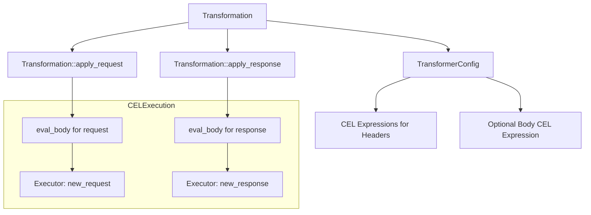
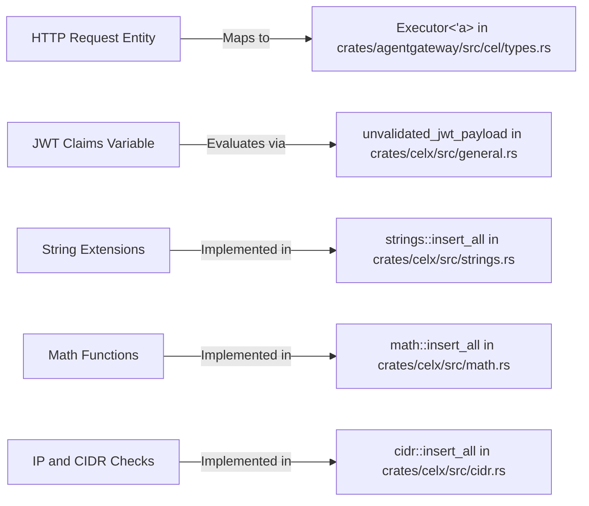
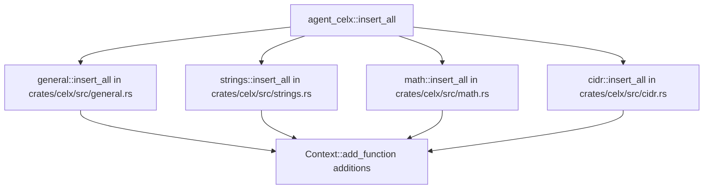

<!-- source: DeepWiki mcp.deepwiki.com · repo agentgateway/agentgateway · page 4.3 CEL Context and Functions · fetched 2026-10-21 -->

# CEL Context and Functions

<details>
<summary>Relevant source files</summary>

The following files were used as context for generating this wiki page:

- [architecture/cel.md](architecture/cel.md)
- [crates/celx/Cargo.toml](crates/celx/Cargo.toml)
- [crates/celx/src/cidr.rs](crates/celx/src/cidr.rs)
- [crates/celx/src/function_tests.rs](crates/celx/src/function_tests.rs)
- [crates/celx/src/general.rs](crates/celx/src/general.rs)
- [crates/celx/src/lib.rs](crates/celx/src/lib.rs)
- [crates/celx/src/math.rs](crates/celx/src/math.rs)
- [crates/celx/src/strings.rs](crates/celx/src/strings.rs)
- [schema/cel-functions.md](schema/cel-functions.md)

</details>


## Purpose and Scope

This page documents the Common Expression Language (CEL) evaluation contexts and custom functions implemented within Agentgateway. CEL is leveraged extensively in the policy system for dynamic evaluation across authorization, rate limiting, request/response transformations, and logging.

The focus here is on the construction and composition of the CEL evaluation environment within the Rust `agentgateway` and `celx` crates. It describes how context variables expose HTTP and Agentic AI request/response data, outlines the design for attribute-driven buffering and evaluation optimization, and details the custom CEL functions provided by the `celx` crate (`agent_celx`).

Sources: [crates/agentgateway/src/cel/types.rs:39-81](), [crates/celx/src/general.rs:20-52](), [crates/celx/src/lib.rs:19-34]()

---

## CEL Evaluation Context Overview

Agentgateway executes CEL expressions inside a strongly typed, structured context represented by the `Executor<'a>` struct. This struct contains references and extension data covering all relevant aspects of a request or response, including HTTP attributes, authentication claims, LLM/AI metadata, and proxy lifecycle information.

Title: Executor Context Architecture

```mermaid
graph TB
    Executor["Executor<'a>"]:::code
    
    subgraph RequestResponse["Request/Response Entities"]
        Req["request: Option<RequestRef<'a>>"]
        Resp["response: Option<ResponseRef<'a>>"]
    end
    
    subgraph AuthClaims["Authentication Entities"]
        JWT["jwt: ExtensionOrDirect<jwt::Claims>"]
        APIKey["apiKey: ExtensionOrDirect<apikey::Claims>"]
        BasicAuth["basicAuth: ExtensionOrDirect<basicauth::Claims>"]
    end
    
    subgraph AI_MCP["AI / Model Context Protocol"]
        LLM["llm: ExtensionOrDirect<LLMContext>"]
        LLMReq["llmRequest: Option<&'a serde_json::Value>"]
        MCP["mcp: Option<&'a MCPInfo>"]
    end
    
    subgraph NetworkMeta["Connectivity and Proxy Metadata"]
        Source["source: ExtensionOrDirect<SourceContext>"]
        Destination["destination: ExtensionOrDirect<DestinationContext>"]
        Backend["backend: ExtensionOrDirect<BackendContext>"]
        Proxy["proxy: ExtensionOrDirect<ProxyContext>"]
    end
    
    subgraph DynamicMeta["Dynamic Metadata Extensions"]
        ExtAuthz["extauthz: ExtensionOrDirect<ExtAuthzDynamicMetadata>"]
        ExtProc["extproc: ExtensionOrDirect<ExtProcDynamicMetadata>"]
        McpGuard["mcpGuardrails: ExtensionOrDirect<McpGuardrailsDynamicMetadata>"]
        Transformation["metadata: ExtensionOrDirect<TransformationMetadata>"]
    end
    
    Env["env: EnvContext"]

    Executor --> Req
    Executor --> Resp
    Executor --> JWT
    Executor --> APIKey
    Executor --> BasicAuth
    Executor --> LLM
    Executor --> LLMReq
    Executor --> MCP
    Executor --> Source
    Executor --> Destination
    Executor --> Backend
    Executor --> Proxy
    Executor --> ExtAuthz
    Executor --> ExtProc
    Executor --> McpGuard
    Executor --> Transformation
    Executor --> Env
    
    classDef code fill:none,stroke:#000,stroke-width:1px,font-family:monospace;
```


Each field of the `Executor` struct provides a context variable accessible within CEL expressions:

- **`request` and `response`**: Provide HTTP request and response data including methods, URIs, headers, bodies, start/end times, version, etc.
- **Authentication claims**: `jwt`, `apiKey`, and `basicAuth` expose parsed claims from JWT tokens, API keys, and Basic Authentication respectively.
- **AI / Protocol context**: `llm` and `llmRequest` hold LLM backend metadata and raw JSON request payload, while `mcp` covers Model Context Protocol session info.
- **Network and proxy lifecycle**: `source`, `destination`, `backend`, and `proxy` provide contextual data about the network path and proxy processing stages.
- **Dynamic metadata**: `extauthz`, `extproc`, `mcpGuardrails`, and `metadata` provide extensibility for external authorization, external processing, guardrails evaluation, and transformation metadata.
- **`env`**: Selected environment variables exposed securely to CEL.

Sources: [crates/agentgateway/src/cel/types.rs:39-81](), [schema/cel.json:1-206](), [schema/cel.md:1-74]()

---

## Detailed Request and Response Context Variables

The `request` and `response` context variables offer a rich HTTP data model. Their JSON schema representation (`schema/cel.json` and documented in `schema/cel.md`) provides detailed validation and structure.

| Variable                | Type           | Description                                                                                   |
|-------------------------|----------------|-----------------------------------------------------------------------------------------------|
| `request.method`        | string         | HTTP request method (e.g., `"GET"`, `"POST"`)                                                |
| `request.uri`           | string         | Full request URI (e.g., `"http://example.com/path"`)                                         |
| `request.host`          | string/null    | Host header or explicit hostname                                                             |
| `request.scheme`        | string/null    | URI scheme such as `"http"` or `"https"`                                                     |
| `request.path`          | string         | Path component of URI (e.g., `"/api/v1"`)                                                    |
| `request.pathAndQuery`  | string         | Full path plus query string (e.g., `"/api/v1?q=1"`)                                          |
| `request.version`       | string         | HTTP version string (e.g., `"HTTP/1.1"`)                                                     |
| `request.headers`       | map<string, string> | Request HTTP headers                                                                       |
| `request.body`          | string/null    | Complete buffered request body, if enabled and buffered                                    |
| `request.bodyPrefix`    | string/null    | A prefix (partial buffer) of the body up to buffer size                                     |
| `request.startTime`     | timestamp      | Timestamp when request started                                                              |
| `request.endTime`       | timestamp      | Timestamp when request completed                                                            |
| `response.code`         | int            | HTTP response status code                                                                    |
| `response.grpcStatus`   | int or null    | gRPC status code if applicable                                                              |
| `response.headers`      | map<string, string> | Response HTTP headers                                                                     |
| `response.body`         | string/null    | Complete buffered response body                                                             |
| `response.bodyPrefix`   | string/null    | Prefix of response body for partial buffering                                               |

Accessing `.body` fields instructs the system to buffer the full body if not already buffered, which may impact performance and resource usage. The system uses attribute flags to manage this dynamically.

Sources: [schema/cel.json:7-143](), [schema/cel.md:4-38](), [crates/agentgateway/src/cel/types.rs:39-81]()

---

## Authentication and AI/Protocol Context Variables

| Category             | Variable         | Description                                                   |
|----------------------|------------------|---------------------------------------------------------------|
| JWT Claims           | `jwt`            | Verified JWT token claims, with raw redacted access            |
| API Key Claims       | `apiKey`         | Claims and metadata decoded from API keys                       |
| Basic Auth           | `basicAuth`      | Credentials/claims from Basic Authentication tokens            |
| AI/LLM Context       | `llm`            | LLM request/response metadata: provider, model, token counts   |
| LLM Raw Request      | `llmRequest`     | Raw JSON serde value of the LLM API request                     |
| MCP Protocol Info    | `mcp`            | Model Context Protocol interaction data                         |

These context variables enable policies and CEL expressions to dynamically adapt behavior based on authentication status or AI model backend details.

Sources: [crates/agentgateway/src/cel/types.rs:39-81](), [schema/cel.md:42-88]()

---

## Specialized Header Accessors in CEL Types

Headers in the context are modeled as maps from string names to *lists* of values to handle multi-valued headers properly. As CEL map access returns lists for headers, Agentgateway extends CEL with specialized accessor functions on header maps (`HeaderMapRef`) for expressive and secure header manipulation:

| Function            | Description                                                                    |
|---------------------|--------------------------------------------------------------------------------|
| `.redacted()`       | Returns header values with sensitive values (e.g., Authorization) replaced by `"<redacted>"`. Useful for safe logging and policy evaluation. |
| `.join()`           | Joins list of header values into a single comma-separated string.               |
| `.raw()`            | Returns the underlying list of string header values.                           |
| `.split()`          | Splits comma-delimited string header values into flat lists.                   |

Sources: [crates/agentgateway/src/cel/types.rs:900-1000](), [crates/agentgateway/src/cel/tests.rs:230-243]()

---

## Controlled Data Capture and Attributes Flagset

To optimize performance, Agentgateway uses a bitflag `Attributes` set and a `ContextBuilder` struct to determine at compile time what CEL attributes are actually required by each expression.

Title: Context Builder Attribute Flow
```graph
graph LR
    ExpressionCompile["Expression::new_strict"] -->|uses| AttributesFlagset["Attributes FlagSet"]
    
    AttributesFlagset --> ContextBuilder["ContextBuilder"]
    ContextBuilder -->|controls| RuntimeBuffers["Buffers request/response body only if needed"]
    
    subgraph Runtime
        RuntimeBuffers --> RequestBodyBuffer["Buffer request body if Attributes::RequestBody set"]
        RuntimeBuffers --> ResponseBodyBuffer["Buffer response body if Attributes::ResponseBody set"]
    end
```

- At expression parse time, attributes like `Request`, `RequestBody`, `Response`, and `ResponseBody` are set in the flagset.
- `ContextBuilder` accumulates these flags across all expressions used in a config.
- At runtime, the proxy decides whether to buffer request or response bodies lazily or eagerly based on these flags to avoid unnecessary buffering overhead.

Sources: [crates/agentgateway/src/cel/mod.rs:109-141](), [crates/agentgateway/src/cel/mod.rs:144-180]()

---

## Custom CEL Functions and the `celx` Crate

Agentgateway extends CEL capabilities by registering a comprehensive set of custom functions via the `celx` crate entrypoint `agent_celx::insert_all` [crates/celx/src/lib.rs:19-34](). This registration delegates to specialized sub-modules:

- **General / General-Purpose Functions**: Registered via `general::insert_all` [crates/celx/src/general.rs:20-52](). Includes `json`, `jsonField`, `unvalidatedJwtPayload`, `to_json`, `with`, `mapValues`, `filterKeys`, `merge`, `variables`, `random`, `default`, `coalesce`, `regexReplace`, `fail`, `uuid`, and various base64, url, form, and hash encodings.
- **String Extensions**: Registered via `strings::insert_all` [crates/celx/src/strings.rs:9-22](). Includes `charAt`, `indexOf`, `lastIndexOf`, `join`, `lowerAscii`, `stripPrefix`, `stripSuffix`, `upperAscii`, `trim`, `replace`, `split`, and `substring`.
- **Math Extensions**: Registered via `math::insert_all` [crates/celx/src/math.rs:9-28](). Includes `math.least`, `math.greatest`, ceil, floor, round, trunc, absolute values, sign, square root, and bitwise operations.
- **CIDR and IP Extensions**: Registered via `cidr::insert_all` [crates/celx/src/cidr.rs:12-16](). Includes `cidr`, `ip`, and `isIP` for network boundary and subnet checks.

Sources: [crates/celx/src/lib.rs:19-34](), [crates/celx/src/general.rs:20-52](), [crates/celx/src/strings.rs:9-22](), [crates/celx/src/math.rs:9-28](), [crates/celx/src/cidr.rs:12-16]()

---

## CEL Transformation Support

Agentgateway offers CEL-based HTTP request and response transformations exposed by the `Transformation` type, allowing modification of headers and bodies dynamically.

Title: Transformation Flow


Sources: [crates/agentgateway/src/http/transformation_cel.rs:15-120]()

---

## Serialization and Schemas

Agentgateway supports serialization of CEL context and expressions:
- `ExecutorSerde` provides fully serializable/deserializable evaluation contexts.
- The `Expression` type wraps CEL's compiled `Program` with original source text.
- The JSON schema (`schema/cel.json`) defines the full context structure for tooling and validation.

Sources: [schema/cel.json:1-100](), [crates/agentgateway/src/cel/mod.rs:40-64]()

---

## Natural Language to Code Entity Space Mappings

Title: Policy and Request Concepts Mapped to Code Entities


Title: Custom Function Registration Flow to Code Entities


Sources: [crates/celx/src/lib.rs:19-34](), [crates/celx/src/general.rs:20-52](), [crates/celx/src/strings.rs:9-22](), [crates/celx/src/math.rs:9-28](), [crates/celx/src/cidr.rs:12-16]()

---

