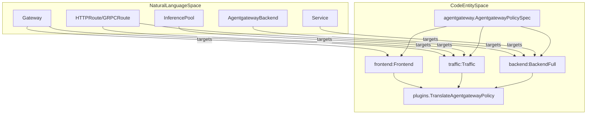
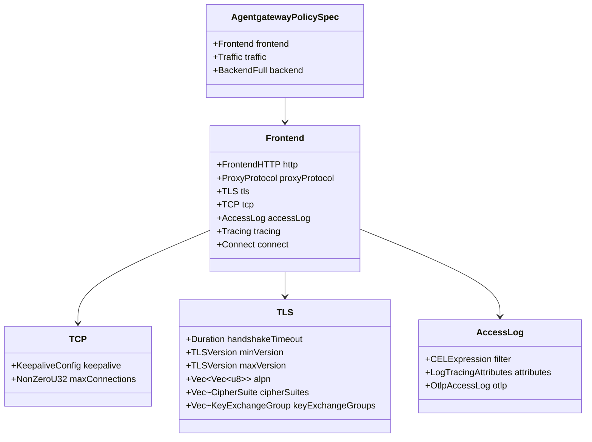
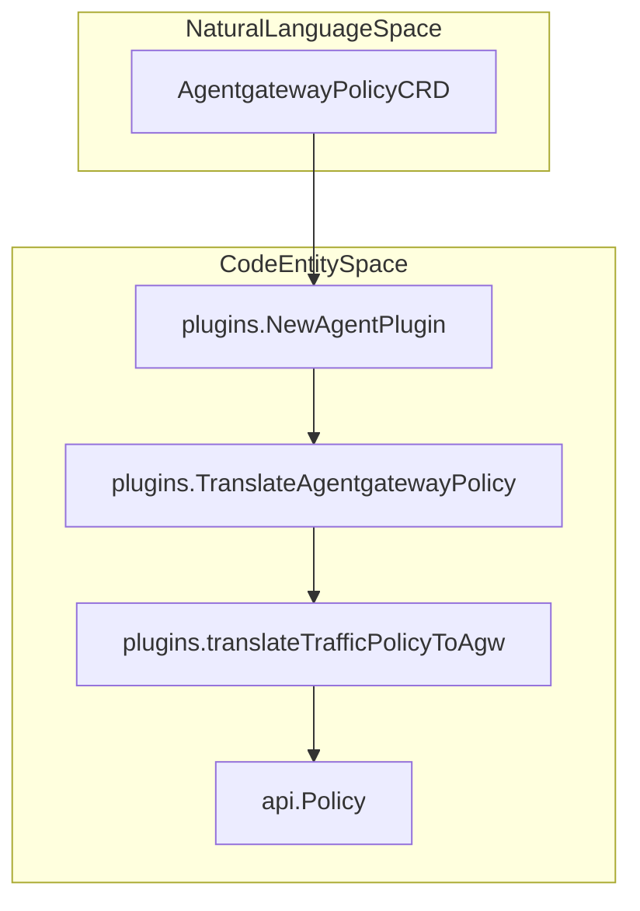
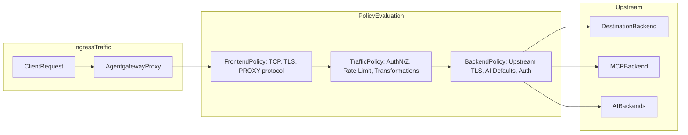

<!-- source: DeepWiki mcp.deepwiki.com · repo agentgateway/agentgateway · page 4.4 Policy Types Reference · fetched 2026-10-21 -->

# Policy Types Reference

<details>
<summary>Relevant source files</summary>

The following files were used as context for generating this wiki page:

- [controller/api/tests/testdata/agentgateway_policy_invalid.yaml](controller/api/tests/testdata/agentgateway_policy_invalid.yaml)
- [controller/api/tests/testdata/agentgateway_policy_valid.yaml](controller/api/tests/testdata/agentgateway_policy_valid.yaml)
- [controller/pkg/agentgateway/plugins/backend_tls_policy_test.go](controller/pkg/agentgateway/plugins/backend_tls_policy_test.go)
- [controller/pkg/agentgateway/plugins/registry.go](controller/pkg/agentgateway/plugins/registry.go)
- [controller/pkg/agentgateway/plugins/registry_test.go](controller/pkg/agentgateway/plugins/registry_test.go)
- [controller/pkg/agentgateway/plugins/testdata/trafficpolicy/gateway-class-missing-not-attached.yaml](controller/pkg/agentgateway/plugins/testdata/trafficpolicy/gateway-class-missing-not-attached.yaml)
- [controller/pkg/agentgateway/plugins/testdata/trafficpolicy/gateway-class-other-controller-not-attached.yaml](controller/pkg/agentgateway/plugins/testdata/trafficpolicy/gateway-class-other-controller-not-attached.yaml)
- [controller/pkg/agentgateway/remotehttp/secret_ca_test.go](controller/pkg/agentgateway/remotehttp/secret_ca_test.go)
- [controller/pkg/syncer/krtxds/xds_test.go](controller/pkg/syncer/krtxds/xds_test.go)
- [controller/test/e2e/transformation_test.go](controller/test/e2e/transformation_test.go)

</details>


## Purpose and Scope

This document provides a complete technical reference of all policy types available in Agentgateway, including their configuration options, attachment points, and runtime behaviors. Policies dictate how traffic flows through the data plane across three distinct operational tiers: **Frontend** (connection handling and TLS), **Traffic** (HTTP request/response processing, routing-phase filters), and **Backend** (upstream connection parameters, AI/GenAI specifications, and upstream authentication).

For details on the hierarchical policy merge model and precedence rules, see [Policy Architecture and Application](./4.1). For details on the Common Expression Language (CEL) evaluation engine and context attributes used within policies, see [CEL Context and Functions](./4.3).

---

## Policy Attachment Levels

Agentgateway policies attach to resources across three hierarchical tiers, each operating at a specific phase of request processing. More specific scopes override broader ones [controller/install/helm/agentgateway-crds/templates/agentgateway.dev_agentgatewaypolicies.yaml:75-80]().

### Code Entity Association: Resource to Policy Mapping

This diagram maps natural language resource concepts to their exact code entities for policies:



**Sources:**  
[controller/api/v1alpha1/agentgateway/agentgateway_policy_types.go:29-73](),  
[controller/api/v1alpha1/agentgateway/agentgateway_policy_types.go:61-68](),  
[controller/api/v1alpha1/agentgateway/agentgateway_policy_types.go:71-115](),  
[controller/pkg/agentgateway/plugins/traffic_plugin.go:102-109]()

### Policy Levels and Phases

| Level       | Target Resource Types                                                                      | Processing Phase        | Configuration Root                                                  |
|-------------|-------------------------------------------------------------------------------------------|-------------------------|--------------------------------------------------------------------|
| **Frontend**| `Gateway`                                                                                  | Connection / TLS Handshake| `spec.frontend` [controller/api/v1alpha1/agentgateway/agentgateway_policy_types.go:55]() |
| **Traffic** | `Gateway`, `ListenerSet`, `HTTPRoute`, `GRPCRoute`, `InferencePool`                       | PreRouting / PostRouting | `spec.traffic` [controller/api/v1alpha1/agentgateway/agentgateway_policy_types.go:55]()   |
| **Backend** | `Gateway`, `Route`, `AgentgatewayBackend`, `Service`                                   | Upstream Connection      | `spec.backend` [controller/install/helm/agentgateway-crds/templates/agentgateway.dev_agentgatewaypolicies.yaml:61-80]() |

**Sources:**  
[controller/api/v1alpha1/agentgateway/agentgateway_policy_types.go:55-71](),  
[controller/install/helm/agentgateway-crds/templates/agentgateway.dev_agentgatewaypolicies.yaml:61-80]()

---

## Frontend Policies

Frontend policies govern connection acceptance, network-layer settings, TLS termination parameters, and connection-level telemetry. These policies attach exclusively to `Gateway` resources, configuring aspects such as PROXY protocol, TLS handshakes, connection timeouts, and observability.

### Frontend Configuration Schema



**Sources:**  
[controller/api/v1alpha1/agentgateway/agentgateway_policy_types.go:61-62](),  
[controller/pkg/agentgateway/plugins/frontend_policies.go:14-87](),  
[controller/api/v1alpha1/agentgateway/agentgateway_policy_types.go:64-65]()

### Key Frontend Features

- **HTTP Settings:** Configuration of buffer sizes, HTTP/1 header limits, idle timeouts, and HTTP/2 window sizes to optimize connection performance and stability.
- **TLS Configuration:** Controls handshake timeout, TLS minimum and maximum versions, cipher suites, ALPN protocols (`h2`, `http/1.1`, etc.), and key exchange groups. It also integrates with SPIFFE and local CA caches for mTLS.
- **PROXY Protocol:** Enables parsing of PROXY protocol versions 1 or 2 on accepts to extract original client connection metadata.
- **Access Logs:** Filters and enriches logs with CEL expressions and exports access logs and tracing attributes over OTLP.
- **Tracing:** Configures tracing policies for connection-level telemetry.

**Sources:**  
[controller/api/v1alpha1/agentgateway/agentgateway_policy_types.go:61-62](),  
[controller/pkg/agentgateway/plugins/frontend_policies.go:14-87]()

---

## Traffic Policies

Traffic policies manipulate the HTTP request and response execution path. They execute during either the `PreRouting` phase (at the Gateway or `ListenerSet` level) or `PostRouting` phase (at the route level). These policies are crucial for runtime filtering, authorization, transformations, and traffic shaping.

### Code Entity Association: Translation Pipeline for Traffic Policies



**Sources:**  
[controller/pkg/agentgateway/plugins/registry.go:12-16](),  
[controller/pkg/agentgateway/plugins/traffic_plugin.go:45-66]()

### Key Traffic Policy Types and Their Code Identifiers

| Policy Type           | Description                                                           | Code Identifier Suffix                  |
|-----------------------|-----------------------------------------------------------------------|----------------------------------------|
| **JWTAuthentication**  | Validates JWT tokens against JWKS endpoints for authentication [controller/pkg/agentgateway/plugins/traffic_plugin.go:61]() | `:jwt`                                |
| **ExtAuthz**           | Delegates authorization to external gRPC or HTTP authorization services [controller/pkg/agentgateway/plugins/traffic_plugin.go:47]() | `:extauth`                           |
| **RateLimit**          | Local and distributed rate limiting using CEL evaluated descriptors [controller/pkg/agentgateway/plugins/traffic_plugin.go:50-51]() | `:rl-local`, `:rl-global`             |
| **Transformation**     | Applies headers, query parameter, and body mutations via CEL [controller/pkg/agentgateway/plugins/traffic_plugin.go:52]() | `:transformation`                      |
| **CORS**               | Handles CORS preflight and headers for cross-origin requests [controller/pkg/agentgateway/plugins/traffic_plugin.go:54]() | `:cors`                              |
| **Header Modifier**    | Static manipulations on HTTP headers for request or response [controller/pkg/agentgateway/plugins/traffic_plugin.go:55-56]() | `:header-modifier`                     |
| **BasicAuth**          | Validates HTTP Basic auth credentials                               | `:basicauth`                           |
| **APIKeyAuth**         | Extracts and validates API keys from headers, cookies, or queries    | `:apikeyauth`                         |
| **DirectResponse**     | Short-circuits processing by sending a static response               | `:direct-response`                    |

**Sources:**  
[controller/pkg/agentgateway/plugins/traffic_plugin.go:45-66](),  
[controller/pkg/agentgateway/plugins/traffic_plugin.go:178-213]()

---

## Backend Policies

Backend policies govern upstream communication parameters such as connection security, authentication, AI backend specifics, and MCP (Model Context Protocol) integration. They apply primarily at the route destination level, including `Backend`, `Service`, or `AgentgatewayBackend` resources [controller/pkg/agentgateway/plugins/backend_tls_policy_test.go:152-155]().

### AI Backend Policies (`spec.backend.ai`)

- **Defaults Injection:** Specifies default values to be merged with user-provided JSON request fields targeting LLM providers. User values take precedence unless overridden explicitly [controller/install/helm/agentgateway-crds/templates/agentgateway.dev_agentgatewaypolicies.yaml:87-126]().
- **Final Transformations:** Post-conversion CEL expressions that overwrite or compute provider-specific request fields. These transformations run after mapping to provider formats [controller/install/helm/agentgateway-crds/templates/agentgateway.dev_agentgatewaypolicies.yaml:127-142]().
- **Model Aliases:** Define logical names for upstream LLM endpoints allowing flexible failover and routing strategies.

**Sources:**  
[controller/install/helm/agentgateway-crds/templates/agentgateway.dev_agentgatewaypolicies.yaml:87-142]()

### Backend Authentication and Security

- **AWS SigV4 Signing (`backend.auth.aws`):** Signs upstream requests for AWS backends such as Bedrock or SageMaker using SigV4 with context-aware session tags via CEL [controller/pkg/agentgateway/plugins/backend_policies.go:42-56](). 
- **API Key Injection:** Supports static tokens or Kubernetes SecretRefs to inject API keys or tokens into upstream requests transparently [controller/api/tests/testdata/agentgateway_policy_valid.yaml:199-222]().
- **Backend TLS & mTLS (`backend.tls`):** Manages client certificate sources (Secrets, SPIFFE), verification policies, hostname overrides, and allows disabling hostname verification for downstream backends [controller/pkg/agentgateway/plugins/backend_tls_policy_test.go:23-173]().
- **MCP Policies (`backend.mcp`):** Configures MCP authentication rules, RBAC enforcement on tools and prompt usage, and guardrails integration for agent security [controller/pkg/agentgateway/plugins/backend_policies.go:184-201]().

**Sources:**  
[controller/pkg/agentgateway/plugins/backend_policies.go:42-201](),  
[controller/api/tests/testdata/agentgateway_policy_valid.yaml:199-222](),  
[controller/pkg/agentgateway/plugins/backend_tls_policy_test.go:23-173]()

### Backend Configuration Hierarchy

Backend policies can be set at multiple scopes, but more specific policies override broader ones without deep merging. The precedence is:

```
Gateway < Route < AgentgatewayBackend < Service
```

**Sources:**  
[controller/install/helm/agentgateway-crds/templates/agentgateway.dev_agentgatewaypolicies.yaml:61-80]()

---

## Policy Merge Semantics and Inheritance

Policies targeting overlapping resource scopes merge according to Agentgateway's hierarchical override rules:

$$
\text{Gateway} < \text{Listener} < \text{Route} < \text{Route Rule} < \text{Backend / Service}
$$

Each effective policy merges fields individually; no deep merging of complex structs occurs.

### Inheritance Modes

Traffic policies support an inheritance strategy (`strategy.inheritance`), only allowed on traffic policies [controller/api/v1alpha1/agentgateway/agentgateway_policy_types.go:56]():

- **DEFAULT (0):** Child scopes merge with and inherit parent policies.
- **OVERRIDE (1):** Child scopes completely replace parent policies, disabling merges from above.

This strategy allows precise control of policy application boundaries and overrides.

**Sources:**  
[controller/api/v1alpha1/agentgateway/agentgateway_policy_types.go:55-58]()

---

## Summary Table of Policy Types and Their Attachment

| Policy Tier | Target Resources                                  | Primary Policy Struct    | Phases Applied          | Notes                                   |
|-------------|-------------------------------------------------|-------------------------|------------------------|-----------------------------------------|
| Frontend    | Gateway                                          | `frontend::Frontend`     | Connection / TLS      | Controls TCP, TLS, PROXY protocol, access log |
| Traffic     | Gateway, ListenerSet, HTTPRoute, GRPCRoute, IP  | `traffic::Traffic`       | PreRouting / PostRouting | Filters, transformations, auth, rate limits |
| Backend     | Gateway, Route, AgentgatewayBackend, Service    | `backend::BackendFull`   | Upstream connection    | AI config, upstream auth, backend TLS  |

**Sources:**  
[controller/api/v1alpha1/agentgateway/agentgateway_policy_types.go:29-73]()

---

## Overall Data Flow with Policies



Each policy tier acts on the traffic at different stages. Frontend policies handle the initial connection setup, Traffic policies execute during HTTP request/response filtering and routing, and Backend policies govern how the proxy connects and authenticates to upstream services.

**Sources:**  
[controller/pkg/agentgateway/plugins/traffic_plugin.go:45-112](),  
[controller/pkg/agentgateway/plugins/backend_policies.go:28-216]()

---

## References

- Agentgateway Kubernetes CRDs and validation rules for policies and backends:  
  - [controller/install/helm/agentgateway-crds/templates/agentgateway.dev_agentgatewaypolicies.yaml]()  
  - [controller/install/helm/agentgateway-crds/templates/agentgateway.dev_agentgatewaybackends.yaml]()
- Go API types for AgentgatewayPolicy and Backend:  
  - [controller/api/v1alpha1/agentgateway/agentgateway_policy_types.go]()  
- Translation plugins for traffic policies:  
  - [controller/pkg/agentgateway/plugins/traffic_plugin.go]()  
- Backend policy translation:  
  - [controller/pkg/agentgateway/plugins/backend_policies.go]()  

**Sources:**  
[controller/api/v1alpha1/agentgateway/agentgateway_policy_types.go:29-73](),  
[controller/install/helm/agentgateway-crds/templates/agentgateway.dev_agentgatewaypolicies.yaml:61-142](),  
[controller/pkg/agentgateway/plugins/traffic_plugin.go:45-112,178-213](),  
[controller/pkg/agentgateway/plugins/backend_policies.go:28-216]()

---

