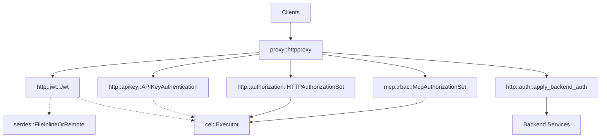
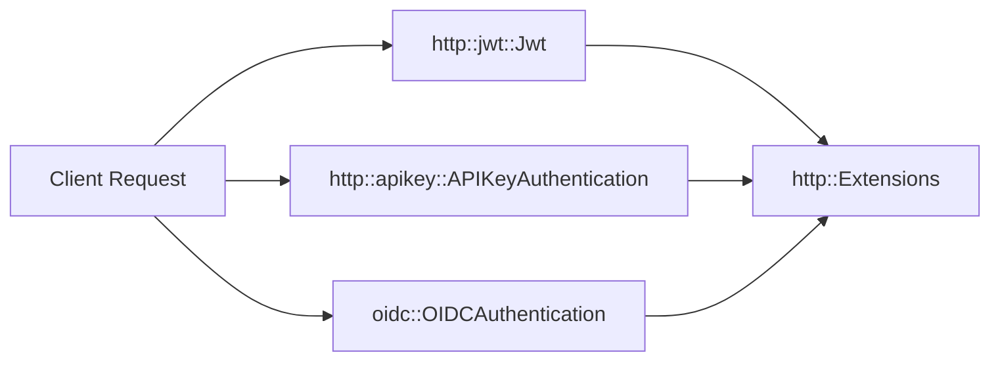
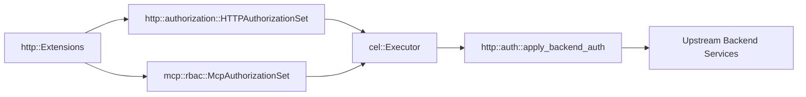

<!-- source: DeepWiki mcp.deepwiki.com · repo agentgateway/agentgateway · page 5 Security and Authentication · fetched 2026-10-21 -->

# Security and Authentication

<details>
<summary>Relevant source files</summary>

The following files were used as context for generating this wiki page:

- [crates/agentgateway/src/http/apikey.rs](crates/agentgateway/src/http/apikey.rs)
- [crates/agentgateway/src/http/apikey_tests.rs](crates/agentgateway/src/http/apikey_tests.rs)
- [crates/agentgateway/src/http/jwt.rs](crates/agentgateway/src/http/jwt.rs)
- [crates/agentgateway/src/http/jwt_tests.rs](crates/agentgateway/src/http/jwt_tests.rs)
- [crates/agentgateway/src/serdes.rs](crates/agentgateway/src/serdes.rs)

</details>


This page provides a high-level overview of authentication, authorization, and security mechanisms employed in Agentgateway. The system implements defense-in-depth across multiple security planes: inbound frontend authentication (validating clients), dynamic authorization policies (controlling access), external authorization delegation, and outbound backend authentication (securing upstream connections).

For detailed configuration and implementation of each mechanism, see the corresponding child pages:
- JWT validation, JWKS URL resolution, and claim extraction: [JWT Authentication](#5.1)
- API key extraction, Basic auth validation, and credential handling: [API Key and Basic Authentication](#5.2)
- Browser-native OIDC flow, PKCE, and session cookie management: [OIDC Browser Authentication](#5.3)
- CEL-based authorization expressions and RBAC: [Authorization Rules](#5.4)
- External authorization service integration (gRPC/HTTP): [External Authorization (ExtAuthz)](#5.5)
- Backend TLS configuration, client certificates, and cloud authentication: [Backend Authentication](#5.6)
- Built-in OAuth token exchange, RFC 8693, and Cross-App Access: [OAuth Token Exchange and Cross-App Access](#5.7)
- Protocol-level TLS, mTLS, and Istio HBONE: [TLS and mTLS Configuration](#11.2)
- MCP-specific authentication and RBAC: [MCP Authentication and Authorization](#9.3)

---

## Security Architecture Overview

Agentgateway orchestrates security checks within the proxy pipeline by extracting credentials, validating tokens or keys, and evaluating authorization policies. These checks populate typed request extensions and CEL evaluation contexts, enabling flexible policy enforcement.

The following diagram maps key system names in natural language to code entities handling security flows:

### Diagram: Security Layer Architecture - Natural Language to Code Entity Mapping



This architecture shows how client requests pass through the HTTP proxy, which handles different authentication mechanisms via dedicated modules (`Jwt`, `APIKeyAuthentication`). The JWT validation module relies on JWKS keys loaded either inline, from files, or remote URLs (`FileInlineOrRemote`) [crates/agentgateway/src/serdes.rs:30-41](). Authenticated credentials feed into HTTP and MCP authorization sets, which use the CEL expression engine for dynamic policy evaluation. Backend authentication is then applied on outbound requests to upstream backends.

Sources:  
[crates/agentgateway/src/http/jwt.rs:71-77]()  
[crates/agentgateway/src/http/apikey.rs:32-47]()  
[crates/agentgateway/src/serdes.rs:30-41]()

### Security Planes Summary

| Security Plane       | Direction | Core Components                                             | Storage Location                        |
|----------------------|-----------|-------------------------------------------------------------|---------------------------------------|
| **Frontend Security** | Inbound   | `Jwt`, `APIKeyAuthentication`, Basic Auth, OIDC            | Populated in request extensions       |
| **Authorization**    | Enforcement | `HTTPAuthorizationSet`, `McpAuthorizationSet`               | Evaluated with `cel::Executor`         |
| **Backend Security** | Outbound  | `BackendAuth`, Cloud Auth (AWS SigV4, GCP, Azure), Token Exchange | Injected into upstream requests       |

Sources:  
[crates/agentgateway/src/http/jwt.rs:71-77]()  
[crates/agentgateway/src/http/apikey.rs:153-164]()

---

## Frontend Security Components

Agentgateway supports multiple authentication mechanisms for client requests, extracting credentials from headers, cookies, query parameters, or other configured locations. Credentials are validated against configured providers or keys, and upon success, structured claims are attached to the request context for downstream policy evaluation.

- **JWT Authentication**: Supports validation against one or many trusted issuers. It performs JWKS key retrieval and caching (supporting inline, file, or remote JWKS sets), token signature validation, issuer and audience checks, and claim enforcement based on configuration [crates/agentgateway/src/http/jwt.rs:134-176]().

- **API Key and Basic Authentication**: API keys employ secure handling including secret redaction and constant-time equality checks to mitigate timing attacks [crates/agentgateway/src/http/apikey.rs:62-67](), [crates/agentgateway/src/http/apikey.rs:91-102](). Extraction is supported from headers, cookies, or query parameters. Basic Authentication is also supported (see child page for details) [crates/agentgateway/src/http/apikey.rs:62-233]().

- **OIDC Browser Authentication**: Provides browser-centric flows including PKCE challenge response and session cookie management to integrate with standard OAuth2/OIDC providers. Details are in the OIDC child page.

These mechanisms enrich the request's extensions with typed claims objects, enabling fine-grained access control rules.

Sources:  
[crates/agentgateway/src/http/jwt.rs:134-176]()  
[crates/agentgateway/src/http/apikey.rs:62-233]()  
[crates/agentgateway/src/serdes.rs:30-41]()

---

## Authorization Rules (RBAC)

Authorization is enforced after successful authentication, using flexible, dynamic rules expressed in CEL (Common Expression Language). Agentgateway supports:

- CEL expressions to specify allow and deny conditions, evaluated on request attributes and authenticated claims.
- Role-Based Access Control (RBAC) policies tailored for both standard HTTP requests and MCP (Model Context Protocol) messages.
- Deny policies that take precedence over allow policies to ensure explicit blocking rules.

The main authorization components are:
- `HTTPAuthorizationSet` for HTTP-layer access control.
- `McpAuthorizationSet` for MCP protocol RBAC enforcement.

See [Authorization Rules](#5.4) for detailed policy syntax and evaluation semantics.

Sources:  
[crates/agentgateway/src/http/jwt.rs:71-77]()  
[crates/agentgateway/src/http/apikey.rs:153-164]()

---

## External Authorization (ExtAuthz)

Agentgateway can delegate authorization decisions to outboard services to integrate with centralized policy systems or enterprise identity providers. This external authorization feature supports:

- Both gRPC and HTTP protocols for extensibility.
- Caching of external decisions to reduce latency.
- Injection of dynamic request metadata based on external responses.

For configuration and operational details, see [External Authorization (ExtAuthz)](#5.5).

Sources:  
[crates/agentgateway/src/serdes.rs:30-41]()

---

## Backend Authentication and Security

Securing outbound connections to upstream backends is handled by the backend authentication subsystem. Supported features include:

- TLS client certificates and mutual TLS to establish trusted upstream connections.
- Cloud provider authentication via:
  - AWS SigV4 request signing.
  - Google Cloud and Microsoft Azure credential integration.
- OAuth token exchange flows compliant with RFC 8693 and RFC 7523, including support for ID-JAG Cross-App Access.

Backend authentication is applied dynamically during proxy egress requests based on the backend configuration and policies.

See [Backend Authentication](#5.6) and [OAuth Token Exchange and Cross-App Access](#5.7) for full technical details.

Sources:  
[crates/agentgateway/src/http/jwt.rs:71-77]()  

---

## Credential Handling and Validation Best Practices

Agentgateway applies rigorous security practices to credential management:

- **Secrecy and Redaction**: Sensitive secrets (e.g., API keys, JWT tokens) are wrapped in `secrecy::SecretString` to prevent accidental logging or exposure [crates/agentgateway/src/http/apikey.rs:62-67]().

- **Constant-Time Equality**: API keys implement constant-time equality checks using the `subtle` crate to prevent timing attacks that leak secret information [crates/agentgateway/src/http/apikey.rs:91-102]().

- **Secure Hashing**: API keys can be stored or compared as SHA-256 hashes to avoid storing plaintext secrets in configuration [crates/agentgateway/src/http/apikey.rs:106-123]().

These measures add critical defense-in-depth to authenticate and authorize with minimal risk of leaking sensitive data.

Sources:  
[crates/agentgateway/src/http/apikey.rs:62-123]()  

---

## Additional References and Related Security Pages

- For TLS and mTLS network security configuration, including Istio HBONE tunnel integration, see [TLS and mTLS Configuration](#11.2).
- MCP protocol authentication and RBAC are covered in [MCP Authentication and Authorization](#9.3).

Detailed child page navigation:

```markdown
1. [JWT Authentication](#5.1)
2. [API Key and Basic Authentication](#5.2)
3. [OIDC Browser Authentication](#5.3)
4. [Authorization Rules](#5.4)
5. [External Authorization (ExtAuthz)](#5.5)
6. [Backend Authentication](#5.6)
7. [OAuth Token Exchange and Cross-App Access](#5.7)
```

---

# Summary Diagrams Bridging Natural Language to Code Entities

### Diagram 1: Frontend Authentication Flows to Code Modules



### Diagram 2: Authorization and Backend Security Pipeline



These diagrams help developers understand how input requests progress through authentication modules into authorization decisions and finally backend authentication application, using exact code entities referenced in the codebase.

Sources:  
- [crates/agentgateway/src/http/jwt.rs:1-221]()  
- [crates/agentgateway/src/http/apikey.rs:1-233]()  
- [crates/agentgateway/src/http/apikey_tests.rs:1-238]()  
- [crates/agentgateway/src/serdes.rs:30-41]()

---

