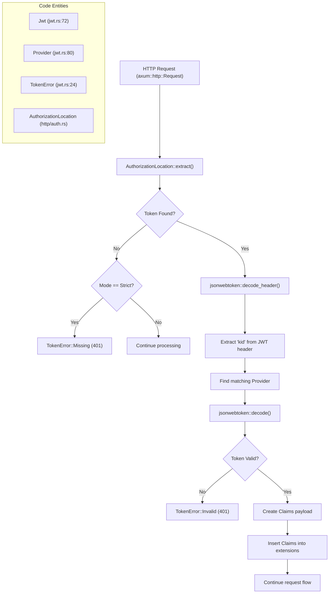
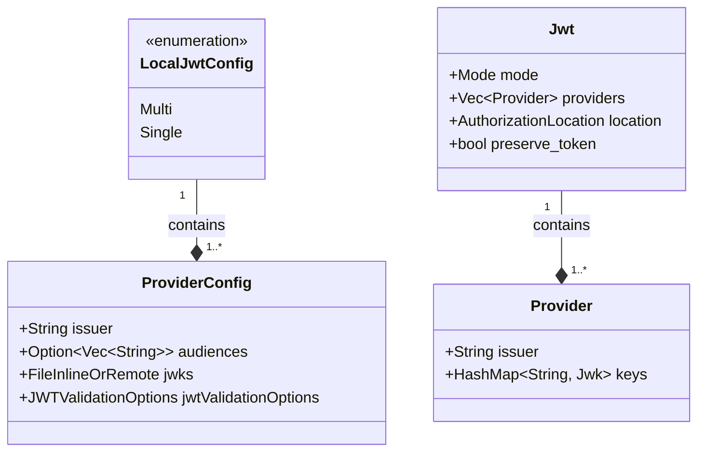
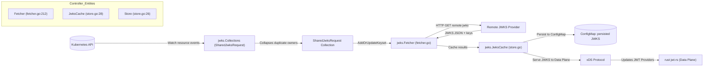

<!-- source: DeepWiki mcp.deepwiki.com · repo agentgateway/agentgateway · page 5.1 JWT Authentication · fetched 2026-10-21 -->

# JWT Authentication

Relevant source files

The following files were used as context for generating this wiki page:

- [controller/pkg/agentgateway/plugins/jwks_translation_test.go](controller/pkg/agentgateway/plugins/jwks_translation_test.go)
- [controller/test/e2e/backendauth_test.go](controller/test/e2e/backendauth_test.go)
- [controller/test/e2e/base/manifest_interceptor.go](controller/test/e2e/base/manifest_interceptor.go)
- [controller/test/e2e/base/test.go](controller/test/e2e/base/test.go)
- [controller/test/e2e/jwtauth_test.go](controller/test/e2e/jwtauth_test.go)
- [controller/test/e2e/policystatus_test.go](controller/test/e2e/policystatus_test.go)
- [controller/test/e2e/testdata/backendauth/invalid-gcp-credential.yaml](controller/test/e2e/testdata/backendauth/invalid-gcp-credential.yaml)
- [controller/test/e2e/testdata/jwtauth/invalid-inline.yaml](controller/test/e2e/testdata/jwtauth/invalid-inline.yaml)
- [controller/test/e2e/testutils/assertions/assertions.go](controller/test/e2e/testutils/assertions/assertions.go)
- [controller/test/e2e/testutils/assertions/test.go](controller/test/e2e/testutils/assertions/test.go)
- [crates/agentgateway/src/http/apikey.rs](crates/agentgateway/src/http/apikey.rs)
- [crates/agentgateway/src/http/apikey_tests.rs](crates/agentgateway/src/http/apikey_tests.rs)
- [crates/agentgateway/src/http/jwt.rs](crates/agentgateway/src/http/jwt.rs)
- [crates/agentgateway/src/http/jwt_tests.rs](crates/agentgateway/src/http/jwt_tests.rs)
- [crates/agentgateway/src/serdes.rs](crates/agentgateway/src/serdes.rs)

## Purpose and Scope

This document details the JWT (JSON Web Token) authentication functionality in AgentGateway, focusing on token validation, JWKS (JSON Web Key Set) URL resolution, provider configuration, and claim extraction. 

The gateway validates bearer tokens from incoming requests against configured JWT providers with specific issuers and audiences `[crates/agentgateway/src/http/jwt.rs:1-42]()`. The Kubernetes controller supports dynamic JWKS fetching, caching, and persistence with a background fetcher component `[controller/pkg/agentgateway/jwks/fetcher.go:212-220]()`. For integrating JWT claims into authorization rules via CEL expressions, see the [Authorization Rules](5.4) page.

Sources: `[crates/agentgateway/src/http/jwt.rs:1-42]()`, `[controller/pkg/agentgateway/jwks/fetcher.go:212-220]()`

---

## Overview

JWT Authentication verifies bearer tokens in HTTP requests before forwarding to upstream services. AgentGateway supports multiple JWT providers, each identified by issuer and associated JWKS sources. This multi-provider support allows validating tokens issued by different identity providers simultaneously.

Key features include:

- **Multi-Provider Validation:** Support for multiple JWT providers configured as `LocalJwtConfig::Multi` with each holding issuer and JWKS data `[crates/agentgateway/src/http/jwt.rs:134-154]()`.
- **Flexible JWKS Loading:** JWKS data can be specified inline, loaded from local files, or fetched from remote URLs using `FileInlineOrRemote` `[crates/agentgateway/src/serdes.rs:30-41]()`.
- **Authentication Modes:** Validation modes `Strict`, `Optional`, `Permissive` control whether JWTs are required or optional `[crates/agentgateway/src/http/jwt.rs:145]()`.
- **Claim Enforcement:** Configurable enforcement of required JWT claims (e.g., `exp`, `nbf`, `iss`, `aud`, `sub`) via `JWTValidationOptions` `[crates/agentgateway/src/http/jwt.rs:174]()`.
- **Controller-Managed JWKS Fetching:** The Kubernetes controller runs a `Fetcher` that periodically refreshes JWKS to keep token validation keys up-to-date `[controller/pkg/agentgateway/jwks/fetcher.go:212-220]()`.
  
Sources: `[crates/agentgateway/src/http/jwt.rs:134-176]()`, `[controller/pkg/agentgateway/jwks/fetcher.go:212-220]()`, `[crates/agentgateway/src/serdes.rs:30-41]()`

---

## JWT Authentication Request Flow

Below is a flow diagram mapping natural language request evaluation to code entities in the gateway:

### Diagram: JWT Request Processing to Code Entities

1. The configured token location extracts the JWT bearer token `[crates/agentgateway/src/http/auth.rs]()`.
2. If no token is found and mode is `Strict`, `TokenError::Missing` is raised `[crates/agentgateway/src/http/jwt.rs:31-32]()`.
3. The token header is decoded to extract the `kid` (key ID) `[crates/agentgateway/src/http/jwt.rs:34-35]()`.
4. The issuer (`iss` claim) is matched against configured `Provider` entries `[crates/agentgateway/src/http/jwt.rs:80-83]()`.
5. The token is cryptographically verified using the matched provider's keys `[crates/agentgateway/src/http/jwt.rs:7-8]()`.
6. On success, claims are bound to request extensions for policy evaluation `[crates/agentgateway/src/http/jwt.rs:11-15]()`.

Sources: `[crates/agentgateway/src/http/jwt.rs:24-83]()`

---

## Provider Configuration

JWT authentication is configured via the `LocalJwtConfig` enum, supporting `Multi` and `Single` variants `[crates/agentgateway/src/http/jwt.rs:140-176]`.

### Important Config Fields

| Field | Type | Description |
|---|---|---|
| `mode` | `Mode` enum | Validation mode: `Strict`, `Optional`, or `Permissive` `[crates/agentgateway/src/http/jwt.rs:145]()` |
| `location` | `AuthorizationLocation` | Where to extract JWTs, e.g., header, cookie, query parameter `[crates/agentgateway/src/http/jwt.rs:148]()` |
| `preserve_token` | `bool` | Whether to preserve the original token in the request `[crates/agentgateway/src/http/jwt.rs:151]()` |
| `providers` *(Multi)* | `Vec<ProviderConfig>` | List of JWT providers `[crates/agentgateway/src/http/jwt.rs:153]()` |
| `issuer` *(Single)* | `String` | Expected token issuer `[crates/agentgateway/src/http/jwt.rs:167]()` |
| `audiences` *(Single)* | `Option<Vec<String>>` | Accepted token audiences `[crates/agentgateway/src/http/jwt.rs:168-169]()` |
| `jwks` *(Single)* | `FileInlineOrRemote` | JWKS source (inline, file, or remote URL) `[crates/agentgateway/src/http/jwt.rs:171]()` |
| `jwt_validation_options` *(Single)* | `JWTValidationOptions` | Required claims and validation behaviors `[crates/agentgateway/src/http/jwt.rs:174]()` |

Sources: `[crates/agentgateway/src/http/jwt.rs:134-176]()`, `[crates/agentgateway/src/http/jwt_tests.rs:17-36]()`

---

## JWKS Resolution and Loading

The gateway converts JWKS configuration into runtime provider structures. The `Provider::from_jwks` function processes the keyset:
- Parses JWK Set into individual keys `[crates/agentgateway/src/http/jwt_tests.rs:155-162]()`.
- Validates supported algorithms (RSA, EC, OKP[Ed25519]) `[crates/agentgateway/src/http/jwt.rs:57-68]()`.
- Stores keys indexed by their `kid` `[crates/agentgateway/src/http/jwt.rs:82]()`.

The `FileInlineOrRemote` helper handles inline strings, local files, and remote URIs `[crates/agentgateway/src/serdes.rs:30-41]()`.

### Diagram: JWT Configuration Structure

Sources: `[crates/agentgateway/src/http/jwt.rs:71-83]`, `[crates/agentgateway/src/serdes.rs:30-51]`, `[crates/agentgateway/src/http/jwt_tests.rs:139-188]`

---

## Controller-Side JWKS Management

In Kubernetes deployments, the `agentgateway` controller manages the lifecycle of JWKS keysets:

### Diagram: Controller JWKS Fetch Pipeline to Code Entities

- **Fetcher:** Maintains an in-memory cache and periodically refreshes JWKS with exponential backoff `[controller/pkg/agentgateway/jwks/fetcher.go:212-220]()`.
- **Store:** Bridges shared JWKS requests to the fetcher and cache runtime, loading persisted keysets from ConfigMaps `[controller/pkg/agentgateway/jwks/store.go:26-62]()`.

Sources: `[controller/pkg/agentgateway/jwks/fetcher.go:212-220]`, `[controller/pkg/agentgateway/jwks/store.go:26-100]`

---

## CEL Context and Claim Extraction

After token validation, claims from the JWT payload are exposed to CEL expressions for authorization and routing policies.

### Extracted JWT Claims

| CEL Attribute | Description |
|---|---|
| `jwt.iss` | Token issuer claim (`iss`) `[crates/agentgateway/src/http/jwt.rs:1-42]()` |
| `jwt.sub` | Token subject claim (`sub`) `[crates/agentgateway/src/http/jwt.rs:1-42]()` |
| `jwt.aud` | Token audience claim(s) (`aud`) `[crates/agentgateway/src/http/jwt.rs:1-42]()` |
| `jwt.claims` | Map of all JWT claims from the payload `[crates/agentgateway/src/http/jwt.rs:1-42]()` |

Sources: `[crates/agentgateway/src/http/jwt.rs:1-42]()`

---

## Error Handling

Validation failures are categorized via `TokenError` and `JwkError`:

| Error Variant | Description | Location |
|---|---|---|
| `TokenError::Invalid` | Signature verification or claim check failed | `[crates/agentgateway/src/http/jwt.rs:25-26]()` |
| `TokenError::Missing` | No bearer token found | `[crates/agentgateway/src/http/jwt.rs:31-32]()` |
| `TokenError::UnknownKeyId` | Token `kid` not found in JWKS | `[crates/agentgateway/src/http/jwt.rs:37-38]()` |
| `JwkError::JwkLoadError` | Failed to load JWKS source | `[crates/agentgateway/src/http/jwt.rs:46-47]()` |
| `JwkError::UnexpectedAlgorithm` | Unsupported cryptographic algorithm | `[crates/agentgateway/src/http/jwt.rs:59-63]()` |

Sources: `[crates/agentgateway/src/http/jwt.rs:23-69]()`

---

# References

- JWT and Provider implementation: `[crates/agentgateway/src/http/jwt.rs]()`
- JWT validation tests: `[crates/agentgateway/src/http/jwt_tests.rs]()`
- JWKS fetching and scheduling: `[controller/pkg/agentgateway/jwks/fetcher.go]()`
- JWKS store and persistence: `[controller/pkg/agentgateway/jwks/store.go]()`
- Authorization claim usage: [Authorization Rules (5.4)]

---

