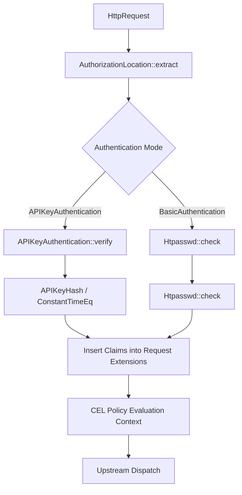
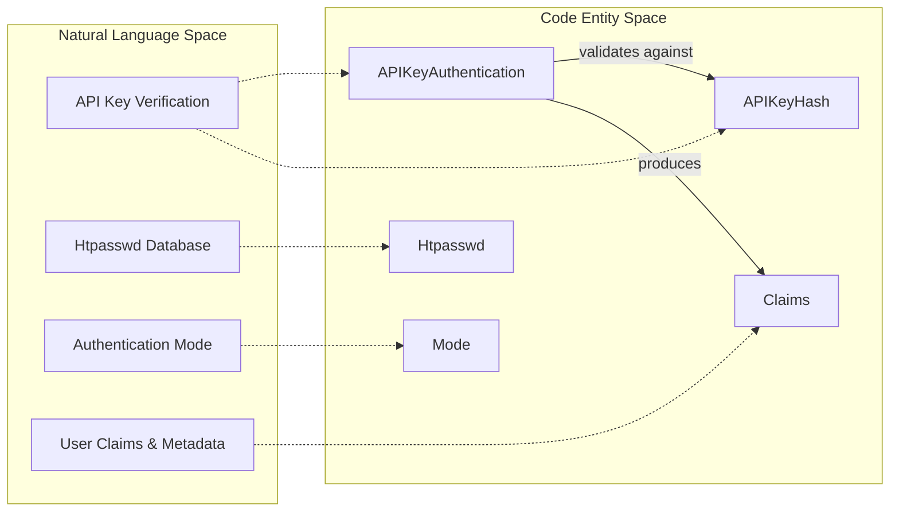

<!-- source: DeepWiki mcp.deepwiki.com · repo agentgateway/agentgateway · page 5.2 API Key and Basic Authentication · fetched 2026-10-21 -->

# API Key and Basic Authentication

Relevant source files

The following files were used as context for generating this wiki page:

- [crates/agentgateway/src/http/apikey.rs](crates/agentgateway/src/http/apikey.rs)
- [crates/agentgateway/src/http/apikey_tests.rs](crates/agentgateway/src/http/apikey_tests.rs)
- [crates/agentgateway/src/http/jwt.rs](crates/agentgateway/src/http/jwt.rs)
- [crates/agentgateway/src/http/jwt_tests.rs](crates/agentgateway/src/http/jwt_tests.rs)
- [crates/agentgateway/src/serdes.rs](crates/agentgateway/src/serdes.rs)
- [crates/htpasswd-verify-fork/Cargo.toml](crates/htpasswd-verify-fork/Cargo.toml)
- [crates/htpasswd-verify-fork/README.md](crates/htpasswd-verify-fork/README.md)
- [crates/htpasswd-verify-fork/src/lib.rs](crates/htpasswd-verify-fork/src/lib.rs)
- [crates/htpasswd-verify-fork/src/md5.rs](crates/htpasswd-verify-fork/src/md5.rs)

This page documents the API Key and Basic Authentication mechanisms in `agentgateway`. These mechanisms are responsible for extracting credentials from inbound requests, validating them against configured stores or hashes, managing cryptographic secrets securely using constant-time comparisons, and exposing claims to the Common Expression Language (CEL) evaluation context.

---

## Purpose and Scope

Inbound authentication policies inspect HTTP requests at the gateway ingress to establish caller identity and enforce access rules before routing traffic to backends or LLM providers. This subsystem covers:

- **API Key Extraction and Validation**: Implemented in `crates/agentgateway/src/http/apikey.rs` [crates/agentgateway/src/http/apikey.rs:1-233](), supporting multiple validation modes (`Strict`, `Optional`, `Permissive`) [crates/agentgateway/src/http/apikey.rs:32-47](), hash-based key lookups (`APIKeyHash`) [crates/agentgateway/src/http/apikey.rs:106-134](), and model access filtering via `AllowedModels` [crates/agentgateway/src/http/apikey.rs:173-225]().

- **Basic Authentication and Htpasswd Parsing**: Via the embedded `htpasswd-verify-fork` crate (`crates/htpasswd-verify-fork/src/lib.rs`) [crates/htpasswd-verify-fork/src/lib.rs:1-237](), supporting Apache `htpasswd` user databases with MD5 (APR1), BCrypt, SHA1, and Unix crypt hash formats [crates/htpasswd-verify-fork/src/lib.rs:1-3]().

- **Credential Handling and Security**: Secure storage of secrets using the `secrecy` crate [crates/agentgateway/src/http/apikey.rs:6](), constant-time verification using `subtle::ConstantTimeEq` [crates/agentgateway/src/http/apikey.rs:8](), [crates/htpasswd-verify-fork/src/lib.rs:12](), and injection of credential claims into CEL evaluation context [crates/agentgateway/src/http/apikey.rs:49-60]().

Sources: [crates/agentgateway/src/http/apikey.rs:1-233](), [crates/htpasswd-verify-fork/src/lib.rs:1-237]()

---

## API Key Authentication Architecture (`apikey.rs`)

API key validation enables token-based machine-to-machine authentication at the gateway ingress. API keys can be extracted from different HTTP locations like headers, query parameters, or cookies, as configured by the `AuthorizationLocation` enum [crates/agentgateway/src/http/apikey.rs:11]().

### Validation Modes

The `Mode` enum governs how the gateway treats requests lacking or with invalid API keys [crates/agentgateway/src/http/apikey.rs:32-47]():

| Mode        | Behavior                                                                                                           |
|-------------|--------------------------------------------------------------------------------------------------------------------|
| Strict      | Requires a valid API key to be present. Invalid or missing keys cause request rejection.                           |
| Optional    | Validates API key if present but allows requests without any key. (Default behavior)                              |
| Permissive  | Decodes and exposes valid API keys but allows missing/invalid keys without failure, enabling downstream policy use |

### Secret Protection and Constant-Time Equality

To defend against timing side-channel attacks, all API key comparisons use constant-time equality checks [crates/agentgateway/src/http/apikey.rs:91-102]():

- `APIKey` encapsulates the key bytes inside `SecretString` from the `secrecy` crate, which prevents accidental logging or exposure [crates/agentgateway/src/http/apikey.rs:62-67]().

- The `PartialEq` trait for `APIKey` leverages `subtle::ConstantTimeEq::ct_eq` to ensure comparison time is invariant to input differences [crates/agentgateway/src/http/apikey.rs:91-102]().

- Serializer implementations redact raw keys automatically, showing `<redacted>` when serialized unless explicitly accessed via `.unredacted()` methods [crates/agentgateway/src/http/apikey.rs:65-66]().

### Hashed Storage with `APIKeyHash`

To avoid storing raw API keys, the system supports hashing keys by SHA-256 and storing hash digests as `APIKeyHash` [crates/agentgateway/src/http/apikey.rs:106-134]():

- Raw keys are converted using `crate::crypto::digest::sha256` and hex-encoded in lowercase hexadecimal [crates/agentgateway/src/http/apikey.rs:119-122]().

- The stored hash strings have a mandatory prefix `sha256:` and decode strictly to 32 bytes [crates/agentgateway/src/http/apikey.rs:124-133]().

### Model Access Control via `AllowedModels`

API keys can restrict access to specific LLM models via the `AllowedModels` structure [crates/agentgateway/src/http/apikey.rs:167-174]().

Supported pattern types are:

- `Exact`: Exact model names (e.g., `"gpt-4o"`).

- `Prefix`: Prefix wildcards (e.g., `"openai/*"`).

- `Suffix`: Suffix wildcards (e.g., `"*-latest"`).

- `All`: Wildcard `"*"` matches all models.

`AllowedModels::compile` validates:

- Patterns may only contain a single wildcard at the beginning or end.

- The wildcard `"*"` cannot be combined with other patterns.

- Empty patterns are disallowed [crates/agentgateway/src/http/apikey.rs:185-217]().

Sources: [crates/agentgateway/src/http/apikey.rs:1-233]()

---

## Basic Authentication and Hash Verification (`htpasswd-verify-fork`)

Basic Authentication is implemented via the embedded `htpasswd-verify-fork` crate, which verifies credentials against Apache-style `htpasswd` files with various supported hash formats [crates/htpasswd-verify-fork/src/lib.rs:1-114]().

### Supported Hash Formats

- **MD5 (APR1)**: Apache-specific MD5 variant starting with `$apr1$` [crates/htpasswd-verify-fork/src/lib.rs:14](), implemented in `md5.rs` [crates/htpasswd-verify-fork/src/md5.rs:62-148]().

- **BCrypt**: Recognized by prefixes `$2a$`, `$2b$`, `$2x$`, or `$2y$`, verified using the `bcrypt` crate [crates/htpasswd-verify-fork/src/lib.rs:18, 86]().

- **SHA1**: Stored with prefix `{SHA}`, Base64-encoded SHA-1 digest [crates/htpasswd-verify-fork/src/lib.rs:19, 87]().

- **Unix Crypt**: Traditional Unix crypt hashes, verified via `pwhash::unix_crypt::verify` [crates/htpasswd-verify-fork/src/lib.rs:88]().

### Verification Flow

- `Htpasswd` loads a map of username to hash entries from file or string [crates/htpasswd-verify-fork/src/lib.rs:38-45]().

- When checking username and password, `Htpasswd::check` delegates to the hash's `check` method [crates/htpasswd-verify-fork/src/lib.rs:49-55]().

- Hash verification employs constant-time comparison (`constant_time_eq`) for hash equality to protect against timing attacks [crates/htpasswd-verify-fork/src/lib.rs:75-79]().

- The proprietary Apache MD5 (APR1) hashing mechanism is implemented with correct salt extraction, 1000 iterations, and encoded output [crates/htpasswd-verify-fork/src/md5.rs:62-148]().

Sources: [crates/htpasswd-verify-fork/src/lib.rs:1-114](), [crates/htpasswd-verify-fork/src/md5.rs:62-148]()

---

## Credential Handling and CEL Context Integration

Upon successful authentication, the gateway attaches a `Claims` struct representing the authenticated identity and metadata to the HTTP request's extensions [crates/agentgateway/src/http/apikey.rs:53-60]():

- The `Claims` struct holds the authenticated `APIKey` wrapped securely, along with any user metadata for downstream policy references.

- The `Claims` struct derives `::cel::DynamicType`, enabling its fields to be accessed within CEL policy expressions securely [crates/agentgateway/src/http/apikey.rs:49-60]().

- API key serialization to the CEL environment exposes the secret string in a controlled manner via the `api_key_to_value` helper [crates/agentgateway/src/http/apikey.rs:79-81](). Raw access is protected unless explicitly unredacted [crates/agentgateway/src/http/apikey.rs:54-56]().

Sources: [crates/agentgateway/src/http/apikey.rs:49-81]()

---

## Architecture Diagrams

### Credential Extraction and Validation Pipeline

This diagram illustrates the flow of incoming requests through authentication extraction and mode-based validation. API key authentication verifies keys via hash matching in constant time, while Basic auth uses the `Htpasswd` checker. Validations culminate in claim insertion for policy evaluation.

Sources: [crates/agentgateway/src/http/apikey.rs:153-177](), [crates/htpasswd-verify-fork/src/lib.rs:48-55]()

---

### Mapping Natural Language Authentication Concepts to Code Entities

This diagram bridges user-facing authentication concepts with codebase entities:

- "API Key Verification" maps to `APIKeyAuthentication` and the supporting `APIKeyHash`.

- "Htpasswd Database" maps to `Htpasswd`.

- "Authentication Mode" corresponds to the `Mode` enum governing strictness.

- "User Claims & Metadata" corresponds to the `Claims` struct injected post validation.

Sources: [crates/agentgateway/src/http/apikey.rs:32-60](), [crates/htpasswd-verify-fork/src/lib.rs:21-46]()

---

# Summary

- `agentgateway` supports configurable API key authentication with multiple extraction modes and credential storage using hashed keys with constant-time validation.

- Basic authentication is supported via Apache mod_htpasswd-compatible verification, supporting multiple hash algorithms including Apache's MD5 APR1 format.

- Authenticated credentials are securely wrapped and exposed to the policy evaluation layer as CEL claims.

This provides a flexible, secure, and performant authentication foundation for both machine clients and interactive users.

Sources: [crates/agentgateway/src/http/apikey.rs](), [crates/htpasswd-verify-fork/src/lib.rs](), [crates/htpasswd-verify-fork/src/md5.rs]()

---

