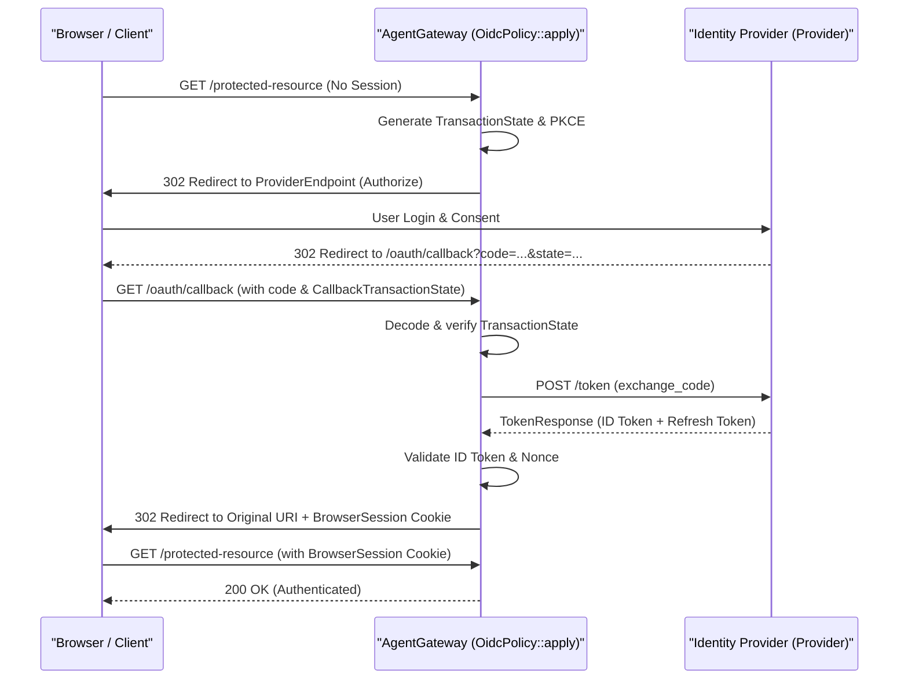
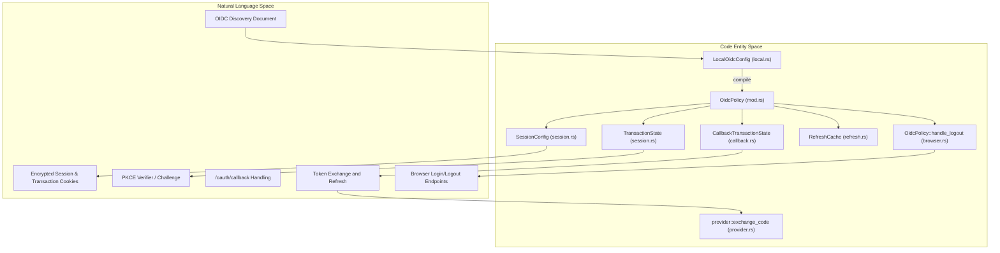
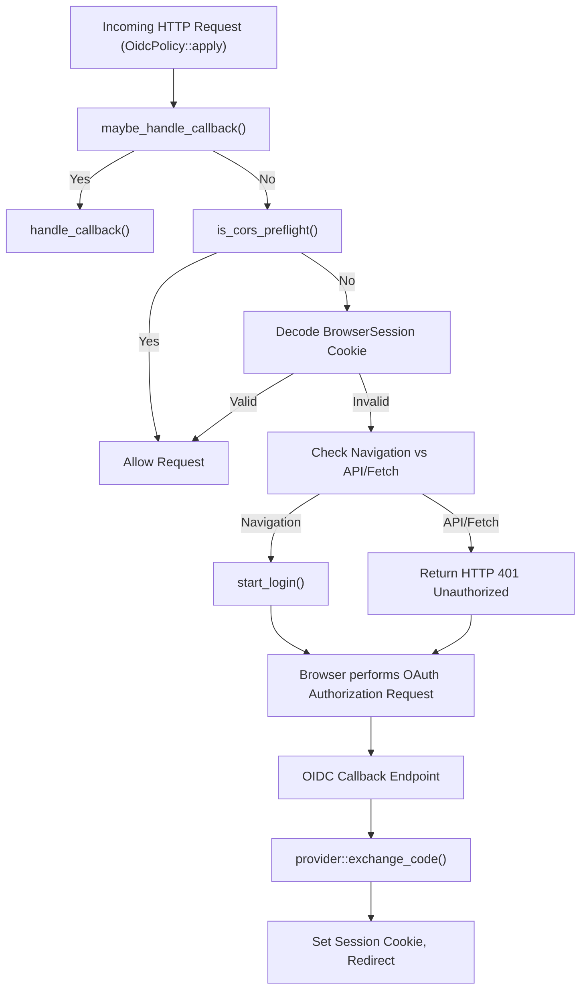

<!-- source: DeepWiki mcp.deepwiki.com · repo agentgateway/agentgateway · page 5.3 OIDC Browser Authentication · fetched 2026-10-21 -->

# OIDC Browser Authentication

<details>
<summary>Relevant source files</summary>

The following files were used as context for generating this wiki page:

- [crates/agentgateway/src/http/oidc/browser.rs](crates/agentgateway/src/http/oidc/browser.rs)
- [crates/agentgateway/src/http/oidc/callback.rs](crates/agentgateway/src/http/oidc/callback.rs)
- [crates/agentgateway/src/http/oidc/local.rs](crates/agentgateway/src/http/oidc/local.rs)
- [crates/agentgateway/src/http/oidc/mod.rs](crates/agentgateway/src/http/oidc/mod.rs)
- [crates/agentgateway/src/http/oidc/provider.rs](crates/agentgateway/src/http/oidc/provider.rs)
- [crates/agentgateway/src/http/oidc/refresh.rs](crates/agentgateway/src/http/oidc/refresh.rs)
- [crates/agentgateway/src/http/oidc/session.rs](crates/agentgateway/src/http/oidc/session.rs)
- [crates/agentgateway/src/http/oidc/tests.rs](crates/agentgateway/src/http/oidc/tests.rs)
- [crates/agentgateway/src/types/local_tests/ui_oidc_normalized.snap](crates/agentgateway/src/types/local_tests/ui_oidc_normalized.snap)

</details>


OIDC Browser Authentication provides a native OpenID Connect (OIDC) flow for browser-based clients within `agentgateway`. Unlike standard JWT validation which expects a pre-existing `Authorization` header, this flow implements the **Authorization Code Flow with PKCE** (Proof Key for Code Exchange) to authenticate users directly through an Identity Provider (IdP) and maintain their state via secure session cookies. It covers the `oidc/` module and integrates with examples such as `traffic-oidc`.

---

## Overview and Implementation

The OIDC subsystem orchestrates browser redirection to the IdP, processes callback requests, exchanges authorization codes for tokens, and securely manages browser sessions via encrypted cookies.

### Core Components

| Component           | Code Entity                    | Responsibility                                                                                  |
|---------------------|-------------------------------|------------------------------------------------------------------------------------------------|
| **OIDC Policy**      | `OidcPolicy` (`oidc/mod.rs`)  | Compiled OIDC configuration capturing issuer, endpoints, client credentials, and policy data.  |
| **Local Config**     | `LocalOidcConfig` (`oidc/local.rs`) | User configuration for OIDC, supporting discovery or explicit endpoint configuration.          |
| **Browser Session**  | `SessionConfig` (`oidc/session.rs`) | Manages session cookies, encryption, TTLs, and cookie attributes.                              |
| **Transaction State**| `TransactionState` (`oidc/session.rs`) | Intermediate state during auth flow holding PKCE verifier, nonce, CSRF state, and redirect URI.|
| **Callback Handler** | `CallbackTransactionState` (`oidc/callback.rs`) | Validates and processes OIDC callback state to guard against CSRF and replay attacks.          |
| **Redirect Logic**   | `OidcPolicy::apply` (`oidc/mod.rs`) | Handles initial request logic, redirect to IdP, and session validation on requests.            |
| **Encoder**          | `sessionpersistence::Encoder` (`http/sessionpersistence.rs`) | Used for encrypting and decrypting cookie payloads (supports AES-256-GCM and Base64).          |

These components collaborate to perform standard OpenID Connect Authorization Code Flow enhanced with PKCE for secure browser authentication within agentgateway.

Sources:  
[crates/agentgateway/src/http/oidc/mod.rs:134-162]()  
[crates/agentgateway/src/http/oidc/local.rs:45-79]()  
[crates/agentgateway/src/http/oidc/session.rs:34-45]()

---

## Authentication Data Flow

The OIDC flow employs the Authorization Code flow enhanced with PKCE, ensuring secure exchanges and protection against interception and replay attacks.

### OIDC Authorization Code Flow with PKCE



Sources:  
[crates/agentgateway/src/http/oidc/mod.rs:224-250]()  
[crates/agentgateway/src/http/oidc/callback.rs:45-190]()  
[crates/agentgateway/src/http/oidc/provider.rs:38-74]()

---

## Implementation Details

### Configuration and Discovery

- `LocalOidcConfig` supports automatic discovery of provider metadata from the `.well-known/openid-configuration` endpoint or explicit overrides.
- Discovered metadata includes issuer, authorization endpoint, token endpoint, JWKS URI, and supported token endpoint authentication methods.
- Once resolved, `LocalOidcConfig::compile` produces a validated `OidcPolicy` holding the provider data, client config, session params, and cryptographic validation keys.

This compilation enables flexible configuration modes: full OIDC discovery or explicit, static configurations.

Sources:  
[crates/agentgateway/src/http/oidc/local.rs:162-174]()  

### Session Management and Cookie Handling

- `SessionConfig` governs cookie names, TTLs, SameSite modes, Secure flags, and encryption.
- Cookies hold encrypted JSON state with optional zstd compression to fit browser size limits (~3800 bytes).
- Two main cookie types are used:
  - **Transaction Cookies** hold transient `TransactionState` during interaction, including PKCE verifier, CSRF token, nonce, and original URI. They have a short TTL (default 5 minutes).
  - **Session Cookies** hold lasting browser `BrowserSession` with the raw ID token and session expiration, typically one hour TTL.
- Cookies are encrypted/decrypted with `sessionpersistence::Encoder` (AES-256-GCM or fallback).
- If cookie size exceeds limits, the session or transaction is rejected to prevent silent failures.

Sources:  
[crates/agentgateway/src/http/oidc/session.rs:162-220]()  

### Redirect and Callback Handling

- Initial unauthenticated requests receive a redirect to the IdP’s authorization endpoint with OAuth parameters, including PKCE and CSRF state.
- The IdP redirects back to the configured callback URI `/oauth/callback` with `code` and `state` parameters.
- The callback handler verifies:
  - The state matches the transaction cookie’s stored value (CSRF protection).
  - The transaction cookie is valid, unexpired, and matches the policy.
- Then exchanges the authorization code plus PKCE verifier for tokens at the token endpoint via `provider::exchange_code`.
- The returned ID token is cryptographically validated for issuer, audience, expiration, and nonce.
- Successful validation sets the browser session cookie and redirects the user to the originally requested URI.
- If any step fails, authentication is rejected or an error response is returned.

Sources:  
[crates/agentgateway/src/http/oidc/callback.rs:108-190]()  
[crates/agentgateway/src/http/oidc/mod.rs:224-250]()

### Token Exchange and Refresh

- The `provider` submodule implements:
  - `exchange_code` to swap authorization code and PKCE verifier for tokens.
  - `refresh_token` to use a refresh token to obtain fresh ID and access tokens.
- `OidcPolicy` supports transparent session refresh via `refresh_browser_session` when the session cookie nears expiration, leveraging a cached concurrency-safe `RefreshCache`.
- Refresh responses update the session and refresh cookies accordingly.

Sources:  
[crates/agentgateway/src/http/oidc/provider.rs:38-94]()  
[crates/agentgateway/src/http/oidc/refresh.rs:40-125]()

---

## Natural Language to Code Entity Mapping



Sources:  
[crates/agentgateway/src/http/oidc/local.rs:97-153]()  
[crates/agentgateway/src/http/oidc/mod.rs:135-146]()  
[crates/agentgateway/src/http/oidc/callback.rs:16-43]()  
[crates/agentgateway/src/http/oidc/provider.rs:38-74]()  
[crates/agentgateway/src/http/oidc/refresh.rs:18-37]()  
[crates/agentgateway/src/http/oidc/browser.rs:8-82]()

---

## Browser Request Handling Logic in Code

- Incoming HTTP requests pass through `OidcPolicy::apply`.
- If the request is an OIDC callback, the callback handler processes it.
- If it's a CORS preflight request, it is allowed immediately.
- If a valid encrypted session cookie is present and the ID token validates, the request proceeds unlocked.
- Without a valid session, behavior depends on the request type:
  - For a document navigation request, redirect to login or explicitly configured login endpoint.
  - For non-navigation (e.g., API or fetch), respond with HTTP 401 and a `Location` header to trigger client-side navigation.
- The login endpoint triggers an OAuth authorization request to the provider with PKCE and CSRF tokens set in a transaction cookie.
- The logout endpoint clears session and transaction cookies and redirects accordingly.



Sources:  
[crates/agentgateway/src/http/oidc/mod.rs:224-250]()  
[crates/agentgateway/src/http/oidc/browser.rs:24-82]()  

---

## Security Features

1. **PKCE (RFC 7636):** Generates a cryptographically random `pkce_verifier` and hashes it to a `code_challenge`. This binds the authorization code exchange to the originating client, preventing interception attacks.
2. **CSRF Protection:** The `state` parameter is generated and stored in the transaction cookie. Callbacks verify the state matches, mitigating cross-site request forgery.
3. **Nonce Validation:** The `nonce` is generated at login start and validated against the ID token to prevent replay attacks.
4. **Encrypted Cookie Storage:** Session and transaction cookies hold encrypted JSON blobs, encrypted via `sessionpersistence::Encoder`. This prevents tampering and exposure of sensitive tokens.
5. **Cookie Attributes:** Cookie attributes for `SameSite` and `Secure` flags are configurable to meet browser security best practices.
6. **Cookie Size Limits:** Session cookies are limited to approximately 3800 bytes encrypted size to avoid silent failure drops by user agents; oversized sessions are rejected.
7. **Refresh Token Management:** Refresh tokens are stored in separate refresh cookies encrypted similarly; token refreshes are coalesced per gateway replica via `RefreshCache` to prevent token reuse errors.

Sources:  
[crates/agentgateway/src/http/oidc/session.rs:14-25]()  
[crates/agentgateway/src/http/oidc/refresh.rs:18-112]()

---

## Example Configuration

Below is a Rust example snippet for configuring an explicit `LocalOidcConfig` for a provider without discovery:

```rust
fn explicit_local_oidc_config() -> LocalOidcConfig {
    LocalOidcConfig {
        issuer: "https://issuer.example.com".into(),
        discovery: None,
        authorization_endpoint: Some("https://issuer.example.com/authorize".parse().unwrap()),
        token_endpoint: Some("https://issuer.example.com/token".parse().unwrap()),
        token_endpoint_auth: None,
        jwks: Some(test_jwks_inline()),
        client_id: "client-id".into(),
        client_secret: SecretString::new("client-secret".into()),
        redirect_uri: "https://app.example.com/oauth/callback".into(),
        scopes: vec!["openid".into(), "profile".into()],
        login: None,
        logout: None,
    }
}
```

This sample shows explicit endpoints with embedded JWKS used for token validation. The `redirect_uri` points to the agentgateway callback handler.

Sources:  
[crates/agentgateway/src/http/oidc/tests.rs:226-249]()

---

