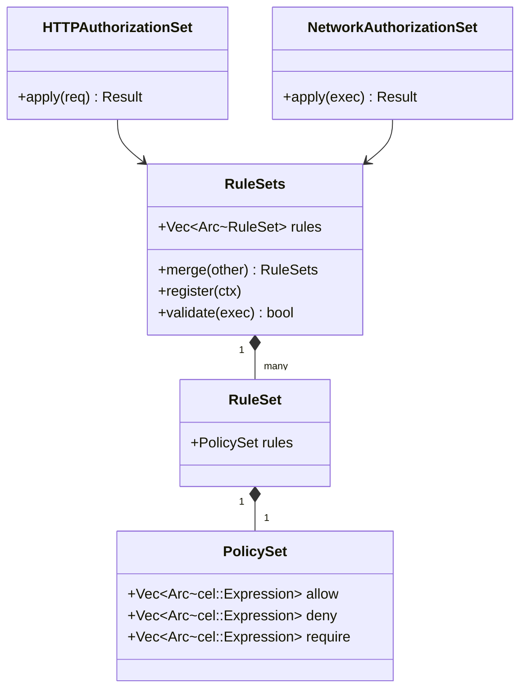
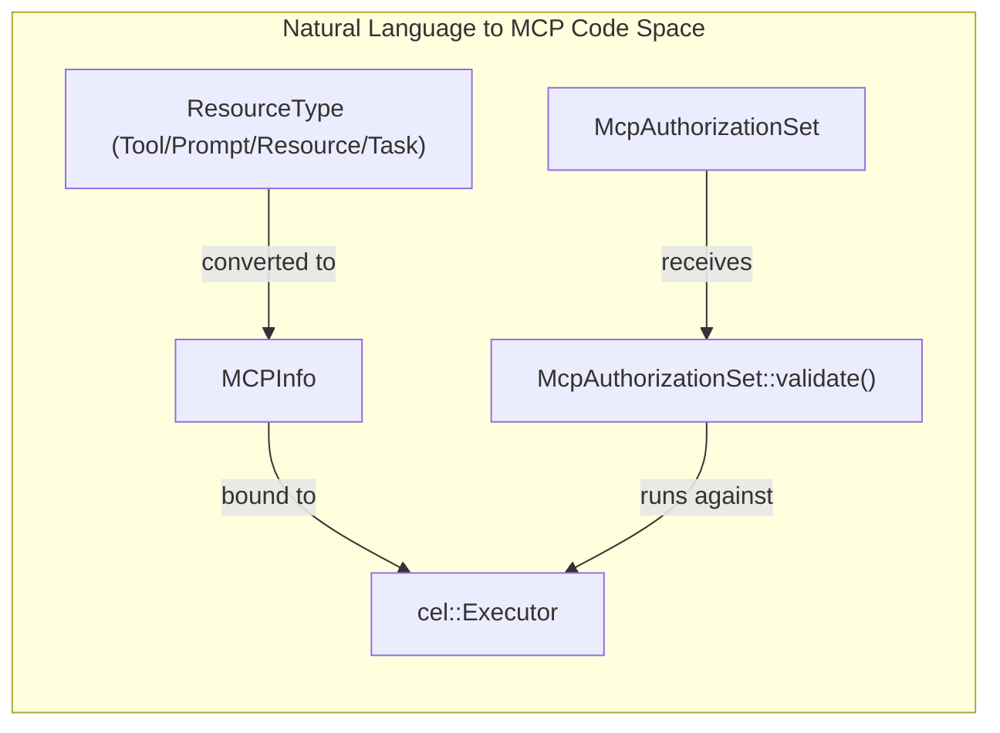

<!-- source: DeepWiki mcp.deepwiki.com · repo agentgateway/agentgateway · page 5.4 Authorization Rules · fetched 2026-10-21 -->

# Authorization Rules

<details>
<summary>Relevant source files</summary>

The following files were used as context for generating this wiki page:

- [crates/agentgateway/src/http/authorization.rs](crates/agentgateway/src/http/authorization.rs)
- [crates/agentgateway/src/http/authorization_tests.rs](crates/agentgateway/src/http/authorization_tests.rs)
- [crates/agentgateway/src/mcp/rbac.rs](crates/agentgateway/src/mcp/rbac.rs)

</details>


## Purpose and Scope

This page documents the authorization system in AgentGateway, which determines whether an authenticated request is permitted to access a resource based on policies defined using CEL (Common Expression Language) expressions. Authorization occurs after authentication has verified the user's identity and extracted claims.

AgentGateway supports granular authorization for standard HTTP traffic, network-level source contexts, and specialized Resource-Based Access Control (RBAC) for the Model Context Protocol (MCP) and Agent-to-Agent (A2A) protocols, enabling fine-grained control over tools, prompts, resources, and tasks.

Sources: [crates/agentgateway/src/http/authorization.rs:15-33](), [crates/agentgateway/src/mcp/rbac.rs:51-59]()

---

## Architecture Overview

Authorization rules are evaluated after authentication policies (JWT, API Key, or Basic Auth) have extracted identity information and before forwarding the request to the backend. The decision is made by evaluating CEL expressions against the request context using a CEL executor abstraction.

### Data Flow and Code Entities

The diagram below maps how client HTTP requests and MCP resource access are processed through respective authorization sets, converging on CEL rule evaluation:

```mermaid
flowchart TD
    subgraph "Natural Language Space"
      direction TB
      ClientRequest["Client sends http::Request"]
      MCPResource["MCP Resource / Tool Access"]
    end

    subgraph "Code Entity Space"
      direction TB
      HTTPAuthSet["HTTPAuthorizationSet"]
      MCPAuthSet["McpAuthorizationSet"]
      ExecutorReq["cel::Executor::new_request()"]
      ExecutorMCP["cel::Executor::new_mcp()"]
      RuleSets["RuleSets"]
      ProxyError["ProxyError::AuthorizationFailed"]
      PolicyResponse["http::PolicyResponse"]
    end

    ClientRequest -->|apply| HTTPAuthSet
    HTTPAuthSet --> ExecutorReq
    ExecutorReq --> RuleSets
    RuleSets -->|validate()| DecisionHTTP{"Allowed?"}
    DecisionHTTP -->|No| ProxyError
    DecisionHTTP -->|Yes| PolicyResponse

    MCPResource --> MCPAuthSet
    MCPAuthSet --> ExecutorMCP
    ExecutorMCP --> RuleSets
    RuleSets -->|validate()| DecisionMCP{"Allowed?"}
    DecisionMCP -->|No| ProxyError
    DecisionMCP -->|Yes| PolicyResponse
```

*Diagram: Authorization Data Flow and Code Entity Mapping*

AgentGateway features three main authorization sets in the codebase:

- **HTTP Authorization (`HTTPAuthorizationSet`)**: Applied to HTTP requests using CEL expressions to determine access.  
- **Network Authorization (`NetworkAuthorizationSet`)**: Used for network-level attributes like source IP CIDRs, TLS info.  
- **MCP Authorization (`McpAuthorizationSet`)**: Resource-based RBAC for MCP and A2A with CEL rules keyed by resource and method.

Sources: [crates/agentgateway/src/http/authorization.rs:12-97](), [crates/agentgateway/src/mcp/rbac.rs:37-64]()

---

## HTTP and Network Authorization

### Policy Structure and Rule Types

Authorization policies are encapsulated primarily in the `RuleSet` struct [crates/agentgateway/src/http/authorization.rs:98-104](), which contains a `PolicySet` [crates/agentgateway/src/http/authorization.rs:106-111]() comprising three categories of CEL expressions:

| Policy Type | Description |
|-------------|-------------|
| **allow**   | Expressions that permit the request when true. |
| **deny**    | Expressions that deny the request when true. *Caution:* Deny mode is discouraged because expression failures do not deny access; prefer `Allow` or `Require` policies. When used, expressions should be defensively designed. |
| **require** | Expressions that must all evaluate to true for access to be granted. |

The logical combination across multiple `RuleSets` is:

- Any deny in any ruleset denies access immediately.  
- All require expressions from all rulesets must be true (logical AND).  
- Allow expressions across rulesets are OR'ed to permit access.



*Diagram: Authorization Policy Class Structure and Interactions*

### `HTTPAuthorizationSet`

- Wraps `RuleSets` to evaluate authorization on HTTP requests [crates/agentgateway/src/http/authorization.rs:12-14]().  
- Creates a `cel::Executor` for the HTTP request context [crates/agentgateway/src/http/authorization.rs:25-33]().  
- `apply()` evaluates the rules, returning an error if access is denied, or success otherwise.  
- Implements `RequestPolicyTrait` and `BackendPolicyTrait` for integration in HTTP proxy pipelines [crates/agentgateway/src/http/authorization.rs:36-70]().

### `NetworkAuthorizationSet`

- Similar to `HTTPAuthorizationSet` but applies on network attributes, such as the source IP address or TLS parameters [crates/agentgateway/src/http/authorization.rs:72-88]().  
- Authorization is performed by creating a `cel::Executor` bound to `SourceContext`.  
- Deny takes precedence in overlapping allow and deny rules.

Sources: [crates/agentgateway/src/http/authorization.rs:12-112](), [crates/agentgateway/src/http/authorization.rs:212-233](), [crates/agentgateway/src/http/authorization.rs:226-231]()

---

## MCP and A2A Authorization

### Resource-Level Filtering with RBAC

MCP authorization implements RBAC targeting MCP resources: tools, prompts, generic resources, and tasks, with context-sensitive CEL rule evaluation.

- `McpAuthorizationSet` wraps multiple `RuleSets` [crates/agentgateway/src/mcp/rbac.rs:39-45]().  
- It validates authorization for a given `ResourceType` and method via the CEL executor, injecting MCP-specific metadata for authorization decisions [crates/agentgateway/src/mcp/rbac.rs:53-63]().  
- MCP metadata includes resource type, target, name, and the called method name.

| `ResourceType` Variant | Description |
|-----------------------|-------------|
| `Tool(ResourceId)`     | MCP Tool access control [crates/agentgateway/src/mcp/rbac.rs:74-74]() |
| `Prompt(ResourceId)`   | MCP Prompt access control [crates/agentgateway/src/mcp/rbac.rs:75-75]() |
| `Resource(ResourceId)` | General resource access [crates/agentgateway/src/mcp/rbac.rs:76-76]() |
| `Task(ResourceId)`     | MCP Task access (SEP-2663), with resource ID as task name [crates/agentgateway/src/mcp/rbac.rs:79-80]() |



*Diagram: MCP Authorization Validation Pipeline*

The authorization check for MCP requests depends on matching the resource context plus the method invoked against CEL rules for authorization. This allows fine-grained control native to the MCP/A2A protocol resources.

Sources: [crates/agentgateway/src/mcp/rbac.rs:53-63](), [crates/agentgateway/src/mcp/rbac.rs:70-117]()

---

## CEL Context for Authorization

Authorization CEL expressions execute against a composed context that enriches the request or MCP data with identity and source attributes.

### Common Context Attributes Utilized in Authorization

| Attribute Example | Description |
|------------------|-------------|
| `jwt` | JWT claims extracted from authenticated request headers, e.g., `jwt.sub == "123"` for subject match. |
| `request.method` | HTTP request method string such as `"POST"`. |
| `source.address` | Source IP address, used in CIDR-based network authorization [crates/agentgateway/src/http/authorization_tests.rs:181-185](). |
| `mcp.tool` | MCP tool resource with `name` and `target` fields for RBAC matching [crates/agentgateway/src/mcp/rbac.rs:109-117](). |

This rich context enables CEL rules to express complex, attribute-driven allow/deny/require conditions for authorization.

Sources: [crates/agentgateway/src/mcp/rbac.rs:70-117](), [crates/agentgateway/src/http/authorization_tests.rs:53-210]()

---

## Implementation Details

### RuleSets Composition and Merging

- `RuleSets` is a vector wrapper holding references (`Arc`) to multiple individual `RuleSet` instances [crates/agentgateway/src/http/authorization.rs:212-214]().  
- The `merge` operation combines two `RuleSets` by appending all contained `RuleSet`s [crates/agentgateway/src/http/authorization.rs:228-232]().  
- Authorization logic applies across the combined collection:  
  - Deny in any single `RuleSet` denies access.  
  - All require expressions across all `RuleSet`s must be true.  
  - Allow rules are OR'ed across all `RuleSet`s to permit access.

### CEL Registration and Execution

- Each CEL expression is registered with a `ContextBuilder` ahead of time to precompile expressions [crates/agentgateway/src/http/authorization.rs:235-239]().  
- At runtime, an appropriate `cel::Executor` instance is created bound to the current request or MCP context.  
- The `validate()` method on `RuleSets` evaluates each CEL allow, deny, and require expression according to rules semantics.

### Error Handling and Responses

- Authorization failures produce `ProxyError::AuthorizationFailed`, which results in a 403 Forbidden at the HTTP proxy layer [crates/agentgateway/src/http/authorization.rs:43-47]().  
- Successful authorization returns an empty `http::PolicyResponse` to continue request processing [crates/agentgateway/src/http/authorization.rs:46-46]().

Sources: [crates/agentgateway/src/http/authorization.rs:228-232](), [crates/agentgateway/src/http/authorization.rs:235-239](), [crates/agentgateway/src/http/authorization.rs:25-33]()

---

## Summary Table of Key Classes and Their Roles

| Class/Struct               | Responsibility                                                   | Location                                                      |
|---------------------------|-----------------------------------------------------------------|---------------------------------------------------------------|
| `RuleSet`                 | Defines a set of CEL-based allow, deny, and require rules       | [crates/agentgateway/src/http/authorization.rs:98-105]()     |
| `PolicySet`               | Holds categorized CEL expressions grouped by allow, deny, require | [crates/agentgateway/src/http/authorization.rs:106-113]()    |
| `RuleSets`                | Collection of rule sets with logical merging and composition    | [crates/agentgateway/src/http/authorization.rs:212-233]()    |
| `HTTPAuthorizationSet`    | Applies authorization rules over HTTP requests                  | [crates/agentgateway/src/http/authorization.rs:13-34]()      |
| `NetworkAuthorizationSet` | Applies authorization based on network source context           | [crates/agentgateway/src/http/authorization.rs:73-97]()      |
| `McpAuthorizationSet`     | Provides MCP-specific RBAC over resources and methods           | [crates/agentgateway/src/mcp/rbac.rs:39-68]()                 |
| `ResourceType`            | Enumerates MCP resource types (Tool, Prompt, Resource, Task)    | [crates/agentgateway/src/mcp/rbac.rs:70-81]()                 |
| `ResourceId`              | Identifies resource target and name for MCP RBAC evaluation     | [crates/agentgateway/src/mcp/rbac.rs:108-117]()               |

Sources:

- [crates/agentgateway/src/http/authorization.rs:1-247]()  
- [crates/agentgateway/src/mcp/rbac.rs:1-127]()  
- [crates/agentgateway/src/http/authorization_tests.rs:1-210]()

---

