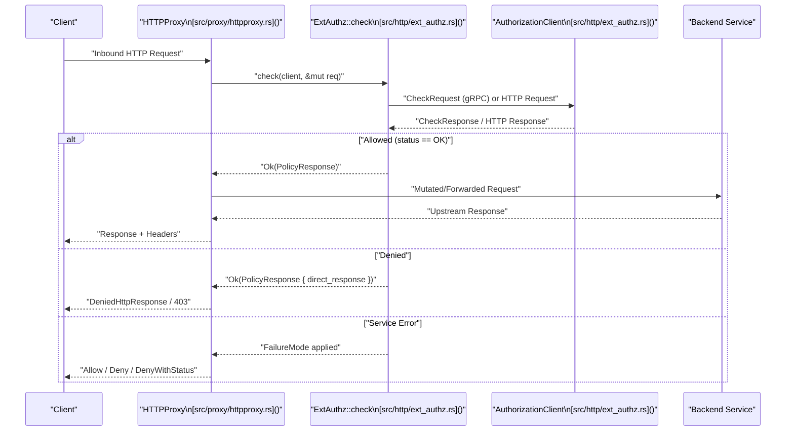
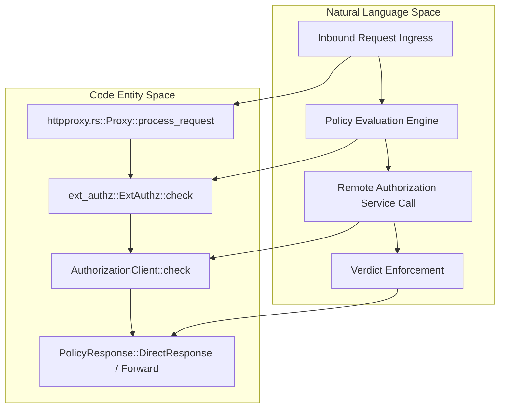
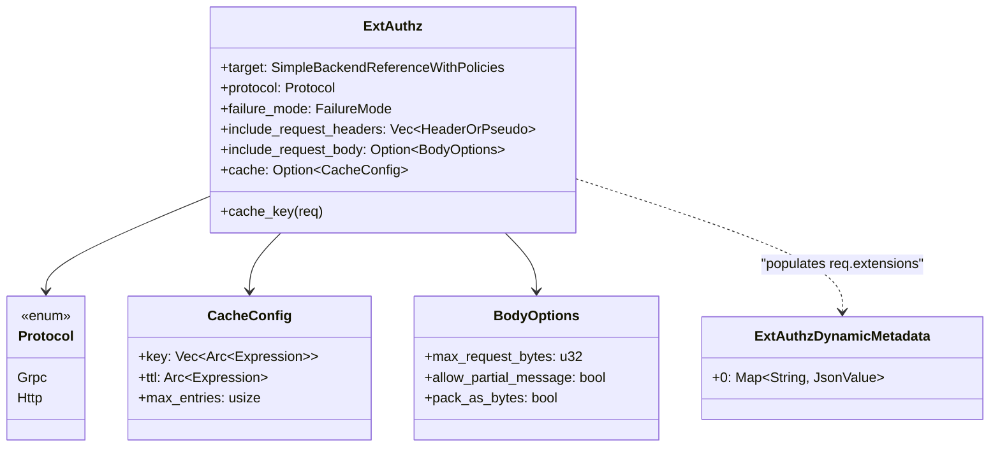
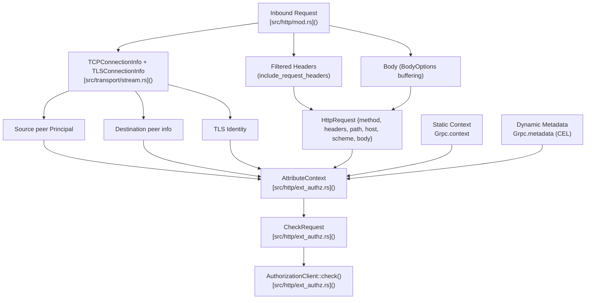
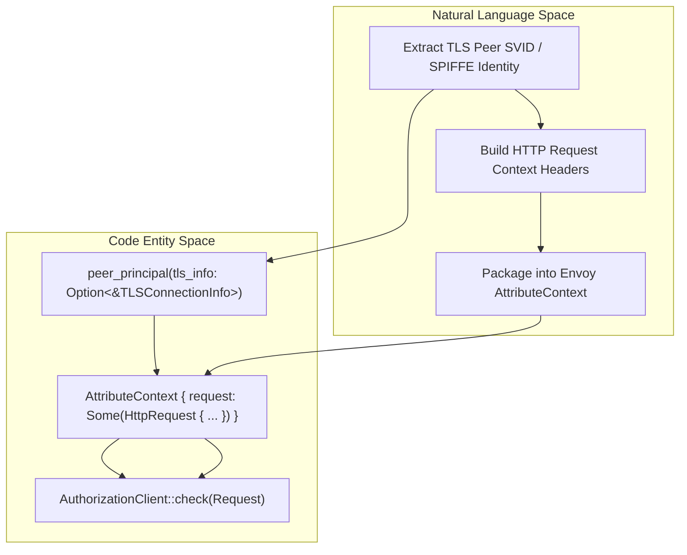

<!-- source: DeepWiki mcp.deepwiki.com · repo agentgateway/agentgateway · page 5.5 External Authorization (ExtAuthz) · fetched 2026-10-21 -->

# External Authorization (ExtAuthz)

<details>
<summary>Relevant source files</summary>

The following files were used as context for generating this wiki page:

- [crates/agentgateway/src/http/ext_authz.rs](crates/agentgateway/src/http/ext_authz.rs)
- [crates/agentgateway/src/http/ext_authz_tests.rs](crates/agentgateway/src/http/ext_authz_tests.rs)
- [crates/agentgateway/src/http/ext_proc.rs](crates/agentgateway/src/http/ext_proc.rs)
- [crates/agentgateway/src/http/ext_proc_tests.rs](crates/agentgateway/src/http/ext_proc_tests.rs)
- [crates/agentgateway/src/http/mod.rs](crates/agentgateway/src/http/mod.rs)
- [crates/agentgateway/src/http/remoteratelimit.rs](crates/agentgateway/src/http/remoteratelimit.rs)
- [crates/agentgateway/src/http/remoteratelimit_tests.rs](crates/agentgateway/src/http/remoteratelimit_tests.rs)
- [crates/agentgateway/src/test_helpers/extauthmock.rs](crates/agentgateway/src/test_helpers/extauthmock.rs)
- [crates/agentgateway/src/test_helpers/extprocmock.rs](crates/agentgateway/src/test_helpers/extprocmock.rs)
- [crates/agentgateway/src/test_helpers/mod.rs](crates/agentgateway/src/test_helpers/mod.rs)
- [crates/agentgateway/src/test_helpers/ratelimitmock.rs](crates/agentgateway/src/test_helpers/ratelimitmock.rs)

</details>


This page documents the External Authorization (`ExtAuthz`) integration in `agentgateway`: its configuration schema, the gRPC and HTTP sub-protocols, how `CheckRequest` and `CheckResponse` messages are built and interpreted, caching mechanisms, dynamic metadata propagation, and failure mode behavior.

ExtAuthz is a **frontend security policy** that gates inbound requests by consulting an external authorization service before proxying to a backend [crates/agentgateway/src/http/ext_authz.rs:172-187](). For authorization rules evaluated entirely within the gateway using CEL expressions, see [Authorization Rules (5.4)](). For the External Processing (`ExtProc`) integration, which mutates rather than gates requests, see [External Processing (7.4)]().

Sources: `[crates/agentgateway/src/http/ext_authz.rs:172-187]()`

---

## Overview

When an `ExtAuthz` policy is attached to a route or gateway bind, the HTTP proxy pipeline invokes the authorization logic implemented in `crates/agentgateway/src/http/ext_authz.rs` before forwarding the request upstream. The authorization check calls an external authorization service—either via gRPC or plain HTTP—and obtains a verdict. If allowed, optional header mutations from the authorization response are applied to the inbound request and processing continues. If denied, a direct response is sent back to the client instead of forwarding upstream.

### Data Flow Sequence for ExtAuthz



The authorization service is contacted synchronously during request processing and the computed decision affects the request handling path.

Sources:  
`[crates/agentgateway/src/http/ext_authz.rs:16-30]()`,  
`[crates/agentgateway/src/proxy/httpproxy.rs:27-28]()`

---

## Code Entity Bridge: ExtAuthz Pipeline Integration

The following diagram bridges natural language descriptions of the request processing lifecycle to the actual Rust code entities involved in evaluating external authorization policies.



Sources:  
`[crates/agentgateway/src/http/ext_authz.rs:172-187]()`

---

## Configuration Reference

The `ExtAuthz` struct is the primary configuration object for external authorization policies. It is defined in `crates/agentgateway/src/http/ext_authz.rs` and includes backend target information, protocol selection, caching, request inclusion options, and failure behavior.

```rust
pub struct ExtAuthz {
	pub target: SimpleBackendReferenceWithPolicies,
	pub protocol: Protocol,
	pub failure_mode: FailureMode,
	pub include_request_headers: Vec<HeaderOrPseudo>,
	pub include_request_body: Option<BodyOptions>,
	pub cache: Option<CacheConfig>,
}
```

### Protocol Variants

| Variant | Description | Key Fields |
|---|---|---|
| `Grpc` | Calls the external authorization backend over gRPC using the Envoy v3 authorization protocol | `context: Option<HashMap<String, String>>`, `metadata: Option<HashMap<String, Arc<cel::Expression>>>` `[crates/agentgateway/src/http/ext_authz.rs:111-121]()` |
| `Http` | Performs a plain HTTP sub-request to the backend without using gRPC, supporting CEL expressions for dynamic request construction and header handling | `path`, `redirect`, `body` (all CEL expressions), `include_response_headers`, `add_request_headers`, `metadata` `[crates/agentgateway/src/http/ext_authz.rs:124-145]()` |

Fields within each variant allow customization of how requests are constructed and how dynamic metadata is extracted.

### BodyOptions

Control for the request body sent to the authorization service (`[crates/agentgateway/src/http/ext_authz.rs:71-81]()`):

- `max_request_bytes`: Maximum size of the body portion sent (default 8192 bytes).
- `allow_partial_message`: Whether to send a truncated body if it exceeds the max length.
- `pack_as_bytes`: Whether to send the body as raw bytes (for gRPC checks) or as a UTF-8 string.

### CacheConfig

Allows caching of authorization results to reduce outbound calls (`[crates/agentgateway/src/http/ext_authz.rs:158-169]()`):

- `key`: List of CEL expressions computing the cache key (evaluated against the request).
- `ttl`: CEL expression that computes how long a cached entry is valid (duration or timestamp).
- `max_entries`: Maximum number of entries in the cache (default 10,000).

### FailureMode

Specifies fallback behavior if the authorization service is unavailable or returns an error (`[crates/agentgateway/src/http/ext_authz.rs:93-104]()`):

- `Allow`: Permit the request regardless (fail-open).
- `Deny`: Reject the request (fail-closed, default).
- `DenyWithStatus(u16)`: Reject with specific HTTP status code.

---

### ExtAuthz Configuration Structure With Relationships



Sources:  
`[crates/agentgateway/src/http/ext_authz.rs:67-68]()`,  
`[crates/agentgateway/src/http/ext_authz.rs:71-81]()`,  
`[crates/agentgateway/src/http/ext_authz.rs:108-146]`,  
`[crates/agentgateway/src/http/ext_authz.rs:158-187]()`

---

## gRPC Protocol

The default and recommended protocol to perform external authorization checks is the gRPC-based Envoy v3 service `Authorization`. The `AuthorizationClient` generated from protobuf is instantiated by the gateway and invoked by the `ExtAuthz` implementation.

### CheckRequest Construction

The gateway builds a `CheckRequest` message encapsulating detailed request context:

- Network layer information provided by `TCPConnectionInfo` and `TLSConnectionInfo` which includes client source, destination ipports, and TLS identities `[crates/agentgateway/src/http/ext_authz.rs:31]()`.
- HTTP-layer metadata including method, URL path, headers (filtered by `include_request_headers`), and optionally a buffered body adhering to `BodyOptions` `[crates/agentgateway/src/http/ext_authz.rs:15-20]()`.
- Static context extensions specified via `Grpc.context` are included as string pairs `[crates/agentgateway/src/http/ext_authz.rs:113-115]()`.
- Dynamic metadata context evaluated from CEL expressions in `Grpc.metadata` `[crates/agentgateway/src/http/ext_authz.rs:116-120]()`.

The function `peer_principal(tls_info)` extracts the verified peer identity from the TLS connection info, prioritizing Istio service identities falling back to raw SPIFFE IDs `[crates/agentgateway/src/http/ext_authz.rs:41-51]()`. This is inserted into attributes to guarantee the authorization server receives trustworthy principal information from the gateway (never client-supplied).



**Key details:**

- If `include_request_body` is configured, the incoming request body is buffered up to `max_request_bytes` before being sent `[crates/agentgateway/src/http/ext_authz.rs:71-81]()`.
- When `pack_as_bytes` is `true`, the request body is sent as raw bytes in the message to the authorization server.
- If dynamic metadata is not configured, the gateway automatically adds `envoy.filters.http.jwt_authn` metadata when JWT authentication is used to maintain compatibility.

Sources:  
`[crates/agentgateway/src/http/ext_authz.rs:15-20]()`,  
`[crates/agentgateway/src/http/ext_authz.rs:108-121]()`,  
`[crates/agentgateway/src/http/ext_authz.rs:41-51]()`

### Code Entity Bridge: gRPC CheckRequest Construction



Sources:  
`[crates/agentgateway/src/http/ext_authz.rs:15-51]()`

---

### CheckResponse Processing

The gateway interprets the `CheckResponse` protobuf message from the authorization service:

- A status code of `0` (OK) means the request is authorized to proceed.
- A denied response carries a `DeniedHttpResponse` embedded with an HTTP status code and response body that the gateway returns directly to the client.
- An allowed response (`OkHttpResponse`) can specify headers to add or remove on the downstream request, enabling header mutations dynamically controlled by the authorization service.

The gateway applies this response outcome to enforce or reject the request according to the service verdict.

Sources:  
`[crates/agentgateway/src/http/ext_authz.rs:17-20]()`

---

## HTTP Protocol

If the `Protocol::Http` variant is configured, external authorization checks occur via ordinary HTTP sub-requests to the backend service implementing the authorization logic (`[crates/agentgateway/src/http/ext_authz.rs:122-146]()`).

- The `path` CEL expression determines the sub-request URI.
- The `add_request_headers` map defines headers with values computed dynamically by CEL expressions, allowing rich request augmentation on the outgoing auth call.
- The `body` CEL expression, if set, computes the body content instead of forwarding the inbound request body.
- The `include_response_headers` specifies headers from the authorization HTTP response to be copied into the backend request headers.
- The `metadata` map of CEL expressions extracts arbitrary values from the auth response, exposing them as dynamic metadata in the `extauthz` CEL variable for downstream policy use.

This HTTP protocol mode supports flexible integrations where the authorization service is not gRPC-based or requires more customizable HTTP interactions.

Sources:  
`[crates/agentgateway/src/http/ext_authz.rs:122-146]()`

---

## Caching

The `ExtAuthz` system implements an optional synchronous cache for authorization results to optimize performance and reduce backend load:

- Cache keys are formed by evaluating the configured list of CEL expressions (`CacheConfig.key`) against the inbound request context (`[crates/agentgateway/src/http/ext_authz_tests.rs:218-245]()`). If CEL evaluation fails or returns empty, caching is bypassed.
- The cache TTL is computed by a CEL expression (`CacheConfig.ttl`) evaluated with post-authorization context, allowing dynamic expiration based on request or response attributes (`[crates/agentgateway/src/http/ext_authz.rs:164-165]()`).
- The cache uses `quick_cache::sync::Cache` providing fast, thread-safe access with an LRU eviction policy `[crates/agentgateway/src/http/ext_authz.rs:11]()`.
- The default cache entry limit is 10,000 entries, configurable by the `max_entries` field `[crates/agentgateway/src/http/ext_authz.rs:36]`, `[crates/agentgateway/src/http/ext_authz.rs:167-168]()`.

Caching is crucial for high traffic proxy workloads to minimize latency and avoid repeated remote authorization calls for identical requests.

Sources:  
`[crates/agentgateway/src/http/ext_authz.rs:11]()`,  
`[crates/agentgateway/src/http/ext_authz.rs:36]()`,  
`[crates/agentgateway/src/http/ext_authz.rs:158-169]()`,  
`[crates/agentgateway/src/http/ext_authz_tests.rs:218-245]()`

---

## Testing

The `crates/agentgateway/src/http/ext_authz_tests.rs` module contains comprehensive unit tests validating header processing, cache key formation, configuration parsing, and response handling (`[crates/agentgateway/src/http/ext_authz_tests.rs:1-1394]()`).

| Test | Description | Source Lines |
|-------|-------------|--------------|
| `test_process_headers_with_allowlist` | Ensures headers included by the authorization response are filtered by the allowlist | `[crates/agentgateway/src/http/ext_authz_tests.rs:71-104]()` |
| `test_process_headers` | Validates insertion and append behaviors of headers from proto options | `[crates/agentgateway/src/http/ext_authz_tests.rs:107-158]()` |
| `test_ext_authz_cache_key_evaluates_cel_values_in_order` | Verifies cache key computations respect CEL expression order | `[crates/agentgateway/src/http/ext_authz_tests.rs:218-245]()` |
| `ext_authz_https_host_defaults_port_and_tls_policy` | Checks that HTTPS backend URLs default to port 443 and inject TLS policies | `[crates/agentgateway/src/http/ext_authz_tests.rs:38-53]()` |

These tests verify core functionality and guard against regressions in the complex authorization interaction logic.

Sources:  
`[crates/agentgateway/src/http/ext_authz.rs:1-51]()`,  
`[crates/agentgateway/src/http/ext_authz_tests.rs:1-260]()`

---

# Summary

The External Authorization (`ExtAuthz`) integration in agentgateway provides a flexible and extensible mechanism to consult remote authorization services over gRPC or HTTP. With configurable request inclusion, CEL-based dynamic metadata, caching, and robust failure modes, it enables secure gating of requests at the gateway edge with traceable and extensible policies, integrating seamlessly into the gateway's HTTP proxy pipeline.

This completes the comprehensive technical guide to the `ExtAuthz` system. For related request mutation and streaming use cases, refer also to [External Processing (ExtProc) (7.4)]().

---

# Appendix: Key Files

- `crates/agentgateway/src/http/ext_authz.rs` — main implementation of ExtAuthz policy and clients.
- `crates/agentgateway/src/http/ext_authz_tests.rs` — test suite validating ExtAuthz behavior.
- `crates/agentgateway/src/http/mod.rs` — HTTP pipeline referencing ExtAuthz at runtime.

Sources:  
`[crates/agentgateway/src/http/ext_authz.rs]()`,  
`[crates/agentgateway/src/http/ext_authz_tests.rs]()`,  
`[crates/agentgateway/src/http/mod.rs]()`

---

