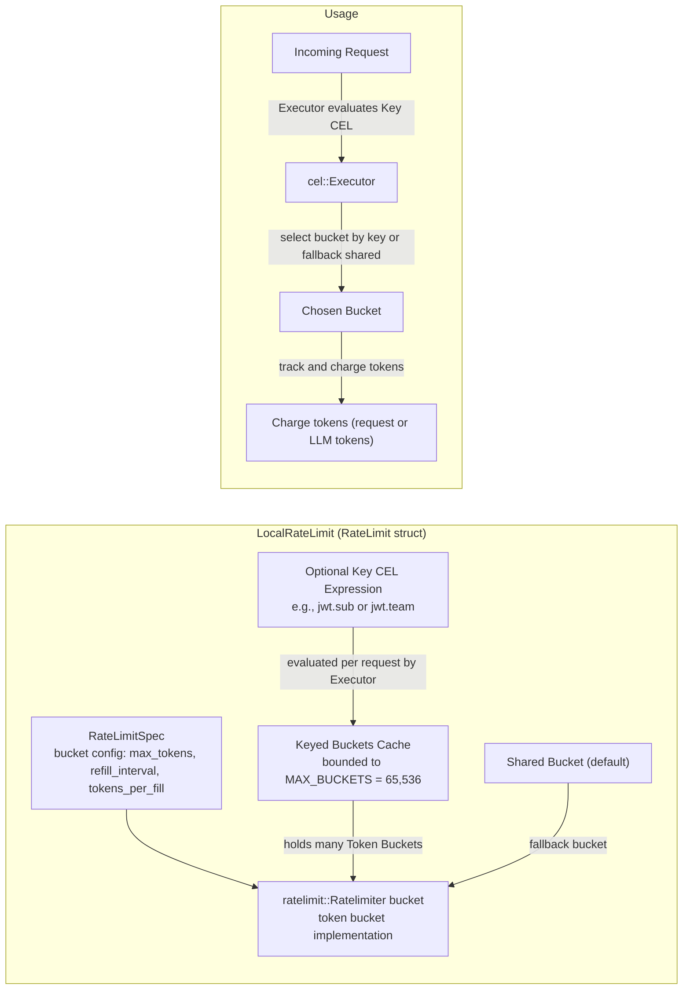
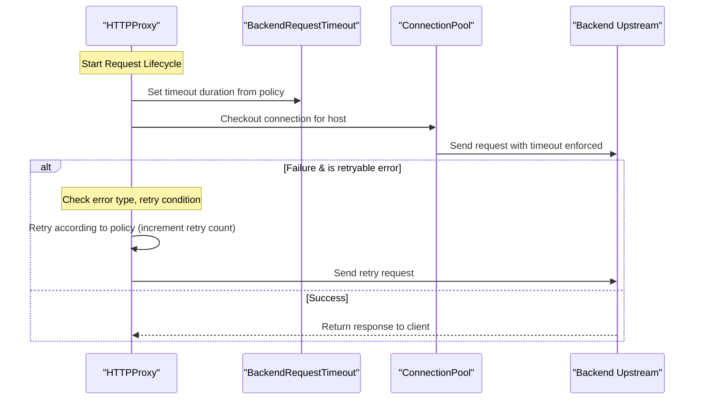
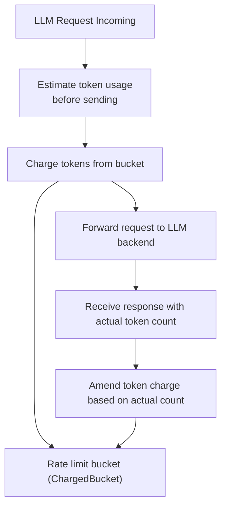

<!-- source: DeepWiki mcp.deepwiki.com · repo agentgateway/agentgateway · page 6 Traffic Management · fetched 2026-10-21 -->

# Traffic Management

Relevant source files

The following files were used as context for generating this wiki page:

- [crates/agentgateway/src/http/ext_authz.rs](crates/agentgateway/src/http/ext_authz.rs)
- [crates/agentgateway/src/http/ext_authz_tests.rs](crates/agentgateway/src/http/ext_authz_tests.rs)
- [crates/agentgateway/src/http/ext_proc.rs](crates/agentgateway/src/http/ext_proc.rs)
- [crates/agentgateway/src/http/ext_proc_tests.rs](crates/agentgateway/src/http/ext_proc_tests.rs)
- [crates/agentgateway/src/http/mod.rs](crates/agentgateway/src/http/mod.rs)
- [crates/agentgateway/src/http/remoteratelimit.rs](crates/agentgateway/src/http/remoteratelimit.rs)
- [crates/agentgateway/src/http/remoteratelimit_tests.rs](crates/agentgateway/src/http/remoteratelimit_tests.rs)
- [crates/agentgateway/src/test_helpers/extauthmock.rs](crates/agentgateway/src/test_helpers/extauthmock.rs)
- [crates/agentgateway/src/test_helpers/extprocmock.rs](crates/agentgateway/src/test_helpers/extprocmock.rs)
- [crates/agentgateway/src/test_helpers/mod.rs](crates/agentgateway/src/test_helpers/mod.rs)
- [crates/agentgateway/src/test_helpers/ratelimitmock.rs](crates/agentgateway/src/test_helpers/ratelimitmock.rs)

This page documents the traffic management capabilities of `agentgateway`, encompassing traffic control policies such as rate limiting (both local and remote), retries, timeouts, CORS, request filters, and token-based rate limiting specifically for Large Language Model (LLM) requests. These policies govern how requests are throttled, timed out, retried upon failure, and how cross-origin requests and header transformations are managed.

As a parent page, it provides a high-level overview. For technical details and configuration specifics, consult the dedicated child pages:

- For details, see [Rate Limiting](#6.1) — Local and remote rate limiting, descriptor configuration, CEL-based dynamic limits, implementation in `localratelimit.rs` and `remoteratelimit.rs`.
- For details, see [Timeouts and Retries](#6.2) — Request timeouts, retry policy configuration, exponential backoff, and replay body buffering, including the `ReplayBody` mechanism and retry logic in `httpproxy.rs`.
- For details, see [CORS and Request Filters](#6.3) — CORS handling, CSRF protection, header/path filters, request redirects, and fault injection policies implemented in `filters.rs` and policy schemas.
- For details, see [Token-Based Rate Limiting for LLM](#6.4) — Token usage based rate limiting, token estimation, amendment, and integration with AI gateway policy and request flow.

---

## Traffic Management Architecture

Traffic management policies are embedded into the HTTP request processing pipeline. They are resolved based on the matched route configuration and applied in various stages of the request lifecycle, primarily within the `HTTPProxy` request handler (`apply_request_policies` function) [crates/agentgateway/src/proxy/httpproxy.rs:141-233](). 

Policies utilize the CEL (Common Expression Language) engine to evaluate dynamic expressions against request state, enabling fine-grained, programmable control. Local rate limiting maintains in-memory token buckets with caching to limit memory usage, while remote rate limiting interacts with external gRPC services for distributed coordination.

Timeout and retry controls tie closely with the connection pool logic, which manages connection lifecycle, backoff, and request replay for robustness.

### System and Code Entity Diagram: Core Components in Traffic Management

```mermaid
graph TD
    subgraph "Traffic_Control_Entities"
        RL_REMOTE["RemoteRateLimit struct<br/>crates/agentgateway/src/http/remoteratelimit.rs"]
        LOCAL_RL["RateLimit struct<br/>crates/agentgateway/src/http/localratelimit.rs"]
        HDR_MOD["HeaderModifier struct<br/>crates/agentgateway/src/http/filters.rs"]
        EXT_PROC["ExtProcInstance struct<br/>crates/agentgateway/src/http/ext_proc.rs"]
        EXT_AUTH["ExtAuthz struct<br/>crates/agentgateway/src/http/ext_authz.rs"]
    end

    subgraph "Logic_Implementation"
        FAIL_MODE["FailureMode enum<br/>crates/agentgateway/src/http/remoteratelimit.rs"]
        RL_TYPE["RateLimitType enum<br/>crates/agentgateway/src/http/localratelimit.rs"]
        INF_ROUTING["InferenceRouting struct<br/>crates/agentgateway/src/http/ext_proc.rs"]
        CEL_EXPR["cel::Expression<br/>crates/agentgateway/src/cel/mod.rs"]
        CACHE_CFG["CacheConfig struct<br/>crates/agentgateway/src/http/ext_authz.rs"]
    end

    subgraph "Processing_Pipeline"
        HTTP_PROXY["HTTPProxy::apply_request_policies<br/>crates/agentgateway/src/proxy/httpproxy.rs"]
        REQ_LOG["RequestLog struct<br/>crates/agentgateway/src/telemetry/log.rs"]
        REQ_OR_RESP["RequestOrResponse enum<br/>crates/agentgateway/src/http/mod.rs"]
    end

    RL_REMOTE --> FAIL_MODE
    LOCAL_RL --> RL_TYPE
    RL_REMOTE --> CEL_EXPR
    EXT_PROC --> INF_ROUTING
    EXT_AUTH --> CACHE_CFG
    
    HTTP_PROXY -- "applies" --> RL_REMOTE
    HTTP_PROXY -- "applies" --> LOCAL_RL
    HTTP_PROXY -- "logs to" --> REQ_LOG
    HTTP_PROXY -- "orchestrates" --> EXT_PROC
    HTTP_PROXY -- "calls" --> EXT_AUTH
```

Sources:  
[crates/agentgateway/src/http/remoteratelimit.rs:41-72](), [crates/agentgateway/src/http/localratelimit.rs:12-199](), [crates/agentgateway/src/proxy/httpproxy.rs:141-233](), [crates/agentgateway/src/http/filters.rs:112-122](), [crates/agentgateway/src/http/ext_proc.rs:108-132](), [crates/agentgateway/src/http/ext_authz.rs:172-182]()

---

## Rate Limiting Overview

Agentgateway supports two primary modes of rate limiting:

- **Local Rate Limiting**: Implemented in the `RateLimit` struct, using in-memory token buckets (`ratelimit::Ratelimiter`) to track usage per bucket with configured capacity and refill rates [crates/agentgateway/src/http/localratelimit.rs:12-199](). Each rate limit may be keyed by a CEL expression evaluated per request (e.g., user ID or team from JWT claims), producing multiple buckets stored in a bounded cache (`keyed` buckets). Requests falling outside keyed buckets share a default shared bucket. Rate limits may count requests or LLM tokens, controlled by the `RateLimitType` enum.

- **Remote Rate Limiting**: Connects to external gRPC rate limit services, sending descriptors summarizing request attributes and receiving allowance decisions. It provides coordination across multiple gateway instances and global rate limit enforcement with configurable failure handling modes.

Local rate limiting also supports "charge amendment" via the `ChargedBucket` abstraction, allowing token adjustments after response processing (critical for accurate LLM token accounting).

Rate limit state snapshots enable sending informative HTTP headers to clients (e.g., `x-ratelimit-limit`, `x-ratelimit-remaining`, `x-ratelimit-reset`).

For in-depth details on rate limiting configuration, descriptor building, and CEL integration, see the [Rate Limiting](#6.1) child page.

### Local Rate Limiting Model Diagram

Sources: [crates/agentgateway/src/http/localratelimit.rs:12-199]()

---

## Timeouts and Retries Overview

Timeouts and retries improve reliability and resilience by bounding how long the gateway waits on upstream responses and resending failed requests under certain conditions.

- **Timeouts**: Request and backend timeouts are set based on policy values and enforced in the HTTP client and proxy layers. This ensures that upstream services do not block indefinitely, improving user experience and resource usage.

- **Retries**: The system supports retry policies configured on routes or backends. Retries can be selective, triggered on certain status codes or connection errors, with backoff strategies for pacing. They occur transparently to clients where appropriate.

- **Replay Body Buffering**: Since requests may be retried, the gateway buffers bodies (via mechanisms like `ReplayBody`) to allow re-sending the same payload without losing data or requiring client re-transmission.

Connection pooling logic supports connection reuse, request pipelining, and manages retry lifecycles, incorporating backoff and cancellation handling.

Refer to the [Timeouts and Retries](#6.2) child page for comprehensive implementation details.

### Request Retry Control Flow Sequence

Sources:  
[crates/agentgateway/src/proxy/httpproxy.rs:141-233]()

---

## CORS and Request Filters Overview

Agentgateway supports rich HTTP filters aimed at cross-origin and security scenarios, including:

- **CORS**: Configurable to handle preflight requests, enforce allowed origins, headers, and methods. Ensures browser clients operate correctly with cross-origin resources.

- **CSRF Protection**: Guards against cross-site request forgery attacks by applying header and routing rules.

- **Header and Path Filters**: Modify, add, or remove headers and paths dynamically using policy expressions. Used for features like redirects or custom header injection.

- **Fault Injection**: Capable of injecting faults such as aborts or delays for testing and resilience validation.

These filters are implemented as part of the HTTP request pipeline and policy system, with configuration expressed in policy schemas. Detailed design and usage are documented in [CORS and Request Filters](#6.3).

Sources:  
[crates/agentgateway/src/http/filters.rs:1-10]()

---

## LLM Token-Based Rate Limiting Overview

The gateway provides specialized rate limiting for Large Language Model (LLM) APIs where the cost relates to tokens consumed rather than request count:

- **Token Counting**: Uses the `RateLimitType::Tokens` variant to charge local rate limiting buckets based on estimated token usage rather than a fixed 1 token per request [crates/agentgateway/src/http/localratelimit.rs:12-199]().

- **Estimation and Amendment**: Tokens are estimated before request forwarding and charged accordingly. Once responses arrive and actual token usage is known, the gateway amends the token charge dynamically to reconcile any difference [crates/agentgateway/src/http/remoteratelimit.rs:130-155]().

- **ChargedBucket Role**: This struct allows deferred token amendments or refunds, enabling accurate enforcement without over- or under-limiting long-lived or streaming LLM requests.

- **Integration**: These capabilities are tightly coupled with AI gateway components handling LLM detection, request translation, and model-specific token pricing.

For a deeper dive into token estimation, amendment APIs, and associated policies, consult [Token-Based Rate Limiting for LLM](#6.4).

### Token-Based Rate Limit Lifecycle

Sources:  
[crates/agentgateway/src/http/localratelimit.rs:12-199](), [crates/agentgateway/src/http/remoteratelimit.rs:130-155]()

---

This concludes the high-level overview of traffic management in `agentgateway`. Please consult the respective child pages listed above for detailed implementation, configuration instructions, and usage examples.

---

