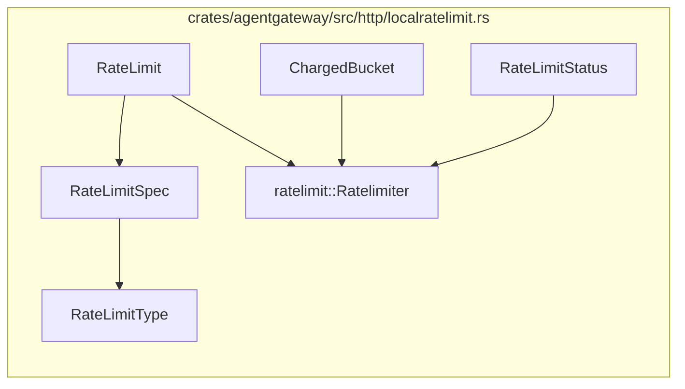
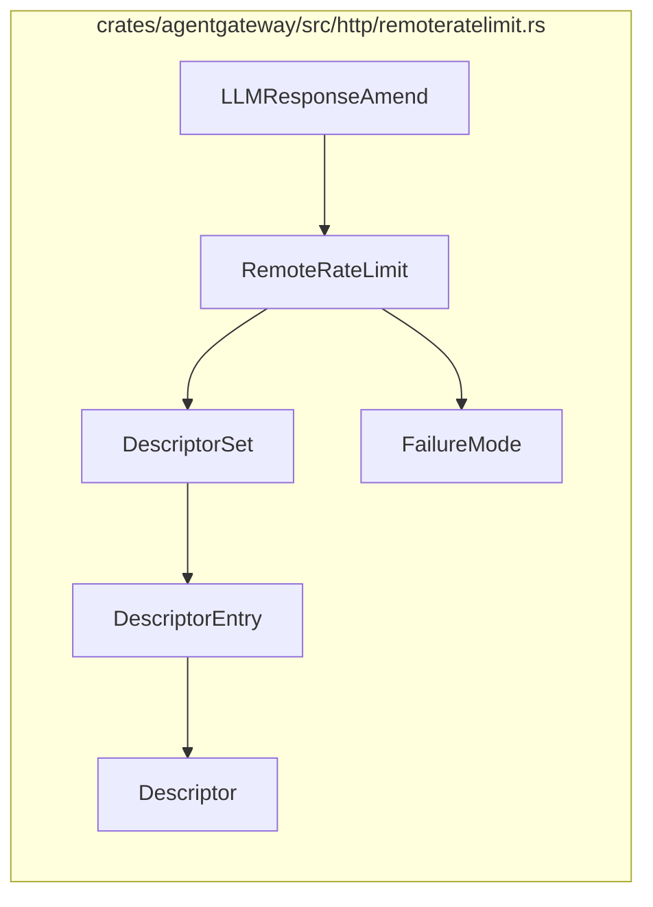
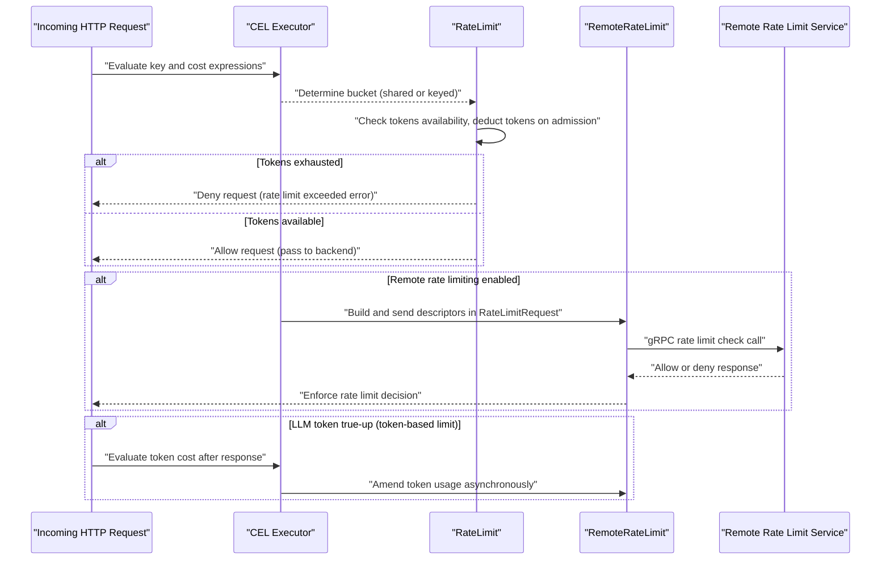

<!-- source: DeepWiki mcp.deepwiki.com · repo agentgateway/agentgateway · page 6.1 Rate Limiting · fetched 2026-10-21 -->

# Rate Limiting

Relevant source files

The following files were used as context for generating this wiki page:

- [crates/agentgateway/src/client/azure.rs](crates/agentgateway/src/client/azure.rs)
- [crates/agentgateway/src/http/ext_authz.rs](crates/agentgateway/src/http/ext_authz.rs)
- [crates/agentgateway/src/http/ext_authz_tests.rs](crates/agentgateway/src/http/ext_authz_tests.rs)
- [crates/agentgateway/src/http/ext_proc.rs](crates/agentgateway/src/http/ext_proc.rs)
- [crates/agentgateway/src/http/ext_proc_tests.rs](crates/agentgateway/src/http/ext_proc_tests.rs)
- [crates/agentgateway/src/http/localratelimit.rs](crates/agentgateway/src/http/localratelimit.rs)
- [crates/agentgateway/src/http/mod.rs](crates/agentgateway/src/http/mod.rs)
- [crates/agentgateway/src/http/remoteratelimit.rs](crates/agentgateway/src/http/remoteratelimit.rs)
- [crates/agentgateway/src/http/remoteratelimit_tests.rs](crates/agentgateway/src/http/remoteratelimit_tests.rs)
- [crates/agentgateway/src/proxy/locality_test.rs](crates/agentgateway/src/proxy/locality_test.rs)
- [crates/agentgateway/src/test_helpers/extauthmock.rs](crates/agentgateway/src/test_helpers/extauthmock.rs)
- [crates/agentgateway/src/test_helpers/extprocmock.rs](crates/agentgateway/src/test_helpers/extprocmock.rs)
- [crates/agentgateway/src/test_helpers/mod.rs](crates/agentgateway/src/test_helpers/mod.rs)
- [crates/agentgateway/src/test_helpers/ratelimitmock.rs](crates/agentgateway/src/test_helpers/ratelimitmock.rs)
- [crates/pool/src/blackbox_tests.rs](crates/pool/src/blackbox_tests.rs)
- [crates/pool/src/client.rs](crates/pool/src/client.rs)
- [crates/pool/src/pool.rs](crates/pool/src/pool.rs)

Rate limiting controls the rate of requests processed by `agentgateway` using local in-process token buckets or delegation to external remote rate limit services. It supports both standard request-based rate limits and token-based rate limits tailored for AI/LLM token consumption.

This page details the implementation, configuration, and data flow for local and remote rate limiting, descriptor structures, and CEL-based dynamic evaluation for limit enforcement.

---

## Overview

`agentgateway` offers two primary rate limiting mechanisms:

1. **Local Rate Limiting**:  
   Implements in-process token buckets (via the `ratelimit::Ratelimiter` crate) to enforce rate limits without external calls. These local buckets can be shared or keyed by request attributes (e.g., user ID) evaluated by CEL expressions.  
   `[crates/agentgateway/src/http/localratelimit.rs:12-193]()`

2. **Remote Rate Limiting**:  
   Calls out to an external Envoy Rate Limit Service (RLS) over gRPC using the `envoy.service.ratelimit.v3` protocol, sending grouped descriptors built from CEL expressions evaluated on the request context. The remote service returns allow/deny decisions.  
   `[crates/agentgateway/src/http/remoteratelimit.rs:52-189]()`

Both mechanisms support two distinct types of rate limits to track usage:

| RateLimitType | Serialized Value | Description                      |
|---------------|------------------|---------------------------------|
| `Requests`    | `"requests"`     | Counts each HTTP request as one token. (Default) `[crates/agentgateway/src/http/localratelimit.rs:63-66]()` |
| `Tokens`      | `"tokens"`       | Counts tokens used by AI/LLM requests, derived from prompt/response usage. `[crates/agentgateway/src/http/localratelimit.rs:67-70]()` |

Sources: `[crates/agentgateway/src/http/localratelimit.rs:12-193](), [crates/agentgateway/src/http/remoteratelimit.rs:52-189]()`

---

## Rate Limiting Architecture

The following diagrams associate core components and types in the code with their rate limiting context.

### Local Rate Limiting Code Entities

Sources: `[crates/agentgateway/src/http/localratelimit.rs:1-199]()`

### Remote Rate Limiting Code Entities

Sources: `[crates/agentgateway/src/http/remoteratelimit.rs:1-189]()`

---

## Local Rate Limiting

Local rate limiting uses an in-memory token bucket algorithm from the `ratelimit::Ratelimiter` crate.

### Configuration: `RateLimitSpec`

`RateLimitSpec` defines the parameters of one rate limit rule:

| Config Field     | Rust Field      | Type                  | Description                          |
|------------------|-----------------|-----------------------|------------------------------------|
| `maxTokens`      | `max_tokens`    | `u64`                 | Maximum tokens bucket can hold. `[crates/agentgateway/src/http/localratelimit.rs:35-38]()` |
| `tokensPerFill`  | `tokens_per_fill`| `u64`                 | Tokens added each refill interval. `[crates/agentgateway/src/http/localratelimit.rs:39-42]()` |
| `fillInterval`   | `fill_interval` | `Duration`            | How often tokens are added. `[crates/agentgateway/src/http/localratelimit.rs:43-46]()` |
| `type`           | `limit_type`    | `RateLimitType`       | Type of tokens counted (`requests` or `tokens`). `[crates/agentgateway/src/http/localratelimit.rs:47-50]()` |
| `key`            | `key`           | `Option<Arc<Expression>>` | Optional CEL expression to extract key from request for per-key buckets. `[crates/agentgateway/src/http/localratelimit.rs:51-58]()` |

When the `key` is specified, each distinct evaluated key uses its own token bucket, cached in an LRU cache to avoid unbounded size (`MAX_BUCKETS` = 65,536). Requests with empty or invalid key share the global shared bucket. `[crates/agentgateway/src/http/localratelimit.rs:91-94]()`

### RateLimit and ChargedBucket

- The `RateLimit` struct maintains:  
  - A **shared** `ratelimit::Ratelimiter` bucket used when no key applies.  
  - A `quick_cache::sync::Cache` of per-key buckets, keyed by the evaluated string.  
  - The configuration `RateLimitSpec`.  
  `[crates/agentgateway/src/http/localratelimit.rs:12-22]()`

- The method `bucket(exec: &Executor)` evaluates the CEL `key` expression (if any) against the request context using the CEL executor. It fetches or inserts the corresponding bucket or returns the shared bucket otherwise.  
  `[crates/agentgateway/src/http/localratelimit.rs:175-193]()`

- `ChargedBucket` holds a reference to the bucket and the charged token amount on admission. It provides:  
  - `amend_tokens(i64)` to adjust usage after request completion (e.g., for true-up).  
  - `refund()` to return tokens if a later policy rejects the request.  
  `[crates/agentgateway/src/http/localratelimit.rs:98-123]()`

### Rate Limit Status Headers

`RateLimitStatus` captures a snapshot of bucket state (limit, remaining tokens, reset seconds), used to populate HTTP response headers like `X-RateLimit-Limit`, `X-RateLimit-Remaining`, and `X-RateLimit-Reset`.  
The static method `most_constrained` selects the tightest applicable limit when multiple apply, reflecting the rate limit a client is most likely to hit next.  
`to_headers()` converts this snapshot into HTTP headers.  
`From<RateLimitStatus> for ProxyError` allows converting exceeded limits into a proxy error for request denial.  
`[crates/agentgateway/src/http/localratelimit.rs:126-173]()`

Sources: `[crates/agentgateway/src/http/localratelimit.rs:1-193]()`

---

## Remote Rate Limiting

Remote rate limiting sends rate limit check requests to an external gRPC Rate Limit Service implementing Envoy’s `envoy.service.ratelimit.v3` API.

### RemoteRateLimit Struct

Key fields of `RemoteRateLimit`:

| Field             | Type                                       | Description                                          |
|-------------------|--------------------------------------------|------------------------------------------------------|
| `domain`          | `String`                                   | Identifier sent to the remote rate limit service. `[crates/agentgateway/src/http/remoteratelimit.rs:52-54]()` |
| `target`          | `SimpleBackendReferenceWithPolicies`       | Endpoint and policies for the remote rate limit service. `[crates/agentgateway/src/http/remoteratelimit.rs:55-57]()` |
| `descriptors`     | `Arc<DescriptorSet>`                       | Set of descriptors (key-value lists) evaluated via CEL on the request. `[crates/agentgateway/src/http/remoteratelimit.rs:58-60]()` |
| `failure_mode`    | `FailureMode`                              | FailOpen or FailClosed behavior when remote service unavailable. `[crates/agentgateway/src/http/remoteratelimit.rs:41-64]()` |

### Descriptors & CEL Evaluation

- A **DescriptorEntry** contains multiple **Descriptors**, each with a key and CEL expression as the value; these expressions are evaluated on the request to form descriptor entries submitted to remote rate limit calls. `[crates/agentgateway/src/http/remoteratelimit.rs:70-78]()`
- If a descriptor’s CEL expression fails, that descriptor is dropped (per Envoy semantics), but the request is not failed outright, allowing partial descriptor sets to proceed. `[crates/agentgateway/src/http/remoteratelimit.rs:83-88]()`
- Each descriptor has a `limit_type` (`requests` or `tokens`) to filter which descriptors are sent per check type. `[crates/agentgateway/src/http/remoteratelimit.rs:79-82]()`
- `build_request()` constructs the remote `RateLimitRequest` message dynamically based on current request data and CEL outcomes. `[crates/agentgateway/src/http/remoteratelimit_tests.rs:45-184]()`

### Failure Modes

- `FailClosed` (default): Deny requests with HTTP 500 error if remote RLS is unreachable or returns error. `[crates/agentgateway/src/http/remoteratelimit.rs:41-45]()`
- `FailOpen`: Allow requests to proceed even if remote rate limit checking fails. `[crates/agentgateway/src/http/remoteratelimit.rs:46-49]()`

### LLM Token-Based Remote Rate Limit Amendments

When using remote rate limiting for LLM tokens, actual token usage might be known only after request completion:

- `LLMResponseAmend` encapsulates asynchronous amendment of remote rate limit token usage, allowing sending the final cost of tokens used in a background task without delaying the main request. `[crates/agentgateway/src/http/remoteratelimit.rs:130-155]()`
- It evaluates `cost` CEL expressions per descriptor to compute the actual token cost. `[crates/agentgateway/src/http/remoteratelimit.rs:157-182]()`
- If evaluation of cost or limit expression fails, that descriptor is skipped in the amendment request. `[crates/agentgateway/src/http/remoteratelimit.rs:170-181]()`
- It invokes remote calls with updated cost for proper token accounting. `[crates/agentgateway/src/http/remoteratelimit.rs:152-155]()`

Sources: `[crates/agentgateway/src/http/remoteratelimit.rs:1-189](), [crates/agentgateway/src/http/remoteratelimit_tests.rs:9-184]()`

---

## Dynamic Limits and CEL

`agentgateway` extensively uses the Common Expression Language (CEL) to provide runtime-configurable, context-aware rate limiting:

- **Descriptor values** are CEL expressions returning strings used as keys to identify user/ip/tool identity or similar in remote descriptors. `[crates/agentgateway/src/http/remoteratelimit.rs:74-78]()`
- **Cost expressions** compute dynamic cost weight for token-based limits. `[crates/agentgateway/src/http/remoteratelimit.rs:83-88]()`
- **Limit override expressions** specify rate limit parameters dynamically per request (e.g., to change limits based on authorization). `[crates/agentgateway/src/http/remoteratelimit.rs:89-96]()`
- CEL executes in the context of the HTTP request, with full access to request headers, JWT claims, or LLM request metadata. `[crates/agentgateway/src/http/localratelimit.rs:51-58]()`
- This allows fine-grained, policy-driven control rather than static rate limits.

Sources: `[crates/agentgateway/src/http/localratelimit.rs:51-58](), [crates/agentgateway/src/http/remoteratelimit.rs:70-96]()`

---

## Data Flow: Local and Remote Rate Limiting

Sources: `[crates/agentgateway/src/http/localratelimit.rs:1-193](), [crates/agentgateway/src/http/remoteratelimit.rs:1-189]()`

---

# Summary

`agentgateway`'s rate limiting system balances local low-latency enforcement with extensible remote service control using the Envoy Rate Limit Service protocol. It supports:

- Per-request and per-user keyed rate limiting with local token buckets dynamically keyed by CEL expressions.
- Delegation to external rate limit services with detailed descriptor construction and fail modes.
- AI/LLM token counting with dynamic true-up cost amendments.
- Full use of CEL for dynamically configurable, context-aware descriptors, cost calculations, and overrides.

This modular design enables fine-grained, policy-driven traffic shaping with extensibility for AI workloads.

---

## Sources

- `[crates/agentgateway/src/http/localratelimit.rs:1-193]()`
- `[crates/agentgateway/src/http/remoteratelimit.rs:1-189]()`
- `[crates/agentgateway/src/http/remoteratelimit_tests.rs:9-184]()`

---

