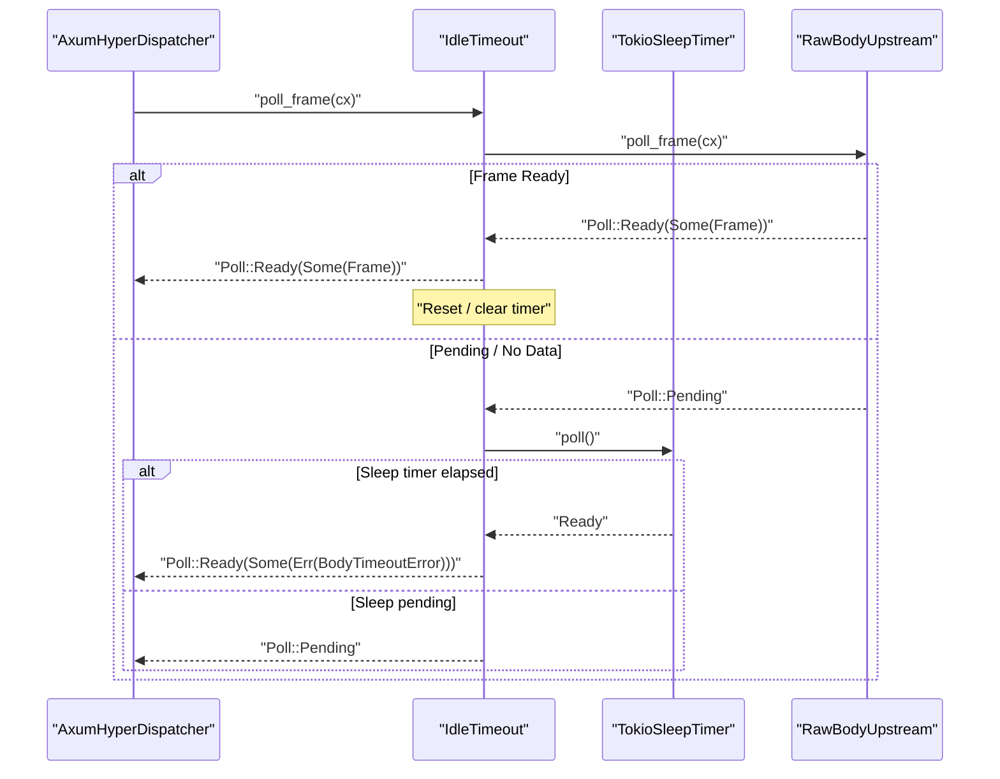
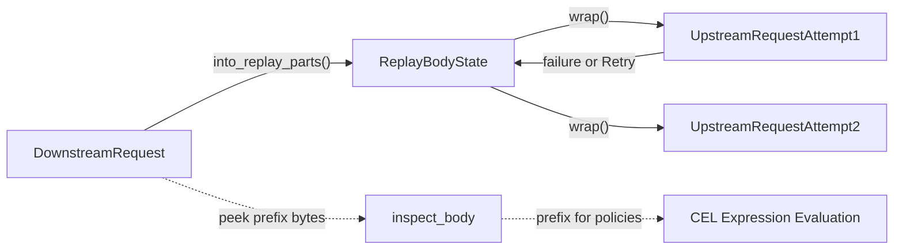
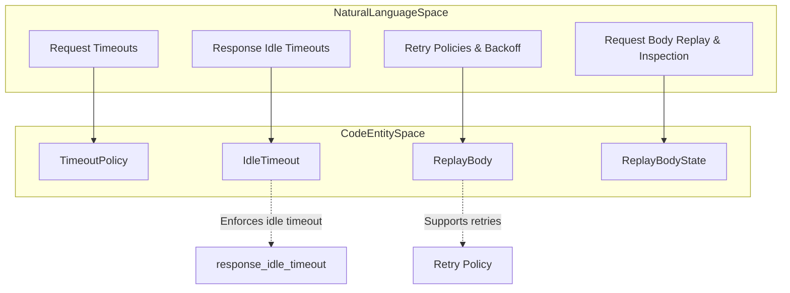

<!-- source: DeepWiki mcp.deepwiki.com · repo agentgateway/agentgateway · page 6.2 Timeouts and Retries · fetched 2026-10-21 -->

# Timeouts and Retries

<details>
<summary>Relevant source files</summary>

The following files were used as context for generating this wiki page:

- [crates/agentgateway/src/client/connect_tunnel.rs](crates/agentgateway/src/client/connect_tunnel.rs)
- [crates/agentgateway/src/http/compression/mod.rs](crates/agentgateway/src/http/compression/mod.rs)
- [crates/agentgateway/src/http/retry/body.rs](crates/agentgateway/src/http/retry/body.rs)
- [crates/agentgateway/src/http/retry/body_tests.rs](crates/agentgateway/src/http/retry/body_tests.rs)
- [crates/agentgateway/src/http/substrate/README.md](crates/agentgateway/src/http/substrate/README.md)
- [crates/agentgateway/src/http/substrate/egress.rs](crates/agentgateway/src/http/substrate/egress.rs)
- [crates/agentgateway/src/http/substrate/ingress.rs](crates/agentgateway/src/http/substrate/ingress.rs)
- [crates/agentgateway/src/http/substrate/mod.rs](crates/agentgateway/src/http/substrate/mod.rs)
- [crates/agentgateway/src/http/timeout.rs](crates/agentgateway/src/http/timeout.rs)
- [crates/agentgateway/src/json.rs](crates/agentgateway/src/json.rs)
- [crates/agentgateway/src/test_helpers/ateapimock.rs](crates/agentgateway/src/test_helpers/ateapimock.rs)
- [crates/agentgateway/src/test_helpers/credprovidermock.rs](crates/agentgateway/src/test_helpers/credprovidermock.rs)
- [crates/agentgateway/tests/tests/basic.rs](crates/agentgateway/tests/tests/basic.rs)
- [crates/agentgateway/tests/tests/substrate.rs](crates/agentgateway/tests/tests/substrate.rs)
- [crates/http/src/body.rs](crates/http/src/body.rs)
- [crates/http/src/body_test.rs](crates/http/src/body_test.rs)
- [crates/http/src/idle_timeout.rs](crates/http/src/idle_timeout.rs)
- [crates/http/src/lib.rs](crates/http/src/lib.rs)
- [crates/http/src/peekbody.rs](crates/http/src/peekbody.rs)
- [crates/protos/build.rs](crates/protos/build.rs)
- [crates/protos/proto/ateapi.proto](crates/protos/proto/ateapi.proto)
- [crates/protos/proto/credprovider.proto](crates/protos/proto/credprovider.proto)
- [crates/protos/src/lib.rs](crates/protos/src/lib.rs)

</details>


This page details how Agentgateway implements request timeouts, response idle timeouts, retry policies, backoff handling, and replay body buffering to ensure robust data plane connectivity for Agentic AI workloads.

---

## Purpose and Scope

Resilient agent architectures require strict latency boundaries and automated recovery from transient upstream failures. Agentgateway manages this via:

- **Request & Backend Timeouts:** Bounding end-to-end processing and single-upstream call durations through timeout policy configurations.
- **Response Idle Timeouts:** Guarding against stalled stream frames during chunked or streaming responses (e.g., LLM SSE streaming via `IdleTimeout`) [crates/http/src/idle_timeout.rs:13-65]().
- **Body Buffering and Replay State:** Capturing request bodies safely via `ReplayBody` and `ReplayBodyState` to enable multi-attempt retries without violating the single-consumption constraint of HTTP streams [crates/agentgateway/src/http/retry/body.rs:32-49](), [crates/http/src/body.rs:84-91]().

The core timeout definitions reside in `crates/agentgateway/src/http/timeout.rs`, while low-level stream inspection, idle tracking, and replay wrapping are handled in the `crates/http/` crate (`body.rs`, `idle_timeout.rs`, `peekbody.rs`) and `crates/agentgateway/src/http/retry/body.rs` [crates/http/src/body.rs:1-137](), [crates/agentgateway/src/http/retry/body.rs:32-159]().

Sources: `crates/http/src/body.rs:1-137](), [crates/agentgateway/src/http/retry/body.rs:32-159](), [crates/http/src/idle_timeout.rs:13-65]()

---

## Timeout Configuration and Policy Schema

Timeout policies support three primary duration fields used throughout the request lifecycle:

| Field                   | Configuration Key          | Description                                                                                  |
|-------------------------|-----------------------------|----------------------------------------------------------------------------------------------|
| `request_timeout`        | `requestTimeout`          | Max time allowed from downstream request start until response headers are received.          |
| `backend_request_timeout`| `backendRequestTimeout`   | Max time allowed for the upstream backend request duration.                                  |
| `response_idle_timeout`  | `responseIdleTimeout`     | Max idle time allowed between consecutive response body frames from the upstream backend.   |

### Response Idle Timeout Implementation

The `response_idle_timeout` protects against stalled or hanging backend response streams, critical for streaming protocols like Server-Sent Events (SSE) used in large LLM responses.

Enforcement is done by wrapping the response body in the `IdleTimeout` struct, which monitors frame arrival timings and returns a timeout error if no new frames arrive in time:

```rust
pub fn apply_response_idle_timeout(
	mut response: crate::http::Response,
	timeout: Duration,
) -> crate::http::Response {
	response.body_mut().set_idle_timeout(timeout);
	response
}
```
[crates/agentgateway/src/http/timeout.rs:50-56]()

Internally, `IdleTimeout` wraps the raw response body and tracks last progress during polls of body frames. It utilizes a Tokio sleep timer to asynchronously await the allowed idle window. If the timer fires before a new frame arrives, the stream yields a `BodyTimeoutError` [crates/http/src/idle_timeout.rs:13-65]().

### Diagram: IdleTimeout Frame Polling Flow



Sources: `crates/http/src/idle_timeout.rs:13-65](), [crates/agentgateway/src/http/timeout.rs:50-56]()

---

## Body Buffering, Inspection, and Replay

Retrying requests that include a body requires buffering the request payload to safely resend the identical data on retry attempts. Because HTTP request bodies are streaming and single-use, Agentgateway uses replayable buffering abstractions to enable multi-attempt requests.

### `ReplayBody` and `ReplayBodyState`: Buffering and Replaying Request Bodies

Agentgateway manages buffering of request bodies via `ReplayBody` (which lazily buffers data as it is read from the inner body) and `ReplayBodyState` [crates/agentgateway/src/http/retry/body.rs:20-49](), [crates/http/src/body.rs:84-91]():

```rust
pub struct ReplayBodyState {
	needs_inspection: bool,
	inspection: Option<BodyInspection>,
	extensions: ::http::Extensions,
	record_limit: Option<usize>,
	observers: std::sync::Arc<parking_lot::Mutex<BodyObservers>>,
}
```
[crates/http/src/body.rs:84-90]()

- `needs_inspection`: Whether the body requires inspection (peek) before forwarding.
- `inspection`: Stores any inspected prefix bytes or partial buffers.
- `record_limit`: Limits how many bytes to buffer for replay.
- `observers`: Observers tracking errors and lifecycle of the replay content stream.

The `ReplayBody::try_new()` function wraps an initial body with a maximum byte limit (`max_bytes`), ensuring that if the limit is exceeded, buffering is safely disabled for subsequent clones while allowing the active request to proceed without unbounded memory consumption [crates/agentgateway/src/http/retry/body.rs:134-159]().

The `ReplayBodyState::wrap()` method creates a new `Body` instance from buffered or streaming content for each retry attempt [crates/http/src/body.rs:108-143]().

### Diagram: Replay and Inspection Data Flow



Sources: `crates/agentgateway/src/http/retry/body.rs:32-159](), [crates/http/src/body.rs:84-143]()

---

## Retry Policy Application and Backoff Handling

Retry policies are configured alongside timeouts and integrated into request dispatching. Upon transient failures or specific error responses, retry loops coordinate with `ReplayBody` to re-transmit buffered payloads.

Additionally, transport-level errors such as stale backend assignments in Substrate architectures are detected and handled through specialized header checks (`h1_stale_assignment` in `client/connect_tunnel.rs`), which can trigger reconnections or fail fast depending on the policy configuration [crates/agentgateway/src/client/connect_tunnel.rs:114-126]().

Sources: `crates/agentgateway/src/client/connect_tunnel.rs:114-126]()

---

## Summary Diagram: Natural Language to Code Entities for Timeouts and Retries



Sources: `crates/agentgateway/src/http/timeout.rs:1-56](), [crates/http/src/idle_timeout.rs:13-65](), [crates/agentgateway/src/http/retry/body.rs:32-49]()

---

## References / Sources

- Timeout policy and response idle timeout definitions: `crates/agentgateway/src/http/timeout.rs:1-56`  
- Response idle timeout streaming enforcement and `IdleTimeout` struct: `crates/http/src/idle_timeout.rs:13-65`, `crates/http/src/body.rs:81-137`  
- Replay body management and buffering (`ReplayBody`, `ReplayBodyState`): `crates/agentgateway/src/http/retry/body.rs:32-159`, `crates/http/src/body.rs:84-143`  
- Transport-level stale assignment and tunnel retry logic: `crates/agentgateway/src/client/connect_tunnel.rs:114-126`

---

# End of 6.2 - Timeouts and Retries

---

