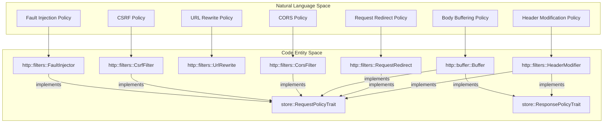
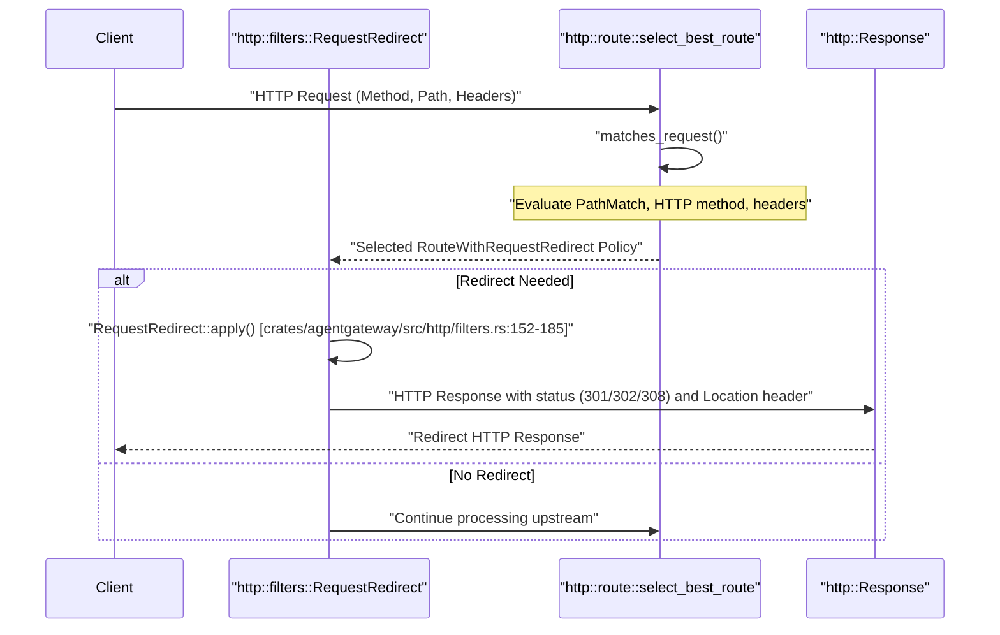

<!-- source: DeepWiki mcp.deepwiki.com · repo agentgateway/agentgateway · page 6.3 CORS and Request Filters · fetched 2026-10-21 -->

# CORS and Request Filters

Relevant source files

The following files were used as context for generating this wiki page:

- [crates/agentgateway/src/http/filters.rs](crates/agentgateway/src/http/filters.rs)
- [crates/agentgateway/src/http/filters_test.rs](crates/agentgateway/src/http/filters_test.rs)

## Purpose and Scope

This document details the Cross-Origin Resource Sharing (CORS) configuration, header/path filters, request redirects, URL rewrites, and request/response transformation filters in Agentgateway. It describes how these filters manipulate HTTP request and response metadata during proxy processing to control cross-origin access, inject headers, perform URL adjustments, enforce security protections (such as CSRF), manage redirects, and enable fault injection.

The key implementations reside primarily in `crates/agentgateway/src/http/filters.rs` [crates/agentgateway/src/http/filters.rs:1-215]() and associated test files `crates/agentgateway/src/http/filters_test.rs` [crates/agentgateway/src/http/filters_test.rs:1-266]().

Sources: [crates/agentgateway/src/http/filters.rs:1-215](), [crates/agentgateway/src/http/filters_test.rs:1-266]()

---

## Overview

Agentgateway’s request filters act as configurable middleware in the HTTP request and response pipeline. These filters enable operators to:

- Control and enforce CORS headers for cross-origin resource sharing.
- Modify or add custom headers (e.g., security headers).
- Perform HTTP redirects based on scheme, host, port, or path conditions.
- Transparently rewrite request URLs before proxying upstream.
- Define failure modes for request/response body buffering.
- Inject fault conditions, simulate delays, or direct responses for testing purposes.

Filters implement traits such as `RequestPolicyTrait`, `ResponsePolicyTrait`, and `BackendPolicyTrait`, allowing their execution at different phases of request processing.

Sources: [crates/agentgateway/src/http/filters.rs:1-122]()

---

## Filter Architecture and Entity Mapping

The filter system converts high-level policy configurations into executable Rust entities implementing filter traits.

### Filter Entity Mapping Diagram

This mapping aligns configuration schema (YAML/JSON) with concrete Rust structs that integrate into the request lifecycle.

Sources: [crates/agentgateway/src/http/filters.rs:1-122]()

---

## Header Modification (`HeaderModifier`)

The `HeaderModifier` struct enables flexible manipulation of HTTP headers in requests and responses by supporting three operations:

- `add`: Append header values without overwriting existing ones.
- `set`: Overwrite or add header values.
- `remove`: Delete headers by name.

### Implementation Details

- **Data Model:**  
  `HeaderModifier` stores vectors of `(Strng, Strng)` tuples for `add` and `set`, and a vector of strings for `remove` headers [crates/agentgateway/src/http/filters.rs:29-41]().

- **Apply to HeaderMap:**  
  The `apply` function transforms header names and values into typed `HeaderName` and `HeaderValue` and applies the add/set/remove operations on a mutable `HeaderMap` [crates/agentgateway/src/http/filters.rs:44-55]().

- **Apply to Request:**  
  The `apply_request` method operates on a mutable HTTP `Request` object, leveraging internal types such as `RequestOrResponse` and actions like `HeaderMutationAction::AppendIfExistsOrAdd` or `OverwriteIfExistsOrAdd` to enforce correct header semantics [crates/agentgateway/src/http/filters.rs:57-85]().

- **Trait Implementations:**  
  Implements asynchronous trait methods to apply header modifications on different phases: incoming requests (`RequestPolicyTrait`), upstream/backend requests (`BackendPolicyTrait`), and outgoing responses (`ResponsePolicyTrait`) [crates/agentgateway/src/http/filters.rs:87-122]().

Sources: [crates/agentgateway/src/http/filters.rs:29-122]()

---

## Request Redirects and URL Rewrites

### RequestRedirect

`RequestRedirect` enables configuration-driven HTTP redirect responses by rewriting parts of the request URI and emitting an HTTP redirect status with a `Location` header.

- **Fields:**  
  - `scheme`: Optional new URI scheme (e.g., `https`)  
  - `authority`: Optional changes to host and/or port encapsulated in `HostRedirect`  
  - `path`: Optional path modifications via `PathRedirect`  
  - `status`: Optional HTTP redirect status code (default 302 Found) [crates/agentgateway/src/http/filters.rs:125-149]().

- **Redirect Application:**  
  When applied to a request, it retrieves matching path information, constructs the new scheme/authority/path, logs via `pol_result!`, and returns a `PolicyResponse` containing a direct response builder configured with the redirect status and `Location` header [crates/agentgateway/src/http/filters.rs:151-185]().

- **Integration:**  
  Implements `RequestPolicyTrait` to intercept ingress requests [crates/agentgateway/src/http/filters.rs:188-200]().

### UrlRewrite and OriginalUrl

- `UrlRewrite` transparently rewrites request URIs by modifying authority and path components before forwarding requests upstream [crates/agentgateway/src/http/filters.rs:203-210]().
- To preserve the original URI, the filter stores the unmodified URI as an extension of type `OriginalUrl` on the request [crates/agentgateway/src/http/filters.rs:212-214]().

Sources: [crates/agentgateway/src/http/filters.rs:125-214]()

---

### Request Redirect Processing Flow

### Request Redirect Sequence Diagram

Sources: [crates/agentgateway/src/http/filters.rs:125-214]()

---

## CORS Handling

Common CORS operations in Agentgateway include:
- Inspecting `Origin` and `Access-Control-Request-*` headers in incoming requests.
- Injecting `Access-Control-Allow-Origin`, `Access-Control-Allow-Methods`, `Access-Control-Allow-Headers`, and related headers in responses.
- Short-circuiting OPTIONS preflight requests with a `204 No Content` status.
- Enforcing allowed origins, methods, and headers declared in configuration policies via `RequestPolicyTrait` or `ResponsePolicyTrait`.

Sources: [crates/agentgateway/src/http/filters.rs:1-122]()

---

## CSRF and Security Headers

CSRF protection filters and security header filters intercept requests to validate tokens or append protective response headers (such as `Content-Security-Policy`, `X-Frame-Options`, `Strict-Transport-Security`). These execute before backend forwarding.

Sources: [crates/agentgateway/src/http/filters.rs:1-122]()

---

## Body Buffering and Failure Modes

Agentgateway supports request and response body buffering policies:
- **FailClosed:** If a body exceeds the configured maximum size, the filter immediately terminates processing with a direct error response (e.g., `413 Payload Too Large`), draining excess bytes to prevent connection stalls.
- **FailOpen:** Buffers up to the allowed size and transparently allows remaining content through, favoring availability over strict enforcement.

Sources: [crates/agentgateway/src/http/filters.rs:1-215]()

---

## Fault Injection and Redirect Filters

Fault injection filters simulate network or application error conditions by injecting artificial delays, returning direct error responses inline, or rewriting request URIs to test system resilience.

Sources: [crates/agentgateway/src/http/filters.rs:125-214]()

---

## Testing and Verification

The filter subsystem is tested extensively in `crates/agentgateway/src/http/filters_test.rs`, covering request redirects, scheme switching, port replacements, status code overrides, path matching strategies (prefix, exact, regex), and header modifications [crates/agentgateway/src/http/filters_test.rs:1-266]().

Sources: [crates/agentgateway/src/http/filters_test.rs:1-266]()

---

# References

- `crates/agentgateway/src/http/filters.rs` [1-215]()
- `crates/agentgateway/src/http/filters_test.rs` [1-266]()

---

