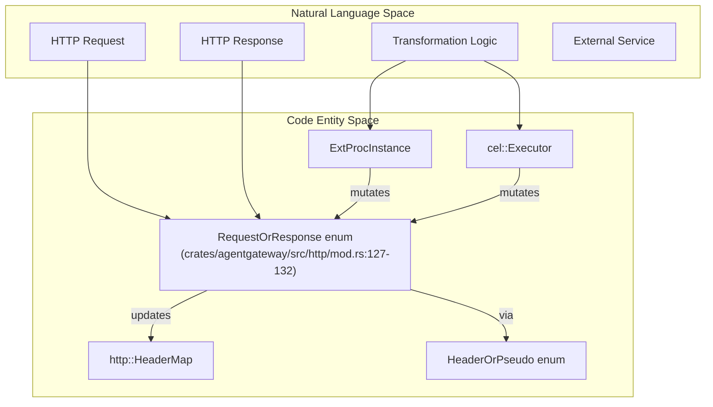
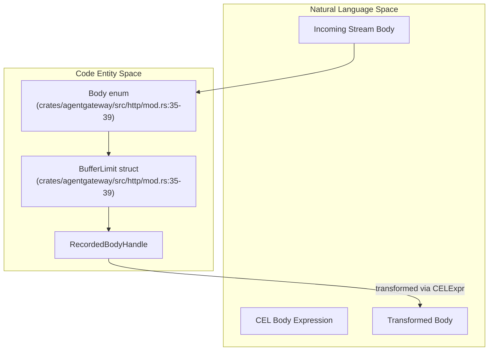

<!-- source: DeepWiki mcp.deepwiki.com · repo agentgateway/agentgateway · page 7 HTTP Processing and Transformation · fetched 2026-10-21 -->

# HTTP Processing and Transformation

Relevant source files

The following files were used as context for generating this wiki page:

- [crates/agentgateway/src/http/ext_authz.rs](crates/agentgateway/src/http/ext_authz.rs)
- [crates/agentgateway/src/http/ext_authz_tests.rs](crates/agentgateway/src/http/ext_authz_tests.rs)
- [crates/agentgateway/src/http/ext_proc.rs](crates/agentgateway/src/http/ext_proc.rs)
- [crates/agentgateway/src/http/ext_proc_tests.rs](crates/agentgateway/src/http/ext_proc_tests.rs)
- [crates/agentgateway/src/http/mod.rs](crates/agentgateway/src/http/mod.rs)
- [crates/agentgateway/src/http/remoteratelimit.rs](crates/agentgateway/src/http/remoteratelimit.rs)
- [crates/agentgateway/src/http/remoteratelimit_tests.rs](crates/agentgateway/src/http/remoteratelimit_tests.rs)
- [crates/agentgateway/src/test_helpers/extauthmock.rs](crates/agentgateway/src/test_helpers/extauthmock.rs)
- [crates/agentgateway/src/test_helpers/extprocmock.rs](crates/agentgateway/src/test_helpers/extprocmock.rs)
- [crates/agentgateway/src/test_helpers/mod.rs](crates/agentgateway/src/test_helpers/mod.rs)
- [crates/agentgateway/src/test_helpers/ratelimitmock.rs](crates/agentgateway/src/test_helpers/ratelimitmock.rs)

This page provides a high-level overview of how Agentgateway handles HTTP request and response processing, header manipulation, and body transformation. It outlines the core concepts and key subsystems involved in processing HTTP messages within the gateway data plane. Detailed technical information is covered in dedicated child pages linked below.

## Overview

Agentgateway implements a comprehensive pipeline to process and transform HTTP traffic passing through the gateway. This includes support for manipulating request and response messages, handling HTTP headers and pseudo-headers, modifying message bodies using CEL expressions, and integrating with external gRPC-based processing services.

The HTTP pipeline unifies representations of requests and responses via abstractions like the `RequestOrResponse` enum, enabling consistent treatment of headers and bodies regardless of message direction. It supports buffering, compression, payload size limits, and robust header mutation actions.

For further technical depth, each aspect of HTTP processing is covered in its own focused child page:

- [Request and Response Processing](#7.1) — covers the `RequestOrResponse` abstraction, error handling, compression, and buffering strategies.  
- [Header and Pseudo-Header Handling](#7.2) — details the handling of HTTP/2 pseudo-headers, the `HeaderOrPseudo` system, and how headers are sanitized and mutated.  
- [Body Transformation](#7.3) — explains CEL-based body rewriting, buffering strategies, and body size limits.  
- [External Processing (ExtProc)](#7.4) — describes the integration with external processing services via Envoy's gRPC `ext_proc` protocol, including bidirectional streaming and body mutation.  

### Transformation Pipeline Architecture

Sources:  
[crates/agentgateway/src/http/mod.rs:127-152]()  
[crates/agentgateway/src/http/ext_proc.rs:1-30]()

---

## Request and Response Processing

At the core of HTTP message handling is the `RequestOrResponse` enum, which abstracts over mutable requests and responses to enable generic processing logic. This abstraction allows transformations, policy enforcement, compression, and buffering to treat both requests and responses uniformly.

`RequestOrResponse` exposes methods to access and mutate headers (`headers()`), bodies (`body()`), and replace body bytes (`replace_body_bytes()`), regardless of whether the underlying message is a request or response [crates/agentgateway/src/http/mod.rs:147-165]().

The system provides support for marking sensitive headers (such as `Authorization`) to prevent accidental logging or exposure [crates/agentgateway/src/http/mod.rs:41-50](). Functions exist to iterate over or strip cookies by prefix for request processing [crates/agentgateway/src/http/mod.rs:52-86]().

Error handling in proxy operations involves types like `ProxyError`, and structures like `PolicyResponse` indicate policy evaluation results. Buffering and compression features are integrated here to ensure efficient handling of large or compressed payloads with configurable size limits.

For detailed mechanics, see [Request and Response Processing](#7.1).

Sources:  
[crates/agentgateway/src/http/mod.rs:41-165]()

---

## Header and Pseudo-Header Handling

Agentgateway manages both standard HTTP headers and HTTP/2 pseudo-headers such as `:method`, `:scheme`, `:authority`, `:path`, and `:status`. These pseudo-headers are critical for HTTP/2 framing and semantics and require careful mutation logic.

The `apply_header` method on `RequestOrResponse` allows adding, appending, or removing headers and pseudo-headers with normalization [crates/agentgateway/src/http/mod.rs:167-195](). For example, mutations of the `host` header on requests are normalized to the `:authority` pseudo-header for consistency [crates/agentgateway/src/http/mod.rs:175-184]().

URI components can be safely modified using internal helpers that update the request’s URI parts according to HTTP/2 rules, ensuring that invalid combinations are handled correctly [crates/agentgateway/src/http/mod.rs:200-225]().

The system treats headers with an explicit `HeaderOrPseudo` key enum to distinguish between normal headers and HTTP/2 pseudo-headers, enabling unified yet nuanced mutation logic.

For full details, see [Header and Pseudo-Header Handling](#7.2).

Sources:  
[crates/agentgateway/src/http/mod.rs:167-225]()

---

## Body Transformation

Body transformation supports modifying or inspecting request and response bodies using Common Expression Language (CEL) expressions. CEL requires working on the full body payload; thus, Agentgateway supports buffering strategies to accumulate body content before applying transformations.

The `Body` type represents HTTP message bodies and can be raw streaming data, buffered content, or recorded bodies [crates/agentgateway/src/http/mod.rs:35-39](). Buffer limits (`BufferLimit`) provide size constraints to prevent resource exhaustion with large payloads [crates/agentgateway/src/http/mod.rs:35-39]().

The system handles partial buffering when necessary, integrates with compression modules, and coordinates with external processing.

### Body Buffering Architecture

For a detailed technical overview, see [Body Transformation](#7.3).

Sources:  
[crates/agentgateway/src/http/mod.rs:35-39]()

---

## External Processing (ExtProc)

Agentgateway integrates with external HTTP processing services using Envoy's `ext_proc` gRPC protocol. This enables external systems to inspect, mutate, or short-circuit HTTP requests and responses by receiving bidirectional streams of header, body, and trailer frames.

The `ExtProcInstance` manages the state machine for these streaming interactions, controlling header sending phases, body chunking, and trailers. The module supports buffering request and response bodies for mutation, applying external policy decisions, and forwarding altered messages downstream.

ExtProc integration also supports dynamic backend routing based on external decisions, such as endpoint picker-based routing [crates/agentgateway/src/http/ext_proc.rs:138-153]().

The implementation consists of multiple submodules handling buffering, channel coordination, header and body mutation, and protocol-level processing within `crates/agentgateway/src/http/ext_proc.rs` [crates/agentgateway/src/http/ext_proc.rs:97-124]().

For complete details, see [External Processing (ExtProc)](#7.4).

Sources:  
[crates/agentgateway/src/http/ext_proc.rs:97-124]()  
[crates/agentgateway/src/http/ext_proc.rs:138-153]()

---

This page serves as a parent overview connecting the major facets of HTTP processing in Agentgateway and linking to their dedicated subsystems for detailed study.

---

