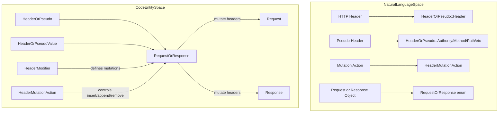
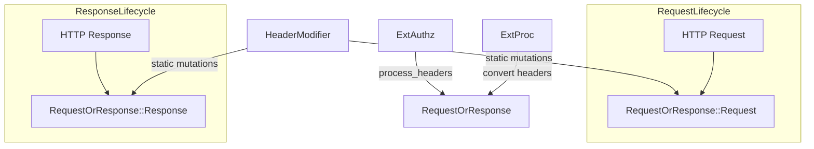
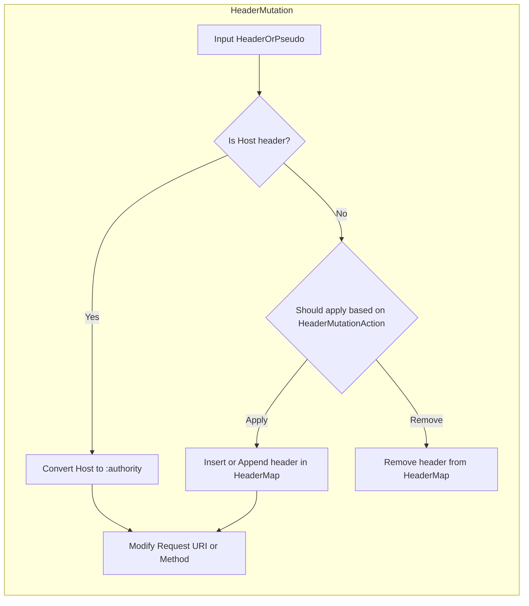

<!-- source: DeepWiki mcp.deepwiki.com · repo agentgateway/agentgateway · page 7.2 Header and Pseudo-Header Handling · fetched 2026-10-21 -->

# Header and Pseudo-Header Handling

Relevant source files

The following files were used as context for generating this wiki page:

- [crates/agentgateway/src/http/ext_authz.rs](crates/agentgateway/src/http/ext_authz.rs)
- [crates/agentgateway/src/http/ext_authz_tests.rs](crates/agentgateway/src/http/ext_authz_tests.rs)
- [crates/agentgateway/src/http/ext_proc.rs](crates/agentgateway/src/http/ext_proc.rs)
- [crates/agentgateway/src/http/ext_proc_tests.rs](crates/agentgateway/src/http/ext_proc_tests.rs)
- [crates/agentgateway/src/http/mod.rs](crates/agentgateway/src/http/mod.rs)
- [crates/agentgateway/src/http/remoteratelimit.rs](crates/agentgateway/src/http/remoteratelimit.rs)
- [crates/agentgateway/src/http/remoteratelimit_tests.rs](crates/agentgateway/src/http/remoteratelimit_tests.rs)
- [crates/agentgateway/src/test_helpers/extauthmock.rs](crates/agentgateway/src/test_helpers/extauthmock.rs)
- [crates/agentgateway/src/test_helpers/extprocmock.rs](crates/agentgateway/src/test_helpers/extprocmock.rs)
- [crates/agentgateway/src/test_helpers/mod.rs](crates/agentgateway/src/test_helpers/mod.rs)
- [crates/agentgateway/src/test_helpers/ratelimitmock.rs](crates/agentgateway/src/test_helpers/ratelimitmock.rs)

This document describes how Agentgateway handles HTTP headers and HTTP/2 pseudo-headers throughout the request processing pipeline. Pseudo-headers are special HTTP/2 header-like constructs that represent request/response metadata such as method, path, authority, scheme, and status. Agentgateway provides a unified interface for accessing and manipulating both regular headers and pseudo-headers across policies, CEL expressions, and external processing.

For information about body transformation, see [Body Transformation](7.3). For header-based routing and matching, see [Routes and Matching](3.5).

Sources: [crates/agentgateway/src/http/mod.rs:127-144](), [crates/agentgateway/src/http/mod.rs:167-225]()

## Overview

HTTP/2 introduces pseudo-headers—special header-like fields prefixed with `:` that represent core request/response attributes. Unlike regular HTTP headers, pseudo-headers must appear before regular headers and have specific semantics. Agentgateway abstracts this complexity by treating pseudo-headers as first-class citizens alongside regular headers, allowing policies and internal transformations to read and write them uniformly via the `HeaderOrPseudo` abstraction.

**Supported pseudo-headers:**

- **`:method`**: HTTP request method (`GET`, `POST`, etc.)
- **`:scheme`**: URI scheme (`http`, `https`)
- **`:authority`**: Host and optional port
- **`:path`**: Path and query string
- **`:status`**: HTTP response status code (response-only)

Sources: [crates/agentgateway/src/http/mod.rs:127-144](), [crates/agentgateway/src/http/mod.rs:167-225]()

## Data Types and Representation

### HeaderOrPseudo System

Agentgateway defines two key enums that unify headers and pseudo-headers under a single abstraction used in header processing and mutations:

- **`HeaderOrPseudo`**: Enum that covers either a standard HTTP header (`HeaderName`) or one of the HTTP/2 pseudo-headers like `:method`, `:scheme`, `:authority`, `:path`, or `:status`.
- **`HeaderOrPseudoValue`**: Union enum wrapping the value of a header or pseudo-header, which could be a header value (`HeaderValue`) or specialized types like HTTP method (`Method`), scheme (`Scheme`), authority, etc.

This design allows consistent handling and transformations without requiring separate code paths for pseudo-headers.

### RequestOrResponse Handle

The enum `RequestOrResponse` provides a mutable handle to either an HTTP request or response object with methods to access headers and body transparently. This is crucial for header mutation routines that apply uniformly to requests or responses.

### Header Modification with `apply_header`

The core method for applying header and pseudo-header mutations is `RequestOrResponse::apply_header`. It takes:

- A key of type `HeaderOrPseudo`
- An optional value of type `HeaderOrPseudoValue`
- An action type (`HeaderMutationAction`) indicating insertion, append, or removal

Key behaviors include:

- Normalization of the `Host` header for requests into the `:authority` pseudo-header to maintain HTTP/2 protocol consistency.
- For pseudo-headers such as `:method`, `:scheme`, and `:authority`, the underlying HTTP request components (e.g., method or URI parts) are mutated directly instead of changing header map entries.
- Headers are inserted, appended, or removed from the mutable headers map depending on the mutation action.

### HeaderModifier Structure

`HeaderModifier` defines static header mutations, including:

- `add`: Headers to append without replacing existing values
- `set`: Headers to replace existing values or insert
- `remove`: Headers to delete
- Optional `replace`: CEL expression to replace header sets (less common)

Policies use `HeaderModifier` to specify consistent header mutations, which are then applied through the `RequestOrResponse` interface and `apply_header` method.

### Supporting Utilities for Cookies

Because HTTP `Cookie` headers differ from typical headers (containing multiple semicolon-separated cookies in a single header), Agentgateway provides specialized cookie helper functions:

| Function                        | Purpose                                              |
|-------------------------------|-----------------------------------------------------|
| `iter_request_cookies`         | Iterates cookies parsed from the `Cookie` header   |
| `read_request_cookie`          | Retrieves value of a specific cookie by name        |
| `strip_request_cookies_by_prefix` | Removes cookies matching a prefix and rebuilds `Cookie` header |

These utilities handle the complex semantics of cookies stored in headers safely and correctly.

Sources: [crates/agentgateway/src/http/mod.rs:41-86](), [crates/agentgateway/src/http/mod.rs:127-225]()

---

## Header and Pseudo-Header Code Entities

Sources: [crates/agentgateway/src/http/mod.rs:127-144](), [crates/agentgateway/src/http/mod.rs:167-225]()

---

## Policy Application Flow

Header mutations are applied at multiple stages during request and response processing:

1. **Ingress Processing**: Incoming request headers and pseudo-headers are initially accessible and immutable until policy application.
2. **Policy Evaluation and Mutation**: Policies apply header modifications via static `HeaderModifier` instances or via CEL-driven dynamic mutations.
3. **Mutation Execution**: `RequestOrResponse::apply_header` performs the needed insertions, appends, replacements, or removals on headers and pseudo-headers.
4. **External Services**: These header mutations propagate when interfacing with external authorization (`ExtAuthz`), external processing (`ExtProc`), or remote rate limiting systems.

### Header Mutation Pipeline Diagram

Sources:  
- [crates/agentgateway/src/http/mod.rs:127-225]()  
- [crates/agentgateway/src/http/ext_authz.rs:134-141]()  
- [crates/agentgateway/src/http/ext_proc.rs:80-120]()

---

## Specialized Header Operations

### Redirects and URL Rewrites

Filters such as `RequestRedirect` and `UrlRewrite` manipulate URI components affecting pseudo-headers:

- **`RequestRedirect`** computes a new `Location` header, rewriting scheme, authority, and path components as configured.
- **`UrlRewrite`** modifies the request URI prior to forwarding upstream, updating the relevant pseudo-headers.

These filters internally change pseudo-header fields (`:scheme`, `:authority`, `:path`) through the `RequestOrResponse` interface.

### Host and Authority Normalization

To maintain HTTP/2 compliance, the `Host` header is normalized:

- When setting the `Host` header in a request, Agentgateway transforms this into the `:authority` pseudo-header.
- The original `Host` header is removed from the header map.
- This ensures consistent communication with HTTP/2 upstreams and avoids header mismatch.

### Cookie Header Handling

The following cookie helper functions are used for safe manipulation:

| Function                      | Purpose                                             |
|-----------------------------|-----------------------------------------------------|
| `iter_request_cookies`       | Parses and iterates cookies in the `Cookie` header  |
| `read_request_cookie`        | Reads a specific cookie value by name                |
| `strip_request_cookies_by_prefix` | Removes cookies with names starting with a prefix, rebuilds the `Cookie` header |

This complexity is necessary because cookies are stored as semi-colon separated strings in a single header, unlike typical HTTP headers.

Sources: [crates/agentgateway/src/http/mod.rs:41-86](), [crates/agentgateway/src/http/mod.rs:175-184]()

---

## Header and URI Synchronization Pattern

This flow outlines how the system first normalizes `Host` headers to `:authority` for requests, then performs header insertion/appending/removal per mutation action, mutating the underlying URI or method where appropriate.

Sources: [crates/agentgateway/src/http/mod.rs:167-225]()

---

## External Integration Points

### External Authorization (ExtAuthz)

ExtAuthz subsystem manages headers with:

- Allowlist filtering to include only specific headers in checks (`include_request_headers`).
- Adding headers computed via CEL expressions for authorization requests (`add_request_headers`).
- Uses `HeaderOrPseudo` and `HeaderOrPseudoValue` for key/value definitions in configuration and header processing.

This integration guarantees correct header transformation and propagation during external authorization.

### External Processing (ExtProc)

The ExtProc subsystem converts Agentgateway's HTTP headers and pseudo-headers into Envoy-style protobuf `HttpHeaders` messages, preserving all semantics.

- It uses conversion helpers like `req_to_header_map` and `resp_to_header_map`.
- Maintains the mapping between `HeaderOrPseudo` and Envoy proto header representations.

### Remote Rate Limiting

Remote rate limiting constructs gRPC `RateLimitRequest` messages by evaluating CEL expressions referencing request headers, pseudo-headers, and other attributes.

- Headers are extracted using the unified `HeaderOrPseudo` system.
- Descriptors contain key/value pairs with CEL-evaluated values, matching headers or pseudo-header content.

Sources: [crates/agentgateway/src/http/ext_authz.rs:134-145](), [crates/agentgateway/src/http/ext_proc.rs:89-94](), [crates/agentgateway/src/http/remoteratelimit.rs:51-97]()

---

## CEL Context and Schema Exposure

In CEL expressions throughout Agentgateway, headers and pseudo-headers are exposed to policies as:

- `request.headers`: Map object of HTTP headers accessible by string keys.
- `request.method`: HTTP request method string.
- `request.path`: Request path including query string.
- `request.host`: Derived from the `:authority` pseudo-header.
- `request.scheme`: URI scheme string.

This schema enables clear and uniform CEL expressions for header and pseudo-header access and manipulation.

Sources: [crates/agentgateway/src/http/mod.rs:127-225]()

---

## Testing and Validation

Agentgateway includes comprehensive tests for header and pseudo-header handling aspects:

- Verifies parsing and application of both header and pseudo-header mutations, including append vs. overwrite semantics.
- Tests normalization and rewriting of `Host` headers to `:authority`.
- Ensures pseudo-header mutations for `:method`, `:scheme`, and `:authority` mutate underlying HTTP method and URI correctly.
- Integration tests verify correct header transformations when interfacing with external authorization (ExtAuthz) and processing (ExtProc) mocks.

Sources: [crates/agentgateway/src/http/ext_authz_tests.rs:71-158](), [crates/agentgateway/src/http/ext_proc_tests.rs:1-66](), [crates/agentgateway/src/http/remoteratelimit_tests.rs:45-94]()

---

# Summary

Agentgateway’s header and pseudo-header handling centers on the unified abstraction `HeaderOrPseudo` and the `RequestOrResponse` interface that expose and manipulate HTTP/2 pseudo-headers transparently alongside regular headers. This design ensures consistent header access, mutation, and propagation across policy-based transformations, external system integrations such as ExtAuthz and ExtProc, and throughout the request/response lifecycle. Special handling for the `Host` header normalization, cookie parsing, and CEL expression integration complement the robustness of this subsystem.

This foundation enables advanced request transformations, routing decisions, external authorization, and secure header management in Agentgateway.

Sources:  
- [crates/agentgateway/src/http/mod.rs:1-225]()  
- [crates/agentgateway/src/http/ext_authz.rs:100-146]()  
- [crates/agentgateway/src/http/ext_proc.rs:80-120]()  
- [crates/agentgateway/src/http/remoteratelimit.rs:40-97]()  
- [crates/agentgateway/src/http/ext_authz_tests.rs:70-160]()  
- [crates/agentgateway/src/http/ext_proc_tests.rs:1-66]()  
- [crates/agentgateway/src/http/remoteratelimit_tests.rs:40-94]()

---

