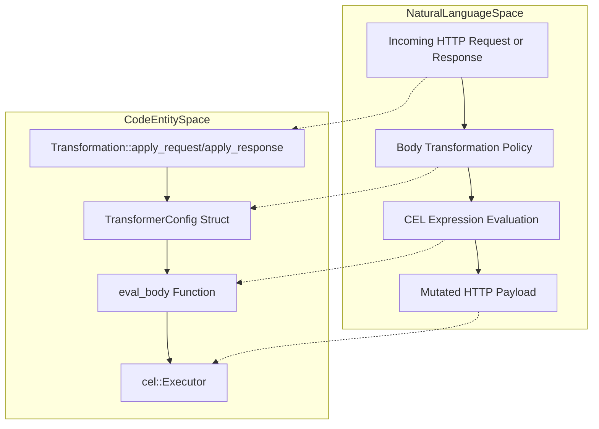
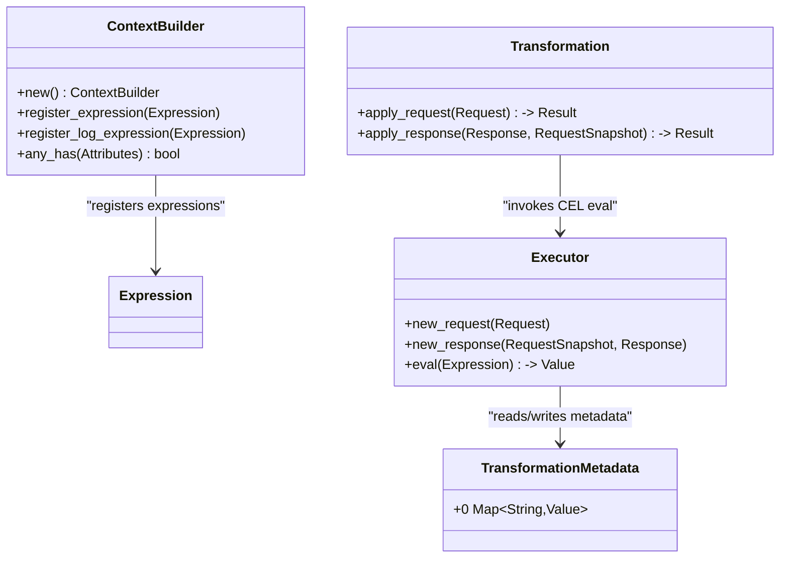
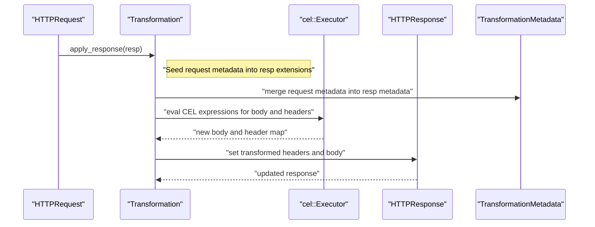

<!-- source: DeepWiki mcp.deepwiki.com · repo agentgateway/agentgateway · page 7.3 Body Transformation · fetched 2026-10-21 -->

# Body Transformation

<details>
<summary>Relevant source files</summary>

The following files were used as context for generating this wiki page:

- [crates/agentgateway/src/cel/mod.rs](crates/agentgateway/src/cel/mod.rs)
- [crates/agentgateway/src/cel/tests.rs](crates/agentgateway/src/cel/tests.rs)
- [crates/agentgateway/src/cel/types.rs](crates/agentgateway/src/cel/types.rs)
- [crates/agentgateway/src/cel/types_test.rs](crates/agentgateway/src/cel/types_test.rs)
- [crates/agentgateway/src/http/transformation_cel.rs](crates/agentgateway/src/http/transformation_cel.rs)
- [crates/agentgateway/src/http/transformation_cel_tests.rs](crates/agentgateway/src/http/transformation_cel_tests.rs)
- [schema/README.md](schema/README.md)
- [schema/cel.json](schema/cel.json)
- [schema/cel.md](schema/cel.md)

</details>


Body transformation in Agentgateway enables dynamic modification of HTTP request and response bodies using CEL (Common Expression Language) expressions. This page provides an in-depth technical exploration of CEL-based body transformation, buffering strategies, and size limit enforcement as implemented primarily in `crates/agentgateway/src/http/transformation_cel.rs` [crates/agentgateway/src/http/transformation_cel.rs:1-350]() and supported by CEL execution types in the `crates/agentgateway/src/cel/` crate.

---

## Overview and Configuration Architecture

Body transformation is configured via the `Transformation` type, which contains optional `TransformerConfig` instances for requests and responses. These configs specify how headers are manipulated and how the body itself can be replaced or transformed using CEL expressions.

- **Transformation**: A container struct that holds optional `request` and `response` transformation configurations, enabling separate specification for each direction of HTTP traffic [crates/agentgateway/src/http/transformation_cel.rs:21-29]().

- **TransformerConfig**: Defines detailed transformation rules including:
  - Header additions (`add`), replacements (`set`), and removals (`remove`) using CEL expressions to compute header values.
  - An optional `replace` CEL expression that replaces the entire header set with the evaluated map.
  - An optional `body` CEL expression that enables full replacement of the HTTP body.
  - Metadata key-value pairs added by CEL expressions [crates/agentgateway/src/http/transformation_cel.rs:31-78]().

This declarative configuration enables powerful and flexible runtime HTTP message modification triggered by policy evaluation.

Title: "Body Transformation Configuration and Execution Architecture"


Sources: [crates/agentgateway/src/http/transformation_cel.rs:21-78](), [crates/agentgateway/src/http/transformation_cel.rs:89-104](), [crates/agentgateway/src/http/transformation_cel.rs:149-183]()

---

## CEL-Based Body Transformation Execution

The central mechanism for evaluating and applying body transformations is the `eval_body` function, which executes a CEL expression in the appropriate context [crates/agentgateway/src/http/transformation_cel.rs:89-104]():

- `eval_body` takes a `RequestOrResponse` enum, which can be either:
  - A HTTP Request reference, triggering a CEL executor created by `cel::Executor::new_request`.
  - A HTTP Response reference, triggering an executor created by `cel::Executor::new_response` with an optional snapshot of the original request for context.

- The CEL expression result is converted into a `Bytes` payload by `cel::value_as_byte_or_json`. This conversion accepts either a string or any serializable JSON value, enabling transformations that yield raw bytes or structured JSON automatically serialized.

Title: "CEL Body Evaluation Flow"
```mermaid
graph TB
    subgraph "BodyTransformationCELEvaluation"
        ROR["RequestOrResponse enum"]
        ROR --> |Request(r)| ExecReq["cel::Executor::new_request"]
        ROR --> |Response(r)| ExecResp["cel::Executor::new_response"]
        ExecReq --> Eval["eval(expression)"]
        ExecResp --> Eval
        Eval --> Conv["value_as_byte_or_json"]
        Conv --> BytesOut["Bytes output"]
    end
```

This execution path enables flexible CEL logic over all aspects of the request/response, including headers, method, body content, and contextual information.

Sources: [crates/agentgateway/src/http/transformation_cel.rs:89-104](), [crates/agentgateway/src/cel/mod.rs:7-14]()

---

## Body Buffering, Context Management, and Size Limits

### CEL Context Builder and Buffering Activation

For CEL expressions to access the HTTP body (via `request.body` or `response.body` context attributes), the system must buffer the streaming body payload because HTTP bodies are generally streamed and not fully materialized in memory.

- The `ContextBuilder` from the CEL module gathers required attributes by inspecting compiled CEL expressions [crates/agentgateway/src/cel/mod.rs:143-204]().
- It distinguishes between attributes required during request processing and those required only for logging after the full request/response lifecycle.
- Expressions referencing `body` or `bodyPrefix` trigger buffering of the corresponding HTTP body with enforced maximum size limits to prevent unbounded memory usage.

Title: "Context Builder and Execution Classes"


This design ensures buffering is only performed when actually needed and controls memory by using a `BufferLimit` extension associated with each HTTP message.

Sources: [crates/agentgateway/src/cel/mod.rs:143-204](), [crates/agentgateway/src/cel/types.rs:39-81](), [crates/agentgateway/src/http/transformation_cel.rs:15-18]()

### Size Limits and Overflow Handling

- The maximum allowable buffered body size is enforced via a `BufferLimit` extension attached to the HTTP request or response [crates/agentgateway/src/cel/tests.rs:134-223]().
- If the body exceeds this limit:
  - Accessing the full `body` attribute in CEL expressions will fail with an error indicating the limit was hit [schema/cel.json:63-76]().
  - However, `bodyPrefix` remains available to CEL as a prefix of the initial bytes up to the buffer limit [schema/cel.json:70-76]().
- This design allows policies to safely use body prefixes where full buffering is too costly or unsupported.

The JSON schema for CEL expressions documents these properties clearly, indicating that requesting `body` triggers buffering and can fail if the body is too large [schema/cel.json:63-76]().

Extensive tests in the CEL crate show that buffering and evaluation behave correctly for bodies under and over the size limit, with errors returned on oversized bodies [crates/agentgateway/src/cel/tests.rs:134-223]().

Sources: [crates/agentgateway/src/cel/tests.rs:134-223](), [schema/cel.json:63-76]()

---

## Implementation Details and Metadata Propagation

During the response transformation phase, `Transformation::apply_response` first merges any metadata accumulated during the request transformation into the response extensions [crates/agentgateway/src/http/transformation_cel.rs:149-183](). This behavior:

- Preserves request-phase transformation metadata for subsequent response transformation logic.
- Enables CEL expressions during response transformation and logging to see a unified metadata set.
- Merges keys without overwriting response metadata, guaranteeing response-time metadata precedence.

After seeding metadata, the method applies the response transformation per configuration, evaluating CEL expressions for headers and body replacements.

Title: "Response Transformation and Metadata Propagation"


Sources: [crates/agentgateway/src/http/transformation_cel.rs:149-183]()

---

# Summary

Agentgateway's Body Transformation subsystem integrates tightly with the CEL execution engine to provide runtime HTTP message body and header modification with detailed policy control.

Key features include:

- **Declarative Transformation Configuration:** The `Transformation` and `TransformerConfig` structs enable comprehensive specification of header and body changes using CEL expressions [crates/agentgateway/src/http/transformation_cel.rs:21-78]().

- **CEL Execution with Rich Context:** Using `cel::Executor`, transformations can access full request and response contexts including buffered bodies and metadata [crates/agentgateway/src/cel/types.rs:39-81](), [crates/agentgateway/src/http/transformation_cel.rs:89-104]().

- **Buffering on Demand with Protection:** HTTP bodies are buffered only when expressions require access, with enforced buffer size limits to avoid resource exhaustion; partial data is available via body prefixes [crates/agentgateway/src/cel/mod.rs:143-204](), [crates/agentgateway/src/cel/tests.rs:134-223]().

- **Metadata Propagation:** Metadata generated during request transformations is preserved and merged into the response scope, facilitating complex cross-phase logic in CEL [crates/agentgateway/src/http/transformation_cel.rs:149-183]().

This framework empowers precise, efficient, and safe dynamic modification of HTTP bodies throughout the Agentgateway request lifecycle.

---

Sources:

- [crates/agentgateway/src/http/transformation_cel.rs:15-78]()
- [crates/agentgateway/src/http/transformation_cel.rs:89-104]()
- [crates/agentgateway/src/http/transformation_cel.rs:149-183]()
- [crates/agentgateway/src/cel/mod.rs:143-204]()
- [crates/agentgateway/src/cel/types.rs:39-81]()
- [crates/agentgateway/src/cel/tests.rs:134-223]()
- [schema/cel.json:63-76]()

---

