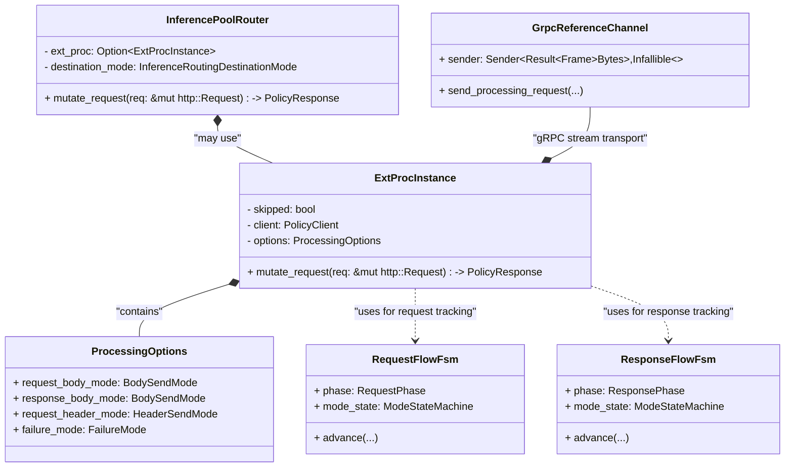
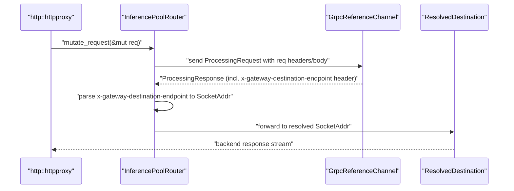

<!-- source: DeepWiki mcp.deepwiki.com · repo agentgateway/agentgateway · page 7.4 External Processing (ExtProc) · fetched 2026-10-21 -->

# External Processing (ExtProc)

Relevant source files

The following files were used as context for generating this wiki page:

- [crates/agentgateway/src/http/ext_authz.rs](crates/agentgateway/src/http/ext_authz.rs)
- [crates/agentgateway/src/http/ext_authz_tests.rs](crates/agentgateway/src/http/ext_authz_tests.rs)
- [crates/agentgateway/src/http/ext_proc.rs](crates/agentgateway/src/http/ext_proc.rs)
- [crates/agentgateway/src/http/ext_proc_tests.rs](crates/agentgateway/src/http/ext_proc_tests.rs)
- [crates/agentgateway/src/http/mod.rs](crates/agentgateway/src/http/mod.rs)
- [crates/agentgateway/src/http/remoteratelimit.rs](crates/agentgateway/src/http/remoteratelimit.rs)
- [crates/agentgateway/src/http/remoteratelimit_tests.rs](crates/agentgateway/src/http/remoteratelimit_tests.rs)
- [crates/agentgateway/src/test_helpers/extauthmock.rs](crates/agentgateway/src/test_helpers/extauthmock.rs)
- [crates/agentgateway/src/test_helpers/extprocmock.rs](crates/agentgateway/src/test_helpers/extprocmock.rs)
- [crates/agentgateway/src/test_helpers/mod.rs](crates/agentgateway/src/test_helpers/mod.rs)
- [crates/agentgateway/src/test_helpers/ratelimitmock.rs](crates/agentgateway/src/test_helpers/ratelimitmock.rs)

## Purpose and Scope
This page documents the External Processing (`ExtProc`) integration in agentgateway, implemented in `crates/agentgateway/src/http/ext_proc.rs` [crates/agentgateway/src/http/ext_proc.rs:1-1910](). `ExtProc` enables outbound gRPC integration with an external processing service following Envoy's `envoy.service.ext_proc.v3` protocol. It supports bidirectional streaming of HTTP request and response lifecycle messages that allow inspection and mutation of headers, bodies, and trailers.

This service integration is a powerful extensibility point, enabling dynamic transformations, routing decisions based on streaming body content, and metadata injection into the request context. It offers fine-grained control over both requests and responses at all HTTP phases.

For related integrations, see [External Authorization (ExtAuthz)](5.5) and [Body Transformation](7.3).

Sources: [crates/agentgateway/src/http/ext_proc.rs:1-40]()

---

## Protocol Overview and Contracts

The ExtProc integration uses a single bidirectional gRPC stream for each HTTP transaction via the `ExternalProcessor.Process` method. The gateway acts as a gRPC client, sending `ProcessingRequest` messages representing discrete HTTP phases, and receives corresponding `ProcessingResponse` messages containing mutation instructions or short-circuit responses.

### `ProcessingRequest` message variants include:
- `request_headers`: Sent immediately with request headers.
- `request_body`: Sent with chunks of the request body.
- `request_trailers`: Sent upon receiving request trailers.
- `response_headers`: Sent when response headers arrive.
- `response_body`: Sent with chunks of the response body.
- `response_trailers`: Sent when response trailers arrive.

### `ProcessingResponse` message variants include:
- `request_headers` / `response_headers`: Header mutation instructions.
- `request_body` / `response_body`: Body mutation instructions.
- `request_trailers` / `response_trailers`: Trailer mutation instructions.
- `immediate_response`: A short-circuited immediate client HTTP response.

The protocol allows both synchronous and asynchronous control over HTTP phases, enabling streaming data mutation or immediate response short-circuits.

The protocol messages are re-exported in the module `proto` within `ext_proc.rs` [crates/agentgateway/src/http/ext_proc.rs:9-21](), [crates/agentgateway/src/http/ext_proc.rs:90-95]().

Sources: [crates/agentgateway/src/http/ext_proc.rs:9-21](), [crates/agentgateway/src/http/ext_proc.rs:90-95]()

---

## Code Entity Mapping

The below diagram maps natural language system components in ExtProc integration to key Rust structs and modules in the codebase.

Title: ExtProc Code Entity Mapping Diagram

- `ExtProcInstance` is the central struct managing the external processor client connection, state, and options [crates/agentgateway/src/http/ext_proc.rs:185-188]().
- `ProcessingOptions` configures how headers and bodies are sent and mutated [crates/agentgateway/src/http/ext_proc.rs:121-124]().
- `RequestFlowFsm` and `ResponseFlowFsm` are finite state machines for request and response phases [crates/agentgateway/src/http/ext_proc.rs:117-121]().
- `GrpcReferenceChannel` encapsulates the bidirectional gRPC transport channel [crates/agentgateway/src/http/ext_proc.rs:107]().
- `InferencePoolRouter` is an ExtProc-aware router using external processing results for routing decisions [crates/agentgateway/src/http/ext_proc.rs:185-188]().

Sources: [crates/agentgateway/src/http/ext_proc.rs:107](), [crates/agentgateway/src/http/ext_proc.rs:117-124](), [crates/agentgateway/src/http/ext_proc.rs:185-188]()

---

## State Management and Flow Control

### Processing Modes and `ModeStateMachine`

ExtProc supports several modes controlling how request and response bodies and headers are sent:

- `BodySendMode` values: `None`, `Buffered`, `Streamed`, `FullDuplexStreamed` [crates/agentgateway/src/http/ext_proc.rs:123]().
- `HeaderSendMode` values: `Skip`, `Send`, `Trigger` [crates/agentgateway/src/http/ext_proc.rs:123]().
- `TrailerSendMode` similarly controls trailer sending [crates/agentgateway/src/http/ext_proc.rs:123]().

These modes are consolidated by the `ModeStateMachine` struct, which enforces invariants such as forcing trailers to be sent during full-duplex streaming [crates/agentgateway/src/http/ext_proc_tests.rs:43-66]().

Dynamic overriding of mode state happens based on initial ExtProc response messages to align with Envoy behavior for compatibility [crates/agentgateway/src/http/ext_proc_tests.rs:68-96]().

### Request and Response FSMs

ExtProc request and response processing are managed via independent finite state machines [crates/agentgateway/src/http/ext_proc.rs:117-121]():

- `RequestFlowFsm` manages `HeaderPhase`, `BodyPhase`, and `TrailerPhase` [crates/agentgateway/src/http/ext_proc.rs:117-120]().
- `ResponseFlowFsm` manages similar phases for the response lifecycle [crates/agentgateway/src/http/ext_proc.rs:119-121]().

These FSMs drive the sending of processing requests at the proper time and handle the corresponding responses including mutation instructions or immediate responses.

Sources: [crates/agentgateway/src/http/ext_proc.rs:117-124](), [crates/agentgateway/src/http/ext_proc_tests.rs:43-96]()

---

## Inference Routing (`InferenceRouting`)

`InferenceRouting` represents a specialized use of ExtProc for AI model inference request routing. It uses an external processing service to analyze the request and dynamically select the destination endpoint [crates/agentgateway/src/http/ext_proc.rs:138-153]().

The key struct is `InferencePoolRouter`, which holds an optional `ExtProcInstance` client and manages destination validation modes [crates/agentgateway/src/http/ext_proc.rs:185-188]().

Title: Inference Routing Data Flow Diagram

- The external processor can set the special header `x-gateway-destination-endpoint` to indicate the routing IP and port [crates/agentgateway/src/http/ext_proc.rs:43-44]().
- The `InferenceRoutingDestinationMode` controls trust:
  - `Validated`: The destination must be validated locally [crates/agentgateway/src/http/ext_proc.rs:131-132]().
  - `Passthrough`: The destination is trusted directly [crates/agentgateway/src/http/ext_proc.rs:134]().
- Failure modes control behavior on routing failure (fail open or closed) [crates/agentgateway/src/http/ext_proc.rs:149-152]().

This architecture enables request routing decisions conditioned on streaming request body content or headers, useful in GenAI processing pipelines.

Sources: [crates/agentgateway/src/http/ext_proc.rs:43-45](), [crates/agentgateway/src/http/ext_proc.rs:128-153](), [crates/agentgateway/src/http/ext_proc.rs:183-196]()

---

## Body Buffering and Mutation

The ExtProc integration supports various body modes configurable via `ProcessingOptions` [crates/agentgateway/src/http/ext_proc.rs:123]():

- `None`: Do not send the body to the external processor.
- `Buffered`: Buffer the entire body before sending (single message).
- `Streamed`: Stream body chunks incrementally.
- `FullDuplexStreamed`: Full duplex streaming of bodies both ways, including trailers.

The external processor can respond with `BodyMutation` messages, specifying mutations like:
- Full replacement of body content [crates/agentgateway/src/test_helpers/extprocmock.rs:183-191]().
- Streaming mutated content in chunks [crates/agentgateway/src/test_helpers/extprocmock.rs:113-122]().

The submodules `mutation` and `buffering` handle the conversion between protobuf mutations and HTTP requests/responses [crates/agentgateway/src/http/ext_proc.rs:97-116]().

Unit tests extensively cover various body modes including replacing request bodies, stream buffering, and handling partial buffers [crates/agentgateway/src/http/ext_proc_tests.rs:100-212]().

Sources: [crates/agentgateway/src/http/ext_proc.rs:97-116](), [crates/agentgateway/src/http/ext_proc_tests.rs:100-212](), [crates/agentgateway/src/test_helpers/extprocmock.rs:110-192]()

---

## Dynamic Metadata and Error Handling

### Dynamic Metadata Injection

The ExtProc service can send back `dynamic_metadata` as part of its `ProcessingResponse`. This data is structured as JSON and wrapped in `ExtProcDynamicMetadata` (`serde_json::Map<String, JsonValue>`) for seamless policy and routing use [crates/agentgateway/src/http/ext_proc.rs:84-86]().

Internal attributes for ExtProc are namespaced using the constant `"envoy.filters.http.ext_proc"` to isolate processing metadata from other systems [crates/agentgateway/src/http/ext_proc.rs:31-32]().

### Failure Modes and Errors

`FailureMode` enum governs behavior when the external processor is unavailable or returns an error [crates/agentgateway/src/http/ext_proc.rs:123]():
- `FailClosed` (default for inference routing): Request is denied upon failure [crates/agentgateway/src/http/ext_proc.rs:179]().
- `FailOpen`: Failure is logged, but the request proceeds.

The `Error` enum enumerates detailed error variants for:
- Sending request failures (`RequestSend`) [crates/agentgateway/src/http/ext_proc.rs:65-67]().
- Missing expected responses (`NoMoreResponses`) [crates/agentgateway/src/http/ext_proc.rs:68-69]().
- Buffering errors (`BodyBuffer`) [crates/agentgateway/src/http/ext_proc.rs:72-73]().
- Invalid mutations returned by the external processor (`BodyMutation`) [crates/agentgateway/src/http/ext_proc.rs:74-75]().
- Metadata conversion errors [crates/agentgateway/src/http/ext_proc.rs:76-77]().

Sources: [crates/agentgateway/src/http/ext_proc.rs:31-36](), [crates/agentgateway/src/http/ext_proc.rs:64-82](), [crates/agentgateway/src/http/ext_proc.rs:123](), [crates/agentgateway/src/http/ext_proc.rs:179]()

---

# Summary

The External Processing (`ExtProc`) integration in agentgateway provides a sophisticated, bidirectional gRPC streaming interface for HTTP request/response inspection and mutation. It closely follows Envoy's `ext_proc` protocol, employs request and response finite state machines to manage streaming phases, supports multiple body modes with buffering and mutation, and dynamically injects metadata for downstream policy use.

The integration enables powerful use cases such as body-aware inference routing and dynamic header/body rewriting, making it a critical extensibility mechanism within the AI gateway architecture.

---

# Appendix: Key Files and Modules

| File | Description |
|-------|-------------|
| `crates/agentgateway/src/http/ext_proc.rs` | Core ExtProc implementation including client, FSM, and streaming logic. |
| `crates/agentgateway/src/http/ext_proc_tests.rs` | Unit and integration tests covering ExtProc functionalities and body modes. |
| `crates/agentgateway/src/test_helpers/extprocmock.rs` | Helpers and mocks for testing ExtProc server interactions. |

---

This completes the documentation for External Processing (ExtProc).

---

