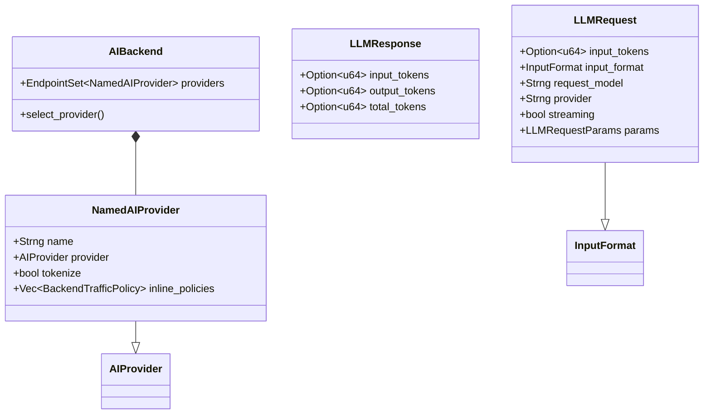

<!-- source: DeepWiki mcp.deepwiki.com · repo agentgateway/agentgateway · page 8 LLM and AI Gateway · fetched 2026-10-21 -->

# LLM and AI Gateway

Relevant source files

The following files were used as context for generating this wiki page:

- [crates/agentgateway/src/llm/mod.rs](crates/agentgateway/src/llm/mod.rs)
- [crates/agentgateway/src/llm/tests.rs](crates/agentgateway/src/llm/tests.rs)
- [crates/agentgateway/src/telemetry/log.rs](crates/agentgateway/src/telemetry/log.rs)
- [crates/agentgateway/src/telemetry/metrics.rs](crates/agentgateway/src/telemetry/metrics.rs)
- [crates/agentgateway/src/telemetry/trc.rs](crates/agentgateway/src/telemetry/trc.rs)
- [crates/agentgateway/tests/tests/llm.rs](crates/agentgateway/tests/tests/llm.rs)
- [crates/core/src/lib.rs](crates/core/src/lib.rs)
- [crates/core/src/metrics.rs](crates/core/src/metrics.rs)
- [crates/core/src/tokio_metrics.rs](crates/core/src/tokio_metrics.rs)

The agentgateway project provides a unified gateway interface to diverse LLM and AI service providers, enabling seamless, policy-driven routing, request and response translation, token accounting, and observability capabilities. This gateway acts as an AI/LLM data plane that abstracts multiple backend implementations behind a consistent interface while enforcing security, rate limiting, and content policies.

This page outlines the high-level architecture and capabilities of the LLM and AI Gateway subsystem. Detailed technical explanations and implementation specifics reside in dedicated child pages referenced throughout.

---

## Overview

At its core, the gateway supports:

- **Provider Abstraction**: The `AIProvider` enum and related abstractions unify multiple LLM backends (OpenAI, Anthropic, Gemini, Vertex AI, AWS Bedrock, Azure, Copilot, and custom implementations) under a common interface. This design enables route-based selection and failover of AI backends with health-aware load balancing.

- **Format Translation**: The gateway automatically converts LLM requests and responses between diverse provider formats—OpenAI Completions, Anthropic Messages, custom Bedrock Converse, Vertex API formats, etc.—using `RequestType` and `ResponseType` traits to marshal and unmarshal requests and responses.

- **AI-specific Policies**: Model aliasing, prompt enrichment, filtering, and runtime guardrails are applied to manage content safety, adherence to usage policies, and moderation, leveraging CEL expressions and guardrails frameworks.

- **Token Counting and Rate Limiting**: Client-side tokenization using `tiktoken-rs` provides accurate token cost estimation facilitating usage tracking and enforcement of token-budget rate limits.

- **Streaming Response Handling**: Server-Sent Events (SSE) based streaming responses are supported with real-time token extraction and integration with streaming guardrails.

- **Multi-provider Routing and Load Balancing**: Backend selection leverages a power-of-two choice algorithm over named providers, incorporating endpoint health and score metrics to balance load and provide failover.

- **Model Cost Catalog and Observability**: A hot-reloadable model catalog tracks model pricing and projects costs, feeding into metrics and telemetry for detailed AI operational insights.

These capabilities are implemented primarily in [crates/agentgateway/src/llm/mod.rs]() with modular subcomponents handling policies, translations, streaming, and provider specifics.

Sources: [crates/agentgateway/src/llm/mod.rs:10-150]()

---

## Core Components and Data Flow

The processing flow for LLM/AI requests within the gateway can be represented as follows, highlighting the major code entities handling each responsibility:

```mermaid
graph TB
    HTTPRequest["HTTP Request<br/>e.g. /v1/chat/completions, /v1/messages"]
    
    RouteDetection["RouteType Detection<br/>(RequestType: Completions, Messages, Responses...)"]
    
    AIBackend["AIBackend<br/>(EndpointSet&lt;NamedAIProvider&gt;)"]
    
    NamedAIProvider["NamedAIProvider<br/>(name: Strng, provider: AIProvider, tokenize: bool)"]
    
    AIProvider["AIProvider Enum<br/>(OpenAI, Anthropic, Bedrock, Gemini, Vertex, Azure, Copilot, Custom)"]
    
    ProcessRequest["process_*_request() Functions<br/>(e.g. process_completions_request)"]
    
    PolicyApplication["llm::policy::Policy<br/>Prompt guards, model aliasing"]
    
    TokenCounting["Token Counting<br/>num_tokens_from_messages(), tiktoken-rs"]
    
    FormatTranslation["Request and Response Translation<br/>RequestType, ResponseType traits"]
    
    BackendAuth["Backend Authentication<br/>AwsAuth, AzureAuth, GcpAuth"]
    
    BackendRequest["Backend Request Composition<br/>Request::from_parts, Body::from"]
    
    ProcessResponse["process_response() / process_streaming()"]
    
    TokenAmend["Token Usage Amendment<br/>LLMRequest::amend_tokens()"]
    
    Telemetry["Telemetry & Metrics<br/>AsyncLog with LLMInfo, gen_ai_client_cost"]
    
    HTTPRequest --> RouteDetection
    RouteDetection --> AIBackend
    AIBackend --> NamedAIProvider
    NamedAIProvider --> AIProvider
    AIProvider --> ProcessRequest
    ProcessRequest --> PolicyApplication
    PolicyApplication --> TokenCounting
    TokenCounting --> FormatTranslation
    FormatTranslation --> BackendAuth
    BackendAuth --> BackendRequest
    BackendRequest --> ProcessResponse
    ProcessResponse --> TokenAmend
    TokenAmend --> Telemetry
```

**LLM Gateway Request Handling Data Flow with Relevant Code Entities**

Sources: [crates/agentgateway/src/llm/mod.rs:61-119](), [crates/agentgateway/src/llm/tests.rs:34-45]()

---

## 8.1 AI Gateway Architecture

The central orchestration entity translating AI gateway requests and managing backends is the `AIBackend` struct. It holds an `EndpointSet` of `NamedAIProvider` instances, each representing a unique name-bound provider endpoint potentially overriding host and path components [crates/agentgateway/src/llm/mod.rs:70-87](). Backend selection within `AIBackend::select_provider()` employs a power-of-two choice load balancing strategy that selects the healthiest and highest-scoring endpoints while optionally supporting affinity keys for affinity-based routing [crates/agentgateway/src/llm/mod.rs:91-120]().

This architecture provides an extensible, pluggable backend routing platform that can gracefully failover and scale across multiple LLM providers.

For detailed architectural design, see [AI Gateway Architecture](#8.1).

Sources: [crates/agentgateway/src/llm/mod.rs:70-120]()

---

## 8.2 Provider Abstraction Layer

The `AIProvider` enum encapsulates backend-specific implementations, including OpenAI, Anthropic, Gemini, Vertex AI, AWS Bedrock, Azure OpenAI, Copilot, and Custom providers [crates/agentgateway/src/llm/mod.rs:143-152]().

Each variant holds a concrete provider implementation wrapping request and response processing logic specific to the service's API, protocol, and expected formats. The provider abstraction exposes unified trait implementations (`Provider` trait) for:

- Endpoint resolution
- Request and response format translation
- Rate limit and tokenization support
- Authentication and header overrides

This abstraction enables transparent backend switching and multi-cloud AI provider support.

For detailed provider design and implementations, see [Provider Abstraction Layer](#8.2).

Sources: [crates/agentgateway/src/llm/mod.rs:10-15](), [crates/agentgateway/src/llm/mod.rs:143-152]()

---

## 8.3 Request Format Translation

LLM requests come in various structural forms depending on the target provider and model type. The gateway uses the `RequestType` trait implemented per format to guide:

- Normalized request conversion from the gateway's internal model to provider-specific JSON payloads
- Format adaptations such as translating OpenAI-style chat completions to Anthropic message formats or Bedrock Converse operations

Standardized message types, including `SimpleChatCompletionMessage`, help ensure consistent translation and testing across formats [crates/agentgateway/src/llm/mod.rs:10-15]().

For comprehensive implementation details and golden test cases, see [Request Format Translation](#8.3).

Sources: [crates/agentgateway/src/llm/mod.rs:10-15]()

---

## 8.4 Response Format Translation

Upon receiving backend responses, the gateway applies the `ResponseType` trait to:

- Extract completion text and tool calls
- Parse token usage and cost data
- Normalize streaming and non-streaming response formats into `LLMResponse`

This enables consistent telemetry and downstream consumption regardless of varied provider response formats [crates/agentgateway/src/llm/mod.rs:10-15]().

For detailed conversions, streaming adaptations, and response normalization, see [Response Format Translation](#8.4).

Sources: [crates/agentgateway/src/llm/mod.rs:10-15]()

---

## 8.5 AI Policies and Prompt Guards

The gateway applies the `llm::policy::Policy` on gateway requests to:

- Map wildcard model aliases to concrete model identifiers
- Enforce prompt enrichment or redaction rules
- Apply guardrails using regex filters, webhook moderation, and integrations with cloud provider safety checks

Request format type (`InputFormat`) informs the structural policy checks and validations for incoming requests [crates/agentgateway/src/llm/mod.rs:18]().

Additional built-in capabilities like streaming guardrails support incremental content monitoring for long-running streamed responses.

For details on guard mechanisms, PII detection, and moderation, see [AI Policies and Prompt Guards](#8.5).

Sources: [crates/agentgateway/src/llm/mod.rs:10-18](), [crates/agentgateway/src/llm/mod.rs:39-42]()

---

## 8.6 Token Counting and Rate Limiting

Accurate token counting is vital for cost estimation and enforcing token-based rate limits. The gateway relies on `tiktoken-rs` via the `agent_llm` crate for:

- Client-side BPE tokenization and estimating tokens on message inputs before sending upstream
- Storing estimated tokens in `LLMRequest.input_tokens`
- Reconciling estimated tokens with actual usage returned by providers using `amend_tokens()` to adjust rate-limiting counters [crates/agentgateway/src/llm/mod.rs:9-15](), [crates/agentgateway/src/llm/tests.rs:67-79]().

For in-depth token counting logic and rate limit application, see [Token Counting and Rate Limiting](#8.6).

Sources: [crates/agentgateway/src/llm/mod.rs:9-15](), [crates/agentgateway/src/llm/tests.rs:67-79]()

---

## 8.7 Streaming Response Handling

Streaming AI responses use Server-Sent Events (SSE) for incremental content delivery. The gateway supports:

- Parsing SSE chunks progressively in `process_streaming()`
- Extracting token counts in real-time to feed token usage counters and apply rate limits
- Integrating with `GuardedSseBody` to run streaming guardrails that monitor responses against policy violations throughout the stream lifecycle [crates/agentgateway/src/llm/mod.rs:39-42](), [crates/agentgateway/src/llm/mod.rs:56-63]().

This allows safe, efficient, and policy-aware streaming of incremental AI outputs.

For comprehensive streaming handling details, see [Streaming Response Handling](#8.7).

Sources: [crates/agentgateway/src/llm/mod.rs:39-42](), [crates/agentgateway/src/llm/mod.rs:56-63]()

---

## 8.8 AWS AgentCore Integration

Agentgateway supports AWS Bedrock integration via specialized backend types encapsulated in `BedrockProvider`. This provider variant manages AWS-specific source credentials caching and assume-role workflows internally, enabling secure, seamless interaction with Bedrock endpoints [crates/agentgateway/src/llm/mod.rs:156-171]().

For details on Bedrock backend type, ARN parsing, and JWT forwarding, see [AWS AgentCore Integration](#8.8).

Sources: [crates/agentgateway/src/llm/mod.rs:156-171]()

---

## 8.9 InferencePool and Endpoint Picker Integration

The gateway can route requests to `InferencePool`s through the `Custom` provider type, enabling dynamic endpoint picker protocol (EPP) integrations and Gateway API inference extensions. This allows orchestrating heterogeneous pools of AI backends with advanced selection logic [crates/agentgateway/src/llm/mod.rs:151]().

For more information on InferencePool support and related integration, see [InferencePool and Endpoint Picker Integration](#8.9).

Sources: [crates/agentgateway/src/llm/mod.rs:151]()

---

## 8.10 Model Cost Catalog

Model pricing, cost per token, and usage projection are managed inside the `ModelCatalog`, which is hot-reloadable via config files. This catalog feeds observability metrics (e.g., `gen_ai_client_cost`) for real-time cost accounting and billing insights [crates/agentgateway/src/llm/mod.rs:40]().

For cost tracking mechanics and catalog details, see [Model Cost Catalog](#8.10).

Sources: [crates/agentgateway/src/llm/mod.rs:40]()

---

## 8.11 Virtual Models and Model Routing

Virtual model definitions allow combining, weighting, and conditionally routing to multiple physical models for seamless failover or routing based on request attributes. Implemented in `model_router.rs`, this mechanism supports semantic routing and advanced model selection via Kubernetes CRDs (AgentgatewayModel) [crates/agentgateway/src/llm/model_router.rs]().

For in-depth virtual model and routing information, see [Virtual Models and Model Routing](#8.11).

Sources: [crates/agentgateway/src/llm/model_router.rs]()

---

## Provider Summary Table

| Provider | Enum Variant | Format Support | Implementation Reference |
|---|---|---|---|
| OpenAI | `OpenAI` | Completions, Embeddings | [crates/agentgateway/src/llm/mod.rs:144]() |
| Gemini | `Gemini` | Messages, Embeddings | [crates/agentgateway/src/llm/mod.rs:145]() |
| Vertex AI | `Vertex` | Messages, Embeddings | [crates/agentgateway/src/llm/mod.rs:146]() |
| Anthropic | `Anthropic` | Messages, Token Counting | [crates/agentgateway/src/llm/mod.rs:147]() |
| Bedrock | `Bedrock` | Converse, Embeddings | [crates/agentgateway/src/llm/mod.rs:148]() |
| Azure | `Azure` | Completions | [crates/agentgateway/src/llm/mod.rs:149]() |
| Copilot | `Copilot` | Completions | [crates/agentgateway/src/llm/mod.rs:150]() |
| Custom | `Custom` | Generic/Passthrough | [crates/agentgateway/src/llm/mod.rs:151]() |

Sources: [crates/agentgateway/src/llm/mod.rs:143-152]()

---

## Core Data Structures

**Mapping key LLM concepts to internal data structures**

Sources: [crates/agentgateway/src/llm/mod.rs:70-138]()

---

This parent page provides a concise high-level overview of the LLM and AI Gateway subsystem. For comprehensive technical details and implementation guidance, please see the following child pages:

- [AI Gateway Architecture](#8.1)
- [Provider Abstraction Layer](#8.2)
- [Request Format Translation](#8.3)
- [Response Format Translation](#8.4)
- [AI Policies and Prompt Guards](#8.5)
- [Token Counting and Rate Limiting](#8.6)
- [Streaming Response Handling](#8.7)
- [AWS AgentCore Integration](#8.8)
- [InferencePool and Endpoint Picker Integration](#8.9)
- [Model Cost Catalog](#8.10)
- [Virtual Models and Model Routing](#8.11)

Each child page dives into the specific subsystems essential for building and operating a provider-agnostic, secure, and observable AI gateway.

---

# End of Section 8 — LLM and AI Gateway

---

