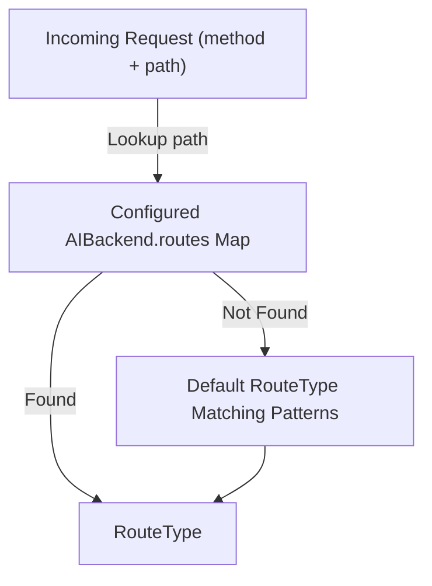
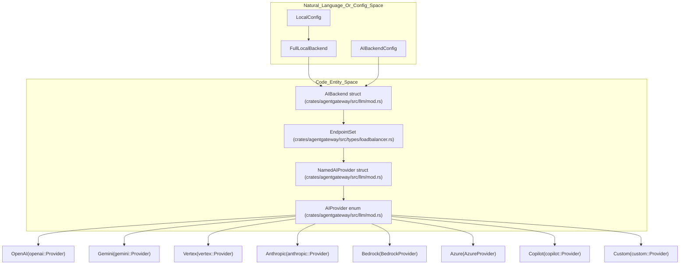
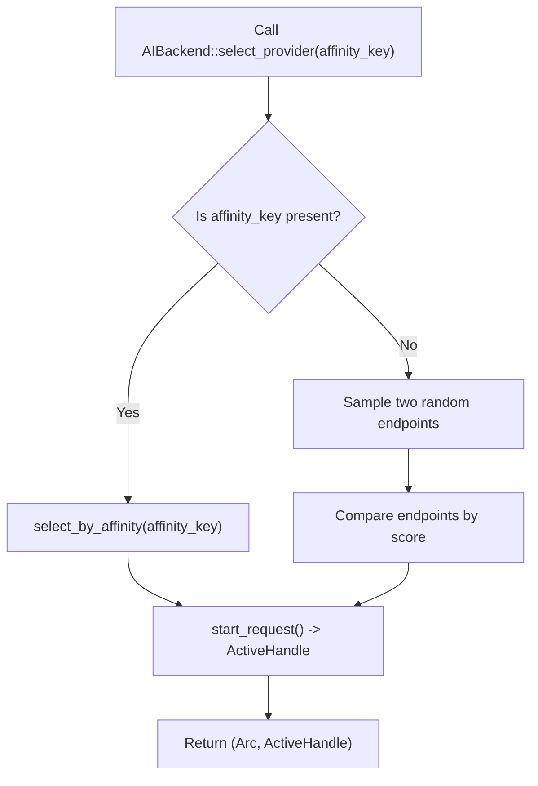
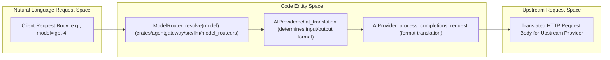

<!-- source: DeepWiki mcp.deepwiki.com · repo agentgateway/agentgateway · page 8.1 AI Gateway Architecture · fetched 2026-10-21 -->

# AI Gateway Architecture

Relevant source files

The following files were used as context for generating this wiki page:

- [crates/agentgateway/src/llm/mod.rs](crates/agentgateway/src/llm/mod.rs)
- [crates/agentgateway/src/llm/tests.rs](crates/agentgateway/src/llm/tests.rs)
- [crates/agentgateway/src/telemetry/log.rs](crates/agentgateway/src/telemetry/log.rs)
- [crates/agentgateway/src/telemetry/metrics.rs](crates/agentgateway/src/telemetry/metrics.rs)
- [crates/agentgateway/src/telemetry/trc.rs](crates/agentgateway/src/telemetry/trc.rs)
- [crates/agentgateway/tests/tests/llm.rs](crates/agentgateway/tests/tests/llm.rs)
- [crates/core/src/lib.rs](crates/core/src/lib.rs)
- [crates/core/src/metrics.rs](crates/core/src/metrics.rs)
- [crates/core/src/tokio_metrics.rs](crates/core/src/tokio_metrics.rs)
- [crates/llm/src/types/count_tokens.rs](crates/llm/src/types/count_tokens.rs)
- [crates/llm/src/types/detect.rs](crates/llm/src/types/detect.rs)
- [crates/llm/src/types/embeddings.rs](crates/llm/src/types/embeddings.rs)
- [crates/llm/src/types/mod.rs](crates/llm/src/types/mod.rs)
- [crates/llm/src/types/rerank.rs](crates/llm/src/types/rerank.rs)

This document describes the architecture of the AI Gateway component within AgentGateway, which enables unified access to multiple Large Language Model (LLM) providers through standardized APIs. The AI Gateway handles request detection, route type classification, provider selection with load balancing, model routing (including virtual and weighted models), and backend configuration management for AI services.

For related topics, see pages:
- 8.2 Provider Abstraction Layer (provider trait and implementations)
- 8.3 Request Format Translation
- 8.4 Response Format Translation
- 8.5 AI Policies and Prompt Guards
- 8.6 Token Counting and Rate Limiting

---

## Route Type Detection

The AI Gateway maps incoming request paths received on LLM listeners to a specific `RouteType`. This route type governs how the request is parsed, translated, and which provider endpoint is called. Route types can be configured explicitly via the AI backend policy `routes` map or inferred by default from well-known path patterns defined in `default_route_types` [crates/agentgateway/src/llm/model_router.rs:55-98]().

| RouteType Variant | Description |
|---|---|
| `Completions` | OpenAI `/v1/chat/completions` format |
| `Messages` | Anthropic `/v1/messages` format |
| `Models` | OpenAI `/v1/models` model listing |
| `Passthrough` | Forward the request upstream as-is |
| `Detect` | Extract telemetry/rate-limit info without applying guards |
| `Responses` | OpenAI `/responses` endpoint |
| `Embeddings` | OpenAI `/v1/embeddings` API |
| `Realtime` | OpenAI `/v1/realtime` WebSocket endpoints |
| `AnthropicTokenCount` | Anthropic `/v1/messages/count_tokens` |
| `GenerateContent` | Gemini native generation API |
| `GeminiCountTokens` | Gemini native token counting |
| `Rerank` | Cohere `/v2/rerank` document reranking |

These route types are defined as an enum in the Rust source [crates/agentgateway/src/llm/mod.rs:10-15]().

### Route Type Detection Flow

A simplified flow depicting route type detection based on URI path and configuration:

Sources:
- [crates/agentgateway/src/llm/model_router.rs:55-98]()
- [crates/agentgateway/src/llm/mod.rs:10-15]()

---

## AIBackend and Model Routing

At runtime, the AI Gateway manages backends as `AIBackend` instances, each holding a set of provider endpoints (`NamedAIProvider`s) within an `EndpointSet`. Each `NamedAIProvider` represents a concrete AI provider with configuration specific to that provider type (OpenAI, Anthropic, Bedrock, Azure, Gemini, Copilot, or Custom). Backend selection includes model routing logic, with support for virtual models enabling weighted failover and conditional routing [crates/agentgateway/src/llm/mod.rs:72-140]().

### Data Model Diagram: Configuration to Runtime Implementation Mapping

Sources:
- [crates/agentgateway/src/llm/mod.rs:72-140]()

### `NamedAIProvider` Fields

| Field | Type | Description |
|---|---|---|
| `name` | `Strng` | Unique provider instance identifier |
| `provider` | `AIProvider` enum | Variant holding provider-specific config (e.g., OpenAI, Anthropic) |
| `provider_backend` | `Option<SimpleBackendReference>` | Optional backend reference for custom providers |
| `host_override` | `Option<Target>` | Overrides default host/port for the provider |
| `path_override` | `Option<Strng>` | Optional path override applied when forwarding |
| `path_prefix` | `Option<Strng>` | Optional prefix prepended to request path |
| `tokenize` | `bool` | Whether to tokenize input for precise rate limiting |
| `inline_policies` | `Vec<BackendTrafficPolicy>` | Attached inline backend traffic policies |

Sources:
- [crates/agentgateway/src/llm/mod.rs:125-140]()

---

## Provider Selection Strategy

Selection of the actual AI provider instance for a request is managed by the method `AIBackend::select_provider`. It supports two main selection modes:

- **Affinity-based selection:** If an `affinity_key` (e.g., hashed user ID, session) is provided, the selection will consistently pick the same provider to enhance cache locality [crates/agentgateway/src/llm/mod.rs:95-98]().

- **Randomized selection with scoring:** Randomly samples two provider endpoints from the internal `EndpointSet` and compares their health/performance scores. The best-scoring endpoint is chosen to balance load across the cluster while avoiding endpoint starvation [crates/agentgateway/src/llm/mod.rs:99-119]().

### AIBackend `select_provider` Selection Flow

The returned `ActiveHandle` tracks the lifecycle of the in-flight request for health scoring and telemetry updates [crates/agentgateway/src/types/loadbalancer.rs]().

Sources:
- [crates/agentgateway/src/llm/mod.rs:95-119]()
- [crates/agentgateway/src/types/loadbalancer.rs]()

---

## Request Processing Pipeline

When an LLM request arrives at an AI Gateway listener (e.g., for path `/v1/chat/completions`), after route type detection and AI provider selection, the gateway builds an `LLMRequest` context encapsulating the request details and managing translation, streaming, token counting, and policy enforcement.

### Key Fields of `LLMRequest` (from `agent_llm` crate)

| Field | Description |
|---|---|
| `input_tokens` | Optional precomputed token count for the input |
| `input_format` | Request format category (e.g., Completions, Messages)|
| `request_model` | Model name extracted from the request payload |
| `streaming` | Indicates if request uses streaming response |
| `provider_state` | Provider-specific opaque state for advanced processing|

The `tokenize` flag present on the `NamedAIProvider` determines whether to count input tokens for detailed rate limiting and budgeting accuracy [crates/agentgateway/src/llm/mod.rs:136-138]().

### Simplified Request Flow

```mermaid
graph LR
    ClientReq["Client LLM Request (HTTP + JSON)"]
    RouteTypeDetect["RouteType Detection (model_router.rs)"]
    AIBackendSel["AIBackend::select_provider()"]
    RequestContext["LLMRequest Creation and Augmentation"]
    FormatTranslation["Apply Request Format Translation"]
    UpstreamReq["Forward Translated Request to Provider"]
    UpstreamResp["Receive Provider Response"]
    ResponseTranslation["Apply Response Format Translation"]
    ClientResp["Send Response to Client"]

    ClientReq --> RouteTypeDetect --> AIBackendSel --> RequestContext --> FormatTranslation --> UpstreamReq
    UpstreamReq --> UpstreamResp --> ResponseTranslation --> ClientResp
```

Sources:
- [crates/agentgateway/src/llm/mod.rs:136-138]()

---

## Format Translation and Routing Logic

The AI Gateway performs request and response format translation to reconcile differences between various LLM providers' APIs. This coordination is implemented in the `ModelRouter` and the provider-specific `process_completions_request` (and related) methods.

- **Virtual Models:** Logical models that route traffic conditionally or weighted across multiple backends, supporting transparent failover and traffic shaping [crates/agentgateway/src/llm/model_router.rs:111-134]().

- **Model Authorization:** API keys can be bound to model permissions and enforced by the model router prior to routing [crates/agentgateway/src/llm/model_router.rs:203-205]().

- **Custom Providers:** Support arbitrary HTTP backends with AI-specific handling, including unique route types like `GenerateContent` and `GeminiCountTokens` enabling integration of providers with non-standard APIs [crates/agentgateway/src/llm/tests.rs:23-24]().

### Natural Language to Code Entity Bridge: Model Routing

Sources:
- [crates/agentgateway/src/llm/model_router.rs:111-134]()
- [crates/agentgateway/src/llm/model_router.rs:203-205]()
- [crates/agentgateway/src/llm/tests.rs:23-24]()

---

## Summary

The AI Gateway architecture integrates multiple LLM providers behind a unified request-processing pipeline. It converts inbound natural language API requests into provider-specific requests through:

- **Route Type Detection** of request paths to interpret request semantics.
- **AIBackend and Provider Selection** with affinity-key and load-balancing aware selection.
- **Model Routing** resolving logical models to concrete providers, supporting virtual and weighted failover models.
- **Format Translation** of requests and responses to handle provider-specific API differences.
- **Request Lifecycle Management** with `LLMRequest` context and policy enforcement.

This layered design, supported by rich policy enforcement and extensible provider abstractions, enables the gateway to transparently manage AI traffic with observability, authorization, rate-limiting, and streaming capabilities.

---

### Sources

- [crates/agentgateway/src/llm/mod.rs:10-15]()
- [crates/agentgateway/src/llm/mod.rs:72-140]()
- [crates/agentgateway/src/llm/mod.rs:95-119]()
- [crates/agentgateway/src/llm/mod.rs:125-140]()
- [crates/agentgateway/src/llm/mod.rs:136-138]()
- [crates/agentgateway/src/llm/model_router.rs:55-98]()
- [crates/agentgateway/src/llm/model_router.rs:111-134]()
- [crates/agentgateway/src/llm/model_router.rs:203-205]()
- [crates/agentgateway/src/llm/tests.rs:23-24]()
- [crates/agentgateway/src/types/loadbalancer.rs]()

---

