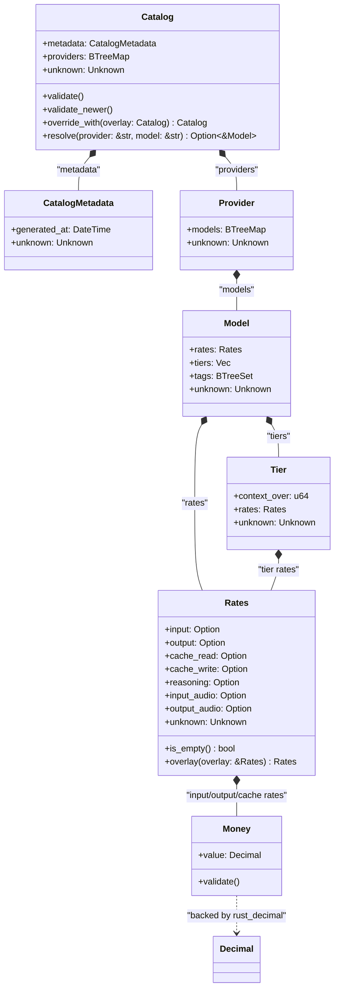
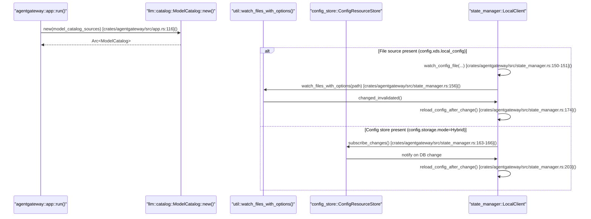
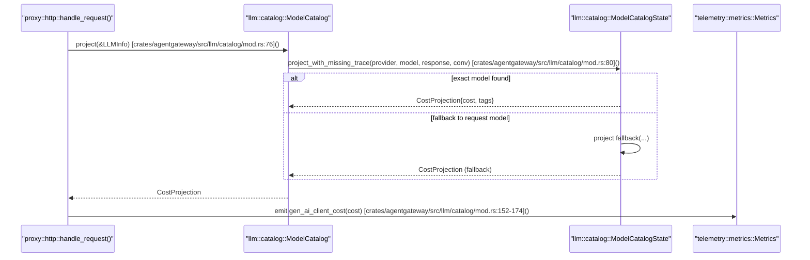
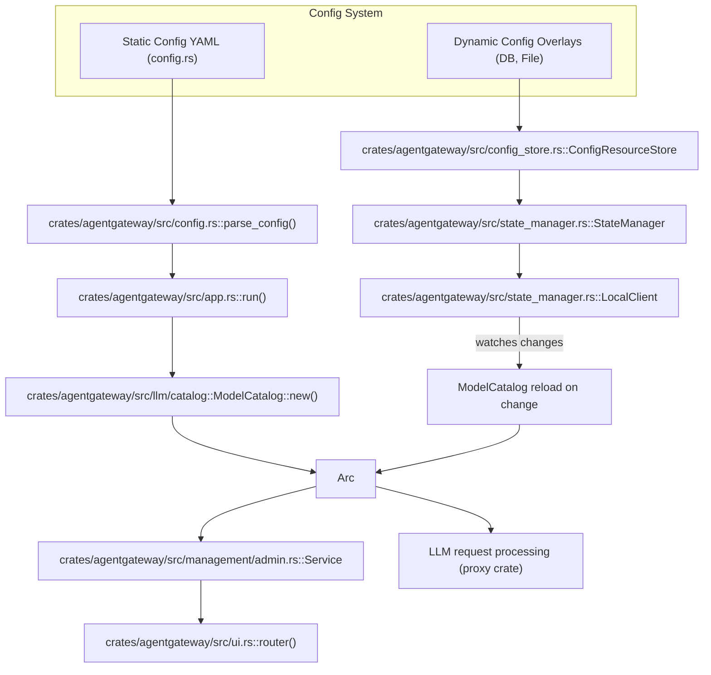

<!-- source: DeepWiki mcp.deepwiki.com · repo agentgateway/agentgateway · page 8.10 Model Cost Catalog · fetched 2026-10-21 -->

# Model Cost Catalog

<details>
<summary>Relevant source files</summary>

The following files were used as context for generating this wiki page:

- [catalog/model-catalog-overrides.yaml](catalog/model-catalog-overrides.yaml)
- [catalog/model-catalog.json](catalog/model-catalog.json)
- [controller/api/v1alpha1/agentgateway/agentgateway_model_types.go](controller/api/v1alpha1/agentgateway/agentgateway_model_types.go)
- [controller/install/helm/agentgateway-crds/templates/agentgateway.dev_agentgatewaymodels.yaml](controller/install/helm/agentgateway-crds/templates/agentgateway.dev_agentgatewaymodels.yaml)
- [controller/pkg/agentgateway/translator/model_collections.go](controller/pkg/agentgateway/translator/model_collections.go)
- [controller/pkg/cli/catalog/cmd.go](controller/pkg/cli/catalog/cmd.go)
- [controller/pkg/cli/catalog/model_catalog.go](controller/pkg/cli/catalog/model_catalog.go)
- [controller/pkg/cli/catalog/source_modelsdev.go](controller/pkg/cli/catalog/source_modelsdev.go)
- [crates/agentgateway/src/app.rs](crates/agentgateway/src/app.rs)
- [crates/agentgateway/src/config.rs](crates/agentgateway/src/config.rs)
- [crates/agentgateway/src/config_store.rs](crates/agentgateway/src/config_store.rs)
- [crates/agentgateway/src/lib.rs](crates/agentgateway/src/lib.rs)
- [crates/agentgateway/src/llm/catalog/model.rs](crates/agentgateway/src/llm/catalog/model.rs)
- [crates/agentgateway/src/llm/catalog/refresh.rs](crates/agentgateway/src/llm/catalog/refresh.rs)
- [crates/agentgateway/src/management/admin.rs](crates/agentgateway/src/management/admin.rs)
- [crates/agentgateway/src/management/admin_tests.rs](crates/agentgateway/src/management/admin_tests.rs)
- [crates/agentgateway/src/state_manager.rs](crates/agentgateway/src/state_manager.rs)
- [crates/agentgateway/src/ui.rs](crates/agentgateway/src/ui.rs)
- [crates/llm/src/custom.rs](crates/llm/src/custom.rs)
- [ui/src/api/configResourcesApi.ts](ui/src/api/configResourcesApi.ts)
- [ui/src/components/GatewayBindingEditor.tsx](ui/src/components/GatewayBindingEditor.tsx)
- [ui/src/components/ProviderIcon.tsx](ui/src/components/ProviderIcon.tsx)
- [ui/src/config.ts](ui/src/config.ts)
- [ui/src/hooks.ts](ui/src/hooks.ts)

</details>


The Model Cost Catalog provides a robust, high-performance system for tracking Large Language Model (LLM) usage costs across multiple providers. It enables Agentgateway to project LLM invocation costs in real-time, inject cost data for Common Expression Language (CEL) policy evaluations, and export detailed cost metrics for observability and operational control.

## Overview and Purpose

This subsystem standardizes pricing data across diverse AI providers such as OpenAI, Anthropic, AWS Bedrock, and more, accommodating complex cost models with varied pricing on input tokens, output tokens, cached reads and writes, and additional categories like reasoning or audio tokens.

**Key capabilities:**

- **Cost Projection:** Computes projected token usage costs in real-time using arbitrary precision decimal arithmetic (`rust_decimal::Decimal`), ensuring financial accuracy without floating point errors [controller/pkg/cli/catalog/model_catalog.go:11-12](), [crates/agentgateway/src/llm/catalog/model.rs:6-6]().
- **Dynamic Reloading & Hybrid Storage:** Supports hot-reloading of model cost data from local JSON files or database-backed `ModelCatalog` config resources, enabling live updates without restart [crates/agentgateway/src/config_store.rs:51-53](), [crates/agentgateway/src/app.rs:106-116]().
- **Observability:** Exposes cost projections as detailed Prometheus metrics for request cost tracking and catalog resolution monitoring [crates/agentgateway/src/llm/catalog/mod.rs:152-174]().
- **Tooling & Automation:** Integration with `agctl catalog import` commands; automated daily refresh with GitHub Actions; web UI management and refresh endpoints [catalog/model-catalog.json:1-4](), [ui/src/ui/src/pages/Costs.tsx:32-124]().

Sources: [controller/pkg/cli/catalog/model_catalog.go:11-12](), [crates/agentgateway/src/llm/catalog/model.rs:6-6](), [crates/agentgateway/src/config_store.rs:51-53](), [crates/agentgateway/src/app.rs:106-116](), [catalog/model-catalog.json:1-4]()

---

## Data Model and Catalog Format

The catalog format is a rigorously defined JSON schema shared between the Go controller tooling and Rust data plane, supporting consistent and verified cost definitions.

The central data structures are:

- `Catalog` (Rust) / `ModelCatalog` (Go): contains metadata and a map of providers [crates/agentgateway/src/llm/catalog/model.rs:18-29](), [controller/pkg/cli/catalog/model_catalog.go:14-20]()
- `Provider`: maps model IDs to `Model` entries [crates/agentgateway/src/llm/catalog/model.rs:140-151]()
- `Model`: pricing information per LLM model, including base rates and optional tiers [crates/agentgateway/src/llm/catalog/model.rs:156-171]()
- `Rates`: per-category token cost rates (input, output, cacheRead, cacheWrite, etc.) [crates/agentgateway/src/llm/catalog/model.rs:176-190]()
- `Tier`: context-length thresholds with overridden rates [crates/agentgateway/src/llm/catalog/model.rs:215-222]()
- `Money`: high-precision cost representations using decimal [crates/agentgateway/src/llm/catalog/model.rs:224-232]()

### Model Catalog Data Entities



Sources: [crates/agentgateway/src/llm/catalog/model.rs:11-190]()

---

### Money Precision and Validation

Monetary values represent USD per one million tokens and are parsed into `rust_decimal::Decimal` to avoid floating-point inaccuracies [crates/agentgateway/src/llm/catalog/model.rs:6-6](). Validation rules enforce:

- Non-negative values only
- Fractional precision limited to max 6 decimal places
- No scientific notation allowed (e.g., 1e-5 disallowed)
- Enforced consistently by both Go tooling and Rust parser

This ensures cost calculations are precise and auditable, critical for billing accuracy.

Sources: [crates/agentgateway/src/llm/catalog/model.rs:224-232]()

---

## Catalog File Management and Overrides

- The *base model catalog* is embedded in the Rust binary compiled from `catalog/model-catalog.json` [catalog/model-catalog.json:1-267]().
- **User Overlays:** Local JSON or YAML overrides can be applied, e.g. `catalog/model-catalog-overrides.yaml` allows wildcarded model IDs (`*opus-4-6*`) to add tags or adjust costs [catalog/model-catalog-overrides.yaml:1-12]().
- **Hybrid Store Mode:** Allows managing `ModelCatalog` resources dynamically from a DB-backed config store exposed via management APIs and watched for live updates [crates/agentgateway/src/config_store.rs:51-53]().
- Overlay merging applies last-write-wins semantics with model-level deep merges of rates and tags [crates/agentgateway/src/llm/catalog/model.rs:85-103]().

```yaml
providers:
  "*":
    models:
      "*opus-4-6*":
        tags: [adaptive_thinking]
```

Sources: [catalog/model-catalog-overrides.yaml:1-12](), [crates/agentgateway/src/config_store.rs:51-53](), [crates/agentgateway/src/llm/catalog/model.rs:85-103]()

---

## Implementation and Data Flow

In the Rust data plane:

- `ModelCatalog` (in `crate::llm::catalog`) holds an `ArcSwap<ModelCatalogState>` for thread-safe, atomic snapshots [crates/agentgateway/src/llm/catalog/mod.rs:25-74]().
- On initialization, it loads the base catalog from the embedded default and applies any configured overlays or dynamic sources [crates/agentgateway/src/app.rs:106-116]().
- If a file source is configured, a file-watch task runs to hot-reload the catalog on changes, updating the shared atomic state [crates/agentgateway/src/state_manager.rs:150-207]().
- In hybrid mode, it subscribes to changes from the config resource store (SQL DB, Postgres, SQLite) and dynamically updates the catalog state [crates/agentgateway/src/config_store.rs:185-208]().

### ModelCatalog Initialization and Reload Flow



Sources: [crates/agentgateway/src/llm/catalog/mod.rs:25-74](), [crates/agentgateway/src/state_manager.rs:150-207](), [crates/agentgateway/src/app.rs:106-116](), [crates/agentgateway/src/config_store.rs:185-208]()

---

### Cost Projection Data Flow During LLM Response Handling

When an LLM API response is received, cost projection occurs as follows:



This projected cost uses catalog rates to calculate token cost depending on request and response token counts, cache usage, and tiered rates.

Sources: [crates/agentgateway/src/llm/catalog/mod.rs:25-84](), [crates/agentgateway/src/llm/catalog/mod.rs:152-174]()

---

## Integration with Agentgateway Components

### Configuration and Startup Integration Diagram

This diagram shows how the Model Cost Catalog fits into the overall agentgateway startup and configuration pipeline:



- The main app (`app.rs`) initializes the model catalog from static and dynamic config sources [crates/agentgateway/src/app.rs:106-116]().
- `StateManager` or `LocalClient` observe config changes to trigger reloads [crates/agentgateway/src/state_manager.rs:150-207]().
- The Admin server exposes APIs and UI for catalog inspection and management [crates/agentgateway/src/management/admin.rs:130-177]().
- Proxy request handlers query `ModelCatalog` for cost projection.

Sources: [crates/agentgateway/src/app.rs:106-116](), [crates/agentgateway/src/state_manager.rs:150-207](), [crates/agentgateway/src/management/admin.rs:130-177](), [crates/agentgateway/src/ui.rs:25-122]()

---

## Tooling and Automated Refresh

The model catalog ecosystem includes CLI tooling and automation for import, transformation, and validation:

- `agctl catalog import` supports merging multiple external catalogs and applying overlay patches with strict decimal validation [controller/pkg/cli/catalog/cmd.go:15-147]().
- A GitHub Actions workflow `.github/workflows/model-catalog.yml` automates daily upstream refreshes.
- The proxy exposes API endpoints for refreshing or forcing reload of the base catalog, accessible via UI or HTTP POST `/api/costs/refresh-base` [crates/agentgateway/src/ui.rs:112-113](), [crates/agentgateway/src/llm/catalog/refresh.rs:19-61]().
- The web UI integrates cost catalog browsing and editing.

Sources: [controller/pkg/cli/catalog/cmd.go:15-147](), [crates/agentgateway/src/llm/catalog/refresh.rs:19-61](), [crates/agentgateway/src/ui.rs:112-113]()

---

## Metrics Reference

The model cost catalog exposes the following Prometheus metrics for operational observability:

| Metric Name | Type | Labels | Description |
|---|---|---|---|
| `gen_ai_client_cost` | Counter | `gen_ai_request_model`, `gen_ai_response_model`, `gen_ai_system` | Cumulative cost (USD) of LLM requests and responses |
| `gen_ai_cost_catalog_lookup` | Counter | `status` (`Found`, `NotFound`, `ProviderNotFound`) | Counts how often model catalog lookups succeed/fail |

These metrics provide insight into cost accrual behavior and catalog health.

Sources: [crates/agentgateway/src/llm/catalog/mod.rs:152-174]()

---

# Summary

The Model Cost Catalog is a key subsystem to enable precise, dynamic cost tracking and observability of AI/LLM usage within Agentgateway. It provides a unified pricing abstraction across heterogeneous providers, live update capability through flexible layering of configuration sources, and integration into policy and telemetry systems. The combination of precise numerical handling, file and DB overlays, and rich tooling simplifies cost management across deployments.

This concludes section 8.10 — Model Cost Catalog.

Sources:
- [catalog/model-catalog.json:1-267]()
- [crates/agentgateway/src/llm/catalog/model.rs:1-190]()
- [crates/agentgateway/src/llm/catalog/mod.rs:25-84]()
- [crates/agentgateway/src/app.rs:106-116]()
- [crates/agentgateway/src/state_manager.rs:150-217]()
- [controller/pkg/cli/catalog/model_catalog.go:11-182]()
- [crates/agentgateway/src/config_store.rs:51-53]()
- [catalog/model-catalog-overrides.yaml:1-12]()
- [crates/agentgateway/src/llm/catalog/refresh.rs:19-61]()
- [crates/agentgateway/src/ui.rs:25-122]()
- [controller/pkg/cli/catalog/cmd.go:15-147]()

---

