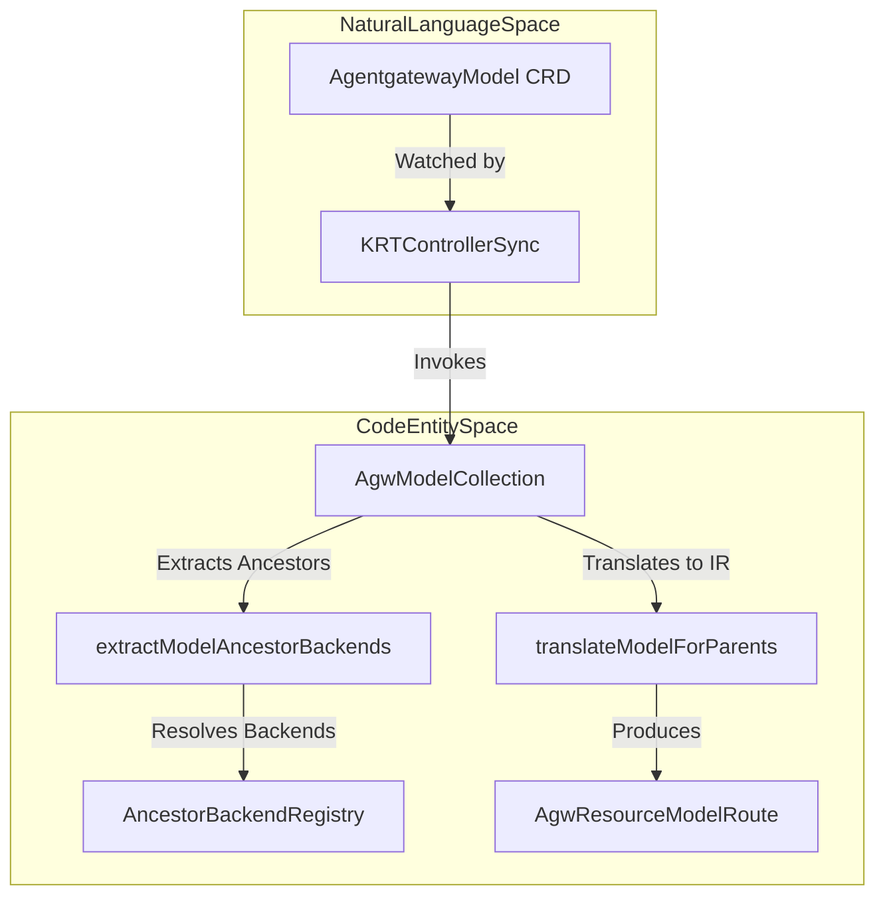
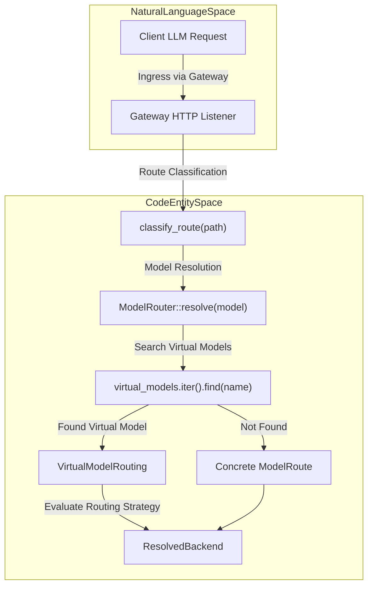
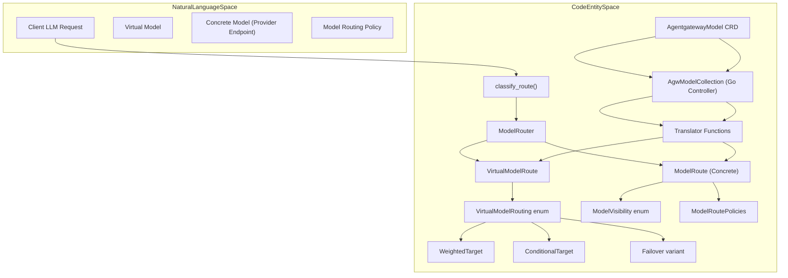

<!-- source: DeepWiki mcp.deepwiki.com · repo agentgateway/agentgateway · page 8.11 Virtual Models and Model Routing · fetched 2026-10-21 -->

# Virtual Models and Model Routing

<details>
<summary>Relevant source files</summary>

The following files were used as context for generating this wiki page:

- [controller/pkg/agentgateway/translator/model_collections_test.go](controller/pkg/agentgateway/translator/model_collections_test.go)
- [controller/pkg/agentgateway/translator/testdata/models/discovery.yaml](controller/pkg/agentgateway/translator/testdata/models/discovery.yaml)
- [controller/pkg/agentgateway/translator/testdata/models/failover-inferencepool-ancestry.yaml](controller/pkg/agentgateway/translator/testdata/models/failover-inferencepool-ancestry.yaml)
- [controller/pkg/agentgateway/translator/testdata/models/httproute-multiple-listeners.yaml](controller/pkg/agentgateway/translator/testdata/models/httproute-multiple-listeners.yaml)
- [controller/pkg/agentgateway/translator/testdata/models/httproute-parent-section-status.yaml](controller/pkg/agentgateway/translator/testdata/models/httproute-parent-section-status.yaml)
- [controller/pkg/agentgateway/translator/testdata/models/httproute-parent.yaml](controller/pkg/agentgateway/translator/testdata/models/httproute-parent.yaml)
- [controller/pkg/agentgateway/translator/testdata/models/httproute-rule-key-collision.yaml](controller/pkg/agentgateway/translator/testdata/models/httproute-rule-key-collision.yaml)
- [controller/pkg/agentgateway/translator/testdata/models/prompt-guard-webhook-ancestry.yaml](controller/pkg/agentgateway/translator/testdata/models/prompt-guard-webhook-ancestry.yaml)
- [controller/pkg/agentgateway/translator/testdata/models/virtual-routing-errors.yaml](controller/pkg/agentgateway/translator/testdata/models/virtual-routing-errors.yaml)
- [controller/pkg/agentgateway/translator/testdata/models/virtual-routing.yaml](controller/pkg/agentgateway/translator/testdata/models/virtual-routing.yaml)
- [controller/test/e2e/modelrouting_test.go](controller/test/e2e/modelrouting_test.go)
- [controller/test/e2e/testdata/modelrouting/setup.yaml](controller/test/e2e/testdata/modelrouting/setup.yaml)
- [crates/agentgateway/src/types/local_tests/llm_provider_reference_normalized.snap](crates/agentgateway/src/types/local_tests/llm_provider_reference_normalized.snap)
- [crates/agentgateway/src/types/local_tests/llm_virtual_model_conditional_normalized.snap](crates/agentgateway/src/types/local_tests/llm_virtual_model_conditional_normalized.snap)
- [crates/agentgateway/src/types/local_tests/llm_virtual_model_failover_normalized.snap](crates/agentgateway/src/types/local_tests/llm_virtual_model_failover_normalized.snap)
- [crates/agentgateway/src/types/local_tests/llm_virtual_model_normalized.snap](crates/agentgateway/src/types/local_tests/llm_virtual_model_normalized.snap)

</details>


## Purpose and Scope

The virtual model and model routing subsystem provides a flexible abstraction layer for managing Large Language Model (LLM) endpoints within the `agentgateway` data plane. It enables defining concrete model routes linked to specific provider endpoints as well as virtual models that apply weighted load distribution, conditional routing, and failover strategies. This enables operators to compose sophisticated routing topologies, enhance model availability, and transparently manage backend failover. The system leverages the `AgentgatewayModel` Kubernetes Custom Resource Definition (CRD) for control plane resource modeling, reconciled into a high-performance runtime routing engine implemented in Rust.

This page covers:

- The `AgentgatewayModel` CRD and controller collection mechanism.
- The runtime `ModelRouter` core architecture for model selection.
- Support for virtual model routing modes: weighted, failover, and conditional.
- Model visibility and access control features.

---

## 1. The `AgentgatewayModel` CRD and Controller Collection

### CRD Overview

`AgentgatewayModel` is a Kubernetes Custom Resource Definition (CRD) in the control plane [controller/api/v1alpha1/agentgateway/agentgateway_model_types.go:18-58](). It defines an LLM model as either:

- A **Concrete model**, specifying a direct AI provider endpoint, or
- A **Virtual model**, which aggregates other models behind weighted, failover, or conditional routing logic.

Validation mandates a choice between specifying a concrete `provider` or a `virtualModel` (never both), ensuring the CRD cleanly models either leaf or composite routing nodes. Additionally, models marked as internal cannot be requested directly, preserving encapsulation and separation between public and internal model layers.

### Controller Collection and Translation

The Kubernetes controller manages these CRDs via a KRT collection named `AgwModelCollection` [controller/pkg/agentgateway/translator/model_collections.go:33-61](). This component:

- Watches for `AgentgatewayModel` resource events.
- Extracts *ancestor* backend models referenced by virtual models through `extractModelAncestorBackends`.
- Resolves backend references (including indirect ones via virtual model failover targets).
- Translates CRDs into intermediate routing definitions (`AgwResourceModelRoute`) used by the runtime [controller/pkg/agentgateway/translator/model_collections.go:63-140]().

This process ensures that virtual models are recursively resolved to concrete backend endpoints, enabling proper status reporting and correct backend propagation in the gateway.

### Diagram: Model Translation and Ancestor Resolution Flow



Sources:
[controller/api/v1alpha1/agentgateway/agentgateway_model_types.go:18-58](),
[controller/pkg/agentgateway/translator/model_collections.go:33-61](),
[controller/pkg/agentgateway/translator/model_collections.go:63-140]()

---

## 2. Core Architecture of `ModelRouter`

### Runtime Routing Engine

At runtime in the data plane, LLM request routing is handled by the `ModelRouter` struct, implemented in Rust [crates/agentgateway/src/llm/model_router.rs:196-202](). It maintains two key collections:

- **`models: Vec<ModelRoute>`**: Concrete model routes that map model names to provider backends and associated policies.
- **`virtual_models: Vec<VirtualModelRoute>`**: Virtual models defining composite routing strategies over underlying concrete or virtual models.

The router intercepts LLM HTTP requests at the gateway's HTTP listener and applies route classification, backend resolution, and routing logic accordingly.

### Request Flow

1. **Ingress**: Client sends a LLM request to the Gateway HTTP Listener.
2. **Classification**: The HTTP request path is matched against predefined serving endpoints using `classify_route` [crates/agentgateway/src/llm/model_router.rs:67-158](), which identifies the route type (e.g., completions, chat).
3. **Routing**: `ModelRouter::resolve` looks up the requested model name among concrete and virtual models.
4. For **virtual models**, the router evaluates the routing strategy (`Weighted`, `Failover`, `Conditional`) to select a target backend.
5. For **concrete models**, the router directly dispatches the request to the backend reference.
6. The request proceeds to the selected backend route for processing.

### Diagram: Request Routing and Resolution Pipeline



Sources:
[crates/agentgateway/src/llm/model_router.rs:67-158](),
[crates/agentgateway/src/llm/model_router.rs:196-202]()

---

## 3. Virtual Model Routing Strategies

Virtual models encapsulate three distinct routing strategies declared in the `VirtualModelRouting` enum [crates/agentgateway/src/llm/model_router.rs:171-174]():

### 3.1 Weighted Routing (`Weighted`)

- Uses a weighted round-robin or probabilistic distribution among multiple models.
- Each `WeightedTarget` specifies a target model name and integer weight.
- The router selects the backend proportional to weights, enabling traffic splitting for load testing or capacity-based routing.
- Example configuration: [crates/agentgateway/src/types/local_tests/llm_virtual_model_normalized.snap:181-193]()

```rust
pub struct WeightedTarget {
    pub model: String,
    pub weight: usize,
    #[serde(skip_serializing_if = "std::ops::Not::not")]
    pub invalid: bool, // internal XDS-only validation state
}
```

Sources:
[crates/agentgateway/src/llm/model_router.rs:170-192](),
[crates/agentgateway/src/types/local_tests/llm_virtual_model_normalized.snap:181-193]()

### 3.2 Failover Routing (`Failover`)

- Single backend target with failover semantics.
- If the primary model's backend is unhealthy or evicted, traffic automatically cascades to fallback models.
- Enables high availability and graceful degradation.
- Example configuration: [crates/agentgateway/src/types/local_tests/llm_virtual_model_failover_normalized.snap:219-232]()

```rust
Failover { backend: RouteBackendReference }
```

Sources:
[crates/agentgateway/src/llm/model_router.rs:170-192](),
[crates/agentgateway/src/types/local_tests/llm_virtual_model_failover_normalized.snap:219-232]()

### 3.3 Conditional Routing (`Conditional`)

- Uses an ordered list of `ConditionalTarget` entries, each with an optional CEL `when` expression.
- On request, the router evaluates conditions in order and routes to the first matching target.
- Supports context-aware routing based on request attributes (headers, body fields).
- Example configuration: [crates/agentgateway/src/types/local_tests/llm_virtual_model_conditional_normalized.snap:139-154]()

```rust
pub struct ConditionalTarget {
    pub model: String,
    pub when: Option<Arc<cel::Expression>>,
    #[serde(skip_serializing_if = "std::ops::Not::not")]
    pub invalid: bool, // internal XDS validation status
}
```

Sources:
[crates/agentgateway/src/llm/model_router.rs:170-192](),
[crates/agentgateway/src/types/local_tests/llm_virtual_model_conditional_normalized.snap:139-154]()

---

## 4. Model Visibility and Security

### Visibility Enumeration

Models declare their visibility scope via the `ModelVisibility` enum [crates/agentgateway/src/llm/model_router.rs:45-53]():

- **`Public`** (default):
  Models visible to external clients, appear in model discovery lists, and accept direct requests.

- **`Internal`**:
  Models hidden from the public model list and reject direct client requests with `model_not_found`. Only selectable via virtual models.

This distinction allows secure encapsulation and layering within multi-tenant or multi-environment deployments.

### Authorization Policies

Each `ModelRoute` also embeds policy structures that include optional authorization and LLM-specific rules [crates/agentgateway/src/llm/model_router.rs:38-43](). These policies may inspect request headers or evaluate CEL expressions to enforce access control decisions prior to routing.

This ensures that:

- Access may be restricted by JWT claims or headers.
- Unauthorized requests can be rejected cleanly before reaching backend providers.

Sources:
[crates/agentgateway/src/llm/model_router.rs:45-59](),
[crates/agentgateway/src/llm/model_router.rs:38-43]()

---

# Summary Table: Virtual Model Routing Strategies

| Routing Type | Routing Behavior | Configuration Struct | Use Cases |
|---|---|---|---|
| Weighted | Distributes traffic by weight | `Weighted(Vec<WeightedTarget>)` | Split traffic for A/B tests, gradual rollouts |
| Failover | Fallback to backup backend on failure | `Failover { backend: RouteBackendReference }` | High availability and resilience |
| Conditional | Route based on CEL predicate matching | `Conditional(Vec<ConditionalTarget>)` | Context-aware routing based on request properties |

---

# Relation Between Natural Language Model Concepts and Code Entities

This diagram maps key logical concepts in model routing to the specific types and functions in the codebase, bridging the gap between system design and implementation.



Sources:
[crates/agentgateway/src/llm/model_router.rs:20-60](),
[crates/agentgateway/src/llm/model_router.rs:162-204](),
[controller/api/v1alpha1/agentgateway/agentgateway_model_types.go:18-58](),
[controller/pkg/agentgateway/translator/model_collections.go:33-61]()

---

# Additional Observations from Tests and Snapshots

- Normalized LocalConfig snapshots confirm that virtual models can reference multiple concrete backend models with varied policies, including weighted and conditional configurations [crates/agentgateway/src/types/local_tests/llm_virtual_model_normalized.snap:181-193](), [crates/agentgateway/src/types/local_tests/llm_virtual_model_conditional_normalized.snap:139-154]().
- Failover virtual models use an internal backend list to represent the prioritized failover sequence [crates/agentgateway/src/types/local_tests/llm_virtual_model_failover_normalized.snap:104-187]().
- The controller enforces strict rules to ensure model references are valid and accessible in the runtime environment, as seen in error handling for missing model targets [controller/pkg/agentgateway/translator/testdata/models/virtual-routing-errors.yaml:190-204]().
- Various test cases exercise the routing logic including authorization enforcement on failover routes [controller/test/e2e/modelrouting_test.go:179-194]().

Sources:
[crates/agentgateway/src/types/local_tests/llm_virtual_model_normalized.snap:181-193](),
[crates/agentgateway/src/types/local_tests/llm_virtual_model_conditional_normalized.snap:139-154](),
[crates/agentgateway/src/types/local_tests/llm_virtual_model_failover_normalized.snap:104-187](),
[controller/pkg/agentgateway/translator/testdata/models/virtual-routing-errors.yaml:190-204](),
[controller/test/e2e/modelrouting_test.go:179-194]()

---

# References

- [`AgentgatewayModel` CRD specification and validation rules](controller/api/v1alpha1/agentgateway/agentgateway_model_types.go:18-58)
- [Model collection and translation logic in the controller](controller/pkg/agentgateway/translator/model_collections.go:33-140)
- [`ModelRouter` runtime implementation and routing strategy definitions](crates/agentgateway/src/llm/model_router.rs:1-209)
- Integration e2e tests demonstrating model routing behaviors [controller/test/e2e/modelrouting_test.go:28-62]()

---

This detailed technical view illustrates how `agentgateway` enables powerful, flexible, and extensible LLM model routing through virtual model abstractions, backed by a robust controller and a performant Rust routing engine. Operators can define complex routing topologies and enforce security and availability policies while presenting a unified model discovery and invocation interface to clients.

---

