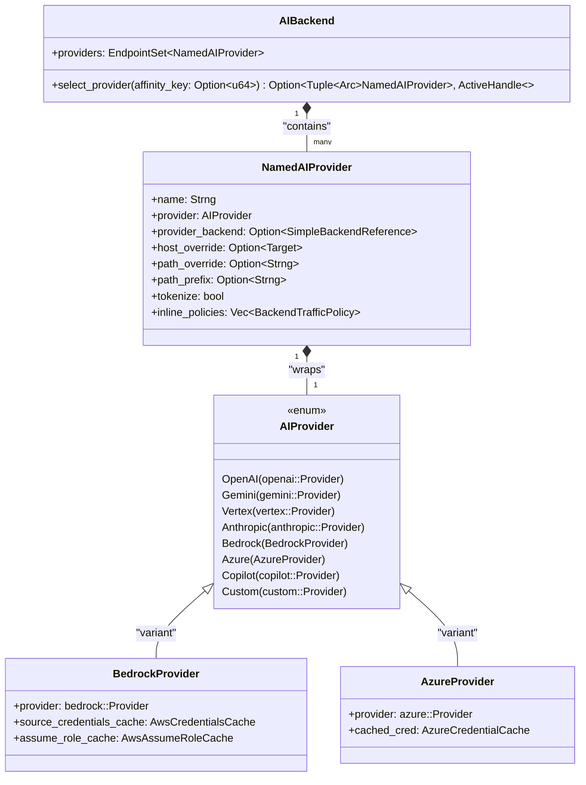
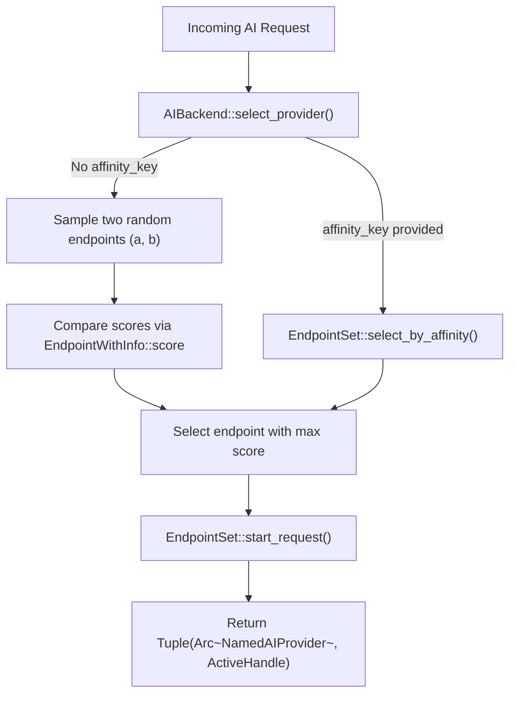
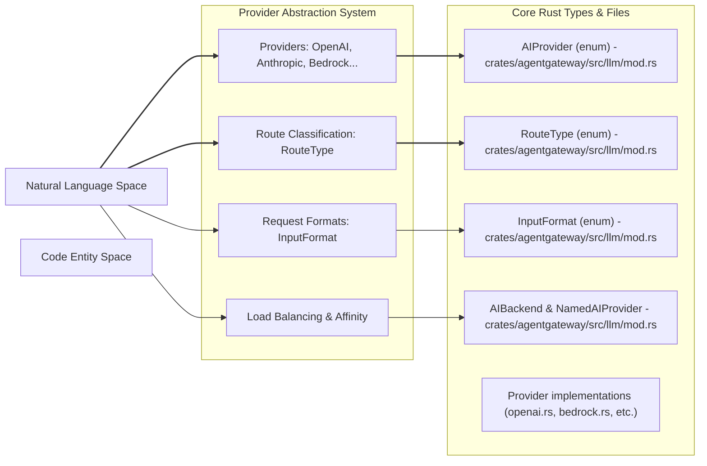

<!-- source: DeepWiki mcp.deepwiki.com · repo agentgateway/agentgateway · page 8.2 Provider Abstraction Layer · fetched 2026-10-21 -->

# Provider Abstraction Layer

Relevant source files

The following files were used as context for generating this wiki page:

- [crates/agentgateway/src/llm/mod.rs](crates/agentgateway/src/llm/mod.rs)
- [crates/agentgateway/src/llm/tests.rs](crates/agentgateway/src/llm/tests.rs)
- [crates/agentgateway/src/telemetry/log.rs](crates/agentgateway/src/telemetry/log.rs)
- [crates/agentgateway/src/telemetry/metrics.rs](crates/agentgateway/src/telemetry/metrics.rs)
- [crates/agentgateway/src/telemetry/trc.rs](crates/agentgateway/src/telemetry/trc.rs)
- [crates/agentgateway/tests/tests/llm.rs](crates/agentgateway/tests/tests/llm.rs)
- [crates/core/src/lib.rs](crates/core/src/lib.rs)
- [crates/core/src/metrics.rs](crates/core/src/metrics.rs)
- [crates/core/src/tokio_metrics.rs](crates/core/src/tokio_metrics.rs)
- [crates/llm/src/tests/requests/messages/reasoning_replay.bedrock.snap](crates/llm/src/tests/requests/messages/reasoning_replay.bedrock.snap)
- [crates/llm/src/tests/requests/messages/reasoning_replay.completions.snap](crates/llm/src/tests/requests/messages/reasoning_replay.completions.snap)
- [crates/llm/src/tests/requests/messages/reasoning_replay.json](crates/llm/src/tests/requests/messages/reasoning_replay.json)
- [crates/llm/src/tests/requests/responses/input-list.bedrock.snap](crates/llm/src/tests/requests/responses/input-list.bedrock.snap)
- [crates/llm/src/tests/requests/responses/input-list.gemini.snap](crates/llm/src/tests/requests/responses/input-list.gemini.snap)
- [crates/llm/src/tests/requests/responses/input-list.json](crates/llm/src/tests/requests/responses/input-list.json)
- [crates/llm/src/tests/response/bedrock/reasoning.bedrock-responses.snap](crates/llm/src/tests/response/bedrock/reasoning.bedrock-responses.snap)
- [crates/llm/src/tests/response/bedrock/reasoning_redacted.bedrock-completions.snap](crates/llm/src/tests/response/bedrock/reasoning_redacted.bedrock-completions.snap)
- [crates/llm/src/tests/response/bedrock/reasoning_redacted.bedrock-messages.snap](crates/llm/src/tests/response/bedrock/reasoning_redacted.bedrock-messages.snap)
- [crates/llm/src/tests/response/bedrock/reasoning_unsigned.bedrock-responses.snap](crates/llm/src/tests/response/bedrock/reasoning_unsigned.bedrock-responses.snap)
- [crates/llm/src/types/bedrock.rs](crates/llm/src/types/bedrock.rs)

The Provider Abstraction Layer defines the common interfaces, enumeration types, and concrete provider configurations required to connect agentgateway to diverse Large Language Model (LLM) backends. It manages upstream host resolution, API path rewriting, credential caching, and format adaptation.

---

## 1. Purpose and Scope

The provider abstraction layer sits at the core of the LLM proxy pipeline implemented mainly in `crates/agentgateway/src/llm/mod.rs` and built atop the `agent_llm` crate. Its responsibilities include:

- Unifying disparate provider APIs (`OpenAI`, `Anthropic`, `Bedrock`, `Vertex`, `Gemini`, `Azure`, `Copilot`, and `Custom`) under a common architectural facade.
- Classifying incoming API intent via the `RouteType` enum and categorizing request payloads via `InputFormat`.
- Orchestrating multi-provider load balancing and affinity-based routing through `AIBackend` and `NamedAIProvider` structures.
- Managing specialized provider authentication caches (such as AWS IAM role assumption and Azure Entra ID tokens).
- Supporting tokenization flags for improved rate limiting and prompt cost estimation.

This layer is fundamental for connecting agentgateway to different LLM cloud services and custom providers transparently with unified request processing and policy enforcement.

Sources: [crates/agentgateway/src/llm/mod.rs:10-15](), [crates/agentgateway/src/llm/mod.rs:70-140]()

---

## 2. The `Provider` Trait and Implementations

The core interface for all LLM providers is the `Provider` trait, re-exported from `agent_llm`. Each provider implements this trait to handle request processing, authentication, request format translation, and response parsing.

### Provider Variants and Modules

| Provider | Struct / Module | Backend Config Key |
|---|---|---|
| OpenAI | `openai::Provider` | `openai` |
| Gemini | `gemini::Provider` | `gcp.gemini` |
| Vertex | `vertex::Provider` | `gcp.vertex_ai` |
| Anthropic | `anthropic::Provider` | `anthropic` |
| Bedrock | `BedrockProvider` | `aws.bedrock` |
| Azure | `AzureProvider` | `azure` |
| Copilot | `copilot::Provider` | `copilot` |
| Custom | `custom::Provider` | `custom` |

These variants are encapsulated in the `AIProvider` Rust enum, allowing polymorphic dispatch based on provider type and enabling runtime flexibility for multi-provider backends [crates/agentgateway/src/llm/mod.rs:140-150]().

### Notable Wrappers

- **BedrockProvider**: Adds AWS credentials cache and assume-role cache.
- **AzureProvider**: Adds cached Entra ID OAuth tokens for Azure OpenAI.

These wrappers provide cloud platform-specific authentication management transparently [crates/agentgateway/src/llm/mod.rs:156-212]().

Sources: [crates/agentgateway/src/llm/mod.rs:10-15](), [crates/agentgateway/src/llm/mod.rs:140-212]()

---

## 3. `RouteType` and `InputFormat` Enums

LLM requests must be routed correctly and parsed according to provider protocols and endpoint semantics. Two key enums facilitate this:

### 3.1 `RouteType`

`RouteType` classifies incoming LLM requests by the route type or endpoint semantics, guiding request transformations and routing decisions.

Common variants include:

- `Completions` — OpenAI `/v1/chat/completions` style.
- `Messages` — Anthropic `/v1/messages` style.
- `Models` — OpenAI `/v1/models` style.
- `Passthrough` — Forward upstream without modifications.
- `Detect` — Forward with detection and telemetry extraction only.
- `Responses` — OpenAI `/responses` style.
- `Embeddings` — OpenAI `/embeddings`.
- `Realtime` — WebSocket streaming endpoint.
- `AnthropicTokenCount`, `GeminiCountTokens` — Token counting endpoints.
- `GenerateContent` — Gemini-specific native generation endpoint.
- `Rerank` — Cohere-style reranking endpoint.

The `RouteType` guides how requests are rewritten, formatted, and proxied upstream and is extensively used in `crates/agentgateway/src/llm/model_router.rs` [crates/agentgateway/src/llm/mod.rs:13]().

### 3.2 `InputFormat`

`InputFormat` categorizes the structure of the request payload, critical for correct parsing and tokenization logic:

- Chat formats: `Completions`, `Messages`, `Responses`, `Gemini`.
- Vectorization/ranking: `Embeddings`, `Rerank`.
- Utility/debug formats: `CountTokens`, `GeminiCountTokens`, `Detect`.

The `InputFormat` supports prompt guard evaluation, policy application, and token counting strategies uniformly across providers [crates/agentgateway/src/llm/mod.rs:11]().

Sources: [crates/agentgateway/src/llm/mod.rs:11](), [crates/agentgateway/src/llm/mod.rs:13]()

---

## 4. Architecture and Code Entity Mapping

The provider abstraction layer entities are organized as follows:

- `AIBackend`: Holds a set of `NamedAIProvider`s, manages load balancing and provider selection.
- `NamedAIProvider`: Individual provider endpoint configuration with tokenization and policy flags.
- `AIProvider`: Enum wrapping concrete implementations of provider logic.
- Provider wrappers like `BedrockProvider` and `AzureProvider` hold platform-specific caches.

### Provider Hierarchy and Entity Mapping Diagram

This layering allows agentgateway to manage multiple LLM endpoints, each with provider-specific logic and tokenization behavior, while exposing a uniform interface upwards.

Sources: [crates/agentgateway/src/llm/mod.rs:70-138](), [crates/agentgateway/src/llm/mod.rs:140-214]()

---

## 5. Provider Selection and Load Balancing

`AIBackend` holds multiple `NamedAIProvider` instances, typically organized in buckets for priority routing and failover.

### Provider Selection Algorithm

- If an `affinity_key` (commonly a user/session hash) is provided, `select_by_affinity` uses consistent hashing to pick a stable endpoint.
- Without affinity, the "power of two choices" (P2C) algorithm samples two random endpoints, compares their scores, and picks the best.
- `start_request` is called on the selected endpoint to increment metrics or track active requests, returning an `ActiveHandle`.
- The API returns a tuple `(Arc<NamedAIProvider>, ActiveHandle)` for further request processing.

### Selection Flow Diagram

This strategy balances load effectively while preserving affinity stickiness.

Sources: [crates/agentgateway/src/llm/mod.rs:91-120]()

---

## 6. Provider Implementation Details

### AWS Bedrock Provider (`BedrockProvider`)

- Wraps the underlying `bedrock::Provider`.
- Manages two caches:
  - `source_credentials_cache`: AWS credentials lifecycle for authentication.
  - `assume_role_cache`: Supports AWS IAM role assumption for scoped access.
- Implements `Deref` and `DerefMut` to provide transparent access to inner `bedrock::Provider` features such as region and model override.
- Ensures minimal overhead in credential retrieval while supporting complex AWS use cases [crates/agentgateway/src/llm/mod.rs:156-197]().

### Azure OpenAI Provider (`AzureProvider`)

- Wraps `azure::Provider` core config.
- Caches Azure Entra ID OAuth tokens for efficient token reuse and refresh.
- Supports transparent Azure-specific token acquisition and injection [crates/agentgateway/src/llm/mod.rs:202-212]().

### Tokenization Support

- `NamedAIProvider` has a `tokenize: bool` flag which, when set, enables local tokenization of requests.
- Tokenization uses `agent_llm::tokenizer` utilities to estimate input token count before forwarding upstream.
- Provides detailed input token counts used by rate limits, token cost accounting, and prompt guards.
- Trading CPU cost of tokenization for more accurate policy enforcement.

Sources: [crates/agentgateway/src/llm/mod.rs:140-214]()

---

## 7. Mapping Natural Language to Code Entities

To relate system concepts like "Provider Abstraction" and "Routing" to code entities:

This diagram highlights how the conceptual components map cleanly to Rust types and source files.

Sources: [crates/agentgateway/src/llm/mod.rs:10-15](), [crates/agentgateway/src/llm/mod.rs:11](), [crates/agentgateway/src/llm/mod.rs:13]()

---

## 8. Summary

The Provider Abstraction Layer in agentgateway unifies diverse LLM backends into a structured framework that supports:

- A polymorphic `Provider` trait with explicit, pluggable implementations per LLM vendor.
- A rich `RouteType` enum classifying request intent for routing and rewriting.
- The `AIBackend` and `NamedAIProvider` types enabling multi-endpoint load balancing and tokenization control.
- Specialized credential caches for AWS Bedrock and Azure OpenAI providers.
- Efficient provider selection with affinity routing and power-of-two-choices load balancing.

This design enables agentgateway to support many providers effectively, maintaining protocol compliance, credential management, and observability.

Sources:
[crates/agentgateway/src/llm/mod.rs:1-212](),
[crates/agentgateway/src/llm/mod.rs:11](),
[crates/agentgateway/src/llm/mod.rs:13]()

---

