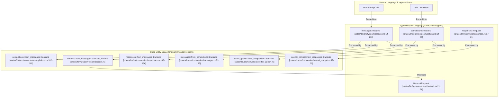
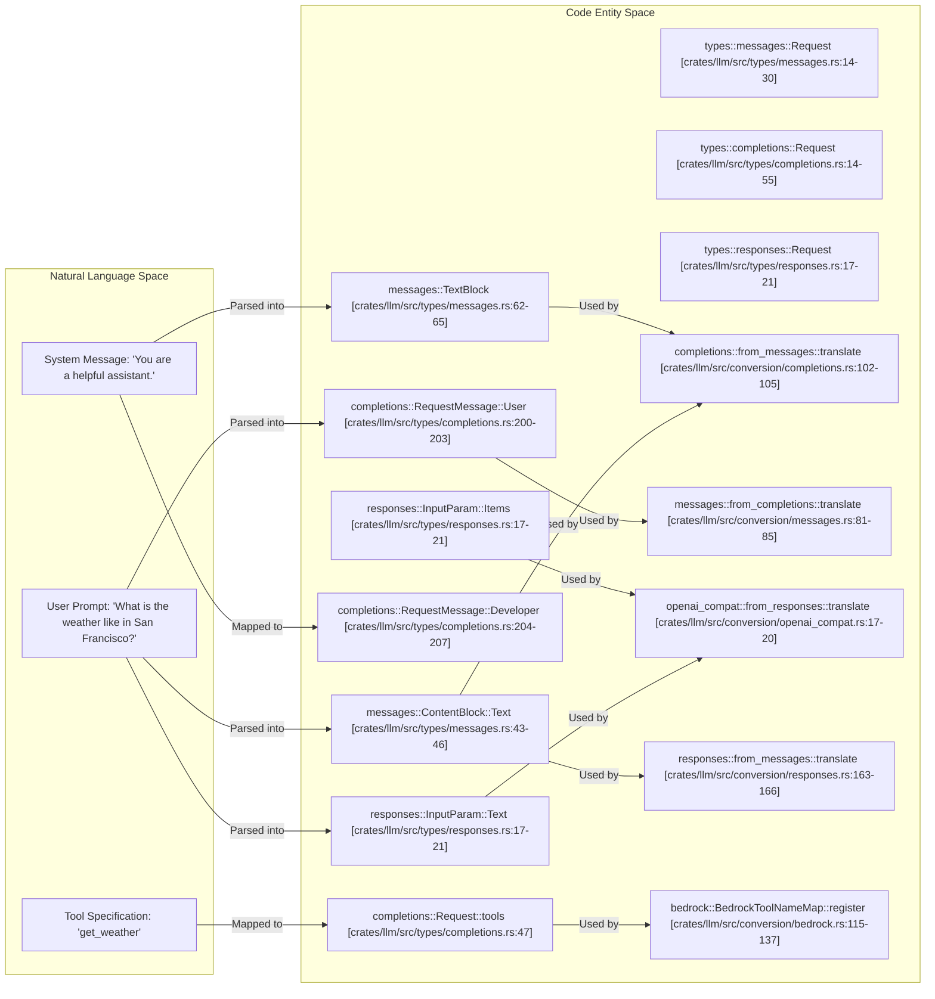

<!-- source: DeepWiki mcp.deepwiki.com · repo agentgateway/agentgateway · page 8.3 Request Format Translation · fetched 2026-10-21 -->

# Request Format Translation

Relevant source files

The following files were used as context for generating this wiki page:

- [crates/llm/src/conversion/bedrock.rs](crates/llm/src/conversion/bedrock.rs)
- [crates/llm/src/conversion/bedrock_tests.rs](crates/llm/src/conversion/bedrock_tests.rs)
- [crates/llm/src/conversion/completions.rs](crates/llm/src/conversion/completions.rs)
- [crates/llm/src/conversion/messages.rs](crates/llm/src/conversion/messages.rs)
- [crates/llm/src/conversion/mod.rs](crates/llm/src/conversion/mod.rs)
- [crates/llm/src/conversion/openai_compat.rs](crates/llm/src/conversion/openai_compat.rs)
- [crates/llm/src/conversion/responses.rs](crates/llm/src/conversion/responses.rs)
- [crates/llm/src/golden_tests.rs](crates/llm/src/golden_tests.rs)
- [crates/llm/src/tests/requests/messages/metadata.responses.snap](crates/llm/src/tests/requests/messages/metadata.responses.snap)
- [crates/llm/src/tests/requests/messages/reasoning_enabled.completions.snap](crates/llm/src/tests/requests/messages/reasoning_enabled.completions.snap)
- [crates/llm/src/tests/requests/messages/reasoning_enabled.json](crates/llm/src/tests/requests/messages/reasoning_enabled.json)
- [crates/llm/src/tests/requests/messages/reasoning_enabled.responses.snap](crates/llm/src/tests/requests/messages/reasoning_enabled.responses.snap)
- [crates/llm/src/tests/requests/messages/reasoning_unsupported_model.completions.snap](crates/llm/src/tests/requests/messages/reasoning_unsupported_model.completions.snap)
- [crates/llm/src/tests/requests/messages/reasoning_unsupported_model.json](crates/llm/src/tests/requests/messages/reasoning_unsupported_model.json)
- [crates/llm/src/tests/requests/messages/reasoning_unsupported_model.responses.snap](crates/llm/src/tests/requests/messages/reasoning_unsupported_model.responses.snap)
- [crates/llm/src/tests/requests/messages/server_tools.responses.snap](crates/llm/src/tests/requests/messages/server_tools.responses.snap)
- [crates/llm/src/tests/requests/messages/tool_reference.responses.snap](crates/llm/src/tests/requests/messages/tool_reference.responses.snap)
- [crates/llm/src/tests/requests/messages/tool_result_error.responses.snap](crates/llm/src/tests/requests/messages/tool_result_error.responses.snap)
- [crates/llm/src/tests/requests/messages/tool_result_image.responses.snap](crates/llm/src/tests/requests/messages/tool_result_image.responses.snap)
- [crates/llm/src/tests/requests/messages/tool_result_unknown_part.responses.snap](crates/llm/src/tests/requests/messages/tool_result_unknown_part.responses.snap)
- [crates/llm/src/tests/requests/messages/tools.anthropic.snap](crates/llm/src/tests/requests/messages/tools.anthropic.snap)
- [crates/llm/src/tests/requests/messages/tools.bedrock.snap](crates/llm/src/tests/requests/messages/tools.bedrock.snap)
- [crates/llm/src/tests/requests/messages/tools.completions.snap](crates/llm/src/tests/requests/messages/tools.completions.snap)
- [crates/llm/src/tests/requests/messages/tools.json](crates/llm/src/tests/requests/messages/tools.json)
- [crates/llm/src/tests/requests/messages/tools.vertex.snap](crates/llm/src/tests/requests/messages/tools.vertex.snap)
- [crates/llm/src/types/completions.rs](crates/llm/src/types/completions.rs)
- [crates/llm/src/types/messages.rs](crates/llm/src/types/messages.rs)
- [crates/llm/src/types/responses.rs](crates/llm/src/types/responses.rs)

## Purpose and Scope

Agentgateway implements comprehensive request format translation logic to enable interoperability between various LLM providers and common API formats. This allows clients to send requests in their preferred format (e.g., OpenAI Chat Completions, Anthropic Messages, or internal Responses) and have them transparently converted to provider-specific request formats such as Bedrock Converse or Vertex AI. The gateway thus acts as a universal data plane, normalizing requests and responses between heterogeneous interfaces.

All translation logic is implemented within the `crates/llm` Rust crate. Provider-specific format adapters reside under the `conversion/` directory, and strongly typed request and response schema are defined under `types/`.

Sources:  
[crates/llm/src/conversion/bedrock.rs:21-26](), [crates/llm/src/conversion/completions.rs:53-105]()

---

## Supported Request Formats

Agentgateway parses incoming and outgoing LLM requests into strongly typed Rust structures representing the different API styles it supports. Key internal formats and their usage are summarized as follows:

| Format          | Usage                                          | Core Types / Modules                                                           |
|-----------------|------------------------------------------------|--------------------------------------------------------------------------------|
| **Completions** | OpenAI Chat Completions style requests          | `types::completions::Request`, `Choice`, `Response` [crates/llm/src/types/completions.rs:14-55]() |
| **Messages**    | Anthropic Messages API style requests            | `types::messages::Request`, `RequestMessage`, `ContentBlock` [crates/llm/src/types/messages.rs:14-230]()  |
| **Responses**   | Internal unified real-time response format       | `types::responses::Request` and related types [crates/llm/src/types/responses.rs:17-142]()                 |
| **Detect**      | Auto protocol detection for ingress payloads     | `types::detect::Request` [crates/llm/src/types/detect.rs:29-32]()                                  |

The gateway converts between these internal formats and provider-native schemas, allowing seamless interoperability.

Sources:  
[crates/llm/src/types/completions.rs:14-55](), [crates/llm/src/types/messages.rs:14-230](),  
[crates/llm/src/types/responses.rs:17-142](), [crates/llm/src/types/detect.rs:29-32]()

---

## Translation Flow Architecture

### Overview

The request format translation in Agentgateway is implemented as a multi-stage pipeline that takes an incoming request in one format and transforms it into the specific request format expected by the targeted LLM provider. Similarly, responses undergo the reverse transformation. The translation modules operate on the strongly typed Rust representations, enabling robust transformations and validations before serialization to JSON bytes for transmission.

**Translation pipeline roles:**

- **Natural Language & Ingress Space:** The initial user prompt texts and tool definitions provided by clients.

- **Typed Request Registry:** Strongly typed Rust structs representing different API formats (`completions`, `messages`, `responses`, `bedrock`).

- **Conversion Modules:** Functions that translate between these typed formats, applying provider-specific formatting and validation.

Title: Request Translation Pipeline bridging Input Formats to Code Entities

Sources:  
[crates/llm/src/conversion/completions.rs:102-105](),  
[crates/llm/src/conversion/bedrock.rs:21-26](),  
[crates/llm/src/conversion/messages.rs:81-85](),
[crates/llm/src/conversion/openai_compat.rs:17-20](),
[crates/llm/src/conversion/responses.rs:163-166]()

---

## Core Translation Logic

### 1. Model Normalization and Aliasing

Before dispatching a request to upstream providers, model names and related token parameters are normalized to match provider expectations:

- OpenAI-style requests with `gpt-` model names require renaming or adjusting the `max_tokens` field to `max_completion_tokens`. This logic is encapsulated in `Request::normalize_openai_token_limit` [crates/llm/src/types/completions.rs:50-66]().

- Anthropic-style reasoning budgets are validated against minimum token counts (1024 tokens) and capped relative to maximum tokens (`max_tokens`) in the request, done by `cap_thinking_budget_to_max_tokens` [crates/llm/src/conversion/messages.rs:14-22](). This function is used by anthropic error translation routines.

- Provider-specific reasoning fields are generated by `reasoning_fields` in the Bedrock converter. It outputs JSON values for reasoning effort tailored for Amazon Nova, OpenAI, or Anthropics, including special legacy or adaptive flags [crates/llm/src/conversion/bedrock.rs:28-63]().

These normalization steps ensure semantic alignment with provider API contracts.

Sources:  
[crates/llm/src/types/completions.rs:50-66](), [crates/llm/src/conversion/messages.rs:12-22](),  
[crates/llm/src/conversion/bedrock.rs:28-63]()

---

### 2. Provider-Specific Transformations

#### Bedrock Converse Translation

- Bedrock enforces constraints on tool naming: tool names must be unique, <=64 characters, and composed only of ASCII alphanumeric or `_`/`-`. 

- The `BedrockToolNameMap` manages bi-directional mappings between client tool names and sanitized Bedrock-compliant tool names, enabling the restoration of original tool names in responses. Key functions include `register` (sanitizes and records mappings) and `restore` (maps sanitized names back) [crates/llm/src/conversion/bedrock.rs:104-148]().

- Bedrock requests embed images and file contents as inline base64 blocks or URLs. Serialization preserves media metadata and MIME types using structures under `bedrock::ImageBlock` and related types [crates/llm/src/types/bedrock.rs:28-37]().

This conversion layer ensures Bedrock's strict API constraints are met while preserving semantics from client requests.

Sources:  
[crates/llm/src/conversion/bedrock.rs:104-148](), [crates/llm/src/types/bedrock.rs:28-37]()

---

#### Google Vertex AI and Gemini

- Vertex AI returns errors wrapped in arrays of error objects rather than single error objects. The function `parse_google_error` enumerates and parses either a single object or an array, returning the first error entry [crates/llm/src/conversion/completions.rs:19-33]().

- The `translate_google_error` adapter converts Vertex AI style errors into OpenAI Chat Completion style error formats, ensuring uniform error reporting across providers [crates/llm/src/conversion/completions.rs:53-68]().

- Gemini's native API requires that `functionCall` or `functionResponse` parts preserve a `thoughtSignature` not normally echoed by OpenAI clients. To work around this, `thoughtSignature` is embedded inside the `tool_call_id` string as `<base-id>__thought__<signature>` by `join_tool_call_id` and extracted by `split_tool_call_id` upon response [crates/llm/src/conversion/vertex_gemini.rs:16-32]().

- Gemini SSE streams are passed through verbatim while extracting usage metadata chunks to enrich telemetry [crates/llm/src/conversion/vertex_gemini.rs:38-101]().

These provider-tailored conversions preserve functionality and semantics despite differing API quirks.

Sources:  
[crates/llm/src/conversion/completions.rs:19-68](), [crates/llm/src/conversion/vertex_gemini.rs:16-101]()

---

## Data Mapping and Entities

This section details how user-intent concepts and natural language request elements correlate to the code entities implementing the translation.

Title: Entity Mapping: Natural Language Space to Code Entity Space

This architecture highlights the layered abstraction separating user input parsing, typed request representation, and final marshaling to provider-specific payloads.

Sources:  
[crates/llm/src/types/messages.rs:14-230](), [crates/llm/src/conversion/completions.rs:102-105](),  
[crates/llm/src/conversion/bedrock.rs:21-26](),
[crates/llm/src/types/completions.rs:14-55](),
[crates/llm/src/types/responses.rs:17-21](),
[crates/llm/src/conversion/openai_compat.rs:17-20](),
[crates/llm/src/conversion/responses.rs:163-166]()

---

## Testing and Validation

Agentgateway rigorously validates its translation logic via golden snapshot tests and unit tests that cover edge cases and multi-provider compatibility scenarios.

- **Golden Test Harness:** 
  Located in `crates/llm/src/golden_tests.rs`, the `test_request` function loads JSON fixtures for various request examples, applies the translation functions for different providers, and compares output against stored snapshots using the `insta` testing framework. This prevents regression in mapping logic and ensures semantic fidelity [crates/llm/src/golden_tests.rs:53-104](). For example, `crates/llm/src/tests/requests/messages/tools.completions.snap` [crates/llm/src/tests/requests/messages/tools.completions.snap:1-141]() shows a snapshot for a tool-enabled message request translated to a completions format.

- **Streaming Translation Pass-Through:** 
  Gemini native SSE streaming is tested with pass-through streams that track token usage without mutating chunks, ensuring telemetry collection while delivering unaltered event data [crates/llm/src/conversion/vertex_gemini.rs:38-46]().

This testing framework assures high confidence in correctness and robustness of request adaptations.

Sources:  
[crates/llm/src/golden_tests.rs:53-104](), [crates/llm/src/conversion/vertex_gemini.rs:38-46](),
[crates/llm/src/tests/requests/messages/tools.completions.snap:1-141]()

---

With this detailed architecture and implementation, Agentgateway supports a broad interoperability matrix between popular LLM provider APIs and experimental internal formats, enabling consistent, extensible, and robust request transformations.

---

