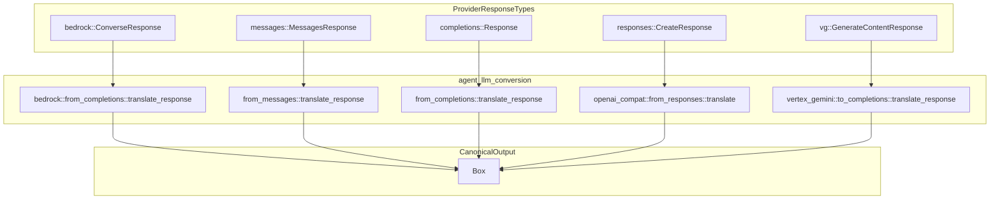
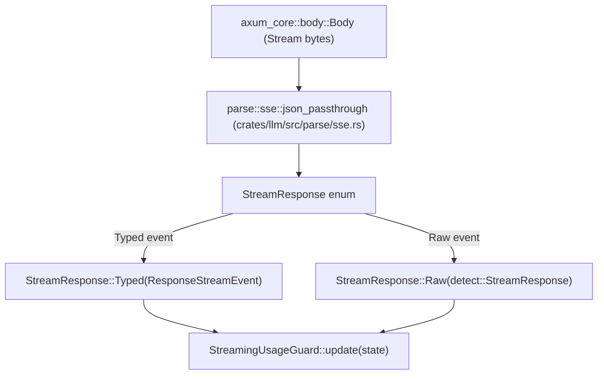

<!-- source: DeepWiki mcp.deepwiki.com · repo agentgateway/agentgateway · page 8.4 Response Format Translation · fetched 2026-10-21 -->

# Response Format Translation

<details>
<summary>Relevant source files</summary>

The following files were used as context for generating this wiki page:

- [crates/llm/src/conversion/completions_tests.rs](crates/llm/src/conversion/completions_tests.rs)
- [crates/llm/src/conversion/vertex_gemini.rs](crates/llm/src/conversion/vertex_gemini.rs)
- [crates/llm/src/conversion/vertex_gemini_tests.rs](crates/llm/src/conversion/vertex_gemini_tests.rs)
- [crates/llm/src/parse/aws_sse.rs](crates/llm/src/parse/aws_sse.rs)
- [crates/llm/src/parse/parse_tests.rs](crates/llm/src/parse/parse_tests.rs)
- [crates/llm/src/parse/sse.rs](crates/llm/src/parse/sse.rs)
- [crates/llm/src/parse/transform.rs](crates/llm/src/parse/transform.rs)
- [crates/llm/src/tests/response/bedrock/basic.bedrock-responses-streaming.snap](crates/llm/src/tests/response/bedrock/basic.bedrock-responses-streaming.snap)
- [crates/llm/src/tests/response/bedrock/namespace-tools-stream.bedrock-responses-streaming.snap](crates/llm/src/tests/response/bedrock/namespace-tools-stream.bedrock-responses-streaming.snap)
- [crates/llm/src/tests/response/bedrock/reasoning.bedrock-responses-streaming.snap](crates/llm/src/tests/response/bedrock/reasoning.bedrock-responses-streaming.snap)
- [crates/llm/src/tests/response/bedrock/tool.bedrock-responses-streaming.snap](crates/llm/src/tests/response/bedrock/tool.bedrock-responses-streaming.snap)
- [crates/llm/src/tests/response/completions/content_filter.completions-messages.snap](crates/llm/src/tests/response/completions/content_filter.completions-messages.snap)
- [crates/llm/src/tests/response/completions/content_filter.json](crates/llm/src/tests/response/completions/content_filter.json)
- [crates/llm/src/tests/response/completions/stream-content_filter.completions-messages-streaming.snap](crates/llm/src/tests/response/completions/stream-content_filter.completions-messages-streaming.snap)
- [crates/llm/src/tests/response/completions/stream-content_filter.json](crates/llm/src/tests/response/completions/stream-content_filter.json)
- [crates/llm/src/tests/response/completions/stream.completions-responses-streaming.snap](crates/llm/src/tests/response/completions/stream.completions-responses-streaming.snap)
- [crates/llm/src/tests/response/completions/stream_tool_empty_content.completions-responses-streaming.snap](crates/llm/src/tests/response/completions/stream_tool_empty_content.completions-responses-streaming.snap)
- [crates/llm/src/tests/response/responses/content_filter.responses-messages.snap](crates/llm/src/tests/response/responses/content_filter.responses-messages.snap)
- [crates/llm/src/tests/response/responses/stream-content_filter.responses-messages-streaming.snap](crates/llm/src/tests/response/responses/stream-content_filter.responses-messages-streaming.snap)

</details>


This page details how `agentgateway` converts AI provider-specific response formats into canonical, normalized representations expected by clients. It covers response conversion including non-streaming deserialization, streaming adaptation with Server-Sent Events (SSE) rewriting, standardized error processing, token count extraction, and handling of engine-specific response extensions.

The primary responsibilities in this translation layer include:

- Converting provider-specific JSON response bodies into internal canonical Rust types implementing the `ResponseType` trait.
- Adapting streaming responses (SSE byte streams) via intermediate parsed event enums.
- Extracting usage metrics and token counts for telemetry and rate limiting.
- Normalizing response content and finish reasons across multiple provider protocols.
- Handling upstream error payloads and converting them to OpenAI-compatible error responses.

For the inverse direction—translating client requests into provider-specific formats—refer to [Request Format Translation (8.3)](8.3). For how translation is selected dynamically based on route configuration, see [AI Gateway Architecture (8.1)](8.1).

---

## 1. The `ResponseType` Trait: Canonical Response Interface

At the core of response translation is the `ResponseType` trait abstraction. Implementations of this trait represent fully translated non-streaming AI responses. This abstraction allows the HTTP request processing pipeline to handle all provider responses uniformly regardless of their original source or format.

The central methods include:

- `serialize() -> Vec<u8>`: Serializes the translated response as JSON bytes to send back to clients.
- `to_llm_response() -> LLMResponse`: Extracts token usage counts, provider model metadata, and other telemetry fields used for logging and rate limiting.
- `to_webhook_choices() -> Option<&Vec<OutputMessage>>`: Exposes the message choices content for policy webhook inspection.
- `set_webhook_choices(new_choices: Vec<OutputMessage>)`: Replaces response choices after webhook filtering.

Concrete implementations typically wrap provider-specific canonical response types such as:

- `completions::Response` (canonical OpenAI completions) [crates/llm/src/types/completions.rs:79-89]()
- `messages::MessagesResponse` (Anthropic-style chat messages) [crates/llm/src/types/messages.rs:79-94]()
- `responses::CreateResponse` (OpenAI Responses API canonical) [crates/llm/src/types/responses.rs:119-130]()

This approach decouples the HTTP response pipeline from individual provider formats, enabling flexible multi-provider support.

Sources: [crates/llm/src/lib.rs:27-29](), [crates/llm/src/types/mod.rs:25-39]()

---

## 2. Provider-Specific Translation Functions and Mapping

The translation functions converting various provider response formats into canonical `ResponseType` implementations are organized under the `agent_llm::conversion` crate. Each supported provider and API variant has dedicated submodules and translation functions.

The following table summarizes key input/output translation pairs and their implementation locations:

| Input Format | Output Format | Module and Function |
|---|---|---|
| `bedrock::ConverseResponse` | `completions::Response` | `conversion::bedrock::from_completions::translate_response` |
| `bedrock::ConverseResponse` | `messages::MessagesResponse`| `conversion::bedrock::from_messages::translate_response` |
| `messages::MessagesResponse` | `completions::Response` | `conversion::completions::from_messages::translate_response` |
| `completions::Response` | `messages::MessagesResponse`| `conversion::completions::from_messages::translate_response` |
| `responses::CreateResponse` | `completions::Response` | `conversion::openai_compat::from_responses::translate` |
| `vg::GenerateContentResponse` | `completions::Response` | `conversion::vertex_gemini::to_completions::translate_response` |

### Diagram: Response Format Translation Function Map



These translation functions typically parse provider JSON payloads into internal Rust types, map tokens and usage metrics, handle any provider-specific extensions, and produce canonical completions or messages response objects.

Sources: [crates/llm/src/conversion/openai_compat.rs](), [crates/llm/src/conversion/completions.rs](), [crates/llm/src/conversion/bedrock.rs]()

---

## 3. OpenAI Responses Compatibility Layer

The gateway supports compatibility with the OpenAI-dependent Responses API by transforming their output into canonical OpenAI chat completions format. This is implemented under `openai_compat::from_responses`.

The translation flow:

- `translate(req: &types::responses::Request) -> Result<Vec<u8>, AIError>`: High-level entrypoint that deserializes, translates, and serializes the response.
- `translate_request(req: &types::responses::Request)` converts the raw JSON into a typed `responses::CreateResponse`.
- `translate_internal(typed)` builds an OpenAI-compatible completions request by converting instructions into developer messages and flattening input items into OpenAI message structs.

Key data type conversion includes parsing `InputItem` variants such as `EasyMessage` roles (User, Assistant, System) into corresponding OpenAI `RequestMessage` variants with detailed content structures.

This translation enables downstream components and clients to consume OpenAI-compatible response payloads regardless of upstream provider format.

Sources: [crates/llm/src/conversion/openai_compat.rs:1-160]()

---

## 4. Streaming Response Adaptation and SSE Event Rewriting

`agentgateway` handles streaming AI responses delivered as Server-Sent Events (SSE) by normalizing upstream byte streams into a canonical event structure for the rest of the data pipeline.

Central to this is the function `responses::passthrough_stream` which wraps an incoming streaming `Body` and re-emits a transformed streaming response adapting upstream event formats.

### Key implementation details:

- Uses an internal enum `StreamResponse` with variants:
  - `Typed`: For well-formed, structured response events corresponding to typed `ResponseStreamEvent` variants.
  - `Raw`: A fallback mode capturing generic streaming events when providers do not fully conform to the expected spec.

- The parser `parse::sse::json_passthrough` [crates/llm/src/parse/sse.rs:36-54]() decodes SSE JSON events into `StreamResponse` and feeds a closure for handling each event.
- `parse::sse::permissive_json_passthrough` [crates/llm/src/parse/sse.rs:56-74]() provides a more lenient parsing for SSE events.
- `parse::sse::json_transform` [crates/llm/src/parse/sse.rs:76-106]() and `parse::sse::json_transform_multi` [crates/llm/src/parse/sse.rs:115-154]() are used for transforming SSE events.

- For each typed event:
  - `ResponseCreated`: Records model metadata and usage counts in the streaming usage guard.
  - `ResponseOutputTextDelta`: Accumulates streamed text string delta fragments and tracks token timing latencies.
  - `ResponseOutputItemDone`: Extracts tool-call outputs to accurately build tool usage messages.
  - `ResponseCompleted`: Marks response completion, finalizes usage metrics, and flushes output messages.

- The streaming usage guard (`StreamingUsageGuard`) tracks token timing and usage statistics live during streaming, to update telemetry.

This streaming adaptation layer provides a uniform SSE interface to clients while internally consolidating multiple provider streaming formats.

### Diagram: Streaming SSE Rewriting Pipeline



Sources: [crates/llm/src/conversion/responses.rs](), [crates/llm/src/tests/response/completions/stream.completions-responses-streaming.snap:1-46](), [crates/llm/src/parse/sse.rs:36-54](), [crates/llm/src/parse/sse.rs:56-74](), [crates/llm/src/parse/sse.rs:76-106](), [crates/llm/src/parse/sse.rs:115-154]()

---

## 5. Non-Streaming Response Translation and Engine Extensions

### Bedrock Provider

`bedrock::ConverseResponse` is translated into canonical completions or messages responses by mapping Bedrock output blocks and stop reason enums into OpenAI equivalents. For instance:

| Bedrock StopReason | OpenAI `FinishReason` |
|---|---|
| `EndTurn` | `stop` |
| `MaxTokens` | `length` |
| `StopSequence` | `stop` |
| `ContentFiltered` | `content_filter` |
| `ToolUse` | `tool_calls` |

This mapping is implemented in the `bedrock` conversion submodules handling these stop reason normalizations to maintain semantic consistency across providers.

### Anthropic Messages to OpenAI Completions

Anthropic-style `messages::MessagesResponse` can be translated into completions using `from_completions` converters that flatten message block arrays and tool usage blocks, adapting token usage accordingly.

The conversion also merges reasoning contents and signatures into assistant message text content or thinking blocks as needed.

### Vertex Gemini Conversion

The `vertex_gemini` module handles conversions for Google's Vertex AI and Gemini models.
- `split_tool_call_id` [crates/llm/src/conversion/vertex_gemini.rs:19-23]() and `join_tool_call_id` [crates/llm/src/conversion/vertex_gemini.rs:27-31]() manage tool call IDs, embedding thought signatures for client echoing.
- `passthrough_stream` [crates/llm/src/conversion/vertex_gemini.rs:38-100]() handles native Gemini SSE streams, extracting usage metadata and content for logging.
- `from_completions::translate` [crates/llm/src/conversion/vertex_gemini.rs:152-155]() converts completions requests to Vertex Gemini format. This includes handling image and file data, ensuring correct MIME types are inferred or explicitly provided [crates/llm/src/conversion/vertex_gemini.rs:110-150]().

### Stop Sequence and Engine-Specific Extensions

Provider-specific fields that signal stop sequences or reasoning tokens are normalized:

- vLLM and SGLang expose proprietary extensions like `stop_reason`, `matched_stop`.
- `agentgateway` extracts these to standard `StopReason::StopSequence` with consistent semantics.
- This normalization is applied during deserialization and streaming event handling to ensure clients receive uniform finish reasons.

Sources: [crates/llm/src/conversion/completions.rs](), [crates/llm/src/conversion/bedrock.rs:210-217](), [crates/llm/src/conversion/completions_tests.rs:55-186](), [crates/llm/src/conversion/vertex_gemini.rs:19-23](), [crates/llm/src/conversion/vertex_gemini.rs:27-31](), [crates/llm/src/conversion/vertex_gemini.rs:38-100](), [crates/llm/src/conversion/vertex_gemini.rs:152-155](), [crates/llm/src/conversion/vertex_gemini.rs:110-150]()

---

## 6. Error Response Translation and Token Metrics Extraction

The translation layer intercepts provider-specific error payloads and normalizes them into standardized OpenAI-compatible error responses (e.g., `ChatCompletionErrorResponse`).

Functions such as `translate_google_error` parse Google error structure variants (single object or array-wrapped) and convert them to OpenAI error responses with mapped error types (`invalid_request_error`, `not_found_error`, etc.). The `context_overflow` tests [crates/llm/src/conversion/completions_tests.rs:3-136]() demonstrate how various provider error messages related to context length are normalized into a `capability_rejected: prompt_too_long` error.

Simultaneously, token usage metrics (`input_tokens`, `output_tokens`, cached counts, reasoning tokens) are extracted either via the `ResponseType::to_llm_response()` method for non-streaming or via `StreamingUsageGuard` during streaming. These drive access logs, rate limiting, and telemetry.

This mechanism ensures proper quota enforcement and observability regardless of the upstream provider's native metrics format.

Sources: [crates/llm/src/conversion/completions.rs:19-68](), [crates/llm/src/conversion/completions_tests.rs:1-75](), [crates/llm/src/tests/response/responses/content_filter.responses-messages.snap:1-47](), [crates/llm/src/conversion/completions_tests.rs:3-136]()

---

## 7. Example Data Flow Summary

Here is a simplified data flow diagram bridging the natural language concept of "Streaming AI response payload" to concrete code entities involved in the translation process:

```mermaid
flowchart TD
    subgraph "Natural Language Space"
        User["User Client"]
        StreamingResponse["Streaming AI Response (SSE)"]
        NonStreamingResponse["Non-Streaming AI JSON Response"]
    end

    subgraph "Code Entity Space"
        HTTPResponse["axum::response::Body"]
        PassthroughStream["responses::passthrough_stream (crates/llm/src/conversion/responses.rs)"]
        StreamResponseEnum["StreamResponse enum"]
        StreamingUsageGuard["StreamingUsageGuard"]
        ResponseTypeTrait["ResponseType Trait Objects"]
        OpenAICompatTranslate["openai_compat::from_responses::translate"]
        CompletionsTranslate["completions::from_messages::translate_response"]
        VertexGeminiPassthroughStream["vertex_gemini::passthrough_stream (crates/llm/src/conversion/vertex_gemini.rs)"]
    end

    User -->|Receives| HTTPResponse
    HTTPResponse -->|If streaming (general)| PassthroughStream
    PassthroughStream --> StreamResponseEnum
    StreamResponseEnum --> StreamingUsageGuard
    StreamingUsageGuard --> ResponseTypeTrait
    HTTPResponse -->|If streaming (Gemini native)| VertexGeminiPassthroughStream
    VertexGeminiPassthroughStream --> StreamingUsageGuard
    StreamingUsageGuard --> ResponseTypeTrait
    HTTPResponse -->|If non-streaming openai_compat| OpenAICompatTranslate
    HTTPResponse -->|If non-streaming completions| CompletionsTranslate
    ResponseTypeTrait -->|Serialized JSON| User
```

---

# Summary

`agentgateway`'s response format translation layer enables seamless interoperability between diverse AI model providers and downstream clients by:

- Abstracting provider response formats under a unified `ResponseType` trait.
- Implementing specialized translators for various API formats including OpenAI-completions, Anthropic messages, Bedrock Converse, and OpenAI Responses API.
- Enabling streaming response adaptation with SSE event rewriting and live token usage tracking.
- Normalizing error payloads and engine-specific extensions to consistent client-facing structures.
- Extracting token usage stats for observability and rate limiting.

This modular and extensible design ensures robust multi-provider support and uniform client experience.

---

**Sources:**

- [crates/llm/src/conversion/responses.rs]()
- [crates/llm/src/conversion/openai_compat.rs:1-160]()
- [crates/llm/src/conversion/completions.rs]()
- [crates/llm/src/conversion/bedrock.rs]()
- [crates/llm/src/conversion/completions_tests.rs:1-75]()
- [crates/llm/src/conversion/completions_tests.rs:55-186]()
- [crates/llm/src/conversion/vertex_gemini.rs]()
- [crates/llm/src/tests/response/completions/stream.completions-responses-streaming.snap:1-46]()
- [crates/llm/src/tests/response/responses/content_filter.responses-messages.snap:1-47]()
- [crates/llm/src/parse/sse.rs]()

---

