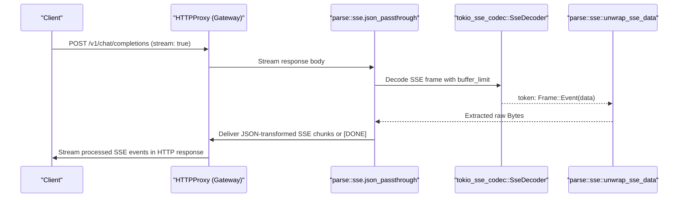
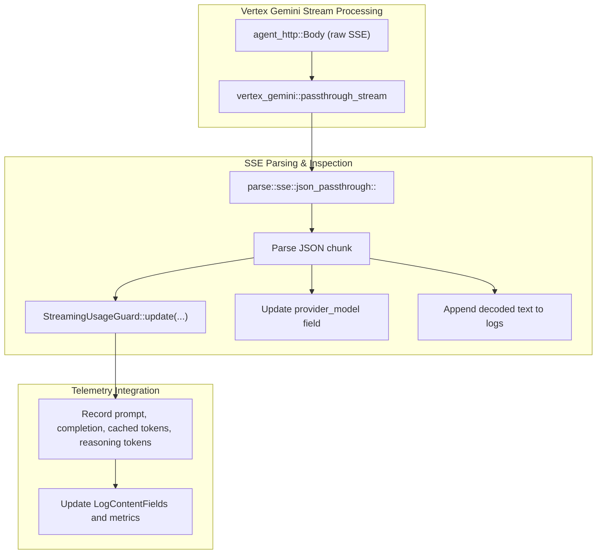

<!-- source: DeepWiki mcp.deepwiki.com · repo agentgateway/agentgateway · page 8.7 Streaming Response Handling · fetched 2026-10-21 -->

# Streaming Response Handling

<details>
<summary>Relevant source files</summary>

The following files were used as context for generating this wiki page:

- [crates/llm/src/conversion/vertex_gemini.rs](crates/llm/src/conversion/vertex_gemini.rs)
- [crates/llm/src/conversion/vertex_gemini_tests.rs](crates/llm/src/conversion/vertex_gemini_tests.rs)
- [crates/llm/src/parse/aws_sse.rs](crates/llm/src/parse/aws_sse.rs)
- [crates/llm/src/parse/parse_tests.rs](crates/llm/src/parse/parse_tests.rs)
- [crates/llm/src/parse/sse.rs](crates/llm/src/parse/sse.rs)
- [crates/llm/src/parse/transform.rs](crates/llm/src/parse/transform.rs)
- [crates/llm/src/tests/response/anthropic/stream_tool.messages-completions-streaming.snap](crates/llm/src/tests/response/anthropic/stream_tool.messages-completions-streaming.snap)
- [crates/llm/src/tests/response/anthropic/stream_tool_empty_args.messages-completions-streaming.snap](crates/llm/src/tests/response/anthropic/stream_tool_empty_args.messages-completions-streaming.snap)
- [crates/llm/src/tests/response/bedrock/tool.bedrock-completions-streaming.snap](crates/llm/src/tests/response/bedrock/tool.bedrock-completions-streaming.snap)

</details>


## Purpose and Scope

This page provides an in-depth technical overview of how the `agentgateway` project implements streaming handling for AI/LLM responses. It focuses on Server-Sent Events (SSE) stream decoding, per-chunk JSON parsing and transformation, specialized handling for provider-specific streaming protocols such as Google Vertex Gemini's SSE streams, and format conversion for streaming responses.

Key concerns include:

- Efficient incremental SSE chunk decoding and transformation without full buffering.
- Supporting multiple output event types per input chunk.
- Tracking token usage dynamically during streaming to feed telemetry and rate limiting.
- Adapting binary event-stream protocols (e.g., AWS Bedrock) to SSE JSON.
- Maintaining well-defined data flows and abstractions for extensibility across AI providers.

This document analyzes core parsing utilities in `crates/llm/src/parse/sse.rs` and provider-specific streaming adaptations such as `passthrough_stream` for Vertex Gemini in `crates/llm/src/conversion/vertex_gemini.rs`.

For related topics on buffered response format conversion and policy integration, see:

- [Response Format Translation (8.4)](8.4)
- [Token-Based Rate Limiting for LLM (6.4)](6.4)

---

## SSE Parsing and Transformation Primitives (`crates/llm/src/parse/sse.rs`)

The `sse.rs` module provides robust abstractions for parsing and transforming SSE streams in a memory-efficient, asynchronous manner. It handles chunk-by-chunk decoding of SSE events using `tokio_sse_codec::SseDecoder` and supports seamless integration of parsing, transformation, and re-encoding pipelines.

### Key Functions

- **`json_passthrough<F>`**

  Parses incoming SSE data frames into deserialized JSON objects of type `F`. It removes the SSE framing, decodes JSON per chunk, and invokes a user-provided closure. Special handling for the OpenAI `[DONE]` sentinel signals stream completion.

  ```rust
  pub fn json_passthrough<F: DeserializeOwned>(
      b: Body,
      buffer_limit: usize,
      mut f: impl FnMut(Option<anyhow::Result<F>>) + Send + 'static,
  ) -> Body
  ```

- **`json_transform<I, O>`**

  Transforms an SSE stream of input events of type `I` into a stream of output events of type `O` by decoding, applying a transformation function, then re-encoding into SSE frames.

  ```rust
  pub fn json_transform<I: DeserializeOwned, O: Serialize>(
      b: Body,
      buffer_limit: usize,
      mut f: impl FnMut(anyhow::Result<I>) -> Option<O> + Send + 'static,
  ) -> Body
  ```

- **`json_transform_multi<I, O, It>`**

  Supports multi-event output per single input event, enabling fan-out or emitting multiple named SSE events from a single parsed chunk.

  ```rust
  pub fn json_transform_multi<I: DeserializeOwned, O: Serialize, It>(
      b: Body,
      buffer_limit: usize,
      mut f: impl FnMut(SseJsonEvent<I>) -> It + Send + 'static,
  ) -> Body
  where
      It: IntoIterator<Item = (&'static str, O)>,
      It::IntoIter: Send,
  ```

- **`append_done_on_success`**

  Wraps a body stream to inject a final OpenAI-style `[DONE]` SSE event after a successful stream close.

### Internal Implementation Details

- Uses `SseDecoder<Bytes>` with configurable `buffer_limit` to parse SSE events incrementally.
- Core parsing loop uses `transform_parser` or `passthrough_parser` to consume tokio streams and decode frames.
- Special-cases the literal `[DONE]` data payload to trigger completion signals or forward end events.
- Provides utilities like `unwrap_sse_data` to extract raw message payloads (`Bytes`) from SSE frames for downstream processing.

---

### Data Flow and Interaction Diagram for SSE Parsing



Sources: [crates/llm/src/parse/sse.rs:14-161]()

---

## Vertex Gemini Streaming Adaptation (`crates/llm/src/conversion/vertex_gemini.rs`)

Google Vertex Gemini's streaming API emits SSE chunks with JSON data representing progressive content generation events. This provider requires specialized handling that forwards raw SSE chunks unchanged yet extracts telemetry and token usage metadata per chunk for reporting.

### `passthrough_stream` Function

This function forwards the raw SSE bytes of a Vertex Gemini streaming response body untouched. Meanwhile, it incrementally inspects parsed JSON chunks to:

- Record first token arrival time for latency metrics.
- Extract and update model version from chunk metadata.
- Extract incremental token usage counts (`prompt_tokens`, `completion_tokens`, `total_tokens`, cached tokens, reasoning tokens).
- Accumulate completion text parts for logging and guard evaluation.

The telemetry updates happen within a `StreamingUsageGuard` passed to the function. The function utilizes a lower-level SSE JSON parsing utility `sse::json_passthrough` specialized to the Gemini schema type `vg::GenerateContentResponse`.

```rust
pub fn passthrough_stream(
    b: agent_http::Body,
    buffer_limit: usize,
    log: crate::StreamingUsageGuard,
    log_content: crate::LogContentFields,
) -> agent_http::Body 
```

### Implementation Highlights

- Uses `json_passthrough::<vg::GenerateContentResponse>` to decode each SSE chunk.
- Handles the absence of a done sentinel in Gemini streams gracefully (no `f(None)` call).
- Upon receiving the first valid token chunk, records a `first_token` timestamp.
- Updates the streaming usage data on every chunk carrying `usageMetadata`.
- Accumulates non-thought text tokens into the completion logs if enabled.

---

### Data Flow Diagram: Vertex Gemini SSE Streaming Handling



Sources: [crates/llm/src/conversion/vertex_gemini.rs:38-101](), [crates/llm/src/parse/sse.rs:36-54]()

---

## Token Tracking and State Management in Streaming Responses

Streaming responses are delivered incrementally before full token usage metadata is available. `agentgateway` manages partial state updates and tracking during the stream lifecycle:

- The **`StreamingUsageGuard`** RAII guard monitors streaming usage updates and flushes collected telemetry on stream completion or drop.
- The gateway marks the timestamp of the **first token** observed in the streaming content to enable Time-to-First-Token metrics.
- If content logging is enabled (`log_content.completion`), textual deltas from chunks are concatenated into internal logs.
- Usage metadata fields tracked include:
  - `input_tokens` (prompt tokens)
  - `output_tokens` (completion tokens)
  - `total_tokens` (sum of input and output)
  - `cached_input_tokens`
  - `reasoning_tokens`

This dynamic tracking feeds upstream metrics and policy enforcements such as token quota limits.

---

## Summary

The streaming response handling in `agentgateway` comprises low-level SSE parsing utilities, generic transform pipelines, and provider-specific streaming adaptations that extract and manage usage telemetry in real-time without buffering entire responses. The gateway supports:

- SSE decoding with buffer size protection and graceful end-of-stream handling.
- JSON fragmentation parsing and incremental event emission.
- Multi-event SSE stream transformation and fan-out.
- Native passthrough of SSE chunks for providers requiring minimal mutation.
- Real-time token usage tracking and latency measurement to support observability and rate-limiting.

This design provides a flexible and extensible foundation for supporting diverse AI platform streaming formats while maintaining rich telemetry integration.

---

# Appendix: Abbreviated Code Location Index

| Concept                          | Code Location                            |
|---------------------------------|----------------------------------------|
| SSE JSON passthrough             | `crates/llm/src/parse/sse.rs:36-54`    |
| SSE JSON transform              | `crates/llm/src/parse/sse.rs:76-106`   |
| SSE JSON multi-transform         | `crates/llm/src/parse/sse.rs:115-154`  |
| Append [DONE] event              | `crates/llm/src/parse/sse.rs:14-34`    |
| Vertex Gemini streaming passthrough | `crates/llm/src/conversion/vertex_gemini.rs:38-101` |

Sources: [crates/llm/src/conversion/vertex_gemini.rs:38-101](), [crates/llm/src/parse/sse.rs:1-170]()

---

