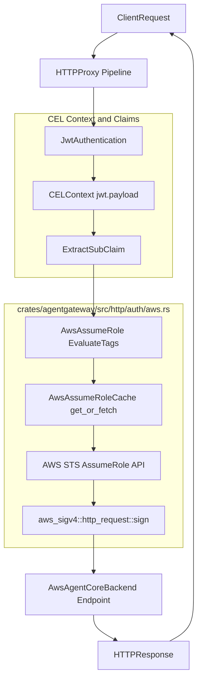
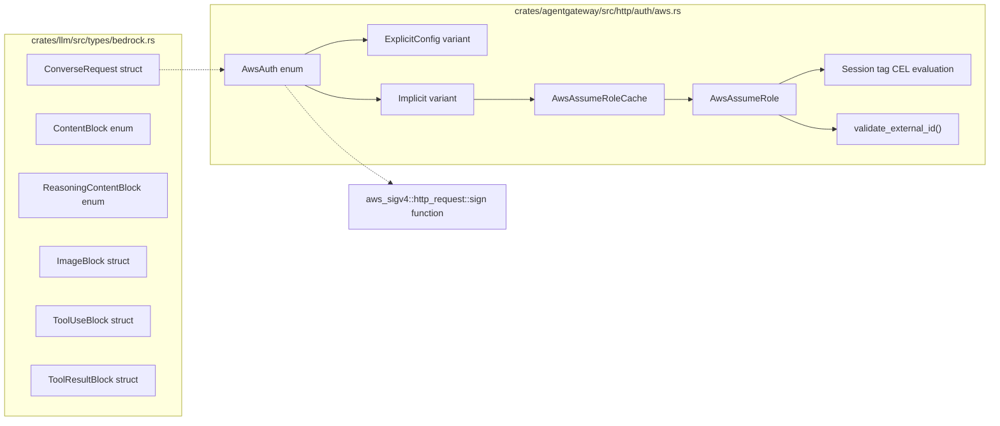

<!-- source: DeepWiki mcp.deepwiki.com · repo agentgateway/agentgateway · page 8.8 AWS AgentCore Integration · fetched 2026-10-21 -->

# AWS AgentCore Integration

<details>
<summary>Relevant source files</summary>

The following files were used as context for generating this wiki page:

- [crates/agentgateway/src/http/auth/aws.rs](crates/agentgateway/src/http/auth/aws.rs)
- [crates/llm/src/tests/requests/messages/reasoning_replay.bedrock.snap](crates/llm/src/tests/requests/messages/reasoning_replay.bedrock.snap)
- [crates/llm/src/tests/requests/messages/reasoning_replay.completions.snap](crates/llm/src/tests/requests/messages/reasoning_replay.completions.snap)
- [crates/llm/src/tests/requests/messages/reasoning_replay.json](crates/llm/src/tests/requests/messages/reasoning_replay.json)
- [crates/llm/src/tests/requests/responses/input-list.bedrock.snap](crates/llm/src/tests/requests/responses/input-list.bedrock.snap)
- [crates/llm/src/tests/requests/responses/input-list.gemini.snap](crates/llm/src/tests/requests/responses/input-list.gemini.snap)
- [crates/llm/src/tests/requests/responses/input-list.json](crates/llm/src/tests/requests/responses/input-list.json)
- [crates/llm/src/tests/response/bedrock/reasoning.bedrock-responses.snap](crates/llm/src/tests/response/bedrock/reasoning.bedrock-responses.snap)
- [crates/llm/src/tests/response/bedrock/reasoning_redacted.bedrock-completions.snap](crates/llm/src/tests/response/bedrock/reasoning_redacted.bedrock-completions.snap)
- [crates/llm/src/tests/response/bedrock/reasoning_redacted.bedrock-messages.snap](crates/llm/src/tests/response/bedrock/reasoning_redacted.bedrock-messages.snap)
- [crates/llm/src/tests/response/bedrock/reasoning_unsigned.bedrock-responses.snap](crates/llm/src/tests/response/bedrock/reasoning_unsigned.bedrock-responses.snap)
- [crates/llm/src/types/bedrock.rs](crates/llm/src/types/bedrock.rs)

</details>


The AWS AgentCore integration provides a specialized backend type and authentication framework for routing traffic to AWS Bedrock AgentCore runtimes and AWS Bedrock services. It leverages `agent-core`, `agent-llm`, and AWS SigV4 libraries to handle intricate AWS requirements such as Amazon Resource Name (ARN) parsing, SigV4 request signing, and JWT-based user identity propagation using dynamic STS session tags and session names.

This page covers the AWS Bedrock AgentCore backend type definition, the ARN parsing model, the AWS authentication mechanism, and the JWT identity forwarding implementation, along with key code flow and entity maps.

---

## Overview

Agentgateway adds support for AWS AgentCore backends by extending the backend spec schema and implementing AWS-specific authentication. The integration enables the gateway to translate generic AI client requests (e.g., OpenAI-compatible chat completions) into AWS Bedrock Runtime and AgentCore API requests securely and with proper identity forwarding.

### Key Capabilities

- **SigV4 Request Signing:** Uses AWS Signature Version 4 protocol (via `aws_sigv4::http_request::sign` [crates/agentgateway/src/http/auth/aws.rs:11-12]()) to sign outgoing HTTP requests with AWS credentials.
- **AWS Auth Config:** Supports explicit AWS credentials or implicit credential sources, including IAM roles with assumption using STS.
- **STS AssumeRole with Caching:** Role assumptions are cached to optimize performance and prevent redundant calls, managed by `AwsAssumeRoleCache` [crates/agentgateway/src/http/auth/aws.rs:87-128]().
- **Dynamic Session Tag & Session Name Evaluation:** JWT claims and request context are evaluated to dynamically inject session tags and session names when assuming roles, improving auditability and user identity propagation.
- **AgentCore Backend Schema:** Defines the AWS AgentCore backend type, supporting ARN specification and optional qualifier.
- **Bedrock Provider Integration:** Bedrock endpoint selection and API path resolution abstracted in the LLM provider for Bedrock.

Sources: `[controller/api/v1alpha1/agentgateway/agentgateway_backend_types.go:97-113]()`, `[crates/agentgateway/src/http/auth/aws.rs:27-159]()`, `[crates/llm/src/types/bedrock.rs]()`.

---

## Configuration and Bedrock Provider

### AWS AgentCore Backend Schema

Configured via the `AgentgatewayBackend` Kubernetes custom resource, the AWS backend is specified under the `Aws` field of the backend spec. The `AwsAgentCoreBackend` subfield configures the AgentCore runtime.

| Field | Type | Description |
|---|---|---|
| `agentRuntimeArn` | `string` | Required Amazon Resource Name (ARN) of the AgentCore runtime to target. This uniquely identifies the AWS AgentCore resource `[controller/api/v1alpha1/agentgateway/agentgateway_backend_types.go:109]()`. |
| `qualifier` | `*string` | Optional alias or version qualifier to select a specific version of the runtime `[controller/api/v1alpha1/agentgateway/agentgateway_backend_types.go:112]()`. |

```go
type AwsAgentCoreBackend struct {
	AgentRuntimeArn string  `json:"agentRuntimeArn"`
	Qualifier       *string `json:"qualifier,omitempty"`
}
```

Sources: `[controller/api/v1alpha1/agentgateway/agentgateway_backend_types.go:97-113]()`

---

### Bedrock LLM Provider Config

The Bedrock LLM provider configuration lives in the `crates/llm/src/types/bedrock.rs` and represents higher-level details used to select Bedrock endpoints, apply guardrails, override models, and determine API paths and signing service names.

Key fields:

- `model_override`: Override model ID used in requests.
- `region`: AWS region string, e.g., `"us-west-2"`.
- `guardrail_identifier` & `guardrail_version`: For Bedrock guardrail application.
- `endpoint_preference`: Enum determining preference between "Runtime" or "Mantle" endpoints.

Bedrock endpoint resolution supports nuanced routing based on request type, model tags in the model catalog, and the endpoint preference configuration.

Sources: `[crates/llm/src/types/bedrock.rs]()`

---

## AWS Authentication (`AwsAuth`)

The AWS authentication system is embodied in the `AwsAuth` enum [crates/agentgateway/src/http/auth/aws.rs:29-70](), which supports two variants:

| Variant | Description |
|---|---|
| `ExplicitConfig` | AWS credentials explicitly provided (`access_key_id`, `secret_access_key`, optional `session_token`). Includes optional SigV4 `service_name`. |
| `Implicit` | Uses implicit credential loading (e.g., environment, IAM role, ECS, EC2). Supports optional `assume_role` for STS role assumption and service/region override. |

```rust
#[serde(untagged)]
pub enum AwsAuth {
    ExplicitConfig {
        access_key_id: SecretString,
        secret_access_key: SecretString,
        region: Option<String>,
        session_token: Option<SecretString>,
        service_name: Option<String>,
    },
    Implicit {
        service_name: Option<String>,
        region: Option<String>,
        assume_role: Option<AwsAssumeRole>,
        source_credentials_cache: AwsCredentialsCache,
        assume_role_cache: AwsAssumeRoleCache,
    }
}
```

- `AwsAssumeRole` [crates/agentgateway/src/http/auth/aws.rs:138-167]() contains fields such as `role_arn`, `session_name` (which can be a CEL expression evaluated per request), session `tags` (static or CEL expressions), and optional `external_id` with validation rules [crates/agentgateway/src/http/auth/aws.rs:177-188]().
- Caches like `AwsCredentialsCache` [crates/agentgateway/src/http/auth/aws.rs:73]() and `AwsAssumeRoleCache` [crates/agentgateway/src/http/auth/aws.rs:88]() optimize credential retrieval and STS calls with bounded caches and single-flight entry guards [crates/agentgateway/src/http/auth/aws.rs:97-128]().

Sources: `[crates/agentgateway/src/http/auth/aws.rs:27-70]()`, `[crates/agentgateway/src/http/auth/aws.rs:136-167]()`

---

## Implementation Details

### SigV4 Request Signing and Identity Forwarding

When sending requests to AWS Bedrock AgentCore backends, the following detailed flow is executed:

1.  **Credential Resolution**
    *   For explicit config, credentials are directly used.
    *   For implicit config, cached ambient credentials are retrieved or refreshed from the environment or EC2/ECS metadata.
    *   If `assume_role` is configured, the SDK uses `AwsAssumeRoleCache::get_or_fetch` [crates/agentgateway/src/http/auth/aws.rs:97-128]() to fetch or reuse cached STS tokens by assuming the configured IAM role with optional session names and tags.

2.  **Session Tags and Name Evaluation**
    *   The gateway evaluates CEL expressions embedded in `AwsAssumeRole`'s `session_name` and `tags` fields against the incoming request context, typically capturing JWT claims such as the user's subject claim (`jwt.sub`).
    *   This enables forwarding user identity into AWS STS session tags for auditing and cost attribution.

3.  **Request Signing**
    *   The outgoing HTTP request is signed using `aws_sigv4::http_request::sign` [crates/agentgateway/src/http/auth/aws.rs:11-12]() with the resolved credentials and signing parameters.
    *   Signing includes the HTTP method, canonical URI, canonical headers, and the request body payload.

4.  **Request Dispatch**
    *   Signed and authorized requests are sent to the AWS AgentCore runtime or Bedrock endpoint.

Sources: `[crates/agentgateway/src/http/auth/aws.rs:11-12]()`, `[crates/agentgateway/src/http/auth/aws.rs:64]()`, `[crates/agentgateway/src/http/auth/aws.rs:87-128]()`, `[crates/agentgateway/src/http/auth/aws.rs:136-159]()`

---

## Data Flow Diagram

Title: AWS AgentCore Request Routing and Identity Forwarding Data Flow



This diagram illustrates the journey from the incoming client request through JWT authentication and CEL context extraction, to AWS STS AssumeRole evaluation with dynamic session tag injection, and finally SigV4 signing before dispatch.

Sources: `[controller/api/v1alpha1/agentgateway/agentgateway_backend_types.go:105-113]()`, `[crates/agentgateway/src/http/auth/aws.rs:87-128]()`, `[crates/agentgateway/src/http/auth/aws.rs:136-159]()`

---

## Code Entity Mapping

Title: Code Entity Mapping for Bedrock and AWS Auth Subsystems



This mapping shows the interaction between the AWS auth enums, role assumption caches, CEL-driven session context evaluation, together with the Bedrock LLM provider that determines endpoint and signing details. The `validate_external_id` function [crates/agentgateway/src/http/auth/aws.rs:177-188]() is also included, which enforces constraints on the `external_id` field of `AwsAssumeRole`.

Sources: `[crates/agentgateway/src/http/auth/aws.rs:27-70]()`, `[crates/agentgateway/src/http/auth/aws.rs:87-128]()`, `[crates/agentgateway/src/http/auth/aws.rs:136-159]()`, `[crates/agentgateway/src/http/auth/aws.rs:177-188]()`, `[crates/llm/src/types/bedrock.rs:16-24]()`, `[crates/llm/src/types/bedrock.rs:28-31]()`, `[crates/llm/src/types/bedrock.rs:54-70]()`, `[crates/llm/src/types/bedrock.rs:81-89]()`, `[crates/llm/src/types/bedrock.rs:100-107]()`, `[crates/llm/src/types/bedrock.rs:157-199]()`

---

## Summary

The AWS AgentCore backend type integration in agentgateway encapsulates the AWS-specific needs for connecting to Bedrock and AgentCore runtimes. It provides:

-   A strong typed schema to configure AWS ARN based backends.
-   AWS SigV4 request signing with implicit or explicit credentials.
-   Integration with Kubernetes backend CRDs for declarative configuration.
-   Dynamic user identity forwarding through JWT claims and session tags in STS AssumeRole.
-   Endpoint preferences and API path resolution per Bedrock conventions.

This integration ensures secure, auditable, and seamless connectivity from agentgateway's AI gateway pipeline to AWS-hosted AI runtimes.

---

# References

-   `AgentgatewayBackendSpec.AwsAgentCoreBackend` Kubernetes schema:
    `[controller/api/v1alpha1/agentgateway/agentgateway_backend_types.go:97-113]()`

-   AWS Auth and signing implementation:
    `[crates/agentgateway/src/http/auth/aws.rs:27-159]()`

-   AWS role assumption, caching, and session tag evaluation:
    `[crates/agentgateway/src/http/auth/aws.rs:87-128]()`

-   AWS Bedrock Provider configuration and endpoint resolution:
    `[crates/llm/src/types/bedrock.rs]()`

---

