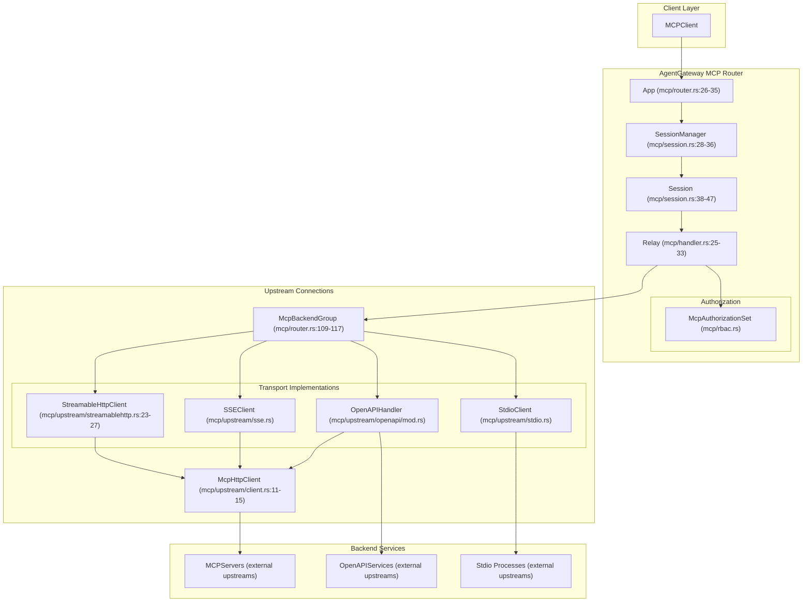
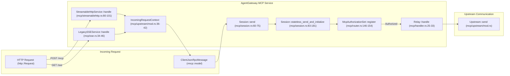

<!-- source: DeepWiki mcp.deepwiki.com · repo agentgateway/agentgateway · page 9 Agent Protocols · fetched 2026-10-21 -->

# Agent Protocols

Relevant source files

The following files were used as context for generating this wiki page:

- [crates/agentgateway/src/mcp/handler.rs](crates/agentgateway/src/mcp/handler.rs)
- [crates/agentgateway/src/mcp/mcp_tests.rs](crates/agentgateway/src/mcp/mcp_tests.rs)
- [crates/agentgateway/src/mcp/mod.rs](crates/agentgateway/src/mcp/mod.rs)
- [crates/agentgateway/src/mcp/router.rs](crates/agentgateway/src/mcp/router.rs)
- [crates/agentgateway/src/mcp/session.rs](crates/agentgateway/src/mcp/session.rs)
- [crates/agentgateway/src/mcp/sse.rs](crates/agentgateway/src/mcp/sse.rs)
- [crates/agentgateway/src/mcp/streamablehttp.rs](crates/agentgateway/src/mcp/streamablehttp.rs)
- [crates/agentgateway/src/mcp/upstream/mod.rs](crates/agentgateway/src/mcp/upstream/mod.rs)
- [crates/agentgateway/src/mcp/upstream/openapi/mod.rs](crates/agentgateway/src/mcp/upstream/openapi/mod.rs)
- [crates/agentgateway/src/mcp/upstream/openapi/tests.rs](crates/agentgateway/src/mcp/upstream/openapi/tests.rs)
- [crates/agentgateway/src/mcp/upstream/sse.rs](crates/agentgateway/src/mcp/upstream/sse.rs)
- [crates/agentgateway/src/mcp/upstream/streamablehttp.rs](crates/agentgateway/src/mcp/upstream/streamablehttp.rs)
- [crates/agentgateway/src/proxy/mod.rs](crates/agentgateway/src/proxy/mod.rs)

## Purpose and Scope

This section addresses AgentGateway's implementation and support for two key protocols facilitating agentic AI connectivity and inter-agent communication:

- **Model Context Protocol (MCP),** a JSON-RPC based protocol designed for agent-to-tool communication, encompassing tools, prompts, resources, and notifications.
- **Agent-to-Agent (A2A) Protocol,** targeted at enabling skill invocation and agent discovery between autonomous agents.

AgentGateway serves as a protocol gateway that routes, authorizes, multiplexes, and merges requests between downstream clients and upstream MCP/A2A services.

For detailed AI model request handling related to providers like OpenAI or Anthropic, refer to the [LLM and AI Gateway](#8). For general request routing and traffic management, see [HTTP Request Processing Pipeline](#2.2).

Sources: [crates/agentgateway/src/mcp/router.rs:71-117](), [crates/agentgateway/src/mcp/handler.rs:25-33](), [crates/agentgateway/src/mcp/mod.rs:1-12](), [crates/agentgateway/src/mcp/upstream/mod.rs:193-201]()

## Overview

AgentGateway provides native support for the following protocols:

### Model Context Protocol (MCP)

MCP is a JSON-RPC 2.0-based protocol enabling agents to communicate with tools, prompts, resources, and notifications. Key features include:

- **Tools:** Represent callable operations with well-defined input/output schemas supporting rich argument structures and validation.
- **Prompts:** Parameterizable reusable prompt templates to interact with LLM providers or tool integrations.
- **Resources:** Exposable queryable data sources such as files, databases, or APIs.
- **Notifications:** Bidirectional event streams enabling asynchronous message delivery and subscription.
- **Multiple Transport Mechanisms:** Supports Streamable HTTP, SSE, Stdio process communication, and an OpenAPI bridge translating REST APIs into MCP tools.

MCP also defines session lifecycle semantics, multiplexing to multiple upstreams with response merging, and RBAC-based authorization policies.

### Agent-to-Agent Protocol (A2A)

A2A protocol enables agent discovery, metadata sharing (via agent cards), and skill invocation between peer agents. This protocol facilitates interoperable, autonomous agent collaboration through the gateway's routing, authentication, and metadata management systems.

Together, MCP and A2A form the core agent protocol ecosystem within AgentGateway, designed for extensible upstream backend integration and fine-grained access control.

Sources: [crates/agentgateway/src/mcp/router.rs:71-117](), [crates/agentgateway/src/mcp/handler.rs:13-33](), [crates/agentgateway/src/mcp/mod.rs:1-12](), [crates/agentgateway/src/mcp/upstream/mod.rs:193-201]()

## System Architecture

**Figure 1: MCP Router Architecture Code Entity Mapping**

This diagram associates natural language components with source code artifacts. The `App` struct in [crates/agentgateway/src/mcp/router.rs:26-35]() orchestrates request processing including authorization and routing. The `SessionManager` and `Session` handle session lifecycles and communications with upstream backends [crates/agentgateway/src/mcp/session.rs:28-36](), [crates/agentgateway/src/mcp/session.rs:38-47](). The `Relay` multiplexes calls and merges results from upstream targets while enforcing RBAC via `McpAuthorizationSet` [crates/agentgateway/src/mcp/handler.rs:25-33](). Upstream communications use multiple transport clients encapsulated within `McpBackendGroup` [crates/agentgateway/src/mcp/router.rs:109-117]() and implemented in transport modules like `StreamableHttpClient` [crates/agentgateway/src/mcp/upstream/streamablehttp.rs:23-27](), `SSEClient` [crates/agentgateway/src/mcp/upstream/sse.rs](), `OpenAPIHandler` [crates/agentgateway/src/mcp/upstream/openapi/mod.rs](), and `StdioClient` [crates/agentgateway/src/mcp/upstream/mod.rs:210]().

Sources: [crates/agentgateway/src/mcp/router.rs:26-35](), [crates/agentgateway/src/mcp/session.rs:28-36](), [crates/agentgateway/src/mcp/session.rs:38-47](), [crates/agentgateway/src/mcp/handler.rs:25-33](), [crates/agentgateway/src/mcp/upstream/mod.rs:193-210](), [crates/agentgateway/src/mcp/upstream/streamablehttp.rs:23-27]()

## Request Processing Flow

**Figure 2: MCP Request Processing Flow Code Mapping**

The request lifecycle begins with an incoming HTTP request, which is then processed by either `StreamableHttpService` [crates/agentgateway/src/mcp/streamablehttp.rs:80-101]() for standard MCP HTTP requests or `LegacySSEService` [crates/agentgateway/src/mcp/sse.rs:34-46]() for legacy SSE. An `IncomingRequestContext` [crates/agentgateway/src/mcp/upstream/mod.rs:36-42]() is created to encapsulate request details. The extracted `ClientJsonRpcMessage` is then passed to a `Session` for processing. The `Session::send` method [crates/agentgateway/src/mcp/session.rs:60-75]() or `Session::stateless_send_and_initialize` [crates/agentgateway/src/mcp/session.rs:83-181]() handles the message, potentially performing a synthetic `initialize` handshake for legacy upstreams. Before routing, `McpAuthorizationSet` [crates/agentgateway/src/mcp/router.rs:146-154]() enforces RBAC policies. Finally, the `Relay` component [crates/agentgateway/src/mcp/handler.rs:25-33]() executes routing, multiplexing, and merges responses from one or more upstreams via `Upstream::send` [crates/agentgateway/src/mcp/upstream/mod.rs]().

Sources: [crates/agentgateway/src/mcp/session.rs:60-75](), [crates/agentgateway/src/mcp/session.rs:83-181](), [crates/agentgateway/src/mcp/router.rs:146-154](), [crates/agentgateway/src/mcp/handler.rs:25-33](), [crates/agentgateway/src/mcp/streamablehttp.rs:80-101](), [crates/agentgateway/src/mcp/sse.rs:34-46](), [crates/agentgateway/src/mcp/upstream/mod.rs:36-42]()

## Child Pages and Sub-Topics

Detailed implementation specifics are covered separately in the following child pages:

- **9.1 Model Context Protocol (MCP) Overview** — Introduction to MCP protocol, supported resource types, and system architecture. For details, see [Model Context Protocol (MCP) Overview](#9.1).
- **9.2 MCP Transports** — Description of supported transports: Streamable HTTP, Server-Sent Events (SSE), Stdio process communication, and the OpenAPI bridge for REST. For details, see [MCP Transports](#9.2).
- **9.3 MCP Authentication and Authorization** — OAuth and JWT authentication mechanisms, RBAC enforcement for tools, prompts, and resources, plus MCP protocol metadata endpoints. For details, see [MCP Authentication and Authorization](#9.3).
- **9.4 MCP Session Management** — Lifecycle of MCP sessions, including creation, persistence, protocol versioning, and stateful backend affinity. For details, see [MCP Session Management](#9.4).
- **9.5 MCP Multiplexing and Response Merging** — Fan-out requests to multiple upstream MCP servers, response merging logic, and name prefixing to avoid collisions. For details, see [MCP Multiplexing and Response Merging](#9.5).
- **9.6 OpenAPI to MCP Bridge** — Parsing OpenAPI specifications to dynamically generate MCP tools and executing REST calls as MCP tool invocations. For details, see [OpenAPI to MCP Bridge](#9.6).
- **9.7 Agent-to-Agent (A2A) Protocol** — Support for the A2A protocol, including skill definitions and management of agent card metadata. For details, see [Agent-to-Agent (A2A) Protocol](#9.7).

Sources: [crates/agentgateway/src/mcp/mod.rs:1-12](), [crates/agentgateway/src/mcp/router.rs:150-154]()

---

