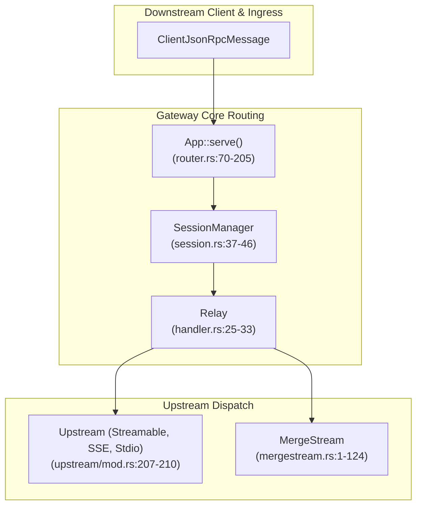
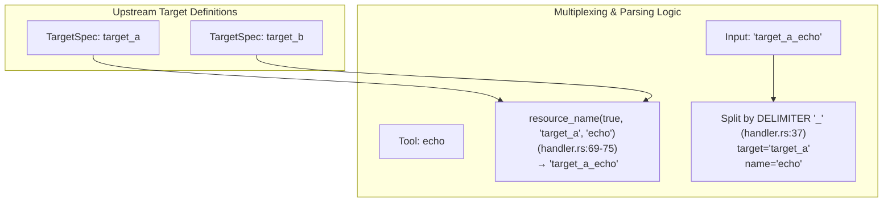

<!-- source: DeepWiki mcp.deepwiki.com · repo agentgateway/agentgateway · page 9.1 Model Context Protocol (MCP) Overview · fetched 2026-10-21 -->

# Model Context Protocol (MCP) Overview

<details>
<summary>Relevant source files</summary>

The following files were used as context for generating this wiki page:

- [crates/agentgateway/src/mcp/handler.rs](crates/agentgateway/src/mcp/handler.rs)
- [crates/agentgateway/src/mcp/mcp_tests.rs](crates/agentgateway/src/mcp/mcp_tests.rs)
- [crates/agentgateway/src/mcp/mod.rs](crates/agentgateway/src/mcp/mod.rs)
- [crates/agentgateway/src/mcp/router.rs](crates/agentgateway/src/mcp/router.rs)
- [crates/agentgateway/src/mcp/session.rs](crates/agentgateway/src/mcp/session.rs)
- [crates/agentgateway/src/mcp/sse.rs](crates/agentgateway/src/mcp/sse.rs)
- [crates/agentgateway/src/mcp/streamablehttp.rs](crates/agentgateway/src/mcp/streamablehttp.rs)
- [crates/agentgateway/src/mcp/upstream/mod.rs](crates/agentgateway/src/mcp/upstream/mod.rs)
- [crates/agentgateway/src/mcp/upstream/openapi/mod.rs](crates/agentgateway/src/mcp/upstream/openapi/mod.rs)
- [crates/agentgateway/src/mcp/upstream/openapi/tests.rs](crates/agentgateway/src/mcp/upstream/openapi/tests.rs)
- [crates/agentgateway/src/mcp/upstream/sse.rs](crates/agentgateway/src/mcp/upstream/sse.rs)
- [crates/agentgateway/src/mcp/upstream/streamablehttp.rs](crates/agentgateway/src/mcp/upstream/streamablehttp.rs)
- [crates/agentgateway/src/proxy/mod.rs](crates/agentgateway/src/proxy/mod.rs)

</details>


## Purpose and Scope

This page introduces the Model Context Protocol (MCP) and explains how Agentgateway implements MCP gateway functionality. It covers the overall MCP architecture, resource types, transport options, session management models, and request routing patterns. The gateway acts as a high-performance intermediary, providing multiplexing, security, and protocol translation support for AI agents communicating over MCP.

For details on other MCP aspects, see the linked child pages:
- MCP transport implementations (SSE, Streamable HTTP, Stdio, OpenAPI): [9.2 MCP Transports]()
- MCP authentication and authorization: [9.3 MCP Authentication and Authorization]()
- Session persistence and state management: [9.4 MCP Session Management]()
- Multiplexing and response merging: [9.5 MCP Multiplexing and Response Merging]()
- OpenAPI to MCP bridge: [9.6 OpenAPI to MCP Bridge]()

Sources: [crates/agentgateway/src/mcp/router.rs:26-36]()

---

## What is Model Context Protocol?

The Model Context Protocol (MCP) is an open JSON-RPC-based protocol designed to standardize communication between AI agents, tools, prompts, and data resources. MCP enables clients to discover, call, and subscribe to resources uniformly.

### MCP Resource Types

| Resource Type | MCP Request Messages | Description |
|---------------|---------------------------------|--------------------------------------------------------------------|
| **Tools** | `ListToolsRequest`, `CallToolRequest` | Executable functions with structured input schemas (JSON Schema). |
| **Prompts** | `ListPromptsRequest`, `GetPromptRequest` | Reusable prompt templates that can be parameterized. |
| **Resources** | `ListResourcesRequest`, `ReadResourceRequest` | Access to data sources via URIs such as `file://`, `http://`, etc. |

### Protocol Fundamentals

- **Message Types**: MCP uses JSON-RPC 2.0 messaging, with message types defined in `rmcp::model::{ClientJsonRpcMessage, ServerJsonRpcMessage}` encompassing requests, notifications, and responses [crates/agentgateway/src/mcp/session.rs:16-21]().
- **Request & Response Types**: Different request variants, such as `InitializeRequest`, `ListToolsRequest`, and corresponding result types like `ListToolsResult`, are used [crates/agentgateway/src/mcp/handler.rs:14-21]().
- **Protocol Versioning**: MCP version negotiation is performed via headers such as `HEADER_MCP_PROTOCOL_VERSION` with support for modern protocol versions (e.g., 2026-07-28) that use `server/discover` plus per-request metadata instead of session initializations [crates/agentgateway/src/mcp/mod.rs:93-95]().
- **Bidirectional Communication**: Supports requests (expecting responses) and notifications (fire-and-forget); the spec includes resource subscription mechanisms for live updates [crates/agentgateway/src/mcp/mod.rs:24-32]().

Sources: [crates/agentgateway/src/mcp/handler.rs:14-21](), [crates/agentgateway/src/mcp/session.rs:16-21](), [crates/agentgateway/src/mcp/streamablehttp.rs:9-13](), [crates/agentgateway/src/mcp/mod.rs:24-32](), [crates/agentgateway/src/mcp/mod.rs:93-95]()

---

## MCP in Agentgateway

Agentgateway implements MCP as a gateway that intermediates between MCP clients (downstream) and upstream MCP services. It provides:

| Feature | Description |
|--------------------------|-------------------------------------------------------------------------------------------------|
| **Multi-Transport Support** | Supports Streamable HTTP, SSE, stdio process communication, and OpenAPI-to-MCP translation [crates/agentgateway/src/mcp/upstream/mod.rs:207-210](). |
| **Multiplexing** | Fan-out MCP requests to multiple upstream targets, merging responses and handling failures [crates/agentgateway/src/mcp/handler.rs:96-124](). |
| **Authentication/Authorization** | JWT-based authentication and CEL-based RBAC on tools, prompts, and resources within MCP [crates/agentgateway/src/mcp/router.rs:123-126](). |
| **Session Management** | Supports both stateful and stateless session modes with session persistence and ID tracking [crates/agentgateway/src/mcp/session.rs:38-47](). |
| **Protocol Translation** | Transforms legacy APIs such as OpenAPI schemas into MCP tools dynamically [crates/agentgateway/src/mcp/upstream/openapi/mod.rs:16-19](). |

Sources: [crates/agentgateway/src/mcp/router.rs:123-126](), [crates/agentgateway/src/mcp/handler.rs:96-124](), [crates/agentgateway/src/mcp/session.rs:38-47](), [crates/agentgateway/src/mcp/upstream/mod.rs:207-210](), [crates/agentgateway/src/mcp/upstream/openapi/mod.rs:16-19]()

---

## MCP Architecture in Agentgateway

### Component Architecture with Code Entities


Title: "MCP Request Flow through Agentgateway Components"

### Request Flow Through Layers

1. **Entry Point**: The MCP request enters via `App::serve()` which handles HTTP requests containing `ClientJsonRpcMessage`s. This is implemented in [crates/agentgateway/src/mcp/router.rs:70-79]().
2. **Policy Evaluation**: `BackendPolicies` are merged and authentication enforced using CEL-based policies [crates/agentgateway/src/mcp/router.rs:123-160]().
3. **Session Retrieval/Creation**: `SessionManager` locates or creates a `Session` for the client context [crates/agentgateway/src/mcp/router.rs:118-119]().
4. **Routing to Relay**: The `Session::send()` method forwards the message to a `Relay` which manages dispatch to one or more upstream MCP servers [crates/agentgateway/src/mcp/session.rs:60-75]().
5. **Upstream Communication**: The relay routes the call to appropriate upstream transport implementations (`StreamableHttpClient`, `SSEClient`, `StdioProcess`) [crates/agentgateway/src/mcp/upstream/mod.rs:207-210]().
6. **Response Merging**: When multiplexing, upstream responses are merged using `mergestream` logic that deduplicates and manages per-target results [crates/agentgateway/src/mcp/handler.rs:96-124]().

Sources: [crates/agentgateway/src/mcp/router.rs:70-205](), [crates/agentgateway/src/mcp/session.rs:60-75](), [crates/agentgateway/src/mcp/handler.rs:96-124](), [crates/agentgateway/src/mcp/upstream/mod.rs:207-210](), [crates/agentgateway/src/mcp/mergestream.rs:1-124]()

---

## Transport Types

Agentgateway supports multiple transport protocols for upstream MCP servers, each with specialized implementations:

| Transport | MCP Target Spec Variant | Key Implementation |
|------------------|------------------------|------------------------------------------------|
| **Streamable HTTP** | `McpTargetSpec::Mcp` | `StreamableHttpService` [crates/agentgateway/src/mcp/streamablehttp.rs:67-154]() |
| **SSE (Server-Sent Events)** | `McpTargetSpec::Sse` | `LegacySSEService` [crates/agentgateway/src/mcp/sse.rs:19-46]() |
| **OpenAPI Bridge** | N/A | `openapi` module for translating OpenAPI schemas to MCP tools [crates/agentgateway/src/mcp/upstream/openapi/mod.rs:16-19]() |
| **Stdio** | Local process | `Upstream::McpStdio` process-based transport [crates/agentgateway/src/mcp/upstream/mod.rs:207-210]() |

### Transport-Specific Notes

- **Streamable HTTP** supports the modern MCP protocol over standard HTTP POST/GET/DELETE methods with JSON and SSE content types [crates/agentgateway/src/mcp/streamablehttp.rs:67-154]().
- **SSE** provides legacy bidirectional streams using traditional SSE event streams and request POSTs, mapping them to MCP messages [crates/agentgateway/src/mcp/sse.rs:34-46]().
- **OpenAPI Bridge** dynamically generates MCP tools from OpenAPI specifications to enable legacy APIs to act like MCP resources [crates/agentgateway/src/mcp/upstream/openapi/mod.rs:16-19]().

Sources: [crates/agentgateway/src/mcp/router.rs:170-202](), [crates/agentgateway/src/mcp/upstream/mod.rs:207-210](), [crates/agentgateway/src/mcp/streamablehttp.rs:67-154](), [crates/agentgateway/src/mcp/sse.rs:19-46](), [crates/agentgateway/src/mcp/upstream/openapi/mod.rs:16-19]()

---

## Session Models

MCP sessions are managed by `SessionManager` with two main modes of operation: stateful and stateless.

### Session Lifecycle Models

```mermaid
stateDiagram-v2
    direction TB
    subgraph "NaturalLanguageSpace" ["Downstream Ingress Request"]
        ClientReq["ClientJsonRpcMessage"]
    end

    subgraph "CodeEntitySpace" ["Gateway Session & Transport Management"]
        direction TB
        [*] --> AppServe: "App::serve()\n(router.rs:70-79)"
        
        AppServe --> Stateful: "backend.stateful = true"
        AppServe --> Stateless: "backend.stateful = false"
        AppServe --> LegacySSE: "path == /sse"
        
        state Stateful {
            [*] --> CreateSession: "SessionManager::create_session()\n(session.rs:37-46)"
            CreateSession --> InsertSession: "SessionManager::insert_session()\n(session.rs:209-210)"
            InsertSession --> Active: "HEADER_SESSION_ID used for identification"
        }
        
        state Stateless {
            [*] --> StatSend: "Session::stateless_send_and_initialize()\n(session.rs:83-181)"
            StatSend --> [*]: "Respond and close"
        }
    end

    ClientReq --> AppServe
```
Title: "MCP Session Management Flow"

### Stateful Mode

- Sessions are explicitly created and stored in `SessionManager` [crates/agentgateway/src/mcp/router.rs:118-119]().
- Clients present a `HEADER_SESSION_ID` on subsequent requests to continue the session context [crates/agentgateway/src/mcp/streamablehttp.rs:164-181]().
- Sessions maintain stateful connections to upstreams and multiplex client requests over time.

### Stateless Mode

- Each request is independent; no session ID is required [crates/agentgateway/src/mcp/session.rs:83-87]().
- For legacy compatibility, `stateless_send_and_initialize()` prepends an `InitializeRequest` to all non-initialize calls [crates/agentgateway/src/mcp/session.rs:83-160]().
- This ensures servers expecting initialization messages respond properly even if the client is stateless.

Sources: [crates/agentgateway/src/mcp/router.rs:70-205](), [crates/agentgateway/src/mcp/session.rs:37-181](), [crates/agentgateway/src/mcp/streamablehttp.rs:164-181]()

---

## Resource Name Multiplexing

Agentgateway supports multiplexing multiple MCP upstream targets behind a single `McpBackend`, combining resource names with target prefixes to avoid collisions.


Title: "MCP Resource Name Multiplexing"

### Prefixing Logic

- The helper function `resource_name(prefix_names: bool, target: &str, name: &str) -> String` prepends the target name to the resource name with an underscore (`_`) delimiter when prefixing is enabled [crates/agentgateway/src/mcp/handler.rs:69-75]().
- This disambiguates names across targets in multiplexed backends.

### Duplicate Name Handling

- When duplicate resource names occur across multiple targets, duplicate names are dropped if configured to reject duplicates [crates/agentgateway/src/mcp/handler.rs:77-92]().

### Failure Mode Strategies

Agentgateway provides two distinct behaviors on upstream target failures in multiplexed backends:

| Failure Mode | Description |
|--------------|--------------------------------------------------------------------|
| FailClosed (default) | Fail the entire client session if any upstream target fails. |
| FailOpen | Continue to serve partial results from healthy targets, skipping failed ones. |

Defined in the `FailureMode` enum [crates/agentgateway/src/mcp/mod.rs:40-52]().

Sources: [crates/agentgateway/src/mcp/handler.rs:37-92](), [crates/agentgateway/src/mcp/mod.rs:40-52]()

---

## Key Components and Code Entities

| Component | Location | Purpose |
|-----------------------|-------------------------------------------|----------------------------------------------------------|
| `App` | `crates/agentgateway/src/mcp/router.rs:26-36` | Main MCP entry point; routes requests, enforces policy. |
| `Relay` | `crates/agentgateway/src/mcp/handler.rs:25-33` | Handles request fan-out and merging from upstreams. |
| `Session` | `crates/agentgateway/src/mcp/session.rs:38-47` | Represents long-lived or stateless MCP session context. |
| `SessionManager` | `crates/agentgateway/src/mcp/session.rs:39-55` | Manages all MCP sessions, session lifecycle. |
| `McpBackendGroup` | `crates/agentgateway/src/mcp/router.rs:109-117` | Aggregates multiple MCP backend targets into a group. |
| `McpAuthorizationSet` | `crates/agentgateway/src/mcp/mod.rs:23` | Manages CEL-based RBAC for MCP resource authorization. |
| `FailureMode` | `crates/agentgateway/src/mcp/mod.rs:40-52` | Enum defining behavior on upstream failure. |

Sources: [crates/agentgateway/src/mcp/router.rs:26-36](), [crates/agentgateway/src/mcp/router.rs:109-117](), [crates/agentgateway/src/mcp/handler.rs:25-33](), [crates/agentgateway/src/mcp/session.rs:39-55](), [crates/agentgateway/src/mcp/mod.rs:23](), [crates/agentgateway/src/mcp/mod.rs:40-52]()

---

# Summary

The Model Context Protocol (MCP) is a modular, JSON-RPC-based protocol that enables standardized, rich communication between AI agents, tools, prompt templates, and data resources. Agentgateway implements MCP as a versatile multi-transport gateway supporting session persistence, multiplexing, authentication, and protocol translation. Key components like `App`, `SessionManager`, and `Relay` orchestrate request routing and upstream communication, supporting both legacy and modern protocol versions.

This overview serves as a foundation before diving into detailed MCP subsystems and extension topics.

---

# References

- `crates/agentgateway/src/mcp/router.rs`
- `crates/agentgateway/src/mcp/session.rs`
- `crates/agentgateway/src/mcp/handler.rs`
- `crates/agentgateway/src/mcp/mod.rs`
- `crates/agentgateway/src/mcp/streamablehttp.rs`
- `crates/agentgateway/src/mcp/sse.rs`
- `crates/agentgateway/src/mcp/upstream/mod.rs`
- `crates/agentgateway/src/mcp/upstream/openapi/mod.rs`
- `crates/agentgateway/src/mcp/mergestream.rs`

---

