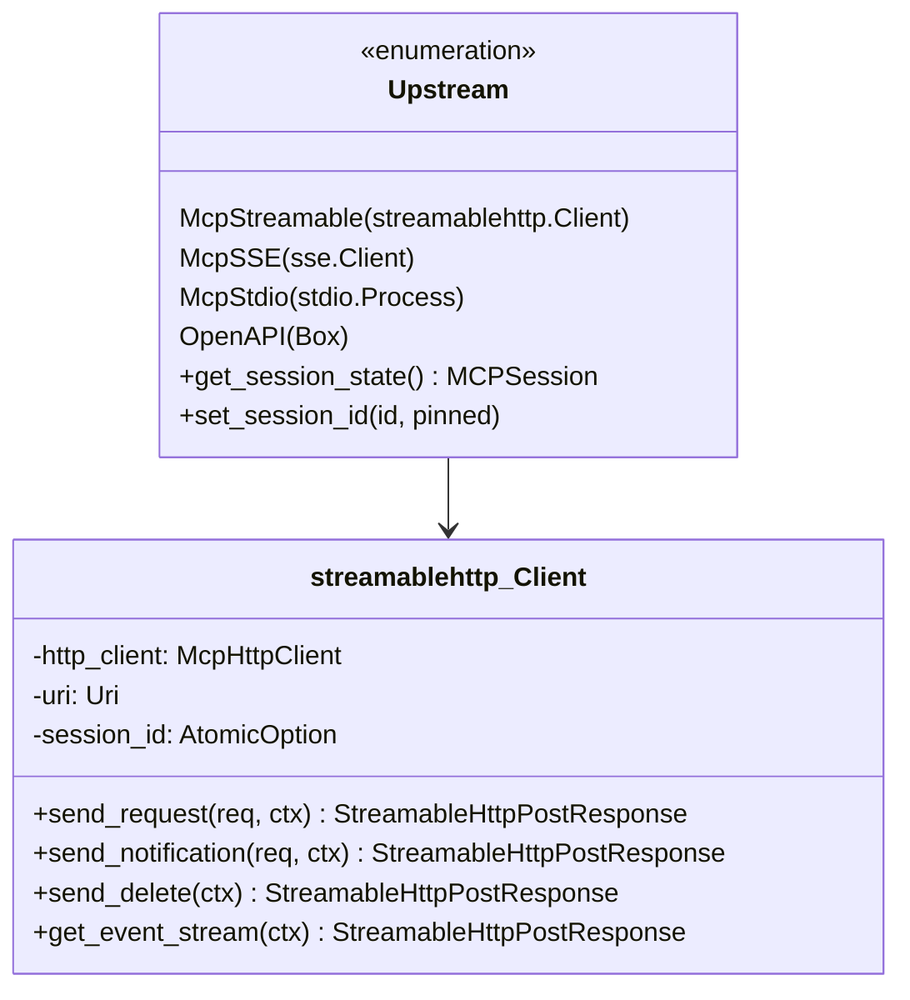
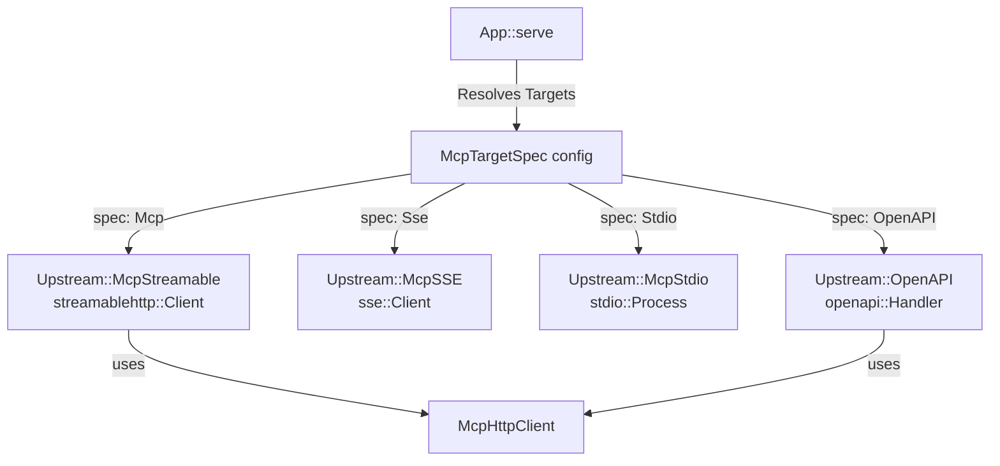
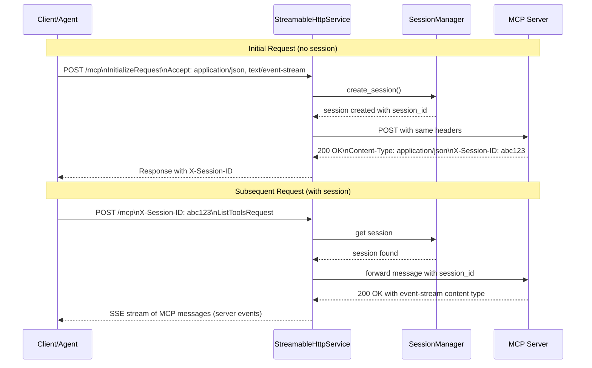
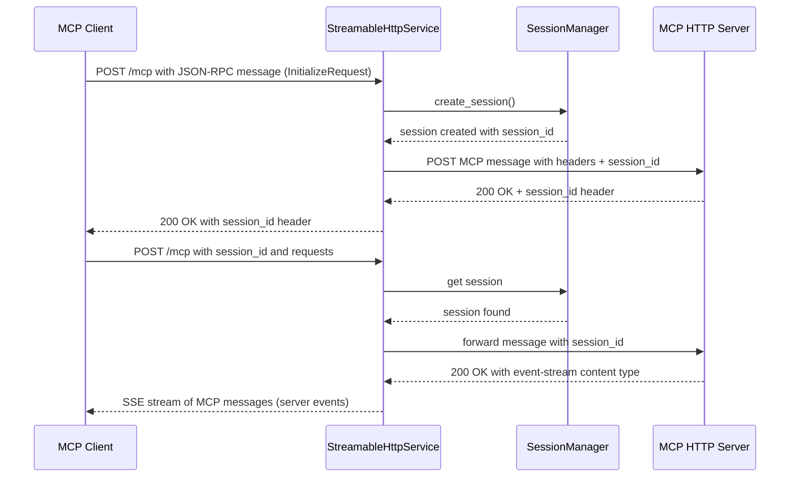

<!-- source: DeepWiki mcp.deepwiki.com · repo agentgateway/agentgateway · page 9.2 MCP Transports · fetched 2026-10-21 -->

# MCP Transports

<details>
<summary>Relevant source files</summary>

The following files were used as context for generating this wiki page:

- [crates/agentgateway/src/mcp/handler.rs](crates/agentgateway/src/mcp/handler.rs)
- [crates/agentgateway/src/mcp/mcp_tests.rs](crates/agentgateway/src/mcp/mcp_tests.rs)
- [crates/agentgateway/src/mcp/mod.rs](crates/agentgateway/src/mcp/mod.rs)
- [crates/agentgateway/src/mcp/router.rs](crates/agentgateway/src/mcp/router.rs)
- [crates/agentgateway/src/mcp/session.rs](crates/agentgateway/src/mcp/session.rs)
- [crates/agentgateway/src/mcp/sse.rs](crates/agentgateway/src/mcp/sse.rs)
- [crates/agentgateway/src/mcp/streamablehttp.rs](crates/agentgateway/src/mcp/streamablehttp.rs)
- [crates/agentgateway/src/mcp/upstream/mod.rs](crates/agentgateway/src/mcp/upstream/mod.rs)
- [crates/agentgateway/src/mcp/upstream/openapi/mod.rs](crates/agentgateway/src/mcp/upstream/openapi/mod.rs)
- [crates/agentgateway/src/mcp/upstream/openapi/tests.rs](crates/agentgateway/src/mcp/upstream/openapi/tests.rs)
- [crates/agentgateway/src/mcp/upstream/sse.rs](crates/agentgateway/src/mcp/upstream/sse.rs)
- [crates/agentgateway/src/mcp/upstream/streamablehttp.rs](crates/agentgateway/src/mcp/upstream/streamablehttp.rs)
- [crates/agentgateway/src/proxy/mod.rs](crates/agentgateway/src/proxy/mod.rs)

</details>


## Purpose and Scope

This document covers the Model Context Protocol (MCP) transport implementations in AgentGateway. MCP transports provide the communication means for the gateway data plane to interact with upstream MCP servers, abstracting different protocols under a unified interface.

Supported transport types include:
- **Streamable HTTP:** The modern MCP transport based on HTTP POST/GET/DELETE with JSON or Server-Sent Events (SSE) streaming.
- **SSE (Legacy):** The older MCP transport using Server-Sent Events directly.
- **Stdio:** A process-based transport communicating with a child process via standard input/output.
- **OpenAPI Bridge:** A bridge transport that translates OpenAPI specifications into MCP tools, proxying RESTful calls over MCP.

This page explains the detailed implementation, data flow, and key classes and functions for each transport type.

For overarching MCP protocol details, see [Model Context Protocol (MCP) Overview (9.1)](). For authentication and session state, see [MCP Authentication and Authorization (9.3)]() and [MCP Session Management (9.4)]().

Sources: [crates/agentgateway/src/mcp/upstream/mod.rs:207-210](), [crates/agentgateway/src/mcp/streamablehttp.rs:22-26]()

---

## Transport Architecture

### The `Upstream` Abstraction

AgentGateway uses the `Upstream` enum to represent MCP transports polymorphically. Defined in `crates/agentgateway/src/mcp/upstream/mod.rs`, it enumerates the transport variants:

- `McpStreamable(streamablehttp::Client)`: Streamable HTTP transport client.
- `McpSSE(sse::Client)`: Server-Sent Events transport client.
- `McpStdio(stdio::Process)`: Process-connected stdio transport.
- `OpenAPI(Box<openapi::Handler>)`: OpenAPI bridge transport.

Each variant implements methods like `get_session_state()` and `set_session_id()` for session management.

#### Diagram: MCP Upstream Abstraction


Sources: [crates/agentgateway/src/mcp/upstream/mod.rs:207-210](), [crates/agentgateway/src/mcp/upstream/streamablehttp.rs:22-27]()

---

### Transport Target Resolution

On MCP request handling, the `App::serve` method resolves backend targets into `Upstream` transport clients depending on `McpTargetSpec` configurations.

- `McpTargetSpec::Mcp` maps to Streamable HTTP transport.
- `McpTargetSpec::Sse` maps to legacy SSE transport.
- `McpTargetSpec::Stdio` launches stdio processes.
- `McpTargetSpec::OpenAPI` constructs OpenAPI bridge handlers.

#### Diagram: MCP Target Configuration to Transport Binding



Sources: [crates/agentgateway/src/mcp/router.rs:70-117](), [crates/agentgateway/src/mcp/upstream/mod.rs:207-210]()

---

## Streamable HTTP Transport

Streamable HTTP is the modern reference MCP transport. It supports full-duplex communication via HTTP POST requests for RPC calls and GET requests for server-sent events.

### `StreamableHttpService`

Defined in `crates/agentgateway/src/mcp/streamablehttp.rs`, `StreamableHttpService` manages MCP messaging over HTTP including request parsing, session management, and response formatting.

- **Configuration:** `StreamableHttpServerConfig` allows enabling stateful mode (session support). [crates/agentgateway/src/mcp/streamablehttp.rs:23-26]()

- **Handling Requests:**
  - `handle_post` manages POST requests carrying JSON-RPC messages with content negotiation. [crates/agentgateway/src/mcp/streamablehttp.rs:103-211]()
  - `handle_get` handles GET event-stream requests for SSE subscription. [crates/agentgateway/src/mcp/streamablehttp.rs:97-97]()
  - `handle_delete` processes DELETE requests for session termination. [crates/agentgateway/src/mcp/streamablehttp.rs:98-98]()

- **Session Lifecycle:** On receiving an InitializeRequest without a session ID, the service creates and returns a new session ID. Subsequent requests specify the header `mcp-session-id`. [crates/agentgateway/src/mcp/streamablehttp.rs:167-211]()

### Protocol Flow

#### Sequence: Streamable HTTP Messaging



### Content Type Validation

The handler ensures:
- The `Accept` header must contain both `application/json` and `text/event-stream`. [crates/agentgateway/src/mcp/streamablehttp.rs:109-119]()
- The `Content-Type` header of the POST must start with `application/json`. [crates/agentgateway/src/mcp/streamablehttp.rs:122-129]()

If validation fails, an appropriate `mcp::Error` is returned immediately.

### Response Modes

| Accept Header                          | Response Content-Type                          | Behavior                                               |
|--------------------------------------|-----------------------------------------------|--------------------------------------------------------|
| application/json, text/event-stream  | application/json                              | Single JSON-RPC message response                        |
| application/json, text/event-stream  | text/event-stream                             | Stream of MCP JSON-RPC messages as SSE events          |
| application/json, text/event-stream  | (none, status 202/204)                        | Request accepted but no immediate response (async)     |

Sources: [crates/agentgateway/src/mcp/streamablehttp.rs:67-209](), [crates/agentgateway/src/mcp/streamablehttp.rs:103-128]()

---

## Stdio Transport

The stdio transport runs an external process and communicates via its standard input/output pipes for MCP message exchange.

- **Process Launch:** Spawned using `tokio::process::Command`. [crates/agentgateway/src/mcp/upstream/mod.rs:20-20]()
- **Message Handling:** The `stdio::Process` wrapper manages asynchronous read/write of JSON-RPC messages over stdio streams. [crates/agentgateway/src/mcp/upstream/mod.rs:209-209]()
- **Session Handling:** Maintains per-session state and performs cleanup upon process exit or channel closure.

This approach is useful for MCP backends implemented as local helper processes rather than networked servers.

Sources: [crates/agentgateway/src/mcp/upstream/mod.rs:20-20](), [crates/agentgateway/src/mcp/upstream/mod.rs:207-210]()

---

## Legacy SSE Service Transport

### Overview

The legacy SSE service (`LegacySSEService`) provides compatibility with MCP clients using SSE-centric transport:

- Supports HTTP GET to establish SSE streams. [crates/agentgateway/src/mcp/sse.rs:43-43]()
- HTTP POST forwards messages to backend MCP sessions identified by query parameter `session_id`. [crates/agentgateway/src/mcp/sse.rs:42-42]()

### Lifecycle

- **GET Handler:** Creates a session, returning an SSE stream that includes an initial `endpoint` event with the session ID, allowing clients to communicate bidirectionally over SSE [crates/agentgateway/src/mcp/sse.rs:96-153]().

- **POST Handler:** Extracts `session_id` from the URI query, decodes incoming JSON-RPC messages, forwards them to the appropriate session [crates/agentgateway/src/mcp/sse.rs:48-94]().

- **Bridging to Streamable HTTP:** When upstream MCP servers support streamable HTTP, the service establishes a GET request to create the upstream event stream once the InitializeRequest has succeeded, forwarding incoming POST messages to the stream. [crates/agentgateway/src/mcp/sse.rs:76-89]()

Sources: [crates/agentgateway/src/mcp/sse.rs:19-154](), [crates/agentgateway/src/mcp/router.rs:169-187]()

---

## OpenAPI Bridge Transport

### Purpose

The OpenAPI bridge enables exposing REST APIs as MCP tools by translating OpenAPI v3 specifications to MCP tool definitions and method invocations.

### Implementation Highlights

- **Parsing and Bundle Resolution:** Recursively resolves `$ref` references in OpenAPI schemas to produce a flattened JSON schema for each tool’s arguments, bundling shared schemas under `$defs` [crates/agentgateway/src/mcp/upstream/openapi/mod.rs:114-176]().

- **Server Prefix Detection:** Extracts URL path prefixes from the OpenAPI `servers` array for correct routing of API endpoint paths [crates/agentgateway/src/mcp/upstream/openapi/mod.rs:64-109]().

- **Tool and Request Mapping:** Each OpenAPI operation maps to an MCP tool. Calling a tool sends an HTTP request to the configured upstream REST API endpoint using the internal `McpHttpClient`. [crates/agentgateway/src/mcp/upstream/openapi/tests.rs:63-197]()

- **Header and Parameter Handling:** Injects allowed headers and formats path parameters for the REST calls based on the OpenAPI specification. [crates/agentgateway/src/mcp/upstream/openapi/mod.rs:202-205]()

Sources: [crates/agentgateway/src/mcp/upstream/openapi/mod.rs:27-176](), [crates/agentgateway/src/mcp/upstream/openapi/mod.rs:64-109]()

---

## Common Transport Interface and Session Handling

All MCP transports implement core methods to participate in session establishment and message forwarding:

| Method                          | Purpose                                            | Location                                      |
|--------------------------------|----------------------------------------------------|-----------------------------------------------|
| `get_session_state()`           | Get MCP session state including session ID        | `Upstream` enum – `crates/agentgateway/src/mcp/upstream/mod.rs` |
| `set_session_id()`              | Associate a session ID and optionally pin backend | `streamablehttp::Client::set_session_id` [crates/agentgateway/src/mcp/upstream/streamablehttp.rs:49-54]() |

Sessions are managed centrally via `SessionManager` and `Session` structs coordinating multiplexed communication, state persistence, and session timeouts. [crates/agentgateway/src/mcp/session.rs:38-69]()

Sources: [crates/agentgateway/src/mcp/upstream/mod.rs:207-210](), [crates/agentgateway/src/mcp/upstream/streamablehttp.rs:49-54](), [crates/agentgateway/src/mcp/session.rs:38-69]()

---

# Summary Diagrams: Natural Language to Code Entity Mapping

### Diagram: Overview of MCP Transport Types to Code Entities

```mermaid
flowchart LR
    subgraph "MCP Transports"
        StreamableHTTP["Streamable HTTP\n(streamablehttp::Client)"]
        SSE["Legacy SSE\n(LegacySSEService)"]
        Stdio["Stdio Process\n(stdio::Process)"]
        OpenAPI["OpenAPI Bridge\n(openapi::Handler)"]
    end

    StreamableHTTP -- "transport variant" --> Upstream["Upstream::McpStreamable"]
    SSE -- "transport variant" --> Upstream["Upstream::McpSSE"]
    Stdio -- "transport variant" --> Upstream["Upstream::McpStdio"]
    OpenAPI -- "transport variant" --> Upstream["Upstream::OpenAPI"]

    Upstream --> AppServe["App::serve method"]

    note over StreamableHTTP, SSE, Stdio, OpenAPI
        These handle MCP protocol messaging differently
    end
```

### Diagram: Streamable HTTP Transport Data Flow (Detailed)



Sources: [crates/agentgateway/src/mcp/streamablehttp.rs:67-209](), [crates/agentgateway/src/mcp/session.rs:38-69](), [crates/agentgateway/src/mcp/upstream/mod.rs:207-210]()

---

This page details the implementation and interaction of the various MCP transports in AgentGateway, defining the protocols, classes, and flow for each supported communication pattern.

---

