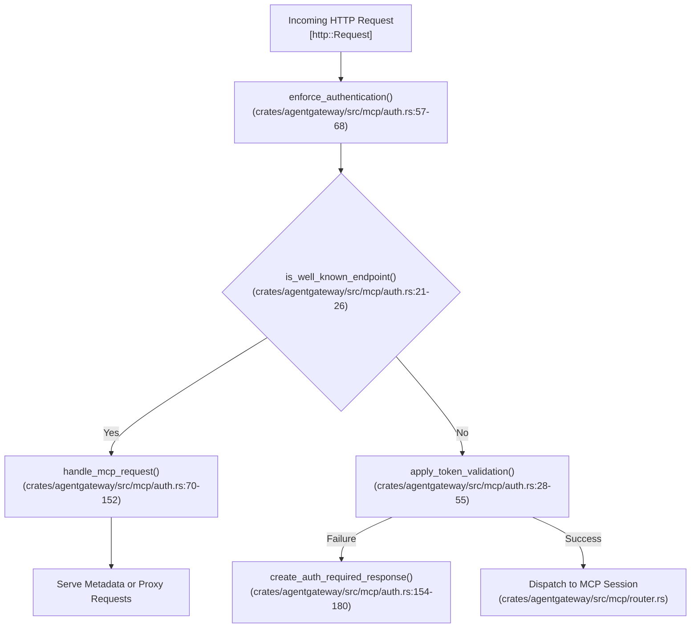
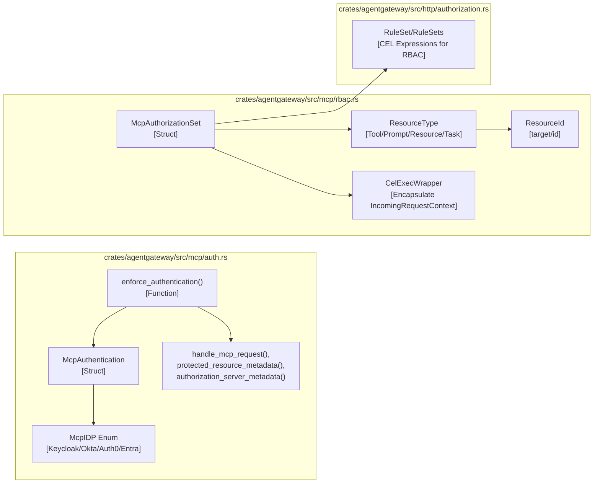

<!-- source: DeepWiki mcp.deepwiki.com · repo agentgateway/agentgateway · page 9.3 MCP Authentication and Authorization · fetched 2026-10-21 -->

# MCP Authentication and Authorization

<details>
<summary>Relevant source files</summary>

The following files were used as context for generating this wiki page:

- [controller/pkg/agentgateway/jwks/persistence.go](controller/pkg/agentgateway/jwks/persistence.go)
- [controller/pkg/agentgateway/jwks/persistence_test.go](controller/pkg/agentgateway/jwks/persistence_test.go)
- [controller/pkg/agentgateway/plugins/testdata/backendpolicy/backend-ancestor-backend.yaml](controller/pkg/agentgateway/plugins/testdata/backendpolicy/backend-ancestor-backend.yaml)
- [controller/pkg/agentgateway/plugins/testdata/backendpolicy/backend-missing-not-attached.yaml](controller/pkg/agentgateway/plugins/testdata/backendpolicy/backend-missing-not-attached.yaml)
- [controller/pkg/agentgateway/plugins/testdata/backendpolicy/httproute-missing-not-attached.yaml](controller/pkg/agentgateway/plugins/testdata/backendpolicy/httproute-missing-not-attached.yaml)
- [controller/pkg/agentgateway/plugins/testdata/backendpolicy/multi-target-ref-backend-policy.yaml](controller/pkg/agentgateway/plugins/testdata/backendpolicy/multi-target-ref-backend-policy.yaml)
- [controller/pkg/agentgateway/plugins/testdata/trafficpolicy/http-route-ancestor-listenerset.yaml](controller/pkg/agentgateway/plugins/testdata/trafficpolicy/http-route-ancestor-listenerset.yaml)
- [controller/pkg/agentgateway/plugins/testdata/trafficpolicy/mcp-auth-multi-target.yaml](controller/pkg/agentgateway/plugins/testdata/trafficpolicy/mcp-auth-multi-target.yaml)
- [controller/pkg/agentgateway/plugins/testdata/trafficpolicy/mcp-auth.yaml](controller/pkg/agentgateway/plugins/testdata/trafficpolicy/mcp-auth.yaml)
- [controller/pkg/agentgateway/plugins/testdata/trafficpolicy/multi-target-missing.yaml](controller/pkg/agentgateway/plugins/testdata/trafficpolicy/multi-target-missing.yaml)
- [controller/pkg/agentgateway/plugins/traffic_plugin_test.go](controller/pkg/agentgateway/plugins/traffic_plugin_test.go)
- [crates/agentgateway/src/http/authorization.rs](crates/agentgateway/src/http/authorization.rs)
- [crates/agentgateway/src/http/authorization_tests.rs](crates/agentgateway/src/http/authorization_tests.rs)
- [crates/agentgateway/src/mcp/auth.rs](crates/agentgateway/src/mcp/auth.rs)
- [crates/agentgateway/src/mcp/rbac.rs](crates/agentgateway/src/mcp/rbac.rs)
- [examples/mcp-authentication/README.md](examples/mcp-authentication/README.md)
- [examples/mcp-authentication/config.yaml](examples/mcp-authentication/config.yaml)

</details>


This page covers how `agentgateway` authenticates Model Context Protocol (MCP) clients and enforces role-based access control (RBAC) on MCP resources (tools, prompts, resources, and tasks). It details the two independent policy fields—`mcpAuthentication` and `mcpAuthorization`—their configuration schemas, request pipeline enforcement points, `.well-known` metadata endpoints, provider adapters, and CEL expression integration.

Sources: [crates/agentgateway/src/mcp/auth.rs:1-211](), [crates/agentgateway/src/mcp/rbac.rs:1-130](), [examples/mcp-authentication/README.md:1-193]()

---

## Two-Layer Security Model

MCP connections are protected by two separate policy types, each operating at a distinct stage and scope:

| Policy Field         | Type           | Purpose                                                                                       |
|----------------------|----------------|-----------------------------------------------------------------------------------------------|
| `mcpAuthentication`  | Route Policy   | Validates the caller's identity via JWT Bearer token before any MCP message or method is processed [crates/agentgateway/src/mcp/auth.rs:29-56]()              |
| `mcpAuthorization`   | Route / Backend Policy | Controls which tools, prompts, resources, or tasks a verified caller may list or invoke via CEL expressions [crates/agentgateway/src/mcp/rbac.rs:38-66]()    |

Both policies are configured under `binds[].listeners[].routes[].policies` and are resolved during request handling [examples/mcp-authentication/config.yaml:34-50]().

Sources: [crates/agentgateway/src/mcp/auth.rs:29-56](), [crates/agentgateway/src/mcp/rbac.rs:38-66](), [examples/mcp-authentication/config.yaml:34-50]()

---

## Authentication and Metadata (`mcpAuthentication`)

### Enforcement and Token Validation

Authentication is enforced by the `enforce_authentication` async function in `auth.rs` [crates/agentgateway/src/mcp/auth.rs:57-68](). This function is called on each incoming MCP HTTP request before processing MCP messages.

Key behaviors:

- **Well-Known Endpoint Bypass**: Requests whose URI path matches any well-known OAuth metadata endpoints (e.g. `/.well-known/oauth-protected-resource` or `/.well-known/oauth-authorization-server`) bypass strict token validation. This is detected by `is_well_known_endpoint` [crates/agentgateway/src/mcp/auth.rs:21-26]().

- **JWT Claims Validation**: For non-well-known requests, the gateway validates the bearer token in the `Authorization` header using the configured `jwt_validator` in `McpAuthentication`. If JWT claims are already present in the request context (from previous layers), authentication fails since MCP-specific validation cannot be assured [crates/agentgateway/src/mcp/auth.rs:28-55]().

- **Error Handling**: Authentication failures result in a `401 Unauthorized` response with a `WWW-Authenticate` header indicating a protected resource URI for OAuth discovery. This response is constructed by `create_auth_required_response` which dynamically locates the appropriate URL to instruct clients where to retrieve metadata [crates/agentgateway/src/mcp/auth.rs:154-180]().

- **Claims Injection**: On successful validation, JWT claims are inserted into the request’s extensions to be available for downstream authorization checks [crates/agentgateway/src/http/jwt.rs:9]().

### Well-Known Endpoints and Provider Adapters

The gateway also implements handler logic for `.well-known` OAuth endpoints to:

- Serve resource metadata at `/.well-known/oauth-protected-resource` via `protected_resource_metadata()`. This metadata includes supported scopes, bearer token methods, documentation, and policy URIs pertinent to the MCP resource [crates/agentgateway/src/mcp/auth.rs:182-211]().

- Serve authorization server metadata at `/.well-known/oauth-authorization-server`. The gateway fetches upstream OpenID Connect (OIDC) configurations and rewrites them for seamless client compatibility through `authorization_server_metadata()` [crates/agentgateway/src/mcp/auth.rs:133-146]().

- Proxy client registration at paths ending in `client-registration` for adapters such as Keycloak and Okta [crates/agentgateway/src/mcp/auth.rs:77-86](), and handle Microsoft Entra-specific quirks by intercepting and sanitizing requests to the `/authorize` and `/token` endpoints [crates/agentgateway/src/mcp/auth.rs:98-131]().

Thus, when a provider is configured in `McpAuthentication`, the gateway acts as an OAuth server facade, enabling MCP clients to perform standard OAuth interactions while adapting for upstream provider incompatibilities.

Sources: [crates/agentgateway/src/mcp/auth.rs:21-211](), [crates/agentgateway/src/http/jwt.rs:1-50](), [examples/mcp-authentication/README.md:128-193]()

---

## Authorization and RBAC (`mcpAuthorization`)

### Resource Types and Identifiers

Authorization rules are applied against typed MCP resources represented by the `ResourceType` enum, each containing a `ResourceId` indicating the target and name:

| ResourceType Variant | Description                   | Use Case / Associated MCP Calls                        |
|---------------------|-------------------------------|-------------------------------------------------------|
| `Tool(ResourceId)`    | Tool definition               | `tools/list`, `tools/call`                             |
| `Prompt(ResourceId)`  | Prompt template              | `prompts/list`, `prompts/get`                          |
| `Resource(ResourceId)`| Arbitrary resource           | `resources/list`, `resources/read`                    |
| `Task(ResourceId)`    | Async task (SEP-2663)        | Task status and management operations                  |

The `ResourceId` holds:

- `target`: The backend or service responsible for the resource
- `id` (renamed to `name` in schema): Unique identifier of the resource itself

Resources are matched precisely to rules in authorization expressions using these fields [crates/agentgateway/src/mcp/rbac.rs:70-117]().

### List-Time Filtering and Invocation Enforcement

The type `McpAuthorizationSet` wraps multiple `RuleSet` objects representing CEL expressions to perform fine-grained RBAC checks. It is integrated at two critical points in request processing [crates/agentgateway/src/mcp/rbac.rs:43-63]():

1. **Fan-Out List Filtering**: When multi-upstream requests produce large lists of available tools, prompts, or resources, the MCP fan-out relay filters entries against `McpAuthorizationSet::validate` to remove unauthorized ones before response aggregation.

2. **Direct Invocation Checks**: Before invoking tools or retrieving prompts (`tools/call`, `prompts/get`), session managers call `.validate()` with the target resource and method to ensure permission.

Authorization predicates access on:

- The type of resource (tool, prompt, resource, task)
- The `target` backend/service
- The resource or task `name`
- JWT claims from the caller (e.g. `sub`, `groups`, `roles`). The JWT claims are part of the CEL evaluation context.

These CEL predicates enable flexible and declarative RBAC policies.

Sources: [crates/agentgateway/src/mcp/rbac.rs:38-68]()

---

## Request Pipeline Data Flow

**Title: MCP Authentication and Metadata Request Flow**



This flowchart illustrates:

- Incoming MCP HTTP requests first reach `enforce_authentication`.
- If the request targets a well-known OAuth metadata endpoint, it's routed to `handle_mcp_request` to serve metadata or proxy exchanges.
- Otherwise, the bearer token is validated strictly.
- Token validation failures return a `401 Unauthorized` with informative headers.
- Successful authentication leads to MCP message dispatching for further processing.

Sources: [crates/agentgateway/src/mcp/auth.rs:21-180](), [crates/agentgateway/src/mcp/router.rs:1-150]()

---

## Code Entity Map

**Title: MCP Security Code Entity Architecture**



This diagram connects core code entities involved in MCP authentication and authorization:

- `McpAuthentication` stores configuration and the JWT validator.
- `enforce_authentication()` applies token validation and dispatches `.well-known` endpoint handling.
- `McpAuthorizationSet` composes CEL-based RBAC rules governing MCP resource access.
- `ResourceType` and `ResourceId` describe the resource targets in authorization checks.
- `CelExecWrapper` wraps request and resource context for CEL evaluation.
- `RuleSet` encapsulates CEL policies used in both HTTP and MCP authorization.

Sources: [crates/agentgateway/src/mcp/auth.rs:1-211](), [crates/agentgateway/src/mcp/rbac.rs:1-130](), [crates/agentgateway/src/http/authorization.rs:1-70]()

---

## CEL Authorization Rules and Context

`McpAuthorizationSet` wraps underlying `RuleSets` to evaluate declarative CEL expressions against incoming requests and target metadata. The evaluation logic follows a strict rule precedence [crates/agentgateway/src/http/authorization.rs:255-295]():

### Evaluation Precedence

1. **Deny Rules:** Evaluated first. If any `deny` expression evaluates to `true`, access is immediately denied.
2. **Require Rules:** All `require` expressions must evaluate to `true` for access to be granted.
3. **Allow Rules:** If any `allow` expression evaluates to `true` (and no deny conditions met), access is granted.

### CEL Context Attributes

When evaluating an MCP request, the CEL executor context is populated with [crates/agentgateway/src/mcp/rbac.rs:53-63]():

- **`jwt`**: The extracted JWT claims from the validated bearer token, e.g., `jwt.sub`, `jwt.groups`, `jwt.roles`. Allows fine-grained control based on user identity, roles, or claim values. Example tests demonstrate complex nested and array claims access [crates/agentgateway/src/http/authorization_tests.rs:60-144]().

- **`mcp`**: Structured resource metadata, such as `mcp.tool.name`, `mcp.tool.target`, representing the target resource for the request. The `ResourceType` and `ResourceId` structures materialize into CEL map types supporting field/key lookups [crates/agentgateway/src/mcp/rbac.rs:83-106]().

- **`request`**: Standard HTTP attributes including headers and method, facilitating conditional policies based on request context.

### Example CEL Authorization Expression

```cel
mcp.tool.name == "increment" && jwt.sub == "1234567890"
```

This expression allows access only if the called tool is named `"increment"` and the subject of the JWT is `"1234567890"`.

The CEL framework also supports logical operators, array containment queries (e.g., `jwt.roles.contains("admin")`), and nested field access (e.g., `jwt.user.role == "admin"`).

Sources: [crates/agentgateway/src/mcp/rbac.rs:53-63](), [crates/agentgateway/src/http/authorization.rs:255-295](), [crates/agentgateway/src/http/authorization_tests.rs:60-145]()

---

## Summary

The MCP authentication and authorization system in `agentgateway` implements a robust OAuth/JWT-based authentication layer combined with expressive CEL-based role-based access control (RBAC). Key highlights are:

- Strict JWT validation on MCP connections ensuring only authorized clients communicate.
- Well-known metadata endpoints serving OAuth resource and authorization server metadata, optionally adapting for various upstream providers.
- Declarative authorization policies precisely controlling access to MCP tools, prompts, resources, and asynchronous tasks.
- Integration of JWT claims and MCP resource identity into CEL contexts for flexible rule evaluation.

This layered approach enables `agentgateway` to serve as a secure and standards-compliant MCP data plane respecting modern identity and access control best practices.

---

