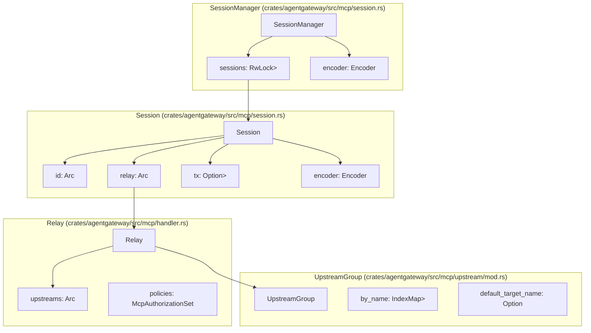
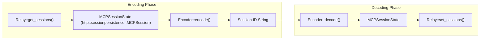
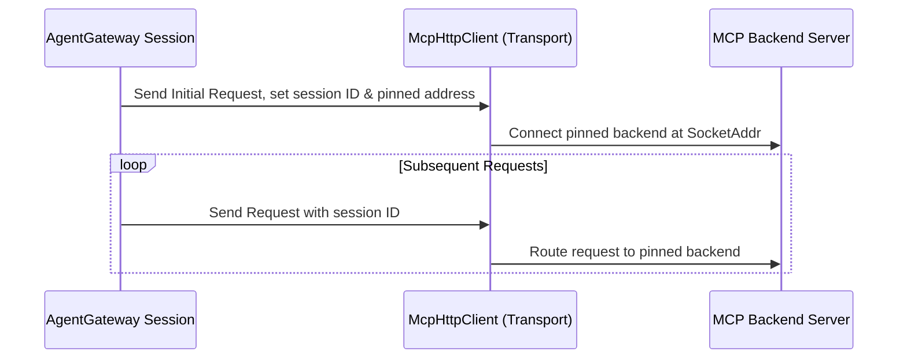

<!-- source: DeepWiki mcp.deepwiki.com · repo agentgateway/agentgateway · page 9.4 MCP Session Management · fetched 2026-10-21 -->

# MCP Session Management

<details>
<summary>Relevant source files</summary>

The following files were used as context for generating this wiki page:

- [crates/agentgateway/src/mcp/handler.rs](crates/agentgateway/src/mcp/handler.rs)
- [crates/agentgateway/src/mcp/mcp_tests.rs](crates/agentgateway/src/mcp/mcp_tests.rs)
- [crates/agentgateway/src/mcp/mod.rs](crates/agentgateway/src/mcp/mod.rs)
- [crates/agentgateway/src/mcp/router.rs](crates/agentgateway/src/mcp/router.rs)
- [crates/agentgateway/src/mcp/session.rs](crates/agentgateway/src/mcp/session.rs)
- [crates/agentgateway/src/mcp/sse.rs](crates/agentgateway/src/mcp/sse.rs)
- [crates/agentgateway/src/mcp/streamablehttp.rs](crates/agentgateway/src/mcp/streamablehttp.rs)
- [crates/agentgateway/src/mcp/upstream/mod.rs](crates/agentgateway/src/mcp/upstream/mod.rs)
- [crates/agentgateway/src/mcp/upstream/openapi/mod.rs](crates/agentgateway/src/mcp/upstream/openapi/mod.rs)
- [crates/agentgateway/src/mcp/upstream/openapi/tests.rs](crates/agentgateway/src/mcp/upstream/openapi/tests.rs)
- [crates/agentgateway/src/mcp/upstream/sse.rs](crates/agentgateway/src/mcp/upstream/sse.rs)
- [crates/agentgateway/src/mcp/upstream/streamablehttp.rs](crates/agentgateway/src/mcp/upstream/streamablehttp.rs)
- [crates/agentgateway/src/proxy/mod.rs](crates/agentgateway/src/proxy/mod.rs)

</details>


MCP Session Management handles the creation, persistence, and lifecycle of Model Context Protocol (MCP) sessions within AgentGateway. Sessions maintain stateful connections to one or more upstream MCP servers, preserve authentication and authorization context, and enable affinity to specific backend replicas for stateful backends. This system supports diverse session types including stateful sessions (persistent and resumable), stateless (ephemeral per-request initialization), and legacy SSE sessions.

For background on MCP protocol and transports, see [MCP Overview (9.1)](). For authentication/authorization details, see [MCP Authentication and Authorization (9.3)](). For multi-backend routing and response merging, see [MCP Multiplexing and Response Merging (9.5)]().

Sources: [crates/agentgateway/src/mcp/session.rs:39-47](), [crates/agentgateway/src/mcp/streamablehttp.rs:23-26]()

## Session Architecture

The session management system comprises:

- **SessionManager**: Central registry tracking active sessions with their metadata.
- **Session**: Represents a client session, maintaining relay to upstream MCP backends and the transport sender channel.
- **Encoder**: Handles serialization and optional encryption of session state for persistence or resumption.
- **Relay**: Manages upstream connections for dispatching messages across target backends.

### Code Entity Relationship Diagram



Sources: [crates/agentgateway/src/mcp/session.rs:38-55](), [crates/agentgateway/src/mcp/handler.rs:1-40](), [crates/agentgateway/src/mcp/upstream/mod.rs:205-210]()

### Session Lifecycle

Sessions exhibit the following lifecycle states and transitions, adapting to protocol versions and configured stateful modes.

**Session State Machine Diagram**

```mermaid
stateDiagram-v2
  [*] --> InitRequest: "POST /mcp (no session header)"

  InitRequest --> CreateSession: "stateful_mode=true"
  InitRequest --> CreateStatelessSession: "stateful_mode=false"

  CreateSession --> SendInitialize: "SessionManager::create_session()"
  CreateStatelessSession --> SendInitialize: "SessionManager::create_stateless_session()"

  SendInitialize --> CaptureUpstreamSessions: "InitializeRequest sent"
  CaptureUpstreamSessions --> EncodeSessionID: "Relay::get_sessions()"
  EncodeSessionID --> InsertSession: "stateful only"
  EncodeSessionID --> ReturnWithHeader: "Add X-MCP-Session-Id"
  
  Active --> ResumeSession: "POST /mcp (with session header)"
  Active --> GetStream: "GET /mcp"
  Active --> DeleteSession: "DELETE /mcp"

  ResumeSession --> DecodeSessionID: "get_or_resume_session()"
  DecodeSessionID --> RestoreUpstreamSessions: "Relay::set_sessions()"

  GetStream --> StreamEvents: "Return SSE stream"
  
  DeleteSession --> CleanupUpstreams: "Upstream::delete()"
  CleanupUpstreams --> [*]
```

- **New InitializeRequest without session ID**: Creates a new session (stateful or stateless).
- **Stateful sessions**: Encode state into a session ID and store session.
- **Subsequent requests with session ID**: Resume existing session after decoding state.
- **GET requests (legacy SSE)**: Establish an event stream.
- **DELETE requests**: Explicitly delete sessions and upstream state.

Sources:  
[crates/agentgateway/src/mcp/streamablehttp.rs:80-101]()  
[crates/agentgateway/src/mcp/streamablehttp.rs:164-212]()  
[crates/agentgateway/src/mcp/session.rs:60-181]()

## Session Types

AgentGateway supports several MCP session modes optimized for different scenarios.

### 1. Stateful Sessions

These sessions persist state within the `SessionManager`'s internal registry keyed by the session ID string, which encodes upstream session affinity and pinned backend details.

- Created on client `InitializeRequest` without a session header in **stateful mode** (`StreamableHttpServerConfig.stateful_mode = true`).
- On success, `Relay::get_sessions()` collects upstream connection states [crates/agentgateway/src/mcp/session.rs:127-134]().
- State is encoded into a Base64/AES session ID string and returned in the `X-MCP-Session-Id` header [crates/agentgateway/src/mcp/streamablehttp.rs:207-210]().
- Subsequent requests include this session ID to resume the session.
  
| Property        | Description                                                    |
|-----------------|----------------------------------------------------------------|
| Storage         | `HashMap<String, SessionEntry>` in `SessionManager` [crates/agentgateway/src/mcp/session.rs:49-55]() |
| Session ID      | Encoded string of session state including upstream hints [crates/agentgateway/src/mcp/session.rs:128-134]() |
| Session Header  | Sent as `X-MCP-Session-Id` (`HEADER_SESSION_ID`) [crates/agentgateway/src/mcp/streamablehttp.rs:9-13]() |

Sources:  
[crates/agentgateway/src/mcp/streamablehttp.rs:186-212]()  
[crates/agentgateway/src/mcp/session.rs:49-55]()

### 2. Stateless Sessions

Stateless sessions entail ephemeral, single-request interactions without stored session state.

- Created via `create_stateless_session` inside `StreamableHttpService` when `stateful_mode=false`.
- Legacy pre-2026 clients receive a synthetic gateway-generated `InitializeRequest` before forwarding the actual request [crates/agentgateway/src/mcp/session.rs:83-181]().
- Modern 2026-07-28+ clients forward messages as-is without initialization [crates/agentgateway/src/mcp/session.rs:83-181]().

These sessions are never registered or assigned a session ID string.

Sources:  
[crates/agentgateway/src/mcp/streamablehttp.rs:214-221]()  
[crates/agentgateway/src/mcp/session.rs:83-181]()

### 3. Legacy SSE Sessions

Legacy SSE sessions are designed for the deprecated MCP SSE transport:

- POST requests return HTTP 202 Accepted without immediate response data.
- Upstream notifications are delivered via a separate GET SSE stream.
- Sessions handle an internal message `Sender` (`tx`) to forward upstream responses to the SSE stream [crates/agentgateway/src/mcp/session.rs:43]().

Sources:  
[crates/agentgateway/src/mcp/session.rs:43]()  
[crates/agentgateway/src/mcp/router.rs:169-185]()

## Session State Persistence and Encoding

### Overview

To allow resumption of stateful sessions, AgentGateway encodes the full upstream session state into a compact string, which is sent to and from clients via the `X-MCP-Session-Id` header.

This encoding preserves information such as upstream session identifiers and pinned backend replica addresses, enabling session affinity and full rehydration after reconnect.

### Encoding and Decoding Data Flow



- `Relay::get_sessions()` extracts per-target session data.
- `MCPSessionState` encapsulates state of all upstream connections.
- `Encoder` serializes and optionally encrypts this state.
- On resumption, the session ID string is decoded back into `MCPSession`.
- `Relay::set_sessions()` restores upstream transport session affinity and state.

Sources: [crates/agentgateway/src/mcp/session.rs:127-134](), [crates/agentgateway/src/mcp/router.rs:32-35]()

### MCPSession State Format

The struct `MCPSession` from the `http::sessionpersistence` module stores upstream session identifiers and affinity metadata, and is implemented by upstream transport clients like `McpHttpClient` [crates/agentgateway/src/mcp/upstream/streamablehttp.rs:39-47]() to export and load session state.

Sources: [crates/agentgateway/src/mcp/upstream/streamablehttp.rs:39-47]()

### Session Encoder Types and Security

Two main encoder implementations exist:

| Encoder Type | Algorithm        | Security Level           | Use Case                |
|--------------|------------------|-------------------------|-------------------------|
| Base64       | URL-safe Base64  | No encryption           | Development/testing     |
| AES          | AES-256-GCM      | Authenticated Encryption| Production/shipping     |

The encoder is instantiated in the `SessionManager` and used both for encoding session state strings sent to clients and decoding strings received from clients [crates/agentgateway/src/mcp/session.rs:40](), [crates/agentgateway/src/mcp/router.rs:32-35]().

Sources: [crates/agentgateway/src/mcp/session.rs:40](), [crates/agentgateway/src/mcp/router.rs:32-35]()

## Stateful Backend Affinity

For session affinity in stateful mode (`backend.stateful=true`), MCP backend sessions pin the client session to a specific backend replica:

- The backend pinning is stored in the upstream transport client, e.g., `McpHttpClient` stores a pinned `SocketAddr` internally.
- This pinning is serialized as part of the `MCPSession` state during session encoding.
- Agents sending subsequent requests using the session ID are routed to the pinned backend replica, ensuring state consistency.

### Backend Pinning Sequence



- `Client::set_session_id(session_id, pinned_socket_addr)` pins backend address [crates/agentgateway/src/mcp/upstream/streamablehttp.rs:49-54]()  
- `MCPSession` stores affinity info for resumption and reconnection [crates/agentgateway/src/mcp/upstream/streamablehttp.rs:39-47]()  

Sources: [crates/agentgateway/src/mcp/upstream/streamablehttp.rs:39-54]()

## Session Cleanup

### Explicit Session Deletion

Clients may explicitly delete sessions via HTTP `DELETE /mcp`. This triggers:

- Removal of the session entry from `SessionManager`.
- Fan-out delete signals to upstream MCP connections to free resources.
  
This cleanup is significant for backends like stdio-based adapters which might hold OS-level resources.

Sources: [crates/agentgateway/src/mcp/upstream/streamablehttp.rs:159-180]()

### Idle Session Reaping

`SessionManager` runs a periodic background task every 30 seconds (`SESSION_REAP_INTERVAL`) to:

- Check sessions' last access timestamps.
- Remove sessions inactive longer than `session_idle_ttl`.
- Drop and close those sessions and associated upstream connections.

This prevents resource leaks from abandoned client connections.

Sources: [crates/agentgateway/src/mcp/session.rs:57]()

### RAII SessionDropper for Legacy SSE

Legacy SSE sessions use a `dropper` guard function wrapping the response body to:

- Clean up the session when the response body stream is dropped.
- This ensures upstream connections and relays are released properly.

This RAII technique protects against resource leaks if clients disconnect unexpectedly.

Sources: [crates/agentgateway/src/mcp/sse.rs:146-152]()

---

This detailed technical overview explains the internal mechanics and code interactions enabling MCP session management in AgentGateway, making MCP use reliable, efficient, and consistent across upstream backends.

# End of 9.4 MCP Session Management

---

