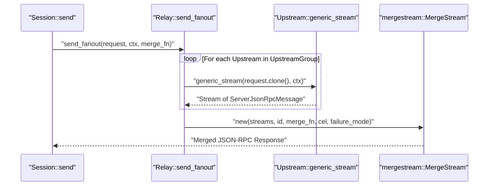

<!-- source: DeepWiki mcp.deepwiki.com · repo agentgateway/agentgateway · page 9.5 MCP Multiplexing and Response Merging · fetched 2026-10-21 -->

# MCP Multiplexing and Response Merging

<details>
<summary>Relevant source files</summary>

The following files were used as context for generating this wiki page:

- [crates/agentgateway/src/mcp/handler.rs](crates/agentgateway/src/mcp/handler.rs)
- [crates/agentgateway/src/mcp/mcp_tests.rs](crates/agentgateway/src/mcp/mcp_tests.rs)
- [crates/agentgateway/src/mcp/mod.rs](crates/agentgateway/src/mcp/mod.rs)
- [crates/agentgateway/src/mcp/router.rs](crates/agentgateway/src/mcp/router.rs)
- [crates/agentgateway/src/mcp/session.rs](crates/agentgateway/src/mcp/session.rs)
- [crates/agentgateway/src/mcp/sse.rs](crates/agentgateway/src/mcp/sse.rs)
- [crates/agentgateway/src/mcp/streamablehttp.rs](crates/agentgateway/src/mcp/streamablehttp.rs)
- [crates/agentgateway/src/mcp/upstream/mod.rs](crates/agentgateway/src/mcp/upstream/mod.rs)
- [crates/agentgateway/src/mcp/upstream/openapi/mod.rs](crates/agentgateway/src/mcp/upstream/openapi/mod.rs)
- [crates/agentgateway/src/mcp/upstream/openapi/tests.rs](crates/agentgateway/src/mcp/upstream/openapi/tests.rs)
- [crates/agentgateway/src/mcp/upstream/sse.rs](crates/agentgateway/src/mcp/upstream/sse.rs)
- [crates/agentgateway/src/mcp/upstream/streamablehttp.rs](crates/agentgateway/src/mcp/upstream/streamablehttp.rs)
- [crates/agentgateway/src/proxy/mod.rs](crates/agentgateway/src/proxy/mod.rs)

</details>


## Purpose and Scope
This page provides an in-depth technical explanation of how the `agentgateway` system implements multiplexing for the Model Context Protocol (MCP). It covers multi-upstream fan-out, response merging, resource name prefixing for collision avoidance, and failure mode handling (`FailClosed` and `FailOpen`). Understanding these mechanisms is critical for grasping how MCP requests are efficiently routed and aggregated from possibly multiple MCP upstream servers in a scalable and robust way.

This page assumes familiarity with upstream concepts such as MCP transports and MCP session management addressed in related pages:
- MCP Transports and Session Handling: [crates/agentgateway/src/mcp/streamablehttp.rs](), [crates/agentgateway/src/mcp/session.rs]()

Sources: [crates/agentgateway/src/mcp/router.rs](), [crates/agentgateway/src/mcp/handler.rs](), [crates/agentgateway/src/mcp/session.rs]()

---

## Configuration Model & Upstream Groups

When an `McpBackend` resource includes multiple upstream targets, `agentgateway` enables MCP multiplexing mode. This groups all those targets into a composite entity called `McpBackendGroup`.

### Key Data Structures

| Struct / Enum | Purpose | Reference |
|-|-|-|
| `McpBackendGroup` | Encapsulates multiple MCP upstream targets, flags for stateful operation, name prefixing mode, and failure mode handling | [crates/agentgateway/src/mcp/router.rs:109-117]() |
| `McpTarget` | Represents one individual upstream target with its transport spec, resolved backend, and associated policies | [crates/agentgateway/src/mcp/router.rs:99-106]() |
| `McpTargetSpec` | Enumerates the underlying target transport types (e.g., MCP streamable HTTP, SSE, Stdio, OpenAPI) | [crates/agentgateway/src/types/agent/mod.rs:20-32]() |
| `FailureMode` | Enum controlling error handling strategy during multiplexed requests (`FailClosed` fails the whole request; `FailOpen` allows partial responses) | [crates/agentgateway/src/mcp/mod.rs:42-51]() |

### Diagram: Conceptual to Code Entity for Multiplexing Configuration
```mermaid
classDiagram
    direction TB
    class "MultiUpstreamFanOutConcept" as NaturalConcept {
        <<Concept>>
        "Multi-Upstream Fan-Out Group"
        "Upstream Target Definition"
        "Reliability Failure Mode"
    }
    class McpBackendGroup {
        +targets: Vec~Arc~McpTarget~~
        +stateful: bool
        +prefix_mode: McpPrefixMode
        +failure_mode: FailureMode
        +session_idle_ttl: Duration
        +sse_keep_alive: Option~Duration~
        +server: Option~McpServerOverrides~
    }
    class McpTarget {
        +name: Strng
        +condition: Option~String~
        +spec: McpTargetSpec
        +backend: Option~SimpleBackend~
        +backend_policies: BackendPolicies
    }
    class FailureMode {
        <<enumeration>>
        FailClosed
        FailOpen
    }
    NaturalConcept --> McpBackendGroup : "configured via App::serve"
    McpBackendGroup "1" --> "*" McpTarget : "contains targets"
    McpBackendGroup --> FailureMode : "governs resilience"
```

Sources: [crates/agentgateway/src/mcp/router.rs:100-117](), [crates/agentgateway/src/mcp/mod.rs:42-51]()

---

## The Relay Architecture

The `Relay` struct acts as the core mechanism for managing MCP session-level multiplexing logic. It orchestrates:

- Dispatching client requests to multiple upstream MCP targets (fan-out)
- Receiving, rewriting, and merging upstream responses into a unified response stream
- Name prefixing for resources to avoid collisions between upstreams
- Applying failure mode logic to tolerate upstream failures as configured
- Enforcing per-target authorization and guardrails policies

### Key Relay Methods
- `send_fanout(request, ctx, merge_fn)` — fans out a single MCP request to all upstreams concurrently and merges their responses using `merge_fn`.
- `send_single(request, ctx, service_name)` — sends a request only to a specific upstream target identified by service name.
- `parse_resource_name(name)` — determines the target and adjusted resource name for dispatching requests with prefixed names.

### UpstreamGroup

Encapsulates all individual upstream clients keyed by target name. Maintains optional default target designation and multiplexing flag.

### Diagram: Relay to Upstream Group Mapping
```mermaid
classDiagram
    direction TB
    class "RelayExecutionConcept" as NaturalConcept {
        <<Concept>>
        "Session Multiplex Relay"
        "Upstream Request Fan-out"
        "Resource Name Parsing"
    }
    class Relay {
        +upstreams: Arc~UpstreamGroup~
        +policies: McpAuthorizationSet
        +mcp_guardrails: Option~Arc~McpGuardrails~~
        +send_fanout(r, ctx, merge) Response
        +send_single(r, ctx, service_name) Response
        +parse_resource_name(name) (service, name)
    }
    class UpstreamGroup {
        +by_name: HashMap~Strng, Arc~Upstream~~
        +default_target_name: Option~String~
        +is_multiplexing: bool
    }
    NaturalConcept --> Relay : "implemented by"
    Relay --> UpstreamGroup : "manages routing"
```

Sources: [crates/agentgateway/src/mcp/handler.rs](), [crates/agentgateway/src/mcp/upstream/mod.rs:207-210]()

---

## Resource Naming, Deduplication, and URI Prefixing

To prevent resource name collisions across multiple upstreams, the system implements name prefixing and deduplication strategies.

- **Name Prefixing**: The function `resource_name(prefix_names: bool, target: &str, name: &str) -> String` prepends the target name plus an underscore delimiter to resource names when prefixing is enabled. This is used consistently for merged lists of tools, prompts, or other named MCP resources to avoid collisions in the unified response.

- **Name Deduplication**: When enabled, the system identifies duplicate resource names across targets via `duplicate_names(enabled: bool, names: Iterator)` which returns all names served by more than one target. Such duplicates are excluded from the merged result sets via `per_target_deduped(...)`. This avoids ambiguity in multiplexer clients and force clients to use prefixing explicitly.

- **Resource URI Prefixing**: For URIs in resource update notifications or read responses containing URI references, `resource_uri` applies consistent prefix rewriting based on multiplexing state. This preserves scheme prefixes if they exist, using special `"service+"` prefixes to concatenate target and upstream URI. Notably, opaque URIs like `foo:bar` and hierarchical URIs like `http://...` are handled correctly.

### Relevant Functions
- `resource_name` — name prefixing [crates/agentgateway/src/mcp/handler.rs:69-75]()
- `duplicate_names` — detects duplicates for deduplication [crates/agentgateway/src/mcp/handler.rs:77-92]()
- `per_target_deduped` — performs deduplication in list responses [crates/agentgateway/src/mcp/handler.rs:96-124]()
- `resource_uri` and `uri_scheme_prefix_len` — for URI prefixing [crates/agentgateway/src/mcp/handler.rs:136-171]()

Sources: [crates/agentgateway/src/mcp/handler.rs:37-200]()

---

## Fanout and Merge Flow

Requests that query lists of resources (e.g., `tools/list`, `resources/list`) are dispatched concurrently to all upstream MCP targets within the group. Each target produces a stream of JSON-RPC messages representing its portion of the resources.

The `Relay` collects these streams and passes them into a `mergestream::MergeStream` which merges individual per-target streams into a single unified response stream merged according to the MCP protocol. This merged stream respects deduplication rules and prefixing.

### Sequence Diagram: Fanout and Merge


Sources: [crates/agentgateway/src/mcp/handler.rs](), [crates/agentgateway/src/mcp/session.rs:63-75](), [crates/agentgateway/src/mcp/mergestream.rs]()

---

## MergeStream and Reliability Modes (`FailClosed` vs `FailOpen`)

The `MergeStream` consists of a fan-in collector that reads asynchronously from multiple upstream response streams and incrementally merges messages to produce a coherent combined result. It implements merging semantics (e.g., combining lists, removing duplicates) in accord with the chosen failure mode.

- **FailClosed (`FailureMode::FailClosed`)** (default): If any upstream target fails (e.g., connection drop, error message) or fails to initialize properly, then the entire fan-out operation terminates with an error response. This strict mode guarantees consistent and total correctness but less tolerance to partial failure.

- **FailOpen (`FailureMode::FailOpen`)**: The multiplexer skips any failing or misbehaving upstream targets and continues serving responses merged from the remaining healthy ones. An error is only returned if *all* upstreams fail to respond. This mode improves availability at the cost of potential partial data.

The failure mode is configured on the `McpBackendGroup` and enforced inside `mergestream::MergeStream`.

Sources: [crates/agentgateway/src/mcp/mergestream.rs](), [crates/agentgateway/src/mcp/mod.rs:42-51]()

---

## Stateless Initialization and Session Multiplexing

The MCP protocol requires an initial handshake (`InitializeRequest`). The system supports stateless invocation as well as multiplexed session-based connections.

The `Session::stateless_send_and_initialize` method manages synthetic or real upstream initialization requests for stateless messages, optionally fanning out the init request to all MCP servers, or targeting a single service when prefixing is never applied.

For multiplexed stateful sessions, the `SessionManager` internally manages one `Relay` instance that fans out requests to all upstreams, merging responses transparently to the client.

This mechanism ensures backward compatibility with legacy MCP servers and supports modern multiplexed clients with session affinity.

Sources: [crates/agentgateway/src/mcp/session.rs:83-181]()

---

# Summary

`agentgateway` implements robust MCP multiplexing by grouping multiple MCP upstream targets into logical backend groups (`McpBackendGroup`), managing fan-out of requests and merging of responses with careful handling of resource name prefixing and duplicate removal. The `Relay` and `MergeStream` types coordinate this behavior seamlessly, supporting flexible failure modes to balance correctness and availability. This multiplexing capability enables scalable aggregation of MCP services behind a unified gateway interface.

For further details on internal code, see the key files:
- `crates/agentgateway/src/mcp/handler.rs` — Relay multiplexing logic, resource renaming
- `crates/agentgateway/src/mcp/router.rs` — MCP backend grouping, routing
- `crates/agentgateway/src/mcp/session.rs` — Session and stateless request handling
- `crates/agentgateway/src/mcp/mergestream.rs` — Response merging streams

This knowledge is critical for developing and debugging advanced MCP routing, upstream scaling, and multi-provider aggregation scenarios.

Sources:
[crates/agentgateway/src/mcp/router.rs]()
[crates/agentgateway/src/mcp/handler.rs]()
[crates/agentgateway/src/mcp/session.rs]()
[crates/agentgateway/src/mcp/mergestream.rs]()
[crates/agentgateway/src/mcp/mod.rs]()

---

