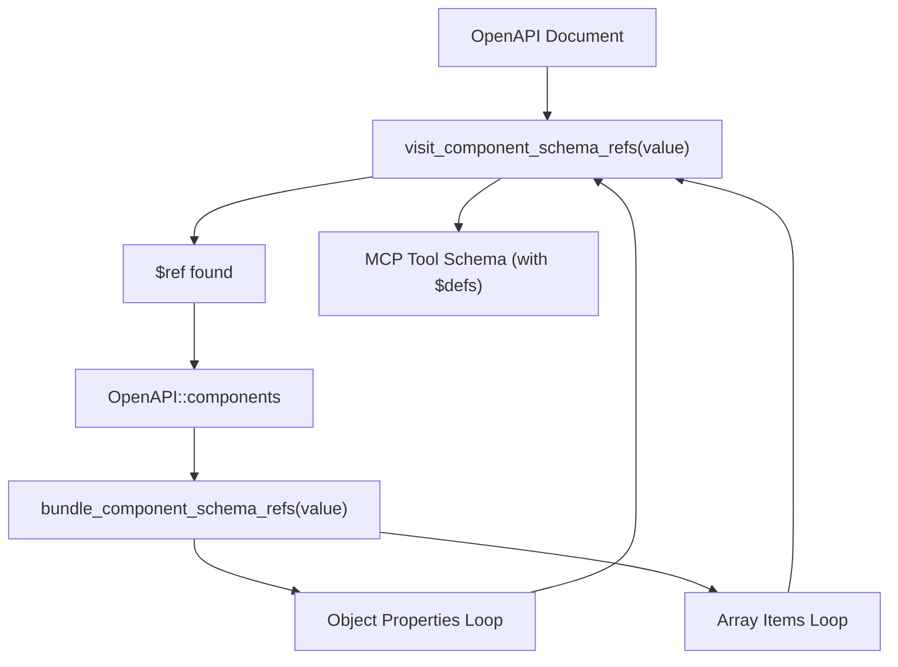
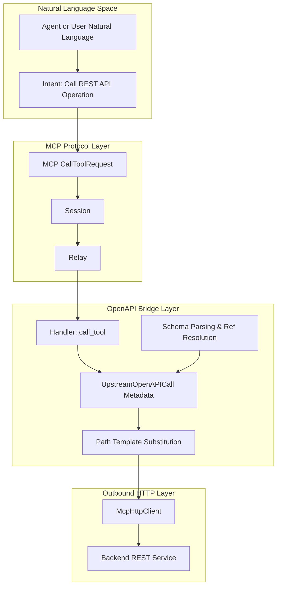

<!-- source: DeepWiki mcp.deepwiki.com · repo agentgateway/agentgateway · page 9.6 OpenAPI to MCP Bridge · fetched 2026-10-21 -->

# OpenAPI to MCP Bridge

<details>
<summary>Relevant source files</summary>

The following files were used as context for generating this wiki page:

- [crates/agentgateway/src/mcp/handler.rs](crates/agentgateway/src/mcp/handler.rs)
- [crates/agentgateway/src/mcp/mcp_tests.rs](crates/agentgateway/src/mcp/mcp_tests.rs)
- [crates/agentgateway/src/mcp/mod.rs](crates/agentgateway/src/mcp/mod.rs)
- [crates/agentgateway/src/mcp/router.rs](crates/agentgateway/src/mcp/router.rs)
- [crates/agentgateway/src/mcp/session.rs](crates/agentgateway/src/mcp/session.rs)
- [crates/agentgateway/src/mcp/sse.rs](crates/agentgateway/src/mcp/sse.rs)
- [crates/agentgateway/src/mcp/streamablehttp.rs](crates/agentgateway/src/mcp/streamablehttp.rs)
- [crates/agentgateway/src/mcp/upstream/mod.rs](crates/agentgateway/src/mcp/upstream/mod.rs)
- [crates/agentgateway/src/mcp/upstream/openapi/mod.rs](crates/agentgateway/src/mcp/upstream/openapi/mod.rs)
- [crates/agentgateway/src/mcp/upstream/openapi/tests.rs](crates/agentgateway/src/mcp/upstream/openapi/tests.rs)
- [crates/agentgateway/src/mcp/upstream/sse.rs](crates/agentgateway/src/mcp/upstream/sse.rs)
- [crates/agentgateway/src/mcp/upstream/streamablehttp.rs](crates/agentgateway/src/mcp/upstream/streamablehttp.rs)
- [crates/agentgateway/src/proxy/mod.rs](crates/agentgateway/src/proxy/mod.rs)

</details>


## Purpose and Scope

The OpenAPI to MCP Bridge provides a dynamic integration mechanism that exposes HTTP REST APIs defined by OpenAPI specifications as Model Context Protocol (MCP) tools. It automatically converts OpenAPI operations into MCP tool signatures and translates MCP requests into corresponding REST calls, enabling seamless invocation of external HTTP services from agents using MCP tools.

This bridge handles OpenAPI schema parsing, tool generation, path and header parameter substitution, request execution, and response handling. It essentially transforms RESTful API endpoints into MCP-callable tools, eliminating manual tool authoring or protocol bridging complexities.

Sources: [crates/agentgateway/src/mcp/upstream/openapi/mod.rs:29-35](), [crates/agentgateway/src/mcp/upstream/mod.rs:207-210]()

---

## Architecture Overview

### System Components

- **OpenAPI Specification**: A standard OpenAPI v3 document describing the target REST API's operations, input parameters, and schemas.
- **MCP Tool Definitions**: Generated from OpenAPI operation schemas, representing callable tools with structured input validation.
- **Handler**: The core MCP upstream handler that implements `call_tool` by converting MCP requests into HTTP calls per the OpenAPI operation. [crates/agentgateway/src/mcp/upstream/openapi/mod.rs:972]()
- **Upstream REST Client**: Executes the REST HTTP requests via MCP HTTP clients such as `McpHttpClient`. [crates/agentgateway/src/mcp/upstream/client.rs]()
- **Session and Relay Layer**: MCP runtime manages sessions, relays calls, applies policies, and merges responses when multiplexing across targets. [crates/agentgateway/src/mcp/session.rs:39-47](), [crates/agentgateway/src/mcp/handler.rs:41-47]()

### Data Flow

```mermaid
graph TB
    subgraph "MCP Client Space"
        MCPClient["Agent MCP Client"]
        MCPSession["Session"]
        MCPClient -->|CallToolRequest| MCPSession
        MCPSession -->|send()| Relay["Relay"]
    end

    subgraph "OpenAPI Bridge Layer"
        Relay -->|call_tool()| Handler["OpenAPI Handler"]
        Handler -->|lookup operation| UpstreamCall["UpstreamOpenAPICall"]
        Handler -->|path/template substitution| PathReplacer["PathParamReplacer"]
    end

    subgraph "Transport Layer"
        Handler -->|build HTTP Request| McpHttpClient["McpHttpClient"]
        McpHttpClient -->|apply policies| PolicyClient["PolicyClient"]
        PolicyClient -->|execute| BackendREST["Backend REST"]
    end
```

This diagram illustrates the mapping from an MCP client tool call to the execution of an HTTP REST request adhering to the OpenAPI specification.

Sources: [crates/agentgateway/src/mcp/upstream/openapi/mod.rs:29-35](), [crates/agentgateway/src/mcp/upstream/mod.rs:207-210](), [crates/agentgateway/src/mcp/session.rs:59-181](), [crates/agentgateway/src/mcp/handler.rs:200-202]()

---

## Tool Generation and Schema Parsing

The bridge parses the OpenAPI document to build MCP `Tool` definitions. Each operation with supported HTTP methods (e.g., GET, POST) is converted into a tool with an input schema representing request parameters.

### Schema Resolution

OpenAPI schemas may reference component definitions via `$ref`. The bridge recursively tracks these references, replacing internal `$ref` strings with JSON Schema `$defs` bundles usable by MCP clients. This ensures a fully self-contained schema per tool for LLM prompt validation.

Process overview:

- `visit_component_schema_refs` traverses JSON schemas, locating and collecting all `$ref` to component schemas. [crates/agentgateway/src/mcp/upstream/openapi/mod.rs:115-140]()
- `bundle_component_schema_refs` fetches all referenced component schemas from the OpenAPI document's `components` section, recursively flattening any nested references. [crates/agentgateway/src/mcp/upstream/openapi/mod.rs:143-177]()
- The final compiled schema, including a `$defs` section, is embedded in the tool description.



Sources: [crates/agentgateway/src/mcp/upstream/openapi/mod.rs:114-177](), [crates/agentgateway/src/mcp/upstream/openapi/tests.rs:63-102]()

---

### Input Schema Namespacing

OpenAPI parameters across different locations are namespaced in the MCP tool schema for clarity and collision avoidance:

| Namespace | Constant Name | Description               | Source File Reference                   |
|-----------|---------------|---------------------------|---------------------------------------|
| Body      | `BODY_NAME` ("body")   | JSON request body            | [crates/agentgateway/src/mcp/upstream/openapi/tests.rs:140-148]()  |
| Path      | `PATH_NAME` ("path")   | Path parameters in URI       | [crates/agentgateway/src/mcp/upstream/openapi/tests.rs:70-76]()  |
| Query     | `QUERY_NAME` ("query") | URL query parameters         | [crates/agentgateway/src/mcp/upstream/openapi/tests.rs:77-81]()  |
| Header    | `HEADER_NAME` ("header") | White-listed HTTP headers     | [crates/agentgateway/src/mcp/upstream/openapi/tests.rs:82-87]()  |

This structured input facilitates MCP clients to correctly fill out respective request parts before issuing tool calls.

Sources: [crates/agentgateway/src/mcp/upstream/openapi/tests.rs:63-96](), [crates/agentgateway/src/mcp/upstream/openapi/tests.rs:108-137]()

---

## Execution Pipeline: `Handler::call_tool`

When an MCP client calls an OpenAPI-generated tool, the bridge performs reconstruction of the HTTP request as follows:

### Server Prefix Handling

To prepare the full REST path, the bridge retrieves the server base path from the OpenAPI's `servers` array via `get_server_prefix`. [crates/agentgateway/src/mcp/upstream/openapi/mod.rs:65-110]() This supports:

- Absolute URLs (`https://api.example.com/v1`)
- Protocol-relative URLs (`//api.example.com/v1`)
- Relative paths (`/v1`)
- Single or zero servers (multiple servers are unsupported)

It extracts the path portion only, trimming trailing slashes, to prepend before the operation-specific path.

```mermaid
flowchart TD
    server[OpenAPI.servers]
    check_len{servers.len()}
    zero_len[Return ""]
    one_len[Extract path prefix]
    multi_server[Error: multiple servers unsupported]
    
    server --> check_len
    check_len -- 0 --> zero_len
    check_len -- 1 --> one_len
    check_len -- more --> multi_server
```

Sources: [crates/agentgateway/src/mcp/upstream/openapi/mod.rs:64-109](), [crates/agentgateway/src/mcp/upstream/openapi/tests.rs:210-244]()

---

### Path Parameter Substitution

The handler scans the operation path for `{param}` placeholders. For each:

- Extracts the corresponding value from the MCP call arguments under the `path` namespace.
- Validates the value is a string or number. [crates/agentgateway/src/mcp/upstream/openapi/mod.rs:59-60]()
- Applies URL percent-encoding safety checks to prevent unsafe path segments. [crates/agentgateway/src/mcp/upstream/openapi/mod.rs:61-62]()
- Replaces the placeholder in the path string with the encoded value.

This ensures correct URL path construction compliant with the API definition.

Sources: [crates/agentgateway/src/mcp/upstream/openapi/mod.rs:54-62](), [crates/agentgateway/src/mcp/upstream/openapi/tests.rs:222-240]()

---

### Header Management and Security Considerations

Only headers explicitly allowed by the OpenAPI operation (`allowed_headers` set) are forwarded on outbound HTTP calls. [crates/agentgateway/src/mcp/upstream/openapi/mod.rs:32]() This whitelisting prevents leaking sensitive headers.

Additionally, transport-internal headers like `host`, `content-length`, and `transfer-encoding` are managed internally or omitted to avoid unintended side effects. [crates/agentgateway/src/mcp/upstream/openapi/mod.rs:12]()

Sources: [crates/agentgateway/src/mcp/upstream/openapi/mod.rs:10-12](), [crates/agentgateway/src/mcp/upstream/openapi/mod.rs:29-35](), [crates/agentgateway/src/mcp/upstream/openapi/tests.rs:83-88]()

---

## Bridge Initialization and Integration

The OpenAPI bridge is tied into gateway runtime initialization via the `ProxyInputs` struct. [crates/agentgateway/src/mcp/upstream/openapi/tests.rs:44-60]() The field `mcp_state` holds the MCP `App` that manages sessions and routing for MCP tools including those backed by OpenAPI. [crates/agentgateway/src/mcp/router.rs:26-29]()

At runtime, the bridge's `Handler` instance handles MCP tool calls, consults generated OpenAPI call maps, and dispatches outbound HTTP requests via `McpHttpClient`. [crates/agentgateway/src/mcp/upstream/openapi/tests.rs:190-198]()

Sources: [crates/agentgateway/src/mcp/upstream/openapi/tests.rs:44-60](), [crates/agentgateway/src/mcp/router.rs:26-29]()

---

## Summary Diagram: Natural Language Request Through OpenAPI Bridge

This conceptual diagram connects user intent to MCP code entities for clearer understanding.



This visualization links high-level usage flow down to specific code symbols involved in the OpenAPI to MCP bridging.

Sources: [crates/agentgateway/src/mcp/upstream/openapi/mod.rs:29-35](), [crates/agentgateway/src/mcp/upstream/mod.rs:207-210](), [crates/agentgateway/src/mcp/session.rs:59-181](), [crates/agentgateway/src/mcp/router.rs:26-29]()

---

# Appendix: Key Code Entities

| Entity Name              | Description                                                | Location                                 |
|--------------------------|------------------------------------------------------------|------------------------------------------|
| `Handler`                | Core MCP upstream handler implementing OpenAPI bridging   | `crates/agentgateway/src/mcp/upstream/openapi/mod.rs:973` |
| `UpstreamOpenAPICall`    | Defines HTTP method, path, allowed headers for calls       | `crates/agentgateway/src/mcp/upstream/openapi/mod.rs:29-35` |
| `get_server_prefix()`    | Extract base path prefix from OpenAPI server URLs          | `crates/agentgateway/src/mcp/upstream/openapi/mod.rs:65-110` |
| `visit_component_schema_refs()` | Recursively finds all `$ref` pointers in schemas     | `crates/agentgateway/src/mcp/upstream/openapi/mod.rs:115-140` |
| `bundle_component_schema_refs()` | Flattens referenced schemas into single JSON schema    | `crates/agentgateway/src/mcp/upstream/openapi/mod.rs:143-177` |
| `McpHttpClient`           | HTTP client used for executing REST calls                  | `crates/agentgateway/src/mcp/upstream/client.rs` (not shown)  |
| `App`                    | MCP router/session manager managing sessions and calls     | `crates/agentgateway/src/mcp/router.rs:26-29`                 |

---

# References

- `crates/agentgateway/src/mcp/upstream/openapi/mod.rs` [lines 1-214]()
- `crates/agentgateway/src/mcp/upstream/openapi/tests.rs` [lines 1-244]()
- `crates/agentgateway/src/mcp/upstream/mod.rs` [lines 1-210]()
- `crates/agentgateway/src/mcp/router.rs` [lines 26-29]()
- `crates/agentgateway/src/mcp/session.rs` [lines 59-181]()

---

