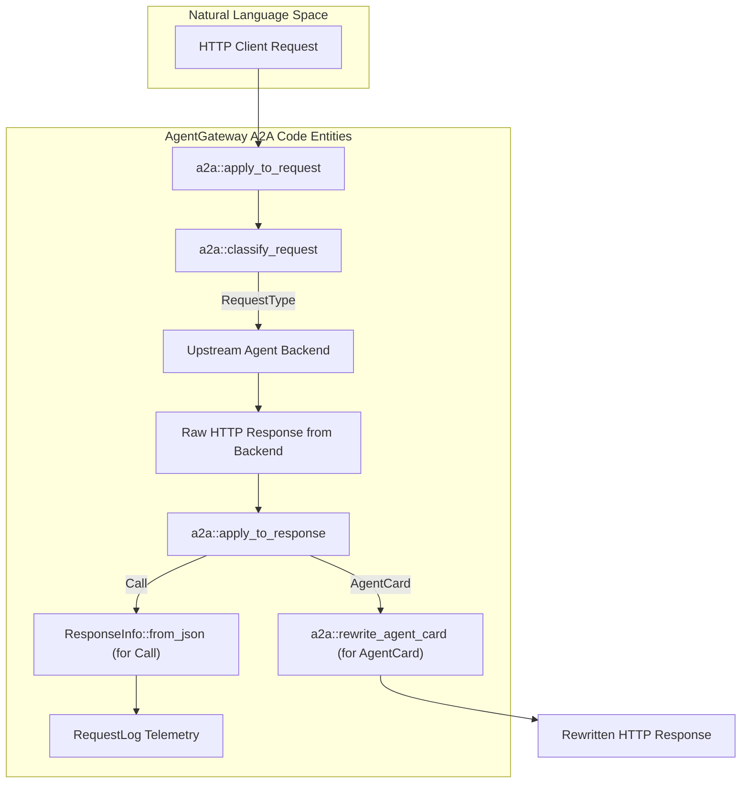
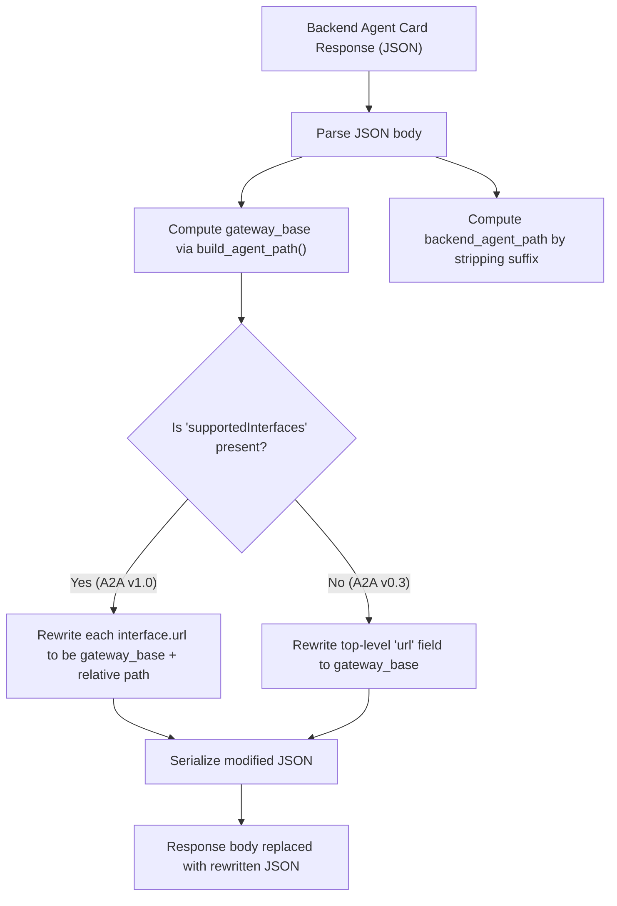
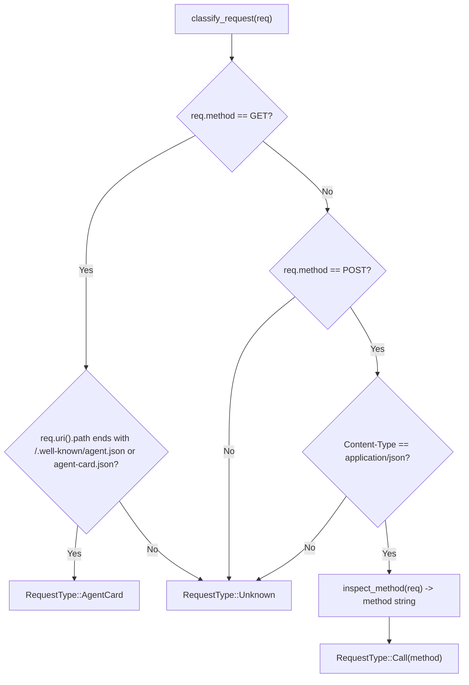
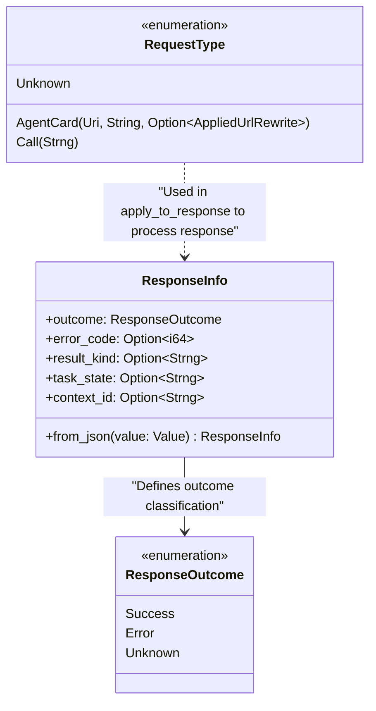

<!-- source: DeepWiki mcp.deepwiki.com · repo agentgateway/agentgateway · page 9.7 Agent-to-Agent (A2A) Protocol · fetched 2026-10-21 -->

# Agent-to-Agent (A2A) Protocol

<details>
<summary>Relevant source files</summary>

The following files were used as context for generating this wiki page:

- [crates/agentgateway/src/a2a/mod.rs](crates/agentgateway/src/a2a/mod.rs)
- [crates/agentgateway/src/a2a/tests.rs](crates/agentgateway/src/a2a/tests.rs)
- [examples/traffic-a2a/README.md](examples/traffic-a2a/README.md)

</details>


## Purpose and Scope

This document details the implementation and behavior of the Agent-to-Agent (A2A) Protocol support within the AgentGateway project. The A2A protocol facilitates direct communication and capability discovery among autonomous AI agents, differing from the Model Context Protocol (MCP) which predominantly targets agent-to-tool interactions.

In AgentGateway, the A2A protocol is supported as an HTTP extension layer that manages agent metadata discovery via "agent cards" and JSON-RPC based skill invocation handling. This support includes request classification, agent card URL rewriting for gateway mediation, and extracting detailed response metadata for observability.

The core A2A logic is implemented in the Rust module `crates/agentgateway/src/a2a/mod.rs`. A representative example configuration and usage is provided in `examples/traffic-a2a/README.md`.

Sources: [crates/agentgateway/src/a2a/mod.rs:1-15](), [examples/traffic-a2a/README.md:1-21]()

---

## Protocol Overview and Key Concepts

The A2A protocol integration into agentgateway hinges on the interception and handling of certain HTTP requests and responses to support agent discovery and inter-agent calls.

| Concept | Code Symbol / Mechanism | Description |
|---------|-------------------------|-------------|
| **Agent Card** | `RequestType::AgentCard` enum variant [crates/agentgateway/src/a2a/mod.rs:68-68]() | Represents requests to well-known URLs `/.well-known/agent.json` or `/.well-known/agent-card.json`. These are used by agents to publish their capabilities and metadata. [crates/agentgateway/src/a2a/mod.rs:21-27]() |
| **Skill Call** | `RequestType::Call` enum variant [crates/agentgateway/src/a2a/mod.rs:69-69]() | Represents JSON-RPC POST calls that invoke specific agent skills or methods. [crates/agentgateway/src/a2a/mod.rs:44-59]() |
| **Discovery Rewrite** | `rewrite_agent_card` function [crates/agentgateway/src/a2a/mod.rs:184-205]() | Rewrites URLs contained in agent cards to point back to the gateway ingress for routing mediation. |
| **Policy Trigger** | `A2aPolicy` struct [crates/agentgateway/src/types/agent.rs]() | Flags routes as carrying A2A traffic to enable A2A-specific processing in request/response pipelines. |
| **Response Metadata** | `ResponseInfo` struct w/ `from_json` [crates/agentgateway/src/a2a/mod.rs:72-137]() | Parses JSON-RPC response bodies to extract result state, errors, task state, and context identifiers for observability. |

Sources: [crates/agentgateway/src/a2a/mod.rs:9-137](), [examples/traffic-a2a/README.md:15-21]()

---

## Request Classification and Lifecycle

When a request arrives at the gateway that matches a route tagged with `A2aPolicy`, the system classifies and processes it using A2A logic.

- The entry point is `apply_to_request(pol: &A2aPolicy, req: &mut Request)` which calls `classify_request(req)` to determine the request's A2A type:
  - **AgentCard** for GET requests at known discovery paths.
  - **Call** for JSON-RPC POST calls with a `method` field in the body.
  - **Unknown** otherwise.

- The classification of requests influences response processing via `apply_to_response`.

### Data Flow Diagram: From Incoming Request to A2A Processing



Sources: [crates/agentgateway/src/a2a/mod.rs:11-15](), [crates/agentgateway/src/a2a/mod.rs:157-182]()

---

## Agent Card Discovery and URL Rewriting

Agents publish metadata about their identity, capabilities, and interface URLs via well-known endpoints. The gateway rewrites these URLs to route traffic through itself rather than exposing backend URLs directly.

### Recognized Discovery Paths

- `/.well-known/agent-card.json` — preferred path for A2A protocol v0.3.0+ [crates/agentgateway/src/a2a/mod.rs:21-27]()
- `/.well-known/agent.json` — legacy or older versions

### URL Rewriting Mechanism

Upon receiving a response for an AgentCard request:

1. The response body is parsed as JSON using `json::from_body_with_limit` with a size limit to avoid malicious payloads [crates/agentgateway/src/a2a/mod.rs:191-193]().
2. The gateway base URL is calculated by stripping the well-known suffix from the original (possibly rewritten) client request URI, using `build_agent_path` [crates/agentgateway/src/a2a/mod.rs:194-194]().
3. The backend path used to fetch the agent card is similarly stripped of the agent-card suffix to compute relative interface URLs so they properly reference the gateway base [crates/agentgateway/src/a2a/mod.rs:200-200]().
4. Supports two agent card schema versions:
   - **A2A v1.0**: If the `supportedInterfaces` array is present, each interface entry's `url` is recalculated to be relative to the gateway base, preserving path semantics [crates/agentgateway/src/a2a/mod.rs:202-205]().
   - **A2A v0.3**: If no interfaces, the top-level `url` property is rewritten likewise.
5. The modified JSON is serialized back and the response body replaced before sending to the client.

### Logic Overview Mermaid Diagram



Sources: [crates/agentgateway/src/a2a/mod.rs:157-227](), [crates/agentgateway/src/a2a/tests.rs:175-243]()

---

## Skill Invocation, JSON-RPC, and Response Inspection

The gateway handles skill invocation requests as JSON-RPC calls sent via HTTP POST. It extracts important metadata from the responses to enable telemetry and observability.

### Request Type Classification

- `RequestType::Call` is assigned to POST requests with `Content-Type: application/json` whose body contains a valid `"method"` field per JSON-RPC [crates/agentgateway/src/a2a/mod.rs:44-59]().

### Response Inspection Details

The `ResponseInfo` struct parses JSON-RPC results and errors with attention to multiple protocol versions:

- Outcome is classified as `Success`, `Error`, or `Unknown` based on presence of `"result"` or `"error"` fields [crates/agentgateway/src/a2a/mod.rs:82-91]().
- Extracts:
  - Numeric error code if present.
  - `result_kind` from `result.kind` or fallback from whether the payload has `task` or `message`.
  - `task_state` from nested `status.state` fields that differ between protocol versions.
  - `context_id` for session correlation, present in multiple JSON locations for v0.3 and v1.0 [crates/agentgateway/src/a2a/mod.rs:92-130]().

These extracted fields are logged alongside HTTP request telemetry (as shown in the `examples/traffic-a2a/README.md`) to enable detailed diagnostics.

### Request Classification Logic Flowchart



Sources: [crates/agentgateway/src/a2a/mod.rs:17-62](), [crates/agentgateway/src/a2a/tests.rs:59-81]()

---

## Observability and Telemetry Data Structures

The `ResponseInfo` structure is pivotal in capturing A2A response semantics for logging and performance insights.



Sources: [crates/agentgateway/src/a2a/mod.rs:64-145](), [examples/traffic-a2a/README.md:53-75]()

---

## Integration Example and Logging

The example configuration in `examples/traffic-a2a/README.md` demonstrates usage:

- Configure route and backend with `policies.a2a: {}` to enable A2A processing on the traffic.
- Run an external sample A2A agent and client.
- Use curl or other HTTP clients to fetch the agent card; observe the rewritten `url` field points back to the gateway.
- Send JSON-RPC calls and observe detailed A2A-specific fields in logs:

```
a2a.method=message/stream a2a.response.outcome=success a2a.result.kind=task
a2a.task.state=completed a2a.context.id=8f2b1c94
```

These logs facilitate rich tracing of the A2A conversation state and outcomes as processed by AgentGateway.

Sources: [examples/traffic-a2a/README.md:25-75]()

---

## Comparison with Model Context Protocol (MCP)

| Feature | A2A Protocol | MCP Protocol (for comparison) |
|---|---|---|
| Module | `crate::a2a` [crates/agentgateway/src/a2a/mod.rs:1]() | `crate::mcp` |
| Transport | HTTP GET for discovery, POST JSON-RPC calls [crates/agentgateway/src/a2a/mod.rs:20]() | SSE / JSON-RPC streamed transport |
| Discovery Mutation | URL rewriting in Agent Card JSON body [crates/agentgateway/src/a2a/mod.rs:184-205]() | Tool list merging and session state management |
| Statefulness | Stateless request handling, no session persistence | Stateful session management with multiplexing |
| Telemetry | JSON-RPC method and result metadata extraction [crates/agentgateway/src/a2a/mod.rs:82-137]() | In-depth tool usage and multi-upstream merging |

The A2A protocol module is lean and extends HTTP processing with minimal state, focusing on mediation and introspection rather than session multiplexing.

Sources: [crates/agentgateway/src/a2a/mod.rs:1-137](), [examples/traffic-a2a/README.md:11-21]()

---

# Summary

The Agent-to-Agent protocol support in AgentGateway enables autonomous AI agents to publish capabilities and invoke skills via standardized HTTP and JSON-RPC requests. Through request classification, URL rewriting of "agent cards," and response inspection, AgentGateway offers transparent routing mediation and rich observability. This protocol complements the MCP protocol, focusing on higher-level agent interaction rather than tool integration.

---

# References

- `crates/agentgateway/src/a2a/mod.rs`
- `crates/agentgateway/src/a2a/tests.rs`
- `examples/traffic-a2a/README.md`

---

