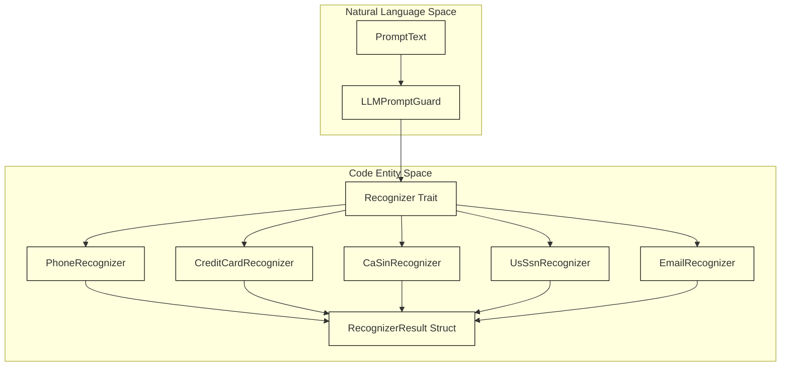
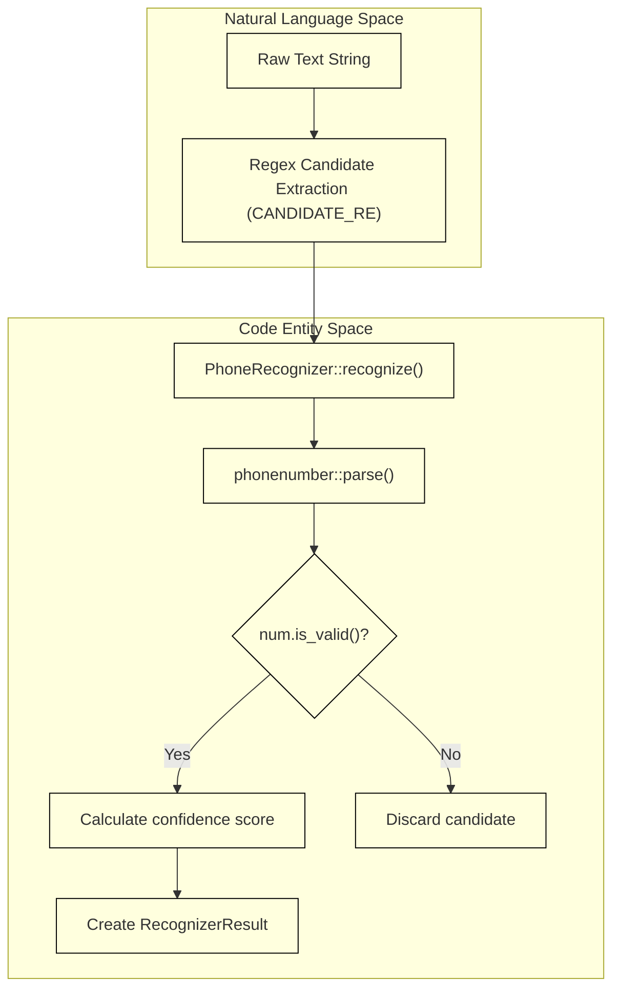
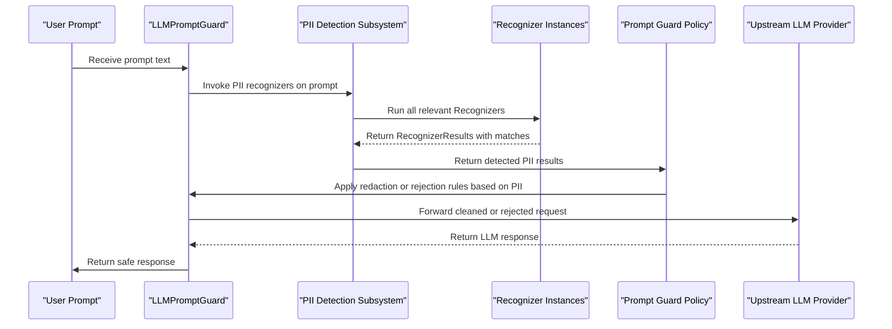

<!-- source: DeepWiki mcp.deepwiki.com · repo agentgateway/agentgateway · extra page PII Detection and Redaction · fetched 2026-10-21 -->

# PII Detection and Redaction

<details>
<summary>Relevant source files</summary>

The following files were used as context for generating this wiki page:

- [crates/agentgateway/src/llm/policy/pii/ca_sin_recognizer.rs](crates/agentgateway/src/llm/policy/pii/ca_sin_recognizer.rs)
- [crates/agentgateway/src/llm/policy/pii/credit_card_recognizer.rs](crates/agentgateway/src/llm/policy/pii/credit_card_recognizer.rs)
- [crates/agentgateway/src/llm/policy/pii/email_recognizer.rs](crates/agentgateway/src/llm/policy/pii/email_recognizer.rs)
- [crates/agentgateway/src/llm/policy/pii/mod.rs](crates/agentgateway/src/llm/policy/pii/mod.rs)
- [crates/agentgateway/src/llm/policy/pii/phone_recognizer.rs](crates/agentgateway/src/llm/policy/pii/phone_recognizer.rs)
- [crates/agentgateway/src/llm/policy/pii/tests.rs](crates/agentgateway/src/llm/policy/pii/tests.rs)

</details>


## Purpose and Scope

The PII (Personally Identifiable Information) detection and redaction subsystem, located in `crates/agentgateway/src/llm/policy/pii/`, provides built-in recognizers to scan, identify, and handle sensitive text patterns within LLM prompts and responses. This subsystem supports prompt guard policies by detecting various PII entity types such as phone numbers, credit cards, Social Insurance Numbers (SIN), Social Security Numbers (SSN), email addresses, and URLs.

By integrating these recognizers, the agent gateway can enforce redaction or rejection behavior on detected PII, preventing sensitive information from being forwarded to upstream model providers and thus maintaining privacy and compliance.

Sources: `[crates/agentgateway/src/llm/policy/pii/mod.rs:1-44]()`

---

## Core Recognizer Architecture and Trait

The subsystem is architected around a common `Recognizer` trait that standardizes the interface for scanning text and identifying PII entities. Each recognizer implements this trait and targets a specific PII type using appropriate detection heuristics.

### Recognizer Trait

- Defines the method `recognize(&self, text: &str) -> Vec<RecognizerResult>` which scans input text and returns matches with their offsets and confidence scores.
- Provides a `name(&self) -> &str` method for identifying the recognizer type.

### RecognizerResult

This structure encapsulates details of a detected entity:

- `entity_type`: The PII type (e.g., PHONE_NUMBER, CREDIT_CARD)
- `matched`: The exact text matched
- `start` and `end`: Byte offsets in the input string
- `score`: Confidence score for the match

### Static Global Recognizers

The module exposes thread-safe, lazily initialized global recognizer instances via `once_cell::sync::Lazy`, for example:

- `EMAIL`: `EmailRecognizer`
- `PHONE`: `PhoneRecognizer`
- `CC`: `CreditCardRecognizer`
- `SSN`: US Social Security Number Recognizer
- `CA_SIN`: Canadian Social Insurance Number Recognizer

These static instances allow efficient reuse across prompt guard processing without repeated initialization.



*Diagram 1: Bridging Natural Language PII detection to Rust Code Entities (`Recognizer`, `PhoneRecognizer`, `CreditCardRecognizer`, and `RecognizerResult`).*

Sources: `[crates/agentgateway/src/llm/policy/pii/mod.rs:19-40]()`

---

## Built-in Recognizers and Validation Logic

The PII detection pipeline relies on specialized recognizers, each implementing custom detection techniques combining regex patterns, structural parsing, and heuristic scoring.

### Phone Number Recognizer

The `PhoneRecognizer` targets phone numbers using a two-step approach:

1.  **Candidate Extraction:** Uses a compiled regex `CANDIDATE_RE` to find potential phone number substrings in the text.
2.  **Parsing & Validation:** For each candidate, it attempts to parse it using the `phonenumber` crate against configured regions (`US, GB, DE, IL, IN, CA, BR`).
3.  **Scoring:** Valid parsed numbers get a confidence score based on digit count; longer digit sequences raise confidence.

This process ensures international and local formatted phone numbers are detected reliably, minimizing false positives.



*Diagram 2: Phone Number recognition flow from raw text through regex filtering, parsing, validation, to scoring and match result.*

Sources: `[crates/agentgateway/src/llm/policy/pii/phone_recognizer.rs:8-93]()`

---

### Credit Card Recognizer and Luhn Validation

Credit card detection is powered by the `CreditCardRecognizer` which extends a generic `PatternRecognizer` preconfigured with multiple issuer-specific regex patterns:

-   Visa, Mastercard, Discover, Amex, Diners Club, and other popular card brands
-   Patterns handle typical card formatting with optional delimiters like hyphens or spaces

Once potential matches are found, each candidate number undergoes **Luhn checksum validation** to confirm syntactic validity and reduce false positives.

#### Luhn Algorithm Overview

-   Processes the candidate string by doubling every second digit from the right.
-   Summation of digits adjusted for double-digit values.
-   Valid credit card numbers have a total sum divisible by 10.

```rust
fn luhn_checksum_is_valid(value: &str) -> bool {
    let mut checksum = 0;
    let mut double = false;
    let mut digits = 0;

    for byte in value.bytes().rev() {
        let mut digit = match byte {
            b'0'..=b'9' => u32::from(byte - b'0'),
            b'-' | b' ' => continue,
            _ => return false,
        };
        digits += 1;

        if double {
            digit *= 2;
            if digit > 9 {
                digit -= 9;
            }
        }

        checksum += digit;
        double = !double;
    }

    digits > 0 && checksum % 10 == 0
}
```

The integration of Luhn validation ensures only legitimately structured card numbers are redacted or flagged.

Sources: `[crates/agentgateway/src/llm/policy/pii/credit_card_recognizer.rs:1-98]()`

---

### Canadian SIN Recognizer

The `CaSinRecognizer` specializes in detecting Canadian Social Insurance Numbers:

-   Supports multiple formats:
    -   **Formatted** with hyphens or spaces (e.g., `123-456-789` or `123 456 789`) with higher confidence scores.
    -   **Unformatted** 9 digit sequences with a lower confidence score.

-   Uses regex patterns layered by confidence to reduce false positives.

This recognizer is crucial for redacting SINs which are sensitive personal data in the Canadian context.

Sources: `[crates/agentgateway/src/llm/policy/pii/ca_sin_recognizer.rs:1-34]()`

---

### Other Recognizers

Other built-in recognizers exposed include:

-   **EmailRecognizer:** Detects typical email address patterns using a `PatternRecognizer` with a standard email regex `[a-zA-Z0-9_.+-]+@[a-zA-Z0-9-]+(?:\.[a-zA-Z0-9-]+)+` `[crates/agentgateway/src/llm/policy/pii/email_recognizer.rs:19-20]()`.
-   **UsSsnRecognizer:** Detects US Social Security Numbers with appropriate pattern matching.
-   **UrlRecognizer:** Detects URLs with various schemes (`http`, `https`, `www.` prefix).

All recognizers follow the same `Recognizer` interface, enabling composability and scalable extension for new PII types.

Sources: `[crates/agentgateway/src/llm/policy/pii/mod.rs:19-33]()`, `[crates/agentgateway/src/llm/policy/pii/email_recognizer.rs:19-20]()`

---

## Dataflow from Prompt Guards to PII Redaction

In the context of LLM prompt guards, PII detection is integrated into the policy evaluation pipeline for guard enforcement.



This sequence assures that unsafe PII-laden prompts or responses are either sanitized or blocked, protecting sensitive information end-to-end in agent gateway operations.

Sources: inferred from overall integration and policy namespace.

---

## Summary

-   The PII detection subsystem offers extensible, pattern-based recognizers implementing a common trait for scanning prompt text.
-   Recognizers include phone, credit card (with Luhn validation), SIN, SSN, email, and URLs—all crucial for privacy compliance.
-   Static global instances optimize reuse within prompt guard policies for prompt evaluation.
-   The subsystem supports automated redaction or prompt rejection to prevent PII leakage to AI providers.
-   Confidence scores and multi-regional support improve detection accuracy and reduce false positives.

This subsystem is foundational to secure and privacy-preserving AI gateway operations.

---

# References

-   `crates/agentgateway/src/llm/policy/pii/tests.rs:1-225`
-   `crates/agentgateway/src/llm/policy/pii/phone_recognizer.rs:1-97`
-   `crates/agentgateway/src/llm/policy/pii/email_recognizer.rs:1-33`
-   `crates/agentgateway/src/llm/policy/pii/credit_card_recognizer.rs:1-99`
-   `crates/agentgateway/src/llm/policy/pii/mod.rs:1-45`
-   `crates/agentgateway/src/llm/policy/pii/ca_sin_recognizer.rs:1-34`

---

