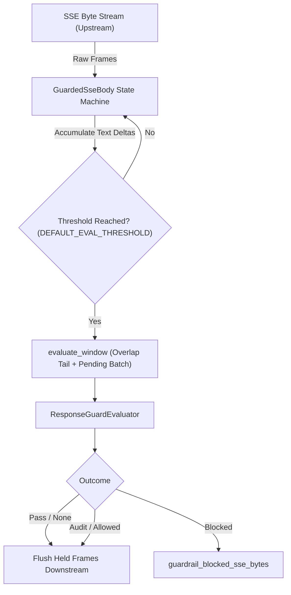
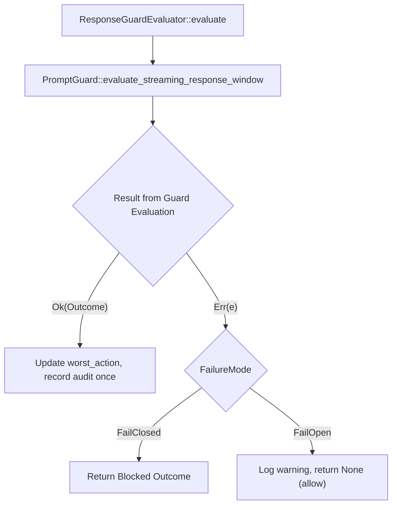
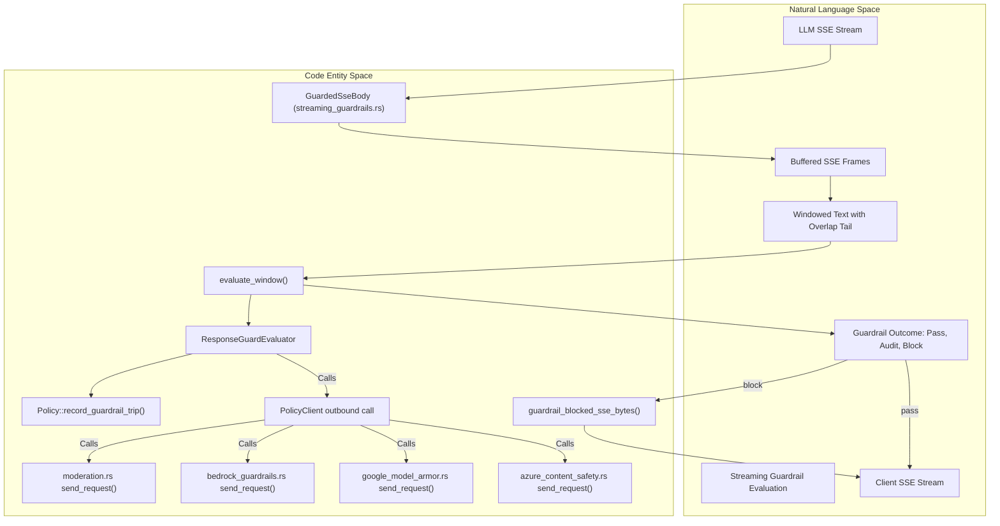

<!-- source: DeepWiki mcp.deepwiki.com · repo agentgateway/agentgateway · extra page Streaming Guardrails · fetched 2026-10-21 -->

# Streaming Guardrails

<details>
<summary>Relevant source files</summary>

The following files were used as context for generating this wiki page:

- [crates/agentgateway/src/llm/policy/azure_content_safety.rs](crates/agentgateway/src/llm/policy/azure_content_safety.rs)
- [crates/agentgateway/src/llm/policy/bedrock_guardrails.rs](crates/agentgateway/src/llm/policy/bedrock_guardrails.rs)
- [crates/agentgateway/src/llm/policy/google_model_armor.rs](crates/agentgateway/src/llm/policy/google_model_armor.rs)
- [crates/agentgateway/src/llm/policy/mod.rs](crates/agentgateway/src/llm/policy/mod.rs)
- [crates/agentgateway/src/llm/policy/moderation.rs](crates/agentgateway/src/llm/policy/moderation.rs)
- [crates/agentgateway/src/llm/policy/streaming_guardrails.rs](crates/agentgateway/src/llm/policy/streaming_guardrails.rs)
- [crates/agentgateway/src/llm/policy/tests.rs](crates/agentgateway/src/llm/policy/tests.rs)
- [crates/agentgateway/src/llm/policy/webhook.rs](crates/agentgateway/src/llm/policy/webhook.rs)

</details>


This page documents the technical implementation of streaming guardrail evaluation in agentgateway, covering windowed buffering strategies, SSE stream interception, deduplication of metrics, and third-party moderation integrations located primarily in `crates/agentgateway/src/llm/policy/streaming_guardrails.rs` and `crates/agentgateway/src/llm/policy/moderation.rs`.

---

## 1. Purpose and Scope

When serving Large Language Models (LLMs) via Server-Sent Events (SSE) streaming, responses are generated incrementally token-by-token. Applying guardrails—such as PII detection, profanity filtering, regex-based rules, or remote webhook evaluations—to streaming responses requires balancing security with time-to-first-byte (TTFB) latency and accuracy.

Agentgateway addresses this challenge via **windowed guardrail evaluation**, implemented in `crates/agentgateway/src/llm/policy/streaming_guardrails.rs` [crates/agentgateway/src/llm/policy/streaming_guardrails.rs:1-19](). Incoming SSE byte frames are buffered into a window until a text length threshold is reached, evaluated against a set of streaming evaluators with an overlap tail to prevent pattern splits, and then either flushed downstream or intercepted with a synthetic SSE error event signaling guardrail enforcement.

---

## 2. Windowed Streaming Evaluation Architecture

The streaming guardrail architecture uses a buffering state machine that intercepts SSE payloads before forwarding to the client. Since guardrails need contiguous text for pattern matching and NLP models, raw SSE chunks are accumulated until a certain byte threshold triggers evaluation.

### Evaluation Lifecycle and Data Flow


*Figure 1: Streaming guardrail evaluation lifecycle and SSE buffering.*

The flow is:

- Incoming SSE frames are intercepted by `GuardedSseBody`.
- Text content from these frames is buffered until a threshold (typically 1024 bytes) is reached.
- A window is constructed consisting of the last overlap tail from previously evaluated text (default 256 bytes) plus the new buffered data.
- This window is passed to all registered streaming evaluators.
- If all evaluators pass (or only audit), buffered frames are flushed downstream to the client.
- If any evaluator blocks, the buffered frames are discarded, and a synthetic SSE error event is sent downstream to terminate the stream.

This design balances latency and secure filtering but allows some possibility of missing pattern matches longer than the overlap window or spanning flushed/batched boundaries.

---

## 3. Key Components and Implementation Details

### 3.1 Windowing Parameters and Tail Extraction

Two key constants in `streaming_guardrails.rs` control buffering behavior:

| Constant               | Description                                                                                     | Value  |
|------------------------|------------------------------------------------------------------------------------------------|--------|
| `DEFAULT_EVAL_THRESHOLD` | Number of text bytes accumulated before triggering guardrail evaluation. Larger values reduce the number of guardrail API calls but increase TTFB and potential discarded content if blocked mid-stream. | 1024   |
| `OVERLAP_BYTES`        | Number of bytes from the tail of previously evaluated text prepended to each new window. Prevents pattern boundaries being missed by spanning batches. | 256    |

A helper function ensures the last `max_bytes` of UTF-8 is extracted safely, avoiding splitting multibyte characters:

```rust
/// Return the last `max_bytes` of `s`, respecting UTF-8 char boundaries.
pub fn tail_chars(s: &str, max_bytes: usize) -> &str {
    if s.len() <= max_bytes {
        return s;
    }
    let mut start = s.len() - max_bytes;
    while !s.is_char_boundary(start) {
        start += 1;
    }
    &s[start..]
}
```

This is critical for maintaining well-formed UTF-8 input to guardrail evaluators [crates/agentgateway/src/llm/policy/streaming_guardrails.rs:51-60]().

### 3.2 `StreamingEvaluator` Trait and `ResponseGuardEvaluator`

Guardrails implement the `StreamingEvaluator` trait — an async interface that receives text windows and returns whether the content should be blocked or allowed.

The concrete `ResponseGuardEvaluator` struct implements `StreamingEvaluator` for response guards and maintains:

- The `ResponseGuard` configuration.
- HTTP headers of the current request.
- An optional original request snapshot.
- A `GuardrailLog` for recording audit/metrics.
- Tracking fields to deduplicate metrics per stream and track worst action seen (Allow < Audit < Reject).
- Honor for guardrail configured `FailureMode` (FailOpen or FailClosed).

Key parts of the evaluator lifecycle:



- It calls prompt guards to evaluate the incoming window text.
- On success updates worst action state, and records audit metrics only once per stream.
- On error, depending on failure mode, it either rejects (FailClosed) or logs a warning and allows the content (FailOpen).
- On drop, it records the final guardrail outcome as metrics.

The evaluator implementation ensures single metric emission per stream for audit/fail open, preventing metric explosion due to many small windows [crates/agentgateway/src/llm/policy/streaming_guardrails.rs:113-191]().

### 3.3 `GuardedSseBody` — SSE Stream Buffering and Interception

While not fully shown in the snippet, `GuardedSseBody` is a key struct implementing the actual streaming interception of SSE byte frames.

Its core responsibilities include:

- Receiving SSE frames streaming from the upstream LLM backend.
- Buffering incoming token text until the evaluation threshold is met.
- Managing an overlap tail window from previous evaluations.
- Invoking `evaluate_window()` to check guardrails on the current text window.
- Flushing buffered frames if allowed or discarding them and emitting synthetic SSE error frames if blocked.

The buffering ensures that patterns spanning across incoming SSE frame boundaries are still evaluated correctly by providing a sliding overlapping window.

---

## 4. Synthetic SSE Error Injection on Block

When a streaming guardrail blocks content, it cannot retract what was already flushed downstream (since SSE streams are unidirectional). The implementation discards only buffered frames yet to be sent and sends a synthetic SSE error event as a replacement:

```rust
fn guardrail_blocked_sse_bytes(body: Bytes) -> Bytes {
    let message = String::from_utf8_lossy(&body);
    let event = serde_json::json!({
        "error": {
            "type": "guardrail_blocked",
            "code": "guardrail_intervention",
            "message": message,
        }
    });
    Bytes::from(format!("data: {event}\n\n"))
}
```

This event is an SSE `data:` message compliant with common streaming LLM protocols signalling termination due to a guardrail intervention [crates/agentgateway/src/llm/policy/streaming_guardrails.rs:200-207]().

---

## 5. Integration with Moderation and Third-Party Guardrails

Agentgateway supports various guardrail implementations which can be used synchronously or asynchronously as streaming evaluators:

- OpenAI Moderation integration is implemented in `crates/agentgateway/src/llm/policy/moderation.rs`.
- AWS Bedrock Guardrails support in `bedrock_guardrails.rs` [crates/agentgateway/src/llm/policy/bedrock_guardrails.rs]().
- Google Model Armor [crates/agentgateway/src/llm/policy/google_model_armor.rs]() and Azure Content Safety [crates/agentgateway/src/llm/policy/azure_content_safety.rs]() integrations with specialized API request/response handling.

### Example: OpenAI Moderation API Integration

The async function `send_request()` in `moderation.rs` sends a moderation check request:

```rust
pub async fn send_request(
    req: &mut dyn RequestType,
    claims: Option<Claims>,
    client: &PolicyClient,
    moderation: &Moderation,
) -> anyhow::Result<async_openai::types::moderations::CreateModerationResponse>
```

- Extracts user prompt text.
- Builds an HTTP POST moderation request to the OpenAI moderation endpoint.
- Adds TLS and authorization backend policies.
- Sends the request asynchronously through the gateway outbound transport.
- Parses the moderation response JSON.

This modular API abstraction allows transparent extension to other policies and guardrail mechanisms, seamlessly integrated with streaming evaluations [crates/agentgateway/src/llm/policy/moderation.rs:12-56]().

---

## 6. Summary Diagram: Natural Language to Guardrail Code Flow



*Figure 2: Mapping of the streaming guardrail natural language data flow to key code entities.*

---

## 7. References and Related Modules

- `crates/agentgateway/src/llm/policy/streaming_guardrails.rs` [crates/agentgateway/src/llm/policy/streaming_guardrails.rs]() — Core streaming guardrail buffering, window evaluation, and SSE interception.
- `crates/agentgateway/src/llm/policy/moderation.rs` [crates/agentgateway/src/llm/policy/moderation.rs]() — OpenAI moderation API integration.
- `crates/agentgateway/src/llm/policy/mod.rs` [crates/agentgateway/src/llm/policy/mod.rs]() — Policy core abstractions, helper traits, and enums.
- `crates/agentgateway/src/llm/policy/webhook.rs` [crates/agentgateway/src/llm/policy/webhook.rs]() — Guardrail webhook request/response structs and evaluation helpers.
- `crates/agentgateway/src/llm/policy/bedrock_guardrails.rs` [crates/agentgateway/src/llm/policy/bedrock_guardrails.rs]() — AWS Bedrock Guardrails integration.
- `crates/agentgateway/src/llm/policy/google_model_armor.rs` [crates/agentgateway/src/llm/policy/google_model_armor.rs]() — Google Model Armor integration.
- `crates/agentgateway/src/llm/policy/azure_content_safety.rs` [crates/agentgateway/src/llm/policy/azure_content_safety.rs]() — Azure Content Safety integration.

---

# Appendix: Key Function and Struct Summaries

| Code Entity                        | Description                                                  | Location                                      |
|----------------------------------|--------------------------------------------------------------|-----------------------------------------------|
| `GuardedSseBody`                 | SSE stream interceptor that buffers token frames and manages windowed evaluation. | `streaming_guardrails.rs`             |
| `evaluate_window`                | Runs all `StreamingEvaluator`s on the provided text window and returns block outcome if any. | `streaming_guardrails.rs:63-86`                |
| `make_evaluator`                 | Factory building a `StreamingEvaluator` from a `ResponseGuard`. | `streaming_guardrails.rs:92-111`               |
| `ResponseGuardEvaluator`         | `StreamingEvaluator` implementation capturing state, dedup metrics, and guard eval logic. | `streaming_guardrails.rs:113-191`              |
| `guardrail_blocked_sse_bytes`   | Constructs a synthetic SSE error frame for blocked streaming content. | `streaming_guardrails.rs:200-207`              |
| `send_request` (OpenAI moderation) | Sends content moderation request, handles response and errors. | `moderation.rs:12-56`                          |
| `send_analyze_text_for_response` (Azure) | Sends content for analysis to Azure Content Safety. | `azure_content_safety.rs:152-161` |
| `send_sanitize_model_response` (Google) | Sends model response for sanitization to Google Model Armor. | `google_model_armor.rs:221-230` |
| `bedrock_audit_outcome` (Bedrock) | Processes Bedrock Guardrails response to determine audit outcome. | `policy/mod.rs:2600-2610` |

---
Sources:  
- `crates/agentgateway/src/llm/policy/streaming_guardrails.rs`  
- `crates/agentgateway/src/llm/policy/moderation.rs`  
- `crates/agentgateway/src/llm/policy/mod.rs`  
- `crates/agentgateway/src/llm/policy/webhook.rs`
- `crates/agentgateway/src/llm/policy/bedrock_guardrails.rs`
- `crates/agentgateway/src/llm/policy/google_model_armor.rs`
- `crates/agentgateway/src/llm/policy/azure_content_safety.rs`

---

