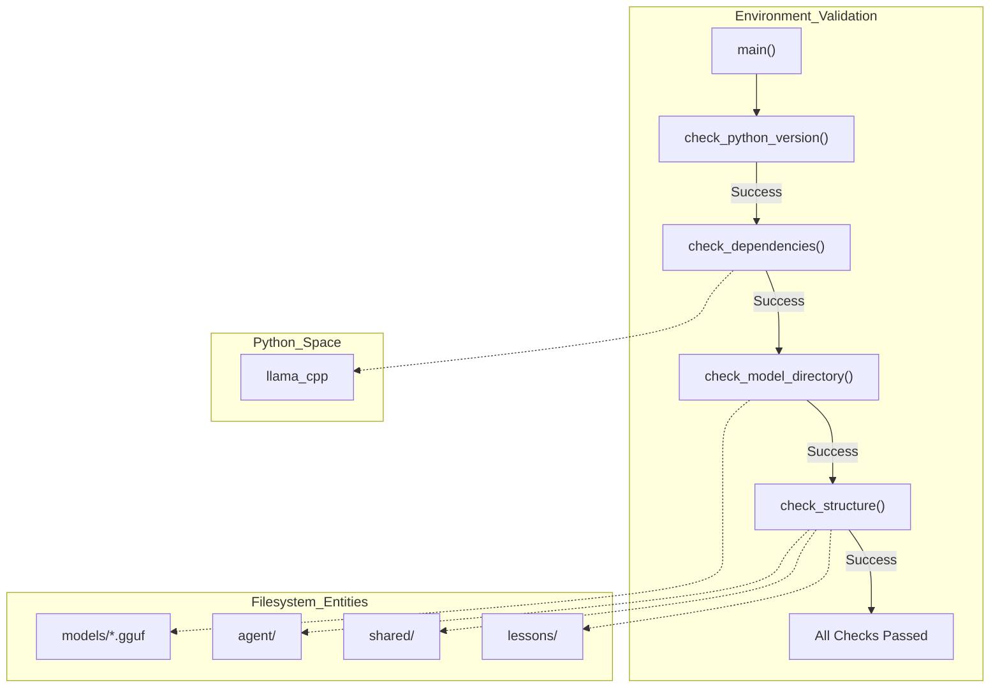
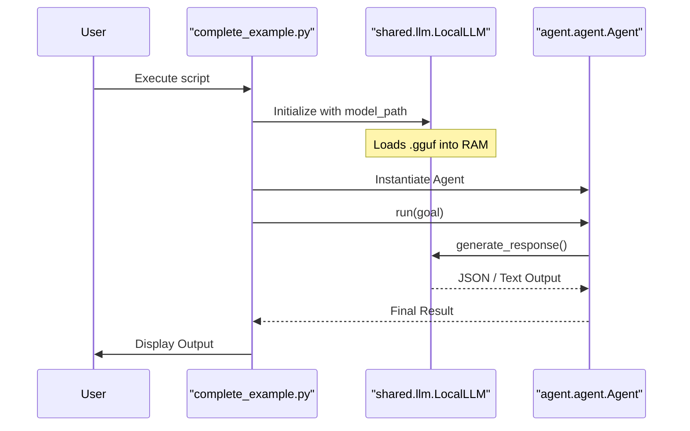

<!-- source: DeepWiki mcp.deepwiki.com · repo pguso/agents-from-scratch · page 1.1 Getting Started · fetched 2026-10-26 -->

# Getting Started

<details>
<summary>Relevant source files</summary>

The following files were used as context for generating this wiki page:

- [QUICKSTART.md](QUICKSTART.md)
- [requirements.txt](requirements.txt)
- [setup_check.py](setup_check.py)

</details>


This page provides a step-by-step guide to setting up the "AI Agents from Scratch" environment. The repository is designed to be local-first, meaning all inference happens on your hardware using `llama-cpp-python`. By the end of this guide, you will have a verified environment capable of running complex agentic workflows without external API dependencies.

## Prerequisites

Before beginning the installation, ensure your system meets the following hardware and software requirements:

*   **Python:** Version 3.10 or higher [setup_check.py:12-20]().
*   **RAM:** At least 8GB is recommended for running 7B or 8B parameter models [QUICKSTART.md:8]().
*   **Disk Space:** 5-10GB for storing GGUF model files [QUICKSTART.md:9]().

## Step 1: Environment Setup

It is recommended to use a virtual environment to manage dependencies. The primary dependency is `llama-cpp-python`, which provides the Python bindings for `llama.cpp` to run GGUF models.

```bash
# Create a virtual environment
python -m venv venv

# Activate the environment
# On Linux/macOS:
source venv/bin/activate  
# On Windows:
venv\Scripts\activate

# Install required packages
pip install -r requirements.txt
```

**Sources:** [QUICKSTART.md:11-23](), [requirements.txt:1]()

## Step 2: Model Acquisition

The agents in this repository require a model in the GGUF format. By default, the examples are configured to look for a Llama 3 8B Instruct model.

1.  Create a directory named `models/` in the repository root [QUICKSTART.md:31]().
2.  Download a compatible GGUF file (e.g., `Meta-Llama-3-8B-Instruct-Q4_K_M.gguf`) from Hugging Face [QUICKSTART.md:29-30]().
3.  Place the file in the `models/` directory. You may rename it to `llama-3-8b-instruct.gguf` for compatibility with the default paths in the scripts [QUICKSTART.md:32]().

**Quantization Selection:**
| Quantization | RAM Required | Recommendation |
| :--- | :--- | :--- |
| Q4_K_M | ~5GB | Balanced (Recommended) |
| Q5_K_M | ~6GB | Higher Quality |
| Q8_0 | ~8GB | Best Quality |

**Sources:** [QUICKSTART.md:25-37](), [QUICKSTART.md:86-90]()

## Step 3: Verification with setup_check.py

The `setup_check.py` script automates the verification of your environment. It performs four critical checks to ensure the repository is ready for execution.

### Environment Verification Logic
The script executes the following functions sequentially:
1.  `check_python_version()`: Validates `sys.version_info` is >= 3.10 [setup_check.py:12-20]().
2.  `check_dependencies()`: Attempts to import `llama_cpp` [setup_check.py:23-32]().
3.  `check_model_directory()`: Verifies the `models/` folder exists and scans for `.gguf` files [setup_check.py:35-53]().
4.  `check_structure()`: Ensures the core packages (`shared/`, `agent/`, `lessons/`) are present [setup_check.py:56-68]().

### Setup Flow Diagram
The following diagram illustrates the verification flow within `setup_check.py`.

**System Setup Flow**

**Sources:** [setup_check.py:71-102](), [QUICKSTART.md:38-49]()

## Step 4: Running the First Example

Once `setup_check.py` returns a success message, you can run `complete_example.py`. This script serves as the primary entry point for demonstrating the progression from basic LLM calls to complex autonomous agents.

```bash
python complete_example.py
```

### Data Flow in complete_example.py
When you run the example, the system initializes the `LocalLLM` wrapper, which loads the model into memory. The execution flows through various lessons, building the `AgentState` and utilizing the `Agent` class to perform tasks.

**Execution Initialization**


**Sources:** [QUICKSTART.md:50-56](), [setup_check.py:96]()

## Troubleshooting

If you encounter issues during setup, refer to the following common resolutions:

*   **ModuleNotFoundError:** Ensure you have activated your virtual environment and run `pip install llama-cpp-python` [QUICKSTART.md:71-75]().
*   **Model file not found:** Verify the filename in `complete_example.py` matches the actual file in your `models/` directory [QUICKSTART.md:77-82]().
*   **Slow Inference:** CPU-based inference is significantly slower than GPU. Expect 10-30 seconds per response depending on your hardware [QUICKSTART.md:91-96]().

**Sources:** [QUICKSTART.md:69-97]()

---

