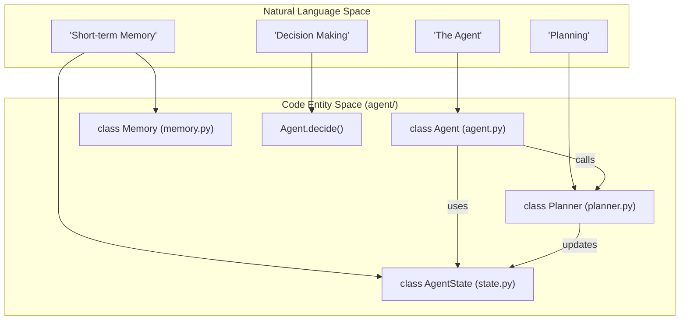
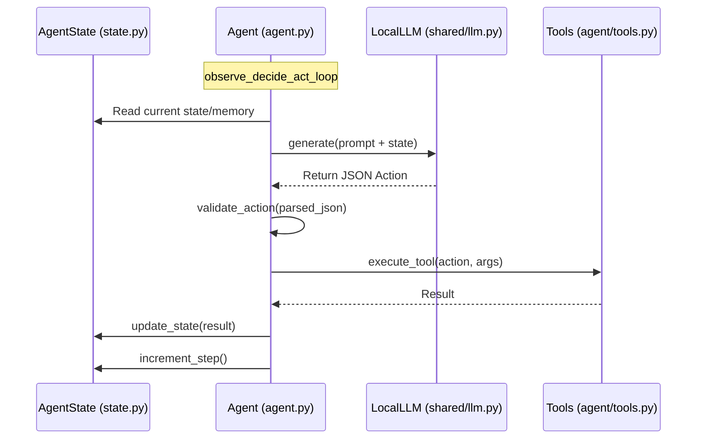

<!-- source: DeepWiki mcp.deepwiki.com · repo pguso/agents-from-scratch · page 1.2 Design Philosophy · fetched 2026-10-26 -->

# Design Philosophy

Relevant source files

The following files were used as context for generating this wiki page:

- [CONTRIBUTING.md](CONTRIBUTING.md)
- [PHILOSOPHY.md](PHILOSOPHY.md)
- [README.md](README.md)

This page outlines the core technical beliefs and architectural constraints that govern the `agents-from-scratch` repository. The project rejects "magical" abstractions in favor of mechanical understanding, treating agents not as digital personalities, but as deterministic loops managing explicit state and structured data [README.md:28-30]().

## Core Beliefs

The implementation is guided by four primary pillars designed to move agent development from probabilistic guesswork to engineering discipline.

| Pillar | Description | Implementation Detail |
| :--- | :--- | :--- |
| **Explicit State** | State is never hidden in opaque context windows; it is a visible Python object [PHILOSOPHY.md:53-62](). | `AgentState` class in `agent/state.py` |
| **Structured Outputs** | Reliability is enforced through JSON contracts rather than "clever" prompting [PHILOSOPHY.md:64-73](). | `extract_json_from_text` in `shared/utils.py` |
| **Validated Decisions** | LLM outputs are treated as untrusted proposals that must pass validation and retry logic [PHILOSOPHY.md:75-85](). | Retry loops in `Agent.decide` and `Agent.create_plan` |
| **Data-Driven Planning** | Plans are discrete data structures (lists or DAGs), not free-form "thoughts" [PHILOSOPHY.md:87-99](). | `Planner` logic in `agent/planner.py` |

**Sources:** [README.md:135-142](), [PHILOSOPHY.md:51-101]()

---

## From Natural Language to Code Entities

The following diagram bridges the gap between high-level "Agent" concepts and the specific Python classes and files that implement them.

### Mapping Concepts to Implementation

**Sources:** [README.md:89-96](), [agent/agent.py:1-20](), [agent/state.py:1-10]()

---

## Technical Constraints

### 1. Explicit State over Hidden Context
In many frameworks, the "state" of an agent is buried within a growing list of chat messages. This codebase externalizes state into the `AgentState` class [agent/state.py:4-15](). This allows the system to track specific variables—like `steps`, `done` status, and the `current_plan`—independently of the LLM's conversation history [PHILOSOPHY.md:55-60]().

### 2. Structured Contracts (JSON)
To ensure the system can act on LLM outputs, every significant decision is forced into a JSON schema. The `shared/utils.py` helper `extract_json_from_text` is used to strip away conversational filler and isolate the machine-readable instruction [shared/utils.py:15-35](). If the LLM fails to provide valid JSON, the agent triggers a retry loop rather than attempting to "guess" the intent [PHILOSOPHY.md:77-85]().

### 3. Local-First Execution
The project exclusively uses `llama-cpp-python` to interface with GGUF models stored in the `models/` directory [README.md:71-73](). This constraint ensures:
*   **Zero Latency Variance:** No network-induced delays.
*   **Privacy:** Data never leaves the local machine.
*   **Cost:** Unlimited experimentation without API tokens.
*   **Reproducibility:** The exact model version is controlled by the developer.

### 4. No External Frameworks
The repository avoids LangChain, CrewAI, or AutoGen. By building the `Agent` loop [agent/agent.py:150-180]() and the `LocalLLM` wrapper [shared/llm.py:8-25]() from scratch, the "magic" of agentic behavior is revealed to be a series of standard software engineering patterns: loops, conditionals, and error handling [PHILOSOPHY.md:11-20]().

---

## The Observe-Decide-Act Loop

The architecture follows a strict cycle. The LLM is never allowed to execute code directly; it only proposes "Actions" which the Python runtime validates and executes.

### Agent Loop Logic Flow

**Sources:** [README.md:43-44](), [agent/agent.py:150-185](), [PHILOSOPHY.md:105-113]()

---

## Why No ReAct?
While ReAct (Reasoning + Acting) is a popular research pattern, this codebase deliberately avoids it in favor of **Planning as Data** [PHILOSOPHY.md:147-155]().
1.  **Transparency:** ReAct "thoughts" are often discarded or unparseable. Discrete plans in `AgentState.current_plan` are persistent and inspectable [agent/state.py:12-14]().
2.  **Separation of Concerns:** Planning happens in `agent/planner.py`, while execution happens in `agent/agent.py`. This prevents the LLM from getting "lost" in a long chain of thought during execution [PHILOSOPHY.md:153-154]().

**Sources:** [README.md:102-126](), [PHILOSOPHY.md:1-204](), [shared/utils.py:1-40](), [agent/state.py:1-20]()

---

