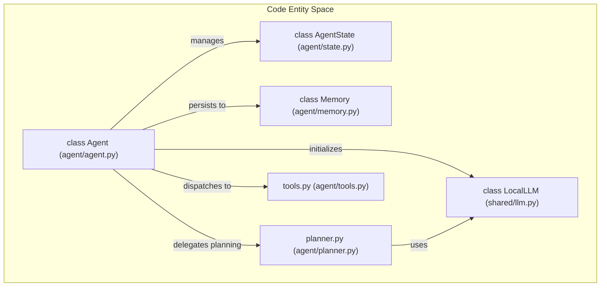
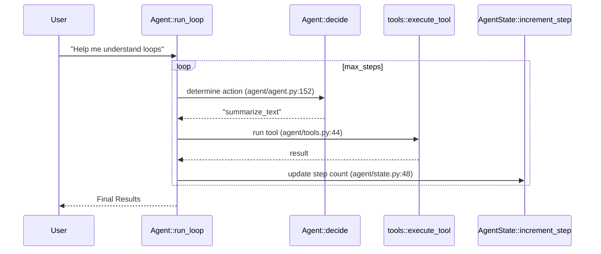

<!-- source: DeepWiki mcp.deepwiki.com · repo pguso/agents-from-scratch · page 2 Core Architecture · fetched 2026-10-26 -->

# Core Architecture

Relevant source files

The following files were used as context for generating this wiki page:

- [agent/agent.py](agent/agent.py)
- [complete_example.py](complete_example.py)
- [diagrams/agent-architecture.png](diagrams/agent-architecture.png)
- [diagrams/lesson-10-atom-of-thoght.png](diagrams/lesson-10-atom-of-thoght.png)

The `Agents from Scratch` codebase is designed to demonstrate how an AI agent is constructed from the ground up without relying on high-level frameworks. The architecture follows a modular design where the `Agent` class acts as the central orchestrator, integrating language model interactions, state management, and planning capabilities.

## The Agent Orchestrator

The `Agent` class is the heart of the repository [agent/agent.py:30-37](). It is designed to grow through a series of 12 lessons, starting from a simple wrapper around a Large Language Model (LLM) and evolving into a complex system capable of autonomous planning and tool execution.

### High-Level Component Interaction
The diagram below illustrates how the `Agent` class interfaces with the core subsystems to perform tasks.

**System Entity Relationship**

Sources: [agent/agent.py:38-60](), [agent/agent.py:22-27]()

For a deep dive into the implementation of these methods and the retry patterns used, see [The Agent Class](#2.1).

## The Observe-Decide-Act Loop

The agent operates on a fundamental execution cycle introduced in Lesson 06 [agent/agent.py:13-14](). This loop allows the agent to process information, determine the next best step, and execute actions until a goal is met or a limit is reached.

1.  **Observe**: The agent receives user input and retrieves relevant context from its `Memory` [agent/agent.py:330-335]().
2.  **Decide**: Using the `decide` method, the model selects an action from a list of available choices [agent/agent.py:152-164]().
3.  **Act**: The agent executes the chosen action, which might involve calling a tool via `execute_tool_call` [agent/agent.py:239-245]() or updating its internal state.

### Loop Execution Flow
This diagram maps the logical loop to specific function calls within the codebase.

**Logic to Code Mapping**

Sources: [agent/agent.py:270-305](), [complete_example.py:86-108]()

## State and Memory Management

To maintain consistency across multiple turns or complex plans, the architecture relies on two distinct systems:
*   **AgentState**: Tracks the immediate status of a single execution run, including the current step, the active plan, and whether the task is finished [agent/state.py:7-16]().
*   **Memory**: A persistent store used to "save" facts that should survive across different sessions [agent/memory.py:6-12]().

For details on how these are serialized into prompts, see [State Management](#2.2).

## Planning and Utilities

The agent's intelligence is augmented by a dedicated planning engine and a set of shared utilities:
*   **Planning Engine**: Located in `agent/planner.py`, it handles the creation of sequential plans and complex "Atom of Thought" (AoT) dependency graphs [agent/agent.py:27]().
*   **Shared Utilities**: The `shared/` package provides the `LocalLLM` wrapper for `llama-cpp-python` and critical JSON parsing helpers that ensure the agent's output remains machine-readable [shared/utils.py:11-15]().

For more information on the LLM wrapper and prompt builders, see [Shared Utilities](#2.3).

## Lesson-Based Progression

The architecture is not static; it is designed to be understood chronologically.

| Lesson | Focus | Key Code Entity |
| :--- | :--- | :--- |
| 01-03 | Fundamentals | `Agent.simple_generate`, `Agent.generate_structured` |
| 04-05 | Action | `Agent.decide`, `Agent.request_tool` |
| 06-07 | Persistence | `Agent.run_loop`, `Memory` |
| 08-10 | Reasoning | `create_plan`, `create_aot_graph` |

Sources: [agent/agent.py:7-17](), [complete_example.py:13-193]()

---

