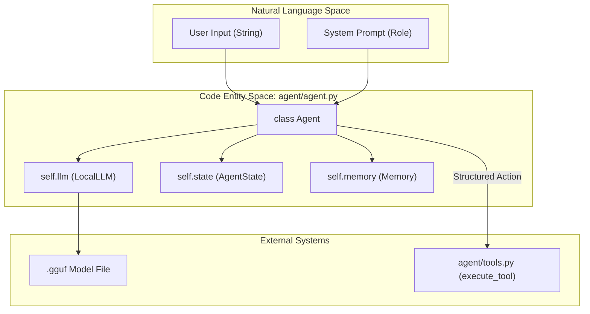
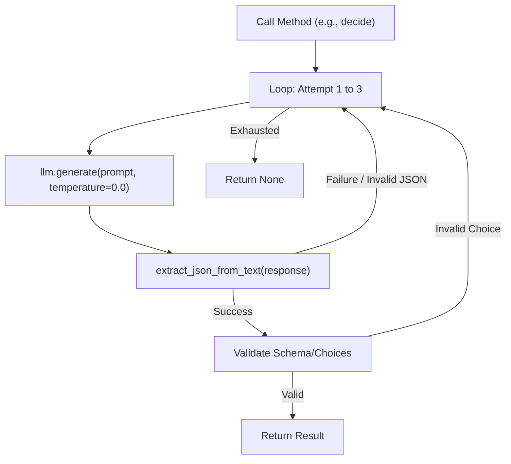

<!-- source: DeepWiki mcp.deepwiki.com · repo pguso/agents-from-scratch · page 2.1 The Agent Class · fetched 2026-10-26 -->

# The Agent Class

Relevant source files

The following files were used as context for generating this wiki page:

- [agent/agent.py](agent/agent.py)
- [complete_example.py](complete_example.py)

The `Agent` class, defined in `agent/agent.py`, is the central orchestrator of the repository. It serves as a unified interface that evolves across 12 lessons, progressively integrating subsystems for state management, memory, tool execution, and hierarchical planning. Unlike framework-driven agents, this class explicitly manages the transition from natural language inputs to structured, validated code execution.

### Architecture Overview

The `Agent` is designed as a stateful wrapper around a `LocalLLM` instance. It maintains an internal `AgentState` to track the lifecycle of a single task and a `Memory` system to persist information across multiple interactions.

#### System Wiring Diagram
This diagram illustrates how the `Agent` class connects natural language processing to internal code entities.

**Sources:** [agent/agent.py:30-60](), [agent/agent.py:22-27]()

---

### Constructor and Initialization

The constructor initializes the core components required for basic interaction and prepares the stateful containers used in later lessons.

| Component | Code Entity | Purpose |
| :--- | :--- | :--- |
| **LLM Engine** | `self.llm` | Wrapper for `llama-cpp-python` to run GGUF models [agent/agent.py:46](). |
| **Persona** | `self.system_prompt` | Defines the "calm, precise" behavior of the assistant [agent/agent.py:49-53](). |
| **Lifecycle** | `self.state` | Tracks steps, status, and current plans [agent/agent.py:56](). |
| **Persistence** | `self.memory` | Stores facts across different `run()` calls [agent/agent.py:59](). |

**Sources:** [agent/agent.py:38-60]()

---

### Method Progression by Lesson

The `Agent` class implements methods that correspond to specific educational milestones. Each method builds upon the previous ones, moving from raw text to complex graph execution.

#### 1. Fundamental Interaction (Lessons 01–03)
*   **`simple_generate(user_input)`**: The most basic entry point, passing raw strings to the LLM [agent/agent.py:65-77]().
*   **`generate_with_role(user_input)`**: Wraps input in a template including `self.system_prompt` and cleans up model-generated artifacts like `<SYSTEM>` tags [agent/agent.py:83-105]().
*   **`generate_structured(user_input, schema)`**: Forces the model into an **Output Contract**. It uses a specialized prompt demanding "ONLY valid JSON" and implements a retry loop [agent/agent.py:111-146]().

#### 2. Decisions and Tools (Lessons 04–05)
*   **`decide(user_input, choices)`**: Constrains the model to a finite list of strings. It validates that the returned JSON `decision` key exists within the provided `choices` list [agent/agent.py:152-195]().
*   **`request_tool(user_input)`**: Prompts the model to output a JSON object containing a `tool` name and `arguments` [agent/agent.py:201-230]().
*   **`execute_tool_call(tool_call)`**: A pass-through to the `execute_tool` utility, shielding the agent from tool implementation details [agent/agent.py:243-254]().

#### 3. The Agent Loop (Lesson 06)
*   **`run_loop(user_input, max_steps)`**: The primary entry point for autonomous behavior. It initializes `self.state`, then enters a loop calling `agent_step()` until the model decides it is `done` or hits `max_steps` [agent/agent.py:269-311]().

#### 4. Memory and Persistence (Lesson 07)
*   **`run_with_memory(user_input)`**: Extends the structured output pattern to include a `save_to_memory` field. If present in the LLM response, the agent calls `self.memory.save()` to persist the data [agent/agent.py:365-410]().

#### 5. Planning and Graph Execution (Lessons 08–10)
The agent delegates complex logic to the `planner.py` module while maintaining the execution state.
*   **`create_plan(goal)`**: Generates a sequential list of steps [agent/agent.py:423-435]().
*   **`execute_plan(plan)`**: Iterates through steps, converting each into an atomic action [agent/agent.py:437-458]().
*   **`create_aot_plan(goal)`**: Generates an **Atom of Thought** dependency graph [agent/agent.py:510-522]().
*   **`execute_aot_plan(graph)`**: Uses `execute_graph` to process nodes in topological order [agent/agent.py:524-541]().

**Sources:** [agent/agent.py:65-541]()

---

### The Retry Pattern

A critical robust-engineering pattern used in `generate_structured`, `decide`, and `request_tool` is the **Validation Retry Loop**. Because LLMs are probabilistic, the agent does not assume the first response is valid.

**Key Implementation Details:**
*   **Temperature 0.0**: Used in structured methods to ensure maximum determinism [agent/agent.py:140]().
*   **JSON Extraction**: Uses `extract_json_from_text` to find JSON blocks even if the model includes preamble text [agent/agent.py:141]().
*   **Validation**: The agent checks if the parsed JSON matches the expected keys (e.g., `if decision in choices`) [agent/agent.py:192]().

**Sources:** [agent/agent.py:138-146](), [agent/agent.py:186-195]()

---

### Data Flow: The `run()` Entrypoint

The `run()` method (introduced in Lesson 06) represents the "Observe-Decide-Act" cycle. It demonstrates how `AgentState` and `LocalLLM` are wired together.

1.  **State Reset**: `self.state.reset(user_input)` clears previous task data [agent/agent.py:283]().
2.  **Loop**: The agent executes up to `max_steps` [agent/agent.py:288]().
3.  **Prompt Assembly**: The agent builds a prompt containing the current `state.history` and `state.step_count` [agent/agent.py:328-335]().
4.  **Decision**: The LLM returns a JSON object with an `action` and `reason` [agent/agent.py:340]().
5.  **State Update**: The action is logged to `self.state.add_history()`, and the step counter increments [agent/agent.py:348]().
6.  **Termination**: If the action is `"done"`, the loop breaks [agent/agent.py:302]().

**Sources:** [agent/agent.py:280-311](), [agent/agent.py:313-358]()

---

