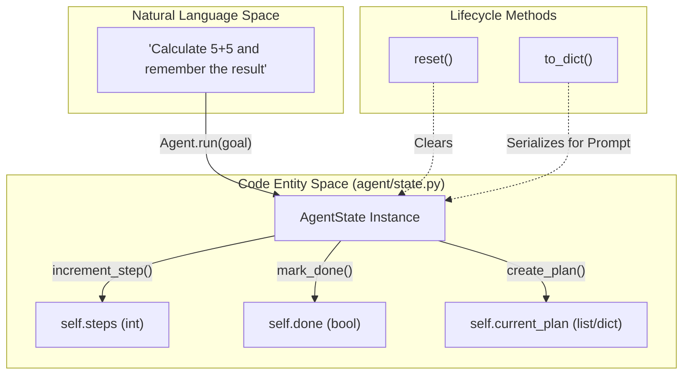
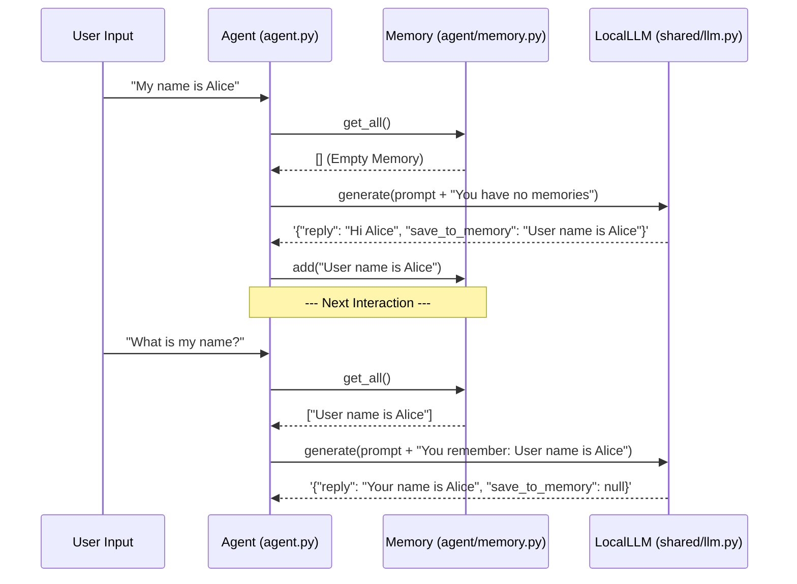

<!-- source: DeepWiki mcp.deepwiki.com · repo pguso/agents-from-scratch · page 2.2 State Management · fetched 2026-10-26 -->

# State Management

Relevant source files

The following files were used as context for generating this wiki page:

- [agent/memory.py](agent/memory.py)
- [agent/state.py](agent/state.py)
- [lessons/07_memory.md](lessons/07_memory.md)

State Management in the `agents-from-scratch` repository is built on the principle of **explicit visibility**. Unlike frameworks that hide agent history or internal variables within complex objects, this codebase treats state and memory as plain, inspectable data structures. This ensures that the developer—and the LLM—can always verify the current context of an operation.

The system is divided into two primary components:
1.  **`AgentState`**: Manages the lifecycle and execution progress of a single task or "run."
2.  **`Memory`**: Manages long-term persistence of facts across multiple separate interactions.

## AgentState Class

The `AgentState` class, defined in `agent/state.py`, serves as the "scratchpad" for the agent's current execution loop. It tracks how many steps have been taken, whether the goal has been reached, and what the current plan looks like.

### Fields and Lifecycle
The state is designed to grow in complexity as the user progresses through the lessons:
- **`steps`**: An integer counter tracking the number of iterations in the current `observe-decide-act` loop [agent/state.py:23]().
- **`done`**: A boolean flag used to terminate the execution loop when the agent determines its task is complete [agent/state.py:24]().
- **`current_plan`**: Stores the sequence of steps generated during planning phases (introduced in Lesson 08) [agent/state.py:25]().
- **`last_action`**: Records the most recent operation performed, providing context for the next decision [agent/state.py:26]().

### Key Methods
| Method | Description |
| :--- | :--- |
| `increment_step()` | Increases the `steps` counter by 1. Called after every action or LLM interaction [agent/state.py:28-30](). |
| `mark_done()` | Sets `done` to `True`, signaling the agent loop to stop [agent/state.py:32-34](). |
| `reset()` | Reverts all fields to their initial values (`steps=0`, `done=False`, etc.) to prepare for a new goal [agent/state.py:36-41](). |
| `to_dict()` | Serializes the state into a dictionary, which is frequently used to inject state information into LLM prompts [agent/state.py:43-55](). |

**Sources:** [agent/state.py:9-59](), [lessons/07_memory.md:139-145]()

---

## Memory Class

The `Memory` class, defined in `agent/memory.py`, handles **Persistence**. While `AgentState` resets between tasks, `Memory` is intended to survive across different `run()` calls, allowing the agent to remember user preferences or facts (e.g., "The user's name is Alice") [lessons/07_memory.md:25-29]().

### Data Flow: Memory to Prompt
The agent does not have direct "consciousness" of the memory; instead, memory must be explicitly retrieved and injected into the prompt context.

**LLM-Memory Interaction Logic:**
1.  **Retrieval**: The agent calls `self.memory.get_all()` [lessons/07_memory.md:60]().
2.  **Serialization**: The list of strings is formatted into a "You remember the following..." block [lessons/07_memory.md:63-66]().
3.  **Inference**: The LLM processes the prompt containing these memories.
4.  **Storage**: If the LLM includes a `save_to_memory` key in its JSON response, the agent calls `self.memory.add()` [lessons/07_memory.md:98-99]().

### Key Methods
- `add(item)`: Appends a new string to memory if it is not already present [agent/memory.py:22-30]().
- `get_all()`: Returns a copy of the entire memory list [agent/memory.py:32-39]().
- `search(query)`: Performs a simple case-insensitive substring search over stored items [agent/memory.py:53-64]().

**Sources:** [agent/memory.py:9-76](), [lessons/07_memory.md:19-35]()

---

## Technical Architecture Diagrams

### State Lifecycle and Code Entity Mapping
This diagram shows how the "Natural Language" goal is transformed into "Code Entities" and managed through the `AgentState` lifecycle.

**Diagram: State Entity Mapping**

**Sources:** [agent/state.py:9-55](), [lessons/07_memory.md:139-145]()

### Memory Persistence Flow
This diagram illustrates the "Memory Loop" where the `Agent` class mediates between the `LocalLLM` (Natural Language) and the `Memory` object (Structured Storage).

**Diagram: Memory Interaction Flow**

**Sources:** [lessons/07_memory.md:48-105](), [agent/memory.py:22-39]()

---

## Comparison: Context vs. Memory

A critical distinction in this architecture is the difference between temporary context and persistent memory.

| Feature | Context (Prompt) | Memory (`agent/memory.py`) |
| :--- | :--- | :--- |
| **Duration** | Lasts for one LLM call. | Persists across multiple interactions. |
| **Storage** | String in RAM (System Prompt + History). | List of strings in the `Memory` object. |
| **Visibility** | Directly visible to the LLM. | Only visible if the Agent explicitly loads it. |
| **Implementation** | `f-string` interpolation in `agent.py`. | `self.items` list in `Memory` class. |

**Sources:** [lessons/07_memory.md:19-35](), [agent/memory.py:9-16]()

---

