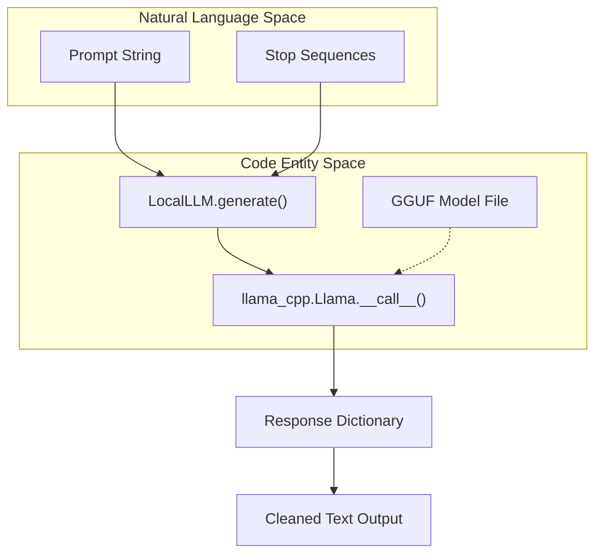
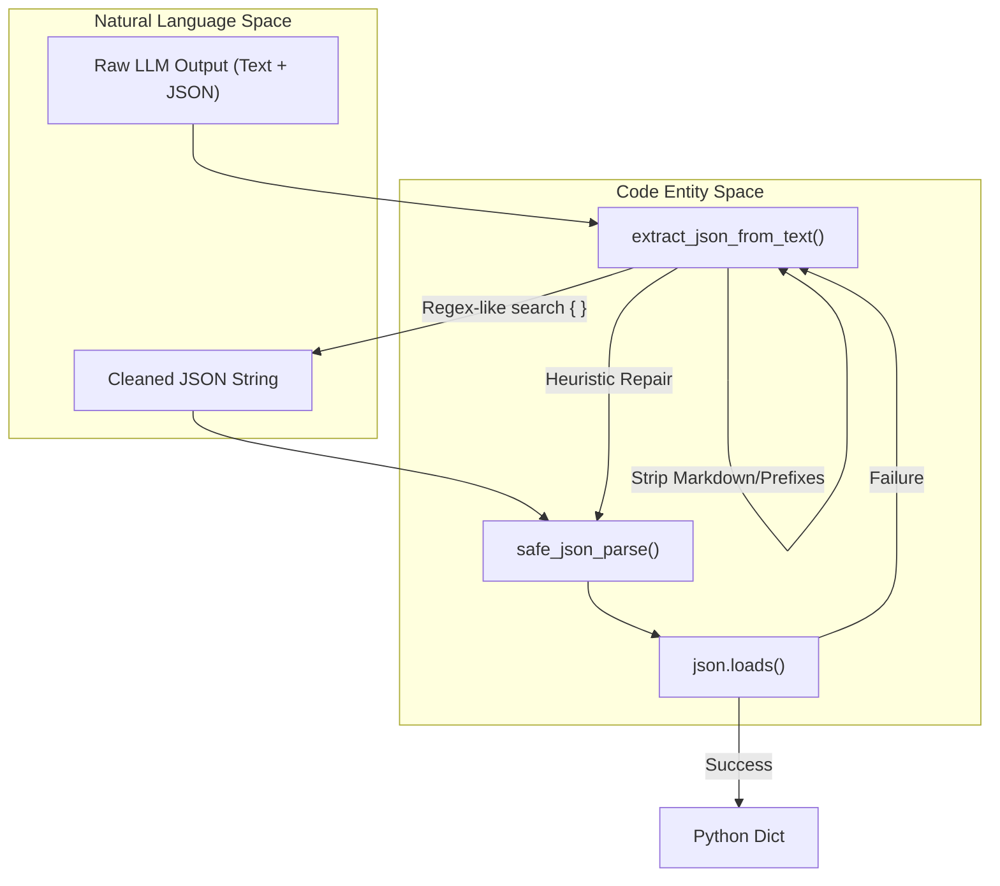

<!-- source: DeepWiki mcp.deepwiki.com · repo pguso/agents-from-scratch · page 2.3 Shared Utilities · fetched 2026-10-26 -->

# Shared Utilities

<details>
<summary>Relevant source files</summary>

The following files were used as context for generating this wiki page:

- [shared/README.md](shared/README.md)
- [shared/llama_logging.py](shared/llama_logging.py)
- [shared/llm.py](shared/llm.py)
- [shared/prompts.py](shared/prompts.py)
- [shared/utils.py](shared/utils.py)

</details>


The `shared/` package contains the foundational, "boring" helpers that support the entire agent architecture [shared/README.md:3-3](). These utilities are intentionally kept simple and free of complex logic to ensure that the core lesson code remains focused on agentic patterns rather than boilerplate string manipulation or library-specific configuration [shared/README.md:13-20]().

### LLM Interface (`llm.py`)

The `LocalLLM` class serves as a minimal wrapper around the `llama-cpp-python` library [shared/llm.py:18-23](). It provides a consistent interface for text generation while abstracting away the underlying GGUF model management.

#### Key Characteristics
- **No Hidden Logic**: It does not implement retries, tool calling, or memory internally; these are handled by the higher-level `Agent` class in later lessons [shared/llm.py:5-9]().
- **Deterministic Defaults**: Defaults to a low temperature (`0.2`) to favor predictable outputs suitable for structured JSON [shared/llm.py:28-28]().
- **Stop Sequences**: Automatically includes standard stop sequences like `</s>`, `User:`, and `Assistant:` to prevent the model from hallucinating both sides of a conversation [shared/llm.py:64-64]().

#### Implementation Details
The `__init__` method initializes the `Llama` instance with a specified context window (`n_ctx`) and disables internal `llama.cpp` logging via a global shim [shared/llm.py:41-46](). The `generate` method takes a raw string prompt and returns a stripped string response [shared/llm.py:49-71]().

**Data Flow: Text Generation**
"This diagram shows how the `LocalLLM` class bridges the gap between raw Python strings and the `llama_cpp.Llama` inference engine."


Sources: [shared/llm.py:41-71](), [shared/llm.py:18-23]()

---

### JSON and Text Helpers (`utils.py`)

Reliable JSON parsing is critical for the "Output Contract" pattern used throughout the repository. The `utils.py` file provides robust extraction logic to handle imperfect model outputs.

#### `safe_json_parse(text)`
A wrapper around `json.loads` that catches `JSONDecodeError` and `TypeError`, returning `None` instead of crashing [shared/utils.py:11-24]().

#### `extract_json_from_text(text)`
This is the primary helper for processing LLM responses. It attempts to find valid JSON even if the model includes conversational "noise" [shared/utils.py:27-38](). It follows a multi-stage recovery strategy:
1. **Markdown Stripping**: Removes ` ```json ` and ` ``` ` blocks [shared/utils.py:43-50]().
2. **Prefix Removal**: Strips common model prefixes like "JSON:" or "Response:" [shared/utils.py:53-56]().
3. **Brace/Bracket Extraction**: Searches for the first `{` and last `}` (or `[` and `]`) to isolate the JSON object from surrounding text [shared/utils.py:64-96]().
4. **Heuristic Repair**: Attempts to fix common issues like unclosed strings by checking quote counts and appending missing characters [shared/utils.py:75-86]().

**Entity Mapping: JSON Extraction**
"This diagram maps the logical steps of the `extract_json_from_text` function to the specific code entities that handle them."


Sources: [shared/utils.py:27-110](), [shared/utils.py:11-24]()

---

### Prompt Builders (`prompts.py`)

Prompts are treated as first-class citizens. Rather than using static files, the repository uses builder functions that evolve in complexity as the lessons progress [shared/prompts.py:1-11]().

| Function | Lesson | Purpose |
| :--- | :--- | :--- |
| `base_prompt` | 01 | Passes raw user input directly [shared/prompts.py:14-26](). |
| `system_prompt` | 02 | Wraps input in `<SYSTEM>` and `<USER>` tags [shared/prompts.py:29-48](). |
| `json_contract` | 03 | Appends a schema and demands "ONLY valid JSON" [shared/prompts.py:51-71](). |
| `decision_prompt` | 04 | Constrains output to a specific list of choices [shared/prompts.py:74-99](). |
| `tool_call_prompt` | 05 | Provides tool definitions and requests a `tool`/`arguments` object [shared/prompts.py:102-129](). |
| `agent_step_prompt` | 06 | Includes the current `AgentState` for loop-based reasoning [shared/prompts.py:132-161](). |
| `memory_prompt` | 07 | Injects relevant facts from the `Memory` subsystem [shared/prompts.py:164-197](). |
| `planning_prompt` | 08 | Requests a list of `steps` to reach a goal [shared/prompts.py:200-222](). |
| `aot_prompt` | 10 | Requests a dependency graph (`nodes` with `depends_on`) [shared/prompts.py:251-279](). |

Sources: [shared/prompts.py:1-279]()

---

### Noise Suppression (`llama_logging.py`)

To maintain a clean terminal output focused on agent behavior, the repository suppresses the verbose C++ logs generated by `llama.cpp`.

The `disable_llama_logging()` function uses `ctypes` to interface with the native C library [shared/llama_logging.py:17-22](). It defines a `_silent_log` callback that does nothing and passes it to `llama_cpp.llama_log_set` [shared/llama_logging.py:25-29](). A module-level reference `_silent_callback_ref` is maintained to prevent the Python garbage collector from reclaiming the callback while the C library is still using it [shared/llama_logging.py:14-14]().

Sources: [shared/llama_logging.py:1-29]()

---

