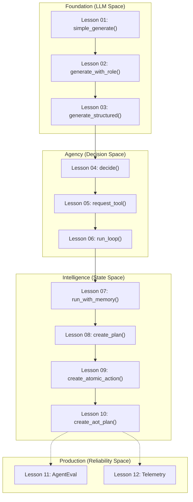

<!-- source: DeepWiki mcp.deepwiki.com · repo pguso/agents-from-scratch · page 3 Lesson Progression · fetched 2026-10-26 -->

# Lesson Progression

Relevant source files

The following files were used as context for generating this wiki page:

- [README.md](README.md)
- [complete_example.py](complete_example.py)
- [lessons/01_basic_llm_chat.md](lessons/01_basic_llm_chat.md)

This page provides a high-level overview of the 12-lesson curriculum designed to build a functional AI agent from scratch. The curriculum follows a "local-first" philosophy, moving from basic text generation to complex graph-based execution and production-ready observability.

Each lesson is implemented as a method or a set of methods within the `Agent` class in [agent/agent.py:1-10]() and demonstrated in [complete_example.py:1-10]().

## Curriculum Roadmap

The following diagram illustrates how the lessons transition from simple text completion to structured agency and finally to system reliability.

### From Text to Agency: System Evolution

**Sources:** [README.md:34-50](), [README.md:143-151](), [complete_example.py:13-232]()

---

## 3.1 Lessons 01–03: LLM Fundamentals
These lessons establish the "Output Contract" between the user and the model. 
- **Lesson 01**: Introduces basic text-in/text-out using `simple_generate` [agent/agent.py:44-54]().
- **Lesson 02**: Introduces the `SYSTEM_PROMPT` to define roles and behaviors [agent/agent.py:56-72]().
- **Lesson 03**: Enforces a "Trust Boundary" by requiring the model to return valid JSON matching a specific schema, implemented in `generate_structured` [agent/agent.py:74-114]().

For details, see [Lessons 01–03: LLM Fundamentals](#3.1).

**Sources:** [lessons/01_basic_llm_chat.md:1-119](), [agent/agent.py:44-114]()

---

## 3.2 Lessons 04–05: Decision Making and Tool Calling
These lessons move the agent from passive generation to active selection.
- **Lesson 04**: Implements `decide`, which constrains the LLM to choose from a specific list of strings [agent/agent.py:116-150]().
- **Lesson 05**: Introduces `request_tool` and `execute_tool_call`, allowing the agent to interface with Python functions like the `calculator` [agent/tools.py:1-40]().

For details, see [Lessons 04–05: Decision Making and Tool Calling](#3.2).

**Sources:** [agent/agent.py:116-188](), [agent/tools.py:1-40]()

---

## 3.3 Lessons 06–07: Agent Loop and Memory
This phase introduces persistence and iterative reasoning.
- **Lesson 06**: Wraps the decision-making process in a `run_loop` that continues until a "final_answer" is reached [agent/agent.py:190-245]().
- **Lesson 07**: Adds a `Memory` class [agent/memory.py:1-30]() to persist facts across different `run_with_memory` calls, using the `save_to_memory` JSON field [agent/agent.py:247-300]().

For details, see [Lessons 06–07: Agent Loop and Memory](#3.3).

**Sources:** [agent/agent.py:190-300](), [agent/memory.py:1-30](), [agent/state.py:1-40]()

---

## 3.4 Lessons 08–10: Planning and Atom of Thought
The final architectural stage focuses on decomposing complex goals into executable data structures.
- **Lesson 08**: Introduces `create_plan`, which generates a sequential list of steps [agent/planner.py:1-50]().
- **Lesson 09**: Implements `create_atomic_action` to turn vague plan steps into validated `action`/`inputs` dictionaries [agent/planner.py:52-100]().
- **Lesson 10**: Introduces "Atom of Thought" (AoT), using `create_aot_graph` to build Directed Acyclic Graphs (DAGs) for non-linear execution [agent/planner.py:102-180]().

For details, see [Lessons 08–10: Planning and Atom of Thought](#3.4).

**Sources:** [agent/planner.py:1-180](), [complete_example.py:139-193]()

---

## 3.5 Lessons 11–12: Evals and Telemetry
These lessons cover the operational requirements for deploying agents.
- **Lesson 11**: Uses `AgentEval` and "Golden Datasets" to perform regression testing [agent/evals.py:1-60]().
- **Lesson 12**: Implements a `Telemetry` system to track LLM latency, token usage, and tool success rates in a `agent_telemetry.jsonl` file [agent/telemetry.py:1-100]().

**Sources:** [agent/evals.py:1-100](), [agent/telemetry.py:1-100](), [complete_example.py:194-240]()

---

